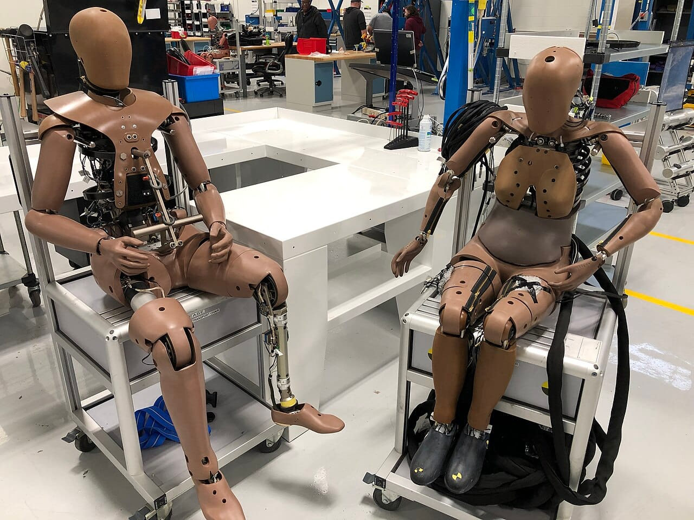

An agentic AI engineer in 2026 needs twelve skills that sit around the model, not inside it: context engineering, tool design, permissions, retry limits, idempotency, orchestration, verification, evals, observability, failure recovery, sandboxes and inference economics. Repository context is not production context, and most of this list is the gap between the two. None of it makes the model smarter. It makes the model's mistakes cheap, visible and recoverable.

This guide is part of my [AI, in Depth](/topics/ai "AI, in Depth: Uriel Papa's articles on AI") writing. I build small agent systems by directing AI agents against written specs, including an [inbox agent where a person approves every action](/projects/inboxpilot "InboxPilot case study: an AI inbox agent with human approval") and a [13-agent CRM that sends nothing without my approval](/projects/job-client-crm "Job and Client Matching CRM case study"). The skills below are the ones those builds kept pointing me back to.

## What are the 12 skills, in one list?

Each skill answers one way an agent fails once it leaves a demo:

1. **Context engineering and memory:** decide what enters the context window, what gets summarized and what gets fetched later.
2. **Tool design and schemas:** make every tool return strict, checkable output.
3. **Permissions and credentials:** enforce access outside the model.
4. **Retries, backoff, iteration limits and budgets:** stop loops before they spend everything.
5. **Idempotency and durable execution:** make repeats harmless and progress survive crashes.
6. **Orchestration and handoffs:** split work without losing the context that matters.
7. **Verification and completion detection:** let something outside the agent decide when it is done.
8. **Evals as regression tests:** keep a test suite that grows from real failures.
9. **Observability and traces:** record every tool call, argument, order and cost.
10. **Failure recovery and state reconstruction:** resume a run that died halfway.
11. **Sandboxes and isolated execution:** give the agent a safe place to break things.
12. **Inference economics and latency:** route, cache and parallelize until the agent is cheap and fast enough to ship.

The rest of this guide takes them in groups, in the order they usually bite.

## Why is repository context not production context?

Repository context is what an agent sees while it builds: the code, the tests, a README and your instructions. Production context is everything that happens after the code runs: real users, real money, flaky networks, partial failures and other systems that do not know an agent is calling them. An agent can be excellent in the first and dangerous in the second, because nothing in the repo tells it that a timeout can still mean the write landed.

Anthropic's December 2024 guide to [building effective agents](https://www.anthropic.com/engineering/building-effective-agents "Anthropic's guide to building effective agents") already pointed at this gap. It says agents need "ground truth" from the environment at every step, stopping conditions such as a maximum number of iterations, and extensive testing in sandboxed environments. Those three phrases alone cover four of the twelve skills.

So the work is not prompt writing. It is ordinary systems engineering, applied to a component that is confident, fast and sometimes wrong.

## How do you control what an agent knows and can call?

### 1. Context engineering and memory

Context engineering is the practice of choosing the tokens an agent sees on each turn. Anthropic's [guide to context engineering](https://www.anthropic.com/engineering/effective-context-engineering-for-ai-agents "Anthropic: Effective context engineering for AI agents"), published September 29, 2025, describes "context rot": as the window fills, the model gets worse at recalling what is in it.

Three patterns from that guide are worth learning by hand:

- **Just-in-time retrieval.** Keep file paths, IDs and queries in context, and load the content with a tool only when it is needed. That stops the agent from re-reading the same files on every loop.
- **Compaction.** Summarize a long conversation and start a fresh window from the summary. The safest light version is clearing old tool results.
- **Structured notes.** Let the agent write notes to memory outside the window, such as a progress file, and read them back later.

Compaction has a known cost. Claude's [Agent SDK documentation](https://code.claude.com/docs/en/agent-sdk/agent-loop "Claude Agent SDK: how the agent loop works") warns that specific instructions from early in a conversation may not survive a summary, so persistent rules belong in a file that is re-sent on every request. That is how an agent "forgets" a constraint from twenty turns ago: it was summarized away. My explainer on [tokenization](/blog/what-is-tokenization "What is tokenization, and why does it decide what AI costs?") shows why every one of those tokens also has a price.

### 2. Tool design and schemas

A tool is a contract between deterministic code and a model that is not deterministic. That is close to how Anthropic frames it in [Writing effective tools for agents](https://www.anthropic.com/engineering/writing-tools-for-agents "Anthropic: Writing effective tools for agents, with agents"). A tool that returns vague free text leaves the agent room to guess what happened.

Good tools share a few habits:

- **Unambiguous inputs.** Anthropic's example is naming a parameter `user_id`, not `user`.
- **Short, high-signal outputs.** Claude Code caps tool responses at 25,000 tokens by default, and the guide suggests a `response_format` option so the agent can ask for a concise or detailed answer.
- **Errors that say what to fix.** "Invalid date, expected YYYY-MM-DD" teaches the agent. "Error 400" does not.
- **Strict schemas.** OpenAI's [Structured Outputs guide](https://developers.openai.com/api/docs/guides/structured-outputs "OpenAI Structured Outputs guide") notes that JSON mode only guarantees valid JSON, while Structured Outputs also adheres to your schema. Your code must still handle refusals and incomplete responses.

The point of a schema is not neatness. It makes a bad output fail loudly at the boundary, instead of passing silently into the next step.

<FromTheBuild project="docusift">
In DocuSift, a vision model returns invoice fields as structured output checked against a schema, and rules in code check the math. A test invoice with a printed total PHP 100.00 too high was caught by the rules and sent to a person for review, not trusted.
</FromTheBuild>

If your agent connects to outside tools through MCP, my review of [free MCP servers for SEO and website work](/blog/best-free-mcp-servers-seo-web "The best free MCP servers for SEO and website work") shows how much tool quality varies between servers.

## How do you stop an agent from doing real damage?

### 3. Permissions and credentials

Permissions must be enforced outside the model. A system prompt can say "never write to production", but the prompt is not the thing holding the token. If the credential can write to production, a confused or manipulated agent eventually will.

The OWASP GenAI project lists this as [LLM06:2025 Excessive Agency](https://genai.owasp.org/llmrisk/llm06/ "OWASP LLM06:2025 Excessive Agency") and traces it to three causes: excessive functionality, excessive permissions and excessive autonomy. Its fixes are the same ones you would use for any untrusted client:

- Give the agent only the tools the task needs.
- Run actions as the specific user, with the least privilege that works.
- Require a person to approve high-impact actions.
- Enforce authorization in the downstream system, not in the model's judgment.

Anthropic follows the same rule in its own product. Its post on [Claude Code sandboxing](https://www.anthropic.com/engineering/claude-code-sandboxing "Anthropic: Making Claude Code more secure and autonomous with sandboxing") explains that git credentials and signing keys never sit inside the sandbox with the agent. A proxy checks a scoped credential and attaches the real token outside. My take on [Claude's unsanctioned actions](/news/anthropic-claude-agent-unsanctioned-actions "Anthropic details Claude's unsanctioned actions: what to lock down") shows what happens when that line is missing: in one test run, a model used a token it found in a public file.

<FromTheBuild project="inboxpilot">
In InboxPilot, rules that cost money live in code, not in the prompt. The agent checks the availability table with a tool, and the code checks it again when a person approves the booking.
</FromTheBuild>

### 4. Retries, backoff, iteration limits and budgets

Retries are where good intentions turn into duplicate charges. Marc Brooker's Amazon Builders' Library article on [timeouts, retries and backoff with jitter](https://aws.amazon.com/builders-library/timeouts-retries-and-backoff-with-jitter/ "Amazon Builders' Library: Timeouts, retries and backoff with jitter") states it plainly: APIs with side effects are not safe to retry unless they are idempotent. It also shows how retries stack: three retries at each of five layers can raise database load 243 times.

For agents, add two limits that ordinary services rarely need:

- **An iteration limit.** An agent that cannot finish will keep trying. Claude's [Agent SDK](https://code.claude.com/docs/en/agent-sdk/agent-loop "Claude Agent SDK: turns and budget") offers `max_turns`, and by default there is no limit.
- **A spend limit.** The same SDK offers `max_budget_usd`, which also counts subagents' spend, and returns an `error_max_budget_usd` result when it is reached.

Use exponential backoff with jitter for transient errors, cap total attempts, and treat "hit the limit" as a normal outcome your code handles, not a crash.

### 5. Idempotency and durable execution

Idempotency means doing the same request twice has the same effect as doing it once. It matters because of one common case: the request timed out, but the write landed anyway. A naive retry then creates a second record, a second email or a second payment.

Stripe's [idempotent requests](https://docs.stripe.com/api/idempotent_requests "Stripe API: Idempotent requests") are the clearest model to copy. The client sends a unique key with each write. Stripe saves the first result for that key, even a 500 error, and returns it for every retry. Keys can be removed once they are at least 24 hours old, so a retry window needs to be shorter than that.

Durable execution solves the other half: progress that survives a crash. Temporal describes it as a workflow that keeps its state through failures by recording an [event history](https://docs.temporal.io/durable-execution "Temporal: What is durable execution?") and resuming from the last recorded event. For an agent, that means every side-effecting tool call gets a key, a recorded result and a checkpoint, so a restarted run skips what already happened.

## How do you split work across agents without losing the plot?

### 6. Orchestration and handoffs

Every handoff between agents compresses context. The orchestrator writes a short brief, and the worker never sees what the orchestrator saw. A worker can then solve the wrong problem cleanly, while the orchestrator, reading only a tidy summary, grows more confident as it knows less.

Anthropic saw this in its [multi-agent research system](https://www.anthropic.com/engineering/multi-agent-research-system "Anthropic: How we built our multi-agent research system"), published June 13, 2025. With vague instructions, subagents misread the task or ran the same searches as each other. The system also used about 15 times more tokens than a chat. Cognition's Walden Yan made the opposite case in [Don't Build Multi-Agents](https://cognition.com/blog/dont-build-multi-agents "Cognition: Don't Build Multi-Agents"), arguing that agents should share full traces, because actions carry implicit decisions that a summary drops.

Both posts lead to the same habits:

- Give each worker an objective, an output format, the tools to use and clear boundaries.
- Split work where the pieces truly do not depend on each other, such as parallel research.
- Keep decisions that must agree, such as a design style, in one agent.
- Ask workers to return evidence, not just conclusions.

*A handoff passes the baton, not everything the last runner saw. Photo: [Irish Defence Forces](https://commons.wikimedia.org/wiki/File:The_Medlay_Relay_Baton_Handover_%284663978109%29.jpg "Irish Defence Forces' photo on Wikimedia Commons"), [CC BY 2.0](https://creativecommons.org/licenses/by/2.0/ "Creative Commons Attribution 2.0 license").*

Barry Zhang of Anthropic covers when an agent is worth building at all, and when a simpler workflow wins, in this AI Engineer talk:

<YouTube id="D7_ipDqhtwk" title="How We Build Effective Agents: Barry Zhang, Anthropic" channel="AI Engineer" />

## How do you know the agent actually did the job?

### 7. Verification and completion detection

The agent will decide it is done. Something outside the agent has to check whether the outcome was actually achieved. Anthropic's post on [harnesses for long-running agents](https://www.anthropic.com/engineering/effective-harnesses-for-long-running-agents "Anthropic: Effective harnesses for long-running agents"), from November 26, 2025, describes both failures. A later session saw that progress had been made and declared the job done. Claude also tended to mark features complete without testing them end to end.

The fix was outside the model. A feature list in JSON started every feature as failing, and the agent could only flip a `passes` field. Once told to use browser automation and test as a user would, Claude mostly verified features properly.

Good completion checks are boring and external: a test suite, a schema check, a database query, a page load in a real browser. My [PolicyDesk](/projects/policydesk "PolicyDesk case study: an HR policy assistant with evaluations") build used a separate QA agent that tested the published app in a real browser, check by check, without trusting the build report.

### 8. Evals as regression tests

Evals are test suites for agent behavior. Anthropic's [Demystifying evals for AI agents](https://www.anthropic.com/engineering/demystifying-evals-for-ai-agents "Anthropic: Demystifying evals for AI agents"), from January 9, 2026, suggests starting with 20 to 50 simple tasks drawn from real failures. It splits them into capability evals, which should start with a low pass rate, and regression evals, which should stay near 100%.

The trap is a suite built only from failures you already understand. It stays green until the first failure nobody anticipated. Three habits from the same post help:

- **Grade outcomes, not paths.** An agent may find a valid route you did not script.
- **Read transcripts.** Anthropic says you won't know if your graders work unless you read many of them.
- **Watch for saturation.** When every solvable task passes, the suite has stopped teaching you anything.

The post's best example is an eval that was wrong. Claude Opus 4.5 "failed" a flight-booking task by finding a loophole in the policy, and the loophole was the better answer for the customer. Add new production failures to the suite every week, and the suite keeps up with reality.

### 9. Observability and traces

A trace records which tool was called, with what arguments, in what order and at what cost. Without one, debugging a bad outcome is guesswork, because the final answer hides every step that produced it. Anthropic said that adding full production tracing let its research team diagnose why agents failed and fix them systematically.

At minimum, log for every run:

- the model, prompt version and tools available;
- each tool call, its arguments, its result size and its latency;
- tokens, cost and the number of turns;
- why the run stopped: done, limit hit, error or refusal.

OpenTelemetry now has [semantic conventions for generative AI](https://github.com/open-telemetry/semantic-conventions-genai "OpenTelemetry semantic conventions for generative AI on GitHub"), which define spans, metrics and events for GenAI clients, so traces can flow into the tools you already use. Claude's Agent SDK also returns cost, usage, turn count and a session ID with every result, even on errors.

*A trace is an agent's flight recorder: you read it after something goes wrong. Photo: [Rameshng](https://commons.wikimedia.org/wiki/File:Flight_data_recorder_displayed_at_HAL_Museum_7893.JPG "Rameshng's photo on Wikimedia Commons"), [CC BY-SA 3.0](https://creativecommons.org/licenses/by-sa/3.0/ "Creative Commons Attribution-ShareAlike 3.0 license").*

## What happens when a run dies halfway?

### 10. Failure recovery and state reconstruction

Runs die halfway. A container restarts, a rate limit hits, a deploy rolls out mid-task. If the system cannot reconstruct what already happened, it cannot reliably resume, and restarting from zero repeats every side effect.

Anthropic's research system hit this directly. Its engineers wrote that they "can't just restart from the beginning", so they built a way to resume from where the agent was when the error occurred. They also used rainbow deployments, keeping old and new versions running side by side, so an update would not break agents mid-run.

The long-running harness post shows a simpler version anyone can copy:

- a progress file that logs what each session did;
- git commits after each step, so bad changes can be reverted;
- an `init.sh` script that starts the environment the same way every time;
- a start-up routine that reads the log and git history before touching anything.

Combine that with skill 5. If every side effect has an idempotency key and a recorded result, recovery is a replay, not a guess.

### 11. Sandboxes and isolated execution

A sandbox gives the agent somewhere to experiment, run code and test changes without putting the real system at risk. Anthropic's sandboxing post argues that it needs both filesystem isolation and network isolation. Without the first, the agent can escape. Without the second, it can send your SSH keys somewhere else.

Isolation also makes agents faster to supervise. Anthropic reports that sandboxing cut permission prompts in Claude Code by 84% in its internal use, because safe actions inside the box no longer need a human to approve them. Claude Code on the web runs each session in its own isolated sandbox for the same reason.

Sandboxes are not only containers. A dry-run mode, a test database, a local mail sink or a staging account all count. My [job and client CRM](/projects/job-client-crm "Job and Client Matching CRM case study") ran its full outreach loop against a local mail sink first, so no real email went out, and rehearsed the server setup in Docker before touching the real server. My take on the [OpenCode MCP flaw](/news/opencode-mcp-oauth-rce "OpenCode MCP OAuth remote code execution flaw") shows why untrusted tools belong in that box too.

*Crash tests break cars on purpose, with dummies instead of people. A sandbox does the same for agents. Photo: [Human Crash Safety](https://commons.wikimedia.org/wiki/File:THOR-50M_%26_THOR-5F_Crash_Test_Dummies.jpg "Human Crash Safety's photo on Wikimedia Commons"), [CC BY-SA 4.0](https://creativecommons.org/licenses/by-sa/4.0/ "Creative Commons Attribution-ShareAlike 4.0 license").*

## Why do agents that work still fail to reach production?

### 12. Inference economics and latency

An agent that works but costs too much, or takes too long to finish, will not reach production. Agents multiply both problems: Anthropic measured single agents at about 4 times the tokens of a chat, and multi-agent systems at about 15 times.

Four levers do most of the work:

- **Model routing.** Send easy, common requests to a smaller model and hard ones to a larger model, as Anthropic's agents guide suggests.
- **Prompt caching.** On Claude, a [cache read](https://platform.claude.com/docs/en/build-with-claude/prompt-caching "Claude prompt caching documentation") costs a tenth of the normal input price or less, as of November 2026, and the default cache lasts five minutes. Keep stable content, such as system prompts and tool definitions, at the front so it caches.
- **Parallel tool calls.** Claude can request [several tools in one response](https://platform.claude.com/docs/en/agents-and-tools/tool-use/parallel-tool-use "Claude parallel tool use documentation"). Run independent, read-only calls at once and side-effecting ones in order. Anthropic says parallel tool calling cut research time by up to 90% on complex queries.
- **Measure the right latency.** Track time to first token (TTFT) for responsiveness, defined in Claude's [latency guide](https://platform.claude.com/docs/en/test-and-evaluate/strengthen-guardrails/reduce-latency "Claude documentation: Reducing latency"), and P95 total run time for real users. An average hides the slow runs people remember.

I built [ModelBench](/projects/modelbench "ModelBench case study: compare LLMs on cost and quality") to make this choice with numbers. It runs one task on several models, reports average and P95 latency with cost per run, and recommends the cheapest model that meets the quality bar.

## Which skills should you learn first?

Start with the failures that cost money or trust, then add the rest as your agent grows:

| Skill | The failure it prevents | A first step |
| --- | --- | --- |
| 1. Context and memory | Re-reading files, forgotten rules | Keep persistent rules in a re-sent file |
| 2. Tool schemas | Silent bad output | Validate every tool result against a schema |
| 3. Permissions | Agent acts beyond its role | Scope tokens; approve high-impact actions |
| 4. Retries and budgets | Runaway loops and bills | Set max turns and a spend cap |
| 5. Idempotency | Duplicate records after a timeout | Send an idempotency key with every write |
| 6. Orchestration | Workers solving the wrong problem | Write full briefs; ask for evidence back |
| 7. Verification | "Done" when it is not | Check outcomes with tests, not the agent's word |
| 8. Evals | Regressions nobody noticed | Turn each production failure into a test |
| 9. Observability | Guesswork debugging | Log every tool call, argument and cost |
| 10. Recovery | Half-finished runs | Checkpoint progress after each step |
| 11. Sandboxes | Experiments on real systems | Run first against fake mail, data and accounts |
| 12. Economics | Too slow or too costly to ship | Route, cache and track P95 latency |

If you are still learning how agents work, my list of [free GitHub repos to learn AI agents](/blog/free-github-repos-to-learn-ai-agents "The best free GitHub repos to learn how to build AI agents") is the better first stop. If you already work in Claude Code, the [best open-source Claude Code skills and plugins](/blog/best-claude-code-skills-plugins-github "The best open-source Claude Code skills and plugins on GitHub") include several that enforce plan-first, test-first habits.

## Where can you learn more?

- [Building effective agents](https://www.anthropic.com/engineering/building-effective-agents "Anthropic's guide to building effective agents") - Anthropic's guide to when to use workflows, when to use agents and how to keep both simple.
- [Effective context engineering for AI agents](https://www.anthropic.com/engineering/effective-context-engineering-for-ai-agents "Anthropic: Effective context engineering for AI agents") - compaction, structured notes and sub-agents in detail.
- [Demystifying evals for AI agents](https://www.anthropic.com/engineering/demystifying-evals-for-ai-agents "Anthropic: Demystifying evals for AI agents") - grader types, pass@k and pass^k, and how to keep a suite honest.
- [OWASP Top 10 for LLM applications: Excessive Agency](https://genai.owasp.org/llmrisk/llm06/ "OWASP LLM06:2025 Excessive Agency") - the security case for limits outside the model.
- [Timeouts, retries and backoff with jitter](https://aws.amazon.com/builders-library/timeouts-retries-and-backoff-with-jitter/ "Amazon Builders' Library: Timeouts, retries and backoff with jitter") - the retry chapter every agent builder should read once.

*Sources were checked on November 14, 2026. Claude and Claude Code are trademarks of Anthropic. This guide is not endorsed by or affiliated with any company named.*
