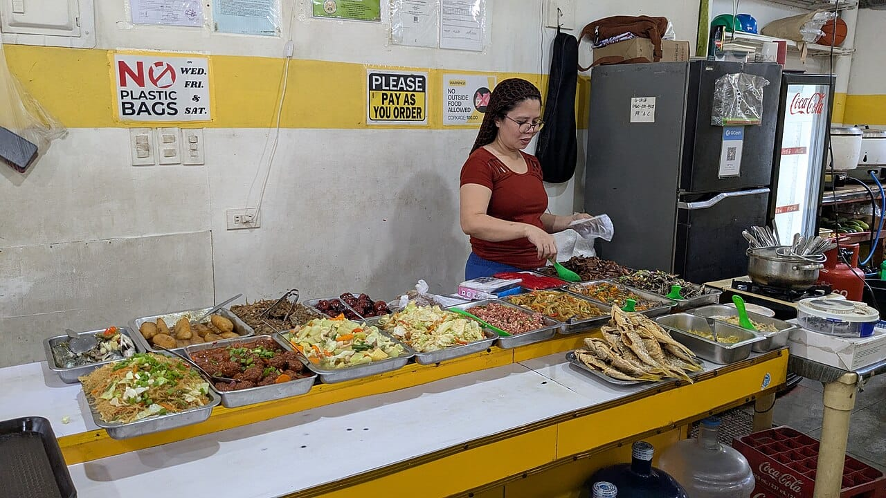

Customers in the Philippines now ask ChatGPT, Gemini and Google's AI answers which business to call. Those tools build the answer from websites and listings they can read and trust. So your business website needs plain facts an AI can quote: what you sell, the price, where you serve, and proof that real customers use you.

I've worked in SEO since 2023. That same year, a part-time marketing job had me signing up 50 car repair shops for a shop finder, so local businesses are where I started. This guide is part of my [SEO, GEO and AEO](/topics/seo-geo-aeo) writing, for the business owner rather than the SEO specialist. For the concepts first, read [GEO and AEO fundamentals](/blog/geo-and-aeo-fundamentals).

The four steps, in order:

1. **Complete and verify your Google Business Profile**, and keep the reviews coming.
2. **Give each service its own page** with prices, location and the areas you serve.
3. **Add schema markup that mirrors what the page already says.**
4. **Get indexed in Google and Bing**, and let the AI search crawlers in.

## How do customers find businesses through AI answers now?

AI answers are becoming a normal first stop for Filipino customers. The [e-Conomy SEA 2026 Philippines report](https://services.google.com/fh/files/misc/philippines_e_conomy_sea_2026_report.pdf "e-Conomy SEA 2026 Philippines report by Google, Temasek and Bain & Company") counts 42 million generative AI users here in 2026, or 53% of the working population. It also estimates that 33% of consumer journeys begin with AI, and it ranks online shopping fourth among the top uses. The report comes from Google, Temasek and Bain & Company.

Usage is still light, though. Only 14% of the population uses AI daily, the lowest in the region. The AI figures draw on a July 2026 Google/YouGov survey of 9,006 AI users in six Southeast Asian countries, plus Bain's analysis. So the habit is wide but still shallow, and that's the window to get your business ready.

*A carinderia in Cebu City. Small local businesses like this one are what people now ask AI to find nearby. Photo: [Martin Michlmayr](https://commons.wikimedia.org/wiki/File:Carinderia_Cebu_City_004.jpg "Martin Michlmayr's photo on Wikimedia Commons"), [CC BY-SA 4.0](https://creativecommons.org/licenses/by-sa/4.0/ "Creative Commons Attribution-ShareAlike 4.0 license").*

The catch is fewer clicks. [Pew Research Center tracked the browsing of 900 US adults](https://www.pewresearch.org/short-reads/2025/07/22/google-users-are-less-likely-to-click-on-links-when-an-ai-summary-appears-in-the-results/ "Pew Research Center: Google users are less likely to click on links when an AI summary appears") in March 2025. With a Google AI summary on the page, people clicked a regular result in 8% of visits, against 15% without one.

They clicked a link inside the summary in just 1% of visits. Pew's data is from the US, so Philippine numbers may differ.

Google's side of the story is different. Its page on [AI features and your website](https://developers.google.com/search/docs/appearance/ai-features "Google Search Central: AI features and your website") says clicks from results with AI Overviews are "higher quality." That means people are more likely to spend more time on the site.

If your business still runs on chats and spreadsheets, [why Philippine businesses still work by hand](/blog/why-philippine-businesses-still-work-by-hand) explains where to start. So expect fewer but better-informed visitors, and make sure the AI answer names you before they ever click.

## How do Google, ChatGPT and Gemini decide which businesses to mention?

Google AI Overviews, AI Mode, ChatGPT search and Gemini work in a similar way. Each one turns a question into searches, reads the pages and listings that come back, and writes an answer from the sources it trusts. None of them can recommend a business it can't find or understand.

### Google AI Overviews and AI Mode

Google says both features may run multiple related searches across subtopics and data sources to build one response. To be eligible as a supporting link, a page has to be indexed and eligible to show in Google Search with a snippet. Google says there are "no additional technical requirements." Its best practices include keeping your Business Profile and Merchant Center details up to date. They also include making sure your structured data matches the visible text on the page.

### ChatGPT search

OpenAI's help page on [searching the web with ChatGPT](https://help.openai.com/en/articles/9237897-searching-the-web-with-chatgpt "OpenAI Help Center: Searching the web with ChatGPT") says ChatGPT sometimes rewrites a question into targeted queries for third-party search providers. The providers it lists include Microsoft.

For local questions, ChatGPT uses an approximate location. In OpenAI's own example, "good restaurants near me" from the San Francisco area becomes the search "top restaurants San Francisco." So a customer in Pasig asking for aircon cleaning is likely searching for something like "aircon cleaning Pasig" behind the scenes. A page that never says Pasig is harder to match.

### Gemini

Google's [Gemini Apps Privacy Hub](https://support.google.com/gemini/answer/13594961 "Gemini Apps Privacy Hub") says "some Gemini responses are grounded on Search results." It adds that Gemini may get precise location from a service like Google Maps. So what Google Search knows about your business is part of what Gemini can draw on.

All four can draw on the open web. A clear, indexed website and an accurate listing are the entry ticket.

## Step 1: How do you get your Google Business Profile ready for AI answers?

Google Business Profile is the listing that puts your business on Google Search and Maps, and it matters for AI answers too. Google's [guide to optimizing for generative AI features](https://developers.google.com/search/docs/fundamentals/ai-optimization-guide "Google Search Central: optimizing for generative AI features") says so directly. Business Profiles and Merchant Center "can help your products and services to be visible in both AI responses and other Google Search results."

Google's [tips to improve your local ranking](https://support.google.com/business/answer/7091 "Google Business Profile Help: tips to improve your local ranking") name three factors. Relevance is how well your profile matches the search. Distance is how far you are from the person searching. Prominence is how well-known the business is, including links from other websites and your review count.

Businesses with complete and accurate information are more likely to show up. And Google is clear that "there's no way to request or pay for a better local ranking on Google."

What to do this week:

* **Verify the profile**, so Google knows you're authorized to represent the business.
* **Fill in every field**: the right category, phone, address or service area, and hours, including special hours for holidays.
* **Link to the matching page** on your website, not only the home page.
* **Ask happy customers for reviews**, and reply to every one, including the bad ones. Google says helpful replies can help your business stand out.

If your business mostly lives on a Facebook page, keep it, but copy the same name, address and phone number there and on your website. Matching details everywhere make it easier for any system to know the listing, the page and the Facebook page are one business.

## Step 2: What should each service page say so AI can quote it?

A service page is the page on your business website that explains one thing you sell. That makes it a natural passage for an AI answer to quote. [Bing's webmaster guidelines](https://www.bing.com/webmasters/help/webmaster-guidelines-30fba23a "Bing Webmaster Guidelines") are blunt about what gets picked for AI answers. Pages focused on one primary topic are more likely to be selected, and essential information belongs near the top.

Bing also wants facts that are explicit and visible on the page itself. People, organizations, products and locations should be named clearly, the same way every time.

For a Philippine business, that means each service page should say:

* **The service and the city** in the main heading, like "Aircon Cleaning in Pasig and Mandaluyong."
* **The price or price range in pesos**, with the date you last updated it.
* **The areas you serve**, by city or barangay, and your hours.
* **What's included** and how long the job takes.
* **How to book**: phone, Messenger, or a form, with no login needed to see the details.
* **Answers to the questions customers really ask** in your chats, in their words.

*An appliance repair shop in Pandacan, Manila. A local service business gets matched by its service and its area, so both belong on the page. Photo: [Ralff Nestor Nacor](https://commons.wikimedia.org/wiki/File:Jud%27s_Appliance_Repair_Shop,_Pandacan,_Manila,_Jul_2026.jpg "Ralff Nestor Nacor's photo on Wikimedia Commons"), [CC BY-SA 4.0](https://creativecommons.org/licenses/by-sa/4.0/ "Creative Commons Attribution-ShareAlike 4.0 license").*

Add proof only you can give: real photos of your work, the owner's name, years in operation, and the permits you actually hold. Google's AI guide favors content with "unique expert or experienced takes that go beyond common knowledge." A generic page copied from a competitor gives the AI nothing new to quote.

Prices matter most. If your price isn't on your page, the answer can't quote it from you. The same rule applies if you later add a chatbot, because it must answer from your real prices. I explain why in [AI is cheaper now, but trust is still expensive](/blog/ai-is-cheaper-but-trust-is-expensive).

## Step 3: Which schema markup should a business website add?

Schema markup is code, usually JSON-LD, that labels the facts on your page so machines read them without guessing. Think business name, address, hours and prices. Google says structured data isn't required for AI features, and there's no special schema you need to add.

It still recommends structured data for rich results. The rule that matters is matching. Google's best practices say your structured data should match the visible text, and Bing's guidelines say "markup must accurately reflect visible content."

So treat schema as confirmation, not decoration:

* **LocalBusiness**, or a more specific type like a restaurant or store, on your home or contact page. Use the same name, address, phone and hours as your Business Profile.
* **Service or Product markup** on service pages, with prices only if the prices are visible on that page.
* **FAQPage markup** only on a page that actually shows those questions and answers.

Never mark up reviews you don't display or a star rating you made up. If a machine checks the schema against the page and they disagree, the schema becomes a reason to doubt you.

At the agency I founded, I led and co-developed a [suite of WordPress SEO plugins](/projects/wordpress-seo-plugins). One was a publish guard that refused a post without an SEO title, a meta description and schema. A tool can check that the schema exists. Only you can make sure it tells the truth.

## Step 4: How do you get indexed in Google and Bing for AI answers?

Indexing is the step where a search engine stores your page so it can show it. An AI answer can't cite a page that isn't indexed. Google's AI features build on Google's own index.

ChatGPT search has its own rule: a site must let OAI-SearchBot crawl it, and the host or CDN must allow OpenAI's search bot IP addresses. OpenAI also says placement is not guaranteed.

Here's the setup I'd do for any business website:

1. **Add the site to Google Search Console**, submit the sitemap, and check that your service pages are indexed.
2. **Add the site to Bing Webmaster Tools.** Microsoft is one of the search providers ChatGPT lists, so being in Bing's index is a sensible bet. Bing's guidelines also ask you to notify IndexNow when content changes.
3. **Check robots.txt and your firewall** so Googlebot, Bingbot and OAI-SearchBot aren't blocked. A security plugin or CDN bot setting can block them even when robots.txt allows them.
4. **Make sure the text loads without JavaScript tricks.** Bing warns that content hidden behind client-side rendering may not be indexed or selected for grounding results.

My own test shows why this comes first. Four days after this site launched, ChatGPT cited it for 0 of 4 questions. It found me through my old agency site instead, as I wrote in [how to check if ChatGPT cites your site](/blog/how-to-check-if-chatgpt-cites-your-site). AI answers quote what's already indexed and known, so new pages need time and links.

## What should you check every month?

A short monthly routine helps keep your business visible in AI answers, because prices, hours and pages drift out of date. Bing's guidelines ask sites to update content when facts change and remove outdated information. Otherwise an old price on your page can keep showing up in AI answers.

The monthly checklist:

* Google Business Profile: hours, holiday hours, phone and photos still correct.
* Every new review has a reply.
* Each service page shows today's price range, areas served and the date updated.
* Name, address and phone match across the website, Business Profile and Facebook page.
* Schema still matches the visible prices, hours and address.
* Search Console and Bing Webmaster Tools show your service pages as indexed.
* robots.txt and the firewall still allow Googlebot, Bingbot and OAI-SearchBot.
* Three customer questions asked in ChatGPT, Gemini and Google AI Mode, like "Who does aircon cleaning in Pasig, and how much?" Note whether you're named.

That last check is the real test. My guide on [how to check if ChatGPT cites your site](/blog/how-to-check-if-chatgpt-cites-your-site) walks through it step by step, including ChatGPT visits in Google Analytics. OpenAI has also opened a way to [claim your business in ChatGPT](/news/chatgpt-businesses-claim-listing), now in beta. For now, though, physical stores can only claim an existing US listing.

<Callout type="note" title="Disclaimer">
  This guide is general information, not legal, financial or professional advice. Features, policies and figures are as of November 20, 2026 and change often, and results vary by business, industry and location. The e-Conomy SEA 2026 figures come from a July 2026 survey of 9,006 AI users across six Southeast Asian countries plus Bain analysis, and the Pew click data covers 900 US adults in March 2025, so neither may reflect every Philippine market. No step here guarantees that an AI answer will mention your business.
</Callout>
