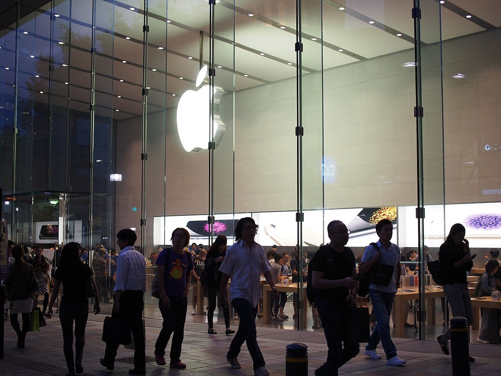

Apple reported revenue of $114.5 billion for its fiscal fourth quarter, up 12% from a year earlier, with record iPhone sales for a September quarter and an all-time high for Services. It was the first results release since John Ternus took over from Tim Cook as CEO on September 1, according to [Outlook Business](https://www.outlookbusiness.com/deeptech/apple-posts-record-june-quarter-under-tim-cooks-last-earnings-report-but-shares-fall).

This take is part of my [Technology and Business](/topics/tech-and-business) writing.

## What happened?

On November 2, 2026, Apple published its [fourth-quarter results](https://finance.yahoo.com/markets/stocks/articles/apple-reports-fourth-quarter-results-213000353.html) for the quarter that ended September 26, distributed through Business Wire. Apple also filed the release with the SEC as an [8-K exhibit](https://www.sec.gov/Archives/edgar/data/0000320193/000032019326000024/a8-kex991q4202609262026.htm).

*Apple reported $114.5 billion in revenue for the quarter that ended September 26. Photo: [Dicklyon](https://commons.wikimedia.org/wiki/File:Apple_Park_dusk_aerial.jpg "Dicklyon's photo on Wikimedia Commons"), [CC BY-SA 4.0](https://creativecommons.org/licenses/by-sa/4.0/ "Creative Commons Attribution-ShareAlike 4.0 license").*

The headline numbers:

- **Revenue:** $114.5 billion, up 12%.
- **Diluted EPS:** $2.10, up 14%, including a $0.05 benefit from tariff refunds.
- **Gross margin:** 47.9%, including about 1 percentage point from tariff refunds.
- **Full fiscal 2026:** $478.8 billion in revenue, a record.
- **Dividend:** $0.27 per share, payable November 16, 2026.

Ternus said the quarter capped "our best fiscal year ever," and pointed to "the iPhone Duo, the most transformational iPhone since the original" and "the all-new Siri AI" as the lineup for the holidays.

## What changed?

Most of the growth came from iPhone and Mac. Services kept growing but more slowly, and two categories shrank.

*iPhone grew 17% and Services hit a record, while iPad and wearables slipped. Photo: [Kestrel](https://commons.wikimedia.org/wiki/File:Apple_Store_Omotesando_P9230569.jpg "Kestrel's photo on Wikimedia Commons"), [CC BY-SA 4.0](https://creativecommons.org/licenses/by-sa/4.0/ "Creative Commons Attribution-ShareAlike 4.0 license").*

| Category | Q4 2026 | Q4 2025 | Change |
| --- | --- | --- | --- |
| iPhone | $57.6B | $49.0B | +17% |
| Services | $31.6B | $28.8B | +10% |
| Mac | $10.8B | $8.7B | +24% |
| Wearables, Home and Accessories | $8.3B | $9.0B | −8% |
| iPad | $6.2B | $7.0B | −10% |

By region, Greater China grew about 21% to $17.5 billion and Rest of Asia Pacific grew about 15% to $9.7 billion. Japan was the only region to slip. The percentage changes are my own math from the release's tables.

## What does it mean for businesses and founders?

For a founder in the Philippines, Apple's earnings rarely change anything this week. But they show where Apple is putting its weight, and that shapes what your customers carry and pay for.

*The release names the iPhone Duo and a new Siri as the holiday lineup. Photo: [Jeremy Levin](https://commons.wikimedia.org/wiki/File:Bridge-gadget-hand-iPhone-macro-1845364_1280.jpg "Jeremy Levin's photo on Wikimedia Commons"), [CC0](https://creativecommons.org/publicdomain/zero/1.0/ "Creative Commons CC0 1.0 public domain dedication").*

My read is that two things stand out. First, Services crossed $31 billion in one quarter. The App Store, iCloud and Apple's subscriptions now bring in more than half as much as iPhone, so I don't expect Apple to loosen its fees or rules soon. Second, Apple chose to name a new Siri in its earnings release. If your app or service depends on how people ask their phone for things, that is the change to watch over the next few months.

Ternus named the iPhone Duo first in his quote. I wrote about its [price in the Philippines](/news/iphone-duo-philippines-price) and what it means for work when it launched here.

## What should you do now?

1. **Do nothing urgent.** Nothing in the release changes prices or rules for developers or sellers.
2. **Watch Siri.** If customers reach you through iPhone, check how the new Siri handles searches and actions for your business.
3. **Plan for Services fees staying put.** Budget for App Store and subscription fees at today's rates.

## Where can you learn more?

- [Apple's fourth-quarter results release](https://finance.yahoo.com/markets/stocks/articles/apple-reports-fourth-quarter-results-213000353.html) - The full figures and tables, via Business Wire.
- [Apple's 8-K filing with the SEC](https://www.sec.gov/Archives/edgar/data/0000320193/000032019326000024/a8-kex991q4202609262026.htm) - The same release as filed.
- [iPhone Duo in the Philippines at ₱159,990](/news/iphone-duo-philippines-price) - My take on the phone Ternus highlighted.
