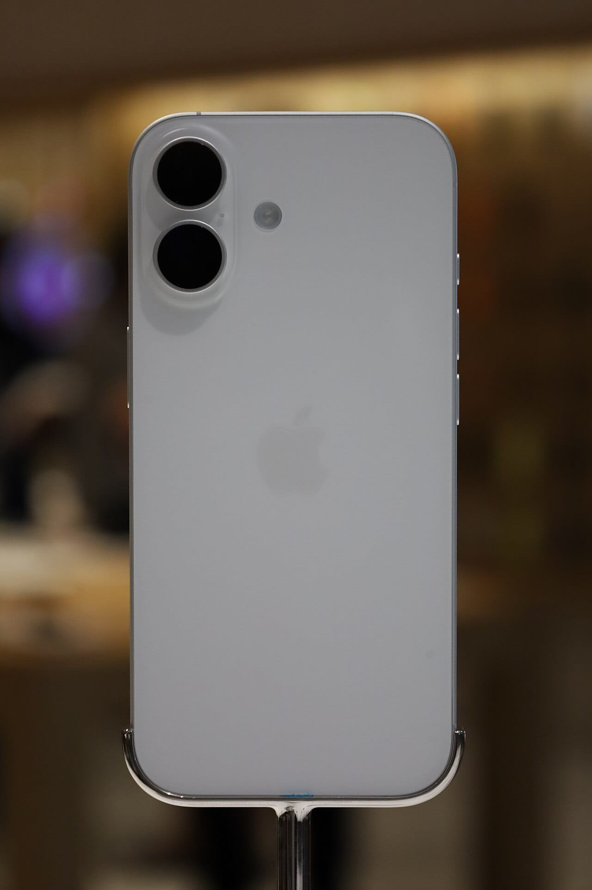

Apple has opened Siri AI to every developer: since November 3, 2026, any app can bring its content and actions into Siri AI through App Intents, in a developer preview that customers will not get for a few months.

This take is part of my [AI, in Depth](/topics/ai) writing. Apple named the new Siri in its earnings release too, which I covered in [Apple's fourth-quarter results](/news/apple-q4-2026-results).

## What happened?

On November 3, 2026, Apple published [Siri AI is now open to all developers](https://developer.apple.com/news/?id=gdk2umrf). The preview starts with the iOS 27.3, iPadOS 27.3, macOS 27.3 and visionOS 27.3 betas, and it gives early access "before first shipping to customers in a few months."

Apple says App Store submission opens "in the spring," and that it will follow up with the terms and usage policies for experiences enabled through Siri AI.

*Apple announced the Siri AI developer preview from Cupertino on November 3. Photo: [IPhone01](https://commons.wikimedia.org/wiki/File:Apple_Park.jpg "IPhone01's photo on Wikimedia Commons"), [CC BY-SA 4.0](https://creativecommons.org/licenses/by-sa/4.0/ "Creative Commons Attribution-ShareAlike 4.0 license").*

## What changed?

Apps can now describe what they do to Siri AI, and Siri can act on it.

- **How it works:** apps use App Intents to bring their content and actions into Siri AI, with capabilities including personal context understanding, onscreen awareness and natural language.
- **Example actions:** Apple lists checking a delivery, booking a reservation and placing an order.
- **Skills:** developers can teach Siri AI to combine several actions into one experience.
- **Spotlight:** Siri AI can surface any entity in the Spotlight semantic index, not only ones that fit an existing schema.
- **Languages:** English, French, Japanese, Korean, Portuguese and Spanish now, with Traditional Chinese, Norwegian, Turkish and Vietnamese coming soon.
- **Limits:** it needs an Apple Intelligence-enabled device, is unavailable to users under 13 and is unavailable in the EU on iOS, iPadOS and watchOS.

Apple also says some server-side Apple Intelligence features have daily usage limits, and that "expanded access to such features will be available for a fee in the future."

*Siri AI needs an Apple Intelligence-enabled device, such as a recent iPhone. Photo: [Ahmad Ali Karim](https://commons.wikimedia.org/wiki/File:White_iPhone_17.jpg "Ahmad Ali Karim's photo on Wikimedia Commons"), [CC0](https://creativecommons.org/publicdomain/zero/1.0/ "Creative Commons CC0 1.0 public domain dedication").*

## What does it mean for businesses and founders?

My read is that this is a "prepare" story, not a "launch" story. Nothing ships to customers yet, and the rules for apps are still to come.

For a Philippine shop or service with an iPhone app, the useful question is which two or three actions customers repeat, such as tracking an order or rebooking. Those are the ones to expose first. The language list matters too: Filipino is not on it, so customers who want Filipino are not covered yet, which is a gap for businesses that serve them.

If you do not have an app, there is nothing to do yet.

## What should you do now?

1. **List your top actions.** Pick the few things customers do most in your app.
2. **Read Apple's documentation.** Start with the [Siri AI Developer Preview page](https://developer.apple.com/documentation/appintents/siri-ai-developer-preview).
3. **Wait for the terms.** Apple has not published the usage policies yet.
4. **Do not promise a date.** Customer release is "a few months" away.

## Where can you learn more?

- [Apple's announcement](https://developer.apple.com/news/?id=gdk2umrf) - Betas, languages, regions and timeline.
- [Siri AI Developer Preview documentation](https://developer.apple.com/documentation/appintents/siri-ai-developer-preview) - How App Intents connect to Siri AI.
- [Apple's fourth-quarter results](/news/apple-q4-2026-results) - Where Apple named the new Siri for the holiday lineup.
