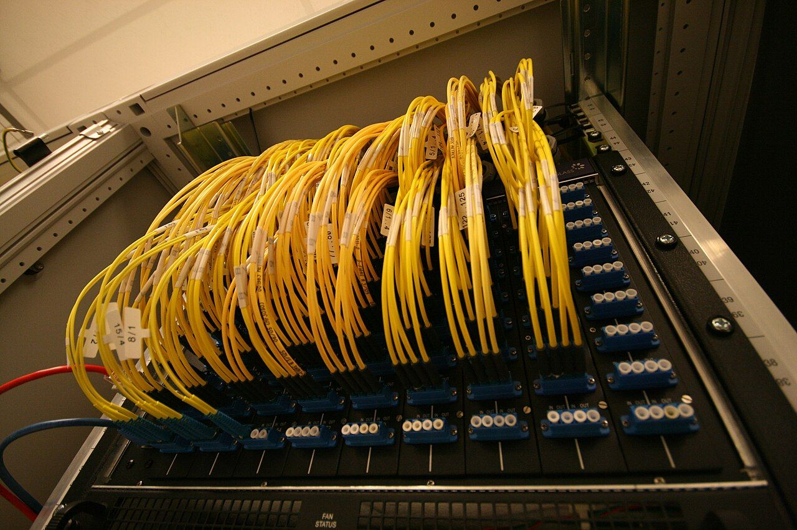

The best free MCP servers for SEO and website work are Chrome DevTools MCP for speed and debugging, mcp-gsc for Google Search Console data, and Google's Analytics MCP server for GA4 reports. All three are open source and were updated in November 2026. Playwright MCP, Context7 and the WordPress MCP Adapter cover browser testing, current code docs and WordPress sites.

This review is part of my [SEO, GEO and AEO](/topics/seo-geo-aeo "SEO, GEO and AEO: Uriel Papa's articles on search") writing. I ran an SEO agency and co-developed [5 WordPress SEO plugins](/projects/wordpress-seo-plugins "WordPress SEO plugins case study"), so I care about tools that read real data instead of guessing.

## How did I choose these servers?

An MCP server is a small program that gives an AI agent tools for one system, such as a browser or Search Console. Claude Code's [MCP documentation](https://code.claude.com/docs/en/mcp "Claude Code MCP documentation") calls the Model Context Protocol "an open source standard for AI-tool integrations". I judged every server on the same checks, against the GitHub API and each README on November 14, 2026:

- **Free and open source:** a license that allows commercial use.
- **Active:** a push to the repository in November 2026.
- **Who maintains it:** the vendor itself where one exists, such as Google, Microsoft or WordPress.
- **Safe defaults:** read-only out of the box, or a clear flag for anything that writes.
- **Useful for websites:** speed, search data, analytics, testing or content.

*Each MCP server is one cable from your agent to a real system. Photo: [Fabienne Serriere](https://commons.wikimedia.org/wiki/File:AMS-IX_optical_patch_panel.jpg "Fabienne Serriere's photo on Wikimedia Commons"), [CC BY-SA 3.0](https://creativecommons.org/licenses/by-sa/3.0/ "Creative Commons Attribution-ShareAlike 3.0 license").*

The point of all six is the same. The agent stops working from what you paste into chat and reads the source directly.

## Which free MCP servers are worth connecting?

Six servers passed. Each one gets the same checks.

### Chrome DevTools MCP

[ChromeDevTools/chrome-devtools-mcp](https://github.com/ChromeDevTools/chrome-devtools-mcp "Chrome DevTools MCP on GitHub") lets an agent "control and inspect a live Chrome browser", with the same tools you use in DevTools.

- **Who it's for:** anyone fixing page speed, broken scripts or layout bugs with an agent.
- **What's inside:** performance traces with insights, network requests, console messages with source-mapped stack traces, and screenshots. It also ships skills, including `debug-optimize-lcp` for Largest Contentful Paint and `a11y-debugging` for accessibility.
- **Cost:** free. Add it with `claude mcp add chrome-devtools --scope user npx chrome-devtools-mcp@latest`.
- **License and activity:** Apache 2.0, about 55,400 stars, last push November 13, 2026. Maintained by the Chrome DevTools team.
- **Watch out for:** usage statistics go to Google by default; `--no-usage-statistics` turns them off. Performance tools may send trace URLs to the CrUX API, which `--no-performance-crux` stops.

<RepoCard repo="ChromeDevTools/chrome-devtools-mcp" />

Try the README's first prompt, "Check the performance of" a page, on one of your own templates. It pairs well with my [PageSpeed Insights guide](/blog/pagespeed-insights-100-guide-for-business-owners "How to get a PageSpeed Insights score of 100").

### mcp-gsc (Google Search Console)

[AminForou/mcp-gsc](https://github.com/AminForou/mcp-gsc "mcp-gsc Google Search Console MCP server on GitHub") connects Google Search Console to Claude, Cursor, Codex CLI, Gemini CLI and other clients.

- **Who it's for:** SEOs and site owners who want to ask questions of their own search data.
- **What's inside:** 20 tools, including search analytics with filters, period comparisons, the queries behind a page, URL inspection for up to 10 URLs at once and sitemap checks.
- **Cost:** free. You create your own Google Cloud OAuth client or service account. The README also promotes a paid hosted version.
- **License and activity:** MIT, about 2,200 stars, last push November 6, 2026. Built by Amin Foroutan.
- **Watch out for:** version 0.4.2 asks only for the read-only scope by default. Leave `GSC_ALLOW_DESTRUCTIVE` off unless you want the agent able to remove sites or sitemaps.

<RepoCard repo="AminForou/mcp-gsc" />

### Google Analytics MCP server

[googleanalytics/google-analytics-mcp](https://github.com/googleanalytics/google-analytics-mcp "Google Analytics MCP server on GitHub") is Google's MCP server for the Google Analytics Admin and Data APIs.

- **Who it's for:** marketers and founders who want GA4 answers without building reports by hand.
- **What's inside:** account and property details, `run_report`, funnel and conversion reports, realtime reports and custom dimensions. The README has a Claude Code setup with `claude mcp add analytics-mcp`.
- **Cost:** free. You need a Google Cloud project with both Analytics APIs enabled.
- **License and activity:** Apache 2.0, about 3,800 stars, last push November 9, 2026. Maintained by the Google Analytics team.
- **Watch out for:** write tools such as `create_key_event` need the `--allow-write` flag, the `analytics.edit` scope and the right role on the property. Keep the read-only scope for daily use.

<RepoCard repo="googleanalytics/google-analytics-mcp" />

The Google Analytics team's own tutorial walks through the setup step by step:

<YouTube id="nS8HLdwmVlY" title="Google Analytics MCP Setup Tutorial" channel="Google Analytics" />

### Playwright MCP

[microsoft/playwright-mcp](https://github.com/microsoft/playwright-mcp "Playwright MCP on GitHub") gives an agent a real browser through Playwright, using the page's accessibility tree instead of screenshots.

- **Who it's for:** people testing forms, checkout flows and pages that only render with JavaScript.
- **What's inside:** browser tools that click, type, navigate and read structured page snapshots, with no vision model needed. Add it with `claude mcp add playwright npx @playwright/mcp@latest`.
- **Cost:** free. It needs Node.js 18 or newer.
- **License and activity:** Apache 2.0, about 39,600 stars, last push November 13, 2026. Maintained by Microsoft.
- **Watch out for:** its README says coding agents "increasingly favor" its CLI and skills, because they avoid loading "large tool schemas and verbose accessibility trees" into context. Use the MCP server for long, stateful browser sessions.

<RepoCard repo="microsoft/playwright-mcp" />

### Context7

[upstash/context7](https://github.com/upstash/context7 "Context7 on GitHub") pulls "up-to-date, version-specific documentation and code examples" for a library into your agent's context.

- **Who it's for:** anyone building a site on Astro, Next.js, Laravel or another stack that changes faster than a model's training data.
- **What's inside:** two MCP tools, `resolve-library-id` and `query-docs`, or a CLI-and-skill mode. Run `npx ctx7 setup --claude` to set it up.
- **Cost:** free. The README recommends a free API key for higher rate limits.
- **License and activity:** MIT, about 64,800 stars, last push November 13, 2026. Maintained by Upstash.
- **Watch out for:** only the MCP server is in the repo; the API backend, parser and crawler are private. Its docs are community-contributed, and the README cannot "guarantee the accuracy, completeness, or security" of every library.

<RepoCard repo="upstash/context7" />

### WordPress MCP Adapter

[WordPress/mcp-adapter](https://github.com/WordPress/mcp-adapter "WordPress MCP Adapter on GitHub") is "the official WordPress package for MCP integration". It turns WordPress abilities into tools, resources and prompts an agent can use.

- **Who it's for:** WordPress developers and agencies who want agents to work with a site through approved actions.
- **What's inside:** the bridge between the WordPress Abilities API and MCP, HTTP and STDIO transports, and per-ability permission checks. Clients connect through WP-CLI or the `/wp-json/mcp/mcp-adapter-default-server` endpoint.
- **Cost:** free.
- **License and activity:** GPL-2.0-or-later, about 1,900 stars, last push November 13, 2026. Part of the AI Building Blocks for WordPress initiative.
- **Watch out for:** abilities are private by default, and a developer must set `meta.public` to expose one. Automattic's older `wordpress-mcp` repo is archived and points to this adapter, so don't start new work on it.

<RepoCard repo="WordPress/mcp-adapter" />

## How do the six servers compare?

The six servers split into two for the browser, two for Google data, one for code docs and one for a CMS.

| Server | Best for | License | Stars (Nov 14, 2026) | Writes by default? |
| --- | --- | --- | --- | --- |
| Chrome DevTools MCP | Speed and debugging | Apache 2.0 | about 55,400 | Controls a browser |
| mcp-gsc | Search Console data | MIT | about 2,200 | No |
| Google Analytics MCP | GA4 reports | Apache 2.0 | about 3,800 | No |
| Playwright MCP | Browser testing | Apache 2.0 | about 39,600 | Controls a browser |
| Context7 | Current library docs | MIT | about 64,800 | No |
| WordPress MCP Adapter | WordPress actions | GPL-2.0-or-later | about 1,900 | Only public abilities |

For SEO work, mcp-gsc and Chrome DevTools MCP give the most value on day one.

## How do you connect an MCP server safely?

An MCP server acts with whatever access you give it, so treat the setup like handing over a login. Claude Code's MCP documentation warns: "Verify you trust each server before connecting it", because servers that fetch outside content carry a prompt injection risk. Before you connect any of these:

- **Use read-only scopes first.** Both Google servers work fine with read-only access.
- **Keep write flags off** until a task needs them, then turn them off again.
- **Turn off telemetry** you did not choose, such as Chrome DevTools MCP's usage statistics.
- **Use a separate Chrome profile** for browser servers. The Chrome DevTools README says clients can "inspect, debug, and modify any data in the browser".

*Give each server the smallest key that does the job. Photo: [Trougnouf](https://commons.wikimedia.org/wiki/File:Solex_99_30_padlock_with_keys_%28DSCF2659%29.jpg "Trougnouf's photo on Wikimedia Commons"), [CC BY 4.0](https://creativecommons.org/licenses/by/4.0/ "Creative Commons Attribution 4.0 license").*

Each tool you connect also adds tool names to the agent's context. Connect the two or three you use weekly, not all six.

## Which one should you start with?

Start with the data you check most:

- **You live in Search Console:** mcp-gsc, with read-only OAuth.
- **Your pages are slow:** Chrome DevTools MCP and its `debug-optimize-lcp` skill.
- **You report on GA4 every month:** the Google Analytics MCP server.
- **You test forms and flows:** Playwright, as MCP or as its CLI with skills.
- **Your agent writes outdated code:** Context7.
- **You run WordPress sites:** the WordPress MCP Adapter, with only the abilities you approve.

Search data from these servers shows clicks and rankings, not AI citations. For those, see my guide on [how to check if ChatGPT cites your site](/blog/how-to-check-if-chatgpt-cites-your-site "How to check if ChatGPT cites your site").

## Where can you learn more?

- [Claude Code security documentation](https://code.claude.com/docs/en/security "Claude Code security documentation") - how workspace trust and prompt injection protection apply to MCP servers.
- [Chrome DevTools MCP client setup](https://github.com/ChromeDevTools/chrome-devtools-mcp/blob/main/docs/client-configurations.md "Chrome DevTools MCP client configurations") - the install steps for Claude Code, Cursor, VS Code and other clients, including the plugin with skills.
- [Playwright CLI](https://github.com/microsoft/playwright-cli "Playwright CLI on GitHub") - Microsoft's lighter option for coding agents that only need quick browser actions.
- [The best open-source SEO and GEO tools on GitHub](/blog/open-source-seo-geo-tools-github "The best open-source SEO and GEO tools on GitHub") - my review of audit and data tools that pair with these servers.

*Repository details are from the GitHub API and each README, checked on November 14, 2026. Google Search Console, Google Analytics, Chrome, Playwright and WordPress are trademarks of their owners. This post is not endorsed by or affiliated with any of the projects listed.*
