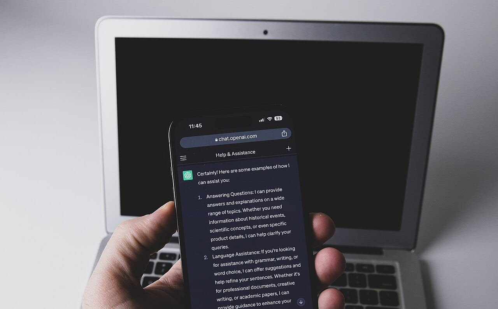

OpenAI has opened Businesses in ChatGPT in beta, so a business can now claim its listing, fix its details and see how often ChatGPT mentions it. Claiming is open wherever ChatGPT is available, including the Philippines, while the Business Agent that answers customers is limited to the US for now.

This take is part of my [SEO, GEO and AEO](/topics/seo-geo-aeo "SEO, GEO and AEO articles") writing. Until now, the only way to see if ChatGPT mentioned you was to test it by hand, as I explain in [how to check if ChatGPT cites your site](/blog/how-to-check-if-chatgpt-cites-your-site "How to check if ChatGPT cites your site").

## What happened?

On November 10, 2026, [OpenAI announced](https://x.com/OpenAI/status/2120216592395174382 "OpenAI's post announcing Businesses in ChatGPT") Businesses in ChatGPT. The idea is simple: "Claim your business, manage your information, and get insights on how people engage with you."

OpenAI announced it on X:

<SocialPost platform="x" url="https://x.com/OpenAI/status/2120216592395174382" author="OpenAI" handle="OpenAI" date="2026-11-10" text={"Now in beta: Businesses in ChatGPT.\n\nClaim your business, manage your information, and get insights on how people engage with you.\n\nEligible businesses can also build a Business Agent to answer customers’ questions and help them explore what you offer.\n\nhttps://openai.com/index/introducing-businesses-chatgpt/"} media={[{"type":"video","src":"https://pbs.twimg.com/amplify_video_thumb/2120214011451170817/img/p-eqRNRKImbCTq9L.jpg","alt":"Opening frame of OpenAI's video: the words Your business, on a white background with a yellow bag and a blue shopping basket at the edges","width":1920,"height":1080}]} />

OpenAI's [announcement page](https://openai.com/index/introducing-businesses-chatgpt/ "OpenAI's announcement of Businesses in ChatGPT") could not be opened from my tools when I wrote this, so the details below come from OpenAI's own posts and from press reports.

*OpenAI opened Businesses in ChatGPT in beta on November 10. Photo: [Jernej Furman from Slovenia](https://commons.wikimedia.org/wiki/File:Smartphone_with_ChatGPT_app_%2852917381673%29.jpg "Jernej Furman from Slovenia's photo on Wikimedia Commons"), [CC BY 2.0](https://creativecommons.org/licenses/by/2.0/ "Creative Commons Attribution 2.0 license").*

## What changed?

Businesses get a place to manage what ChatGPT shows about them, called Business Hub.

- **Your details:** once verified, you can "update your business details, and add product feeds with current pricing and availability," [OpenAI says](https://x.com/OpenAI/status/2120216596753121411 "OpenAI's post on Business Hub").
- **Insights:** you can see "aggregated insights on mentions, website clicks, and common topics in conversations where your business is cited."
- **Privacy:** "We don’t share people’s conversations or Business Agent chats with businesses."
- **Business Agent:** a chat that answers customer questions from your information, [available to](https://x.com/OpenAI/status/2120216594244849690 "OpenAI's post on the Business Agent") "eligible ecommerce and online service businesses in the U.S."
- **Cost:** free at launch, according to [VentureBeat](https://venturebeat.com/technology/openai-lets-you-claim-your-business-in-chatgpt-and-set-up-a-custom-agentic-ai-customer-sales-rep "VentureBeat's report on Businesses in ChatGPT"), citing Digiday. OpenAI's monetization lead left open charging later.
- **No ranking boost:** VentureBeat quotes OpenAI that "claiming a profile carries no guarantee of better placement or more sales."

OpenAI showed what Business Hub looks like:

<SocialPost platform="x" url="https://x.com/OpenAI/status/2120216596753121411" author="OpenAI" handle="OpenAI" date="2026-11-10" text={"Use Business Hub to shape what customers see about your business in ChatGPT.\n\nOnce verified, you can create a Business Agent, update your business details, and add product feeds with current pricing and availability.\n\nYou can also see aggregated insights on mentions, website clicks, and common topics in conversations where your business is cited.\n\nWe don’t share people’s conversations or Business Agent chats with businesses.\n\nEligible businesses located wherever ChatGPT is available can get started by claiming their business in Business Hub.\n\nhttps://openai.com/business/businesses-in-chatgpt/"} media={[{"src":"https://pbs.twimg.com/media/HWyEdWcaoAAawU3.jpg","alt":"Business Hub screens for a sample toy shop: a mentions chart, top discovery topics such as gifts for kids, agent conversation and click counts, and an edit business info form","width":3840,"height":2160}]} />

There is a limit for shops with a physical address. VentureBeat reports that local stores and restaurants can only claim "an existing U.S. listing." Verification can go through a business phone number, email address, website domain or Shopify account, followed by an identity check.

*Local stores can only claim an existing US listing for now, according to VentureBeat. Photo: [MarvinBikolano](https://commons.wikimedia.org/wiki/File:Sari-sari_store_in_baao.JPG "MarvinBikolano's photo on Wikimedia Commons"), [CC BY-SA 4.0](https://creativecommons.org/licenses/by-sa/4.0/ "Creative Commons Attribution-ShareAlike 4.0 license").*

## What does it mean for businesses and founders?

My read is that this is the first real dashboard for AI search, and that matters more than the listing itself. Mention counts and common topics tell you what people ask ChatGPT about your kind of business.

For a Philippine online shop or service business with its own website, claiming looks possible now. A neighborhood store without a US listing will have to wait.

Claiming does not replace the basics. ChatGPT still answers from what it finds about you, so clear pages with your prices, services and location still do the heavy lifting. I covered the paid side of AI search in [Google bringing ads in AI Mode to the Philippines](/news/google-ads-in-ai-mode-philippines "Google brings ads in AI Mode to the Philippines").

## What should you do now?

1. **Try to claim your business** in Business Hub, starting with your website domain.
2. **Fix your details and prices** so ChatGPT has current information.
3. **Check the insights monthly.** Note which topics bring mentions and write pages that answer them.
4. **Keep your website first.** Claiming does not guarantee placement.

## Where can you learn more?

- [OpenAI's announcement](https://openai.com/index/introducing-businesses-chatgpt/ "OpenAI's announcement of Businesses in ChatGPT") - The official overview.
- [OpenAI's post on Business Hub](https://x.com/OpenAI/status/2120216596753121411 "OpenAI's post on Business Hub") - Insights, privacy and eligibility.
- [VentureBeat's report](https://venturebeat.com/technology/openai-lets-you-claim-your-business-in-chatgpt-and-set-up-a-custom-agentic-ai-customer-sales-rep "VentureBeat's report on Businesses in ChatGPT") - Cost, verification and the limits for local stores.
