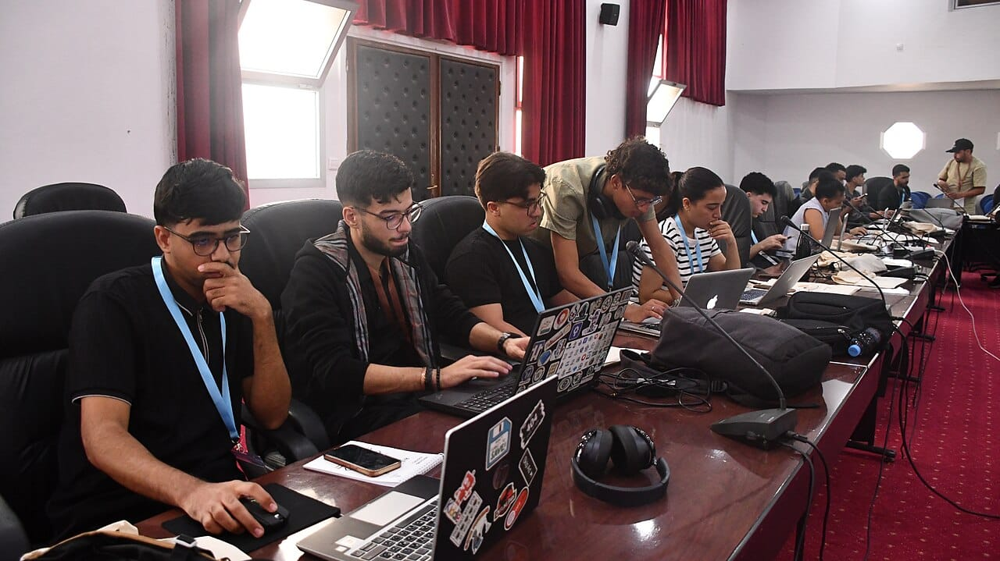

The Department of Information and Communications Technology (DICT) opened applications for its Startup Grant Fund on November 23, 2026. It offers early-stage startups equity-free grants of up to ₱1.5 million, and the deadline is January 4, 2027. For the first time, founders who have not registered a business yet can apply too.

This take is part of my [technology and business](/topics/tech-and-business "Technology and business articles") writing. My notes from the [Philippine SME Business Expo](/events/philippine-sme-business-expo-technology-adoption "Philippine SME Business Expo: what I learned about tech adoption") cover why funding and tools matter so much for small Filipino businesses.

## What happened?

The DICT announced the call on its official X account: "Applications to the Startup Grant Fund are officially OPEN!" The graphics in [the post](https://x.com/DICTgovph/status/2124787388232987009 "DICT's X post announcing the Startup Grant Fund call for applications") give the deadline, January 4, 2027, and say the fund "provides eligible early-stage startups with equity-free grants of up to ₱1.5 Million." Questions go to startupgrant@dict.gov.ph.

*The Startup Grant Fund is the DICT's equity-free grant for early-stage Philippine startups. Photo: [Patrick Roque](https://commons.wikimedia.org/wiki/File:Makati_Skyline_as_of_June_2015.jpg "Patrick Roque's photo on Wikimedia Commons"), [CC BY-SA 3.0](https://creativecommons.org/licenses/by-sa/3.0/ "Creative Commons Attribution-ShareAlike 3.0 license").*

Here is the DICT's post, with the application and guideline links in its images:

<SocialPost platform="x" url="https://x.com/DICTgovph/status/2124787388232987009" author="Department of ICT" handle="DICTgovph" date="2026-11-23" text={"📢 Calling all startup founders! Applications to the Startup Grant Fund are officially OPEN!\n\nCheck full details here: https://www.facebook.com/share/p/1Dcb3JHYsa/\n\n#StartupGrantFund #StartupFunding #Founders #Innovation #DICTSGF #CallForApplications #EarlyStageStartups"} media={[{"src":"https://pbs.twimg.com/media/HXzCZZ4aYAAgPfy.jpg","alt":"DICT graphic reading Startup Grant Fund, Call for Applications, Deadline: January 4, 2027, with hands holding a light bulb and a megaphone","width":3375,"height":3375},{"src":"https://pbs.twimg.com/media/HXzCbGZaoAASAVy.jpg","alt":"DICT graphic of hands typing on a laptop whose screen says the DICT Startup Grant Fund provides eligible early-stage startups with equity-free grants of up to 1.5 million pesos","width":3375,"height":3375},{"src":"https://pbs.twimg.com/media/HXzCyBSaYAAC40v.jpg","alt":"DICT graphic with two QR codes for the application forms and the revised SGF guidelines, and the email address startupgrant@dict.gov.ph for questions","width":3375,"height":3375},{"src":"https://pbs.twimg.com/media/HXzC14ibwAASN1_.jpg","alt":"DICT graphic with a QR code under the words Submit your application here, and the link tinyurl.com/DICTSGF2026Application","width":3375,"height":3375}]} />

## What changed, in plain words?

The fund now has three tracks. [Newsbytes.PH reported](https://newsbytes.ph/2026/11/14/dict-eases-startup-grant-requirements-expands-funding-to-p1-5m/ "Newsbytes.PH: DICT eases startup grant requirements, expands funding to P1.5M") that the DICT's ICT Industry Development Bureau unveiled the revised rules on November 12, at the close of Philippine Startup Week:

- **Track A, proof of concept to prototype:** up to ₱500,000. Open to "individual Filipino founders and startup teams that have not yet registered their businesses," who must commit to registering if selected.
- **Track B, prototype to minimum viable product:** up to ₱1 million.
- **Track C, minimum viable product to early growth:** up to ₱1.5 million.

Tracks B and C need DTI or SEC registration plus Startup Philippines registration before you apply. The [Daily Tribune](https://tribune.net.ph/2026/11/17/govt-opens-p15-m-grants-to-unregistered-startups "Daily Tribune: Gov't opens P1.5-M grants to unregistered startups") adds that the rules come from Department Circular No. RMDC-001, series of 2026, signed by DICT Secretary Robert Joseph M. de Claro on November 11. The money is not paid at once. Track A comes in four equal installments, and Tracks B and C in releases of 10, 20, 30 and 40 percent, each tied to milestones.

*Track A is for founders and teams who want to turn an idea into a working prototype. Photo: [DERDAKI ILIAS](https://commons.wikimedia.org/wiki/File:Wikimedia_Morocco_Mini-Hackathon_2026_day_1_-_Group_working_on_laptops_at_a_conference_table_-_0015.jpg "DERDAKI ILIAS's photo on Wikimedia Commons"), [CC BY-SA 4.0](https://creativecommons.org/licenses/by-sa/4.0/ "Creative Commons Attribution-ShareAlike 4.0 license").*

## What does it mean for small businesses and founders?

The big change is Track A. The revised rules let a founder with a working idea, but no registered business yet, ask for up to ₱500,000 and register once selected. Equity-free means you keep your whole company.

The milestone payments matter for planning. You will not get the full amount on day one, so your plan has to show what each tranche pays for and what you will deliver before the next one.

## What should you do now?

1. **Pick your track honestly.** An idea or proof of concept is Track A. A working prototype is Track B. A product with early customers is Track C.
2. **Get the revised guidelines first.** Scan the guidelines QR code in the [DICT's post](https://x.com/DICTgovph/status/2124787388232987009 "DICT's X post with the application form and guideline QR codes") and read the requirements before you start the form.
3. **Start registrations now for Tracks B and C.** DTI or SEC registration and Startup Philippines registration take time, and January 4 is close once the holidays start.
4. **Write a milestone plan.** Match each tranche to a clear deliverable, such as a prototype, a pilot or the first paying customers.
5. **Ask early.** Email startupgrant@dict.gov.ph with questions well before the deadline.
