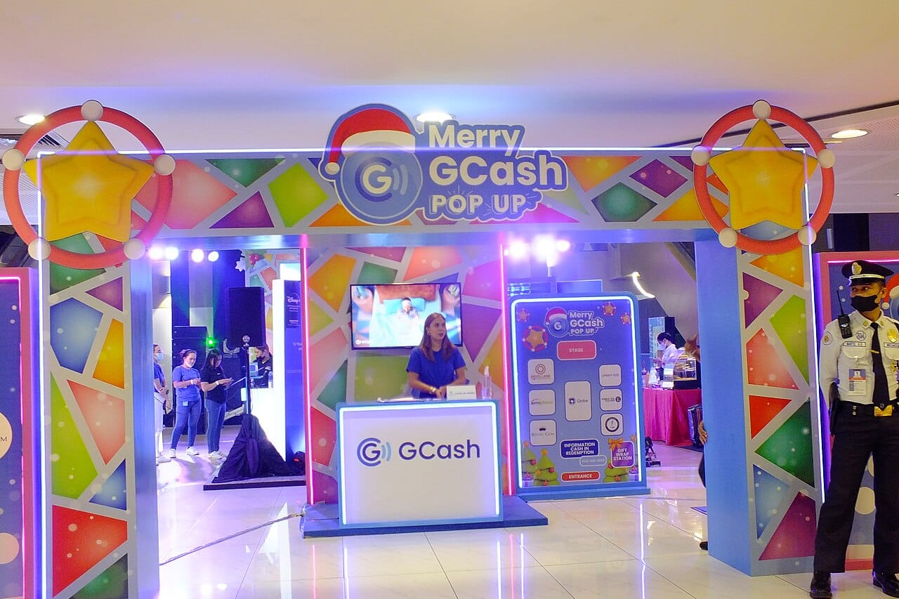
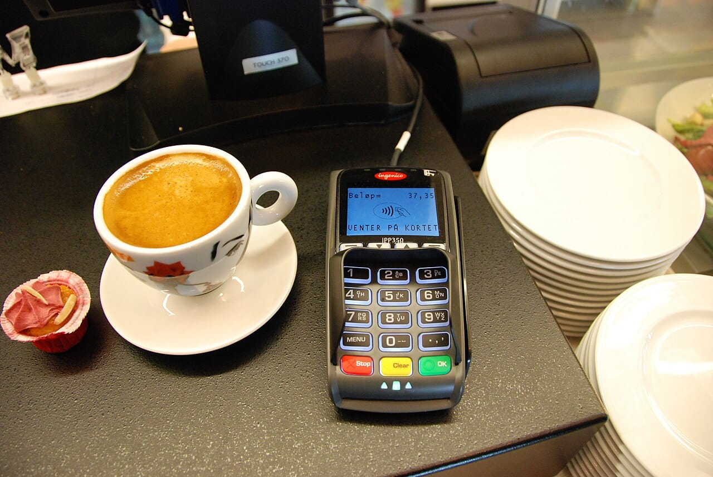
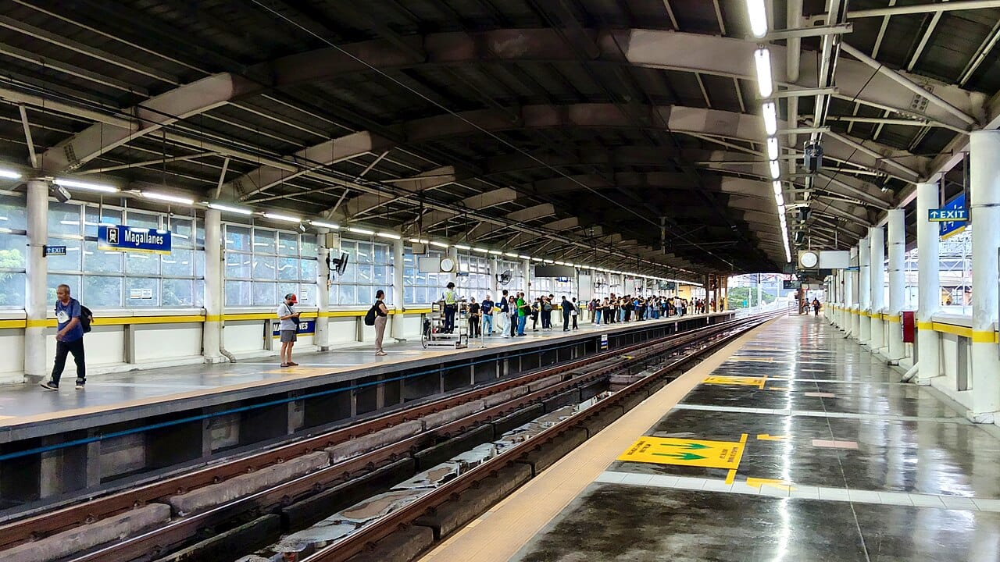

GCash is preparing No Signal Pay, a feature that lets you pay by tapping your phone on an NFC payment terminal even with weak or no signal and no mobile data. Martha Sazon, president and CEO of GCash parent Mynt, previewed it on November 10, 2026. For shops and commuters in places with poor signal, it could remove the most common reason a GCash payment fails at the counter.

This take is part of my [Technology and Business](/topics/tech-and-business "Technology and Business articles") writing. NFC is close to my own work: I led and co-developed an [NFC business card platform](/projects/nfc-card-platform "NFC business card platform case study") where a tap opens a profile.

## What happened?

Sazon announced the feature at the end of the [Mynt third-quarter 2026 earnings call](https://www.investing.com/news/transcripts/earnings-call-transcript-mynt-posts-strong-q3-2026-growth-as-stock-hits-52week-high-93CH-5014416 "Investing.com transcript of Mynt's Q3 2026 earnings call"). She described it as a "sneak peek of something exciting coming soon" and closed with the line "No signal, no data, no problem with No Signal Pay."

Her examples were everyday ones: buying a snack or merienda, and paying while commuting on the MRT. She tied it to Mynt's push to serve the Filipinos who are still unbanked, including areas where connectivity is weak.

*A GCash pop-up booth at SM City Cebu. Sazon tied No Signal Pay to reaching Filipinos who are still unbanked. Photo: [PaulGorduiz106](https://commons.wikimedia.org/wiki/File:GCash_Pop_Up_%2812-08-2022%29.jpg "PaulGorduiz106's photo on Wikimedia Commons"), [CC BY-SA 4.0](https://creativecommons.org/licenses/by-sa/4.0/ "Creative Commons Attribution-ShareAlike 4.0 license").*

The same quarter, GCash had 42.1 million monthly active users, up 9.7%, [according to the Daily Tribune](https://tribune.net.ph/2026/11/10/gcash-parent-mynt-posts-p165b-profit-in-q3 "Daily Tribune on Mynt's third-quarter 2026 results"). Philippine tech outlets picked up the news over the following days.

CLTV36 summed it up on X:

<SocialPost platform="x" url="https://x.com/CLTV36/status/2121106673498571135" author="CLTV36" handle="CLTV36" date="2026-11-13" text={"GCash is preparing No Signal Pay, an offline tap-to-pay feature for select merchants and public transport. Using NFC, it could let users pay without mobile data or a QR scan—as long as they have enough wallet balance. Launch details are still pending.\n\nhttps://cltv36.tv/offline-tap-to-pay-feature-na-no-signal-pay-inihahanda-na-ng-gcash/"} card={{"url":"https://cltv36.tv/offline-tap-to-pay-feature-na-no-signal-pay-inihahanda-na-ng-gcash/","title":"Offline tap-to-pay feature na ‘No Signal Pay’, inihahanda na ng GCash","description":"Hindi na magiging hadlang ang mahinang signal o kawalan ng mobile data sa pagbabayad gamit ang e-wallet matapos ianunsyo ng GCash ang bago nitong feature na tinatawag na “No Signal Pay.”","domain":"cltv36.tv","image":"https://pbs.twimg.com/card_img/2121106675608231936/M5vXJHz2?format=jpg&name=800x320_1","imageAlt":"The GCash logo, a white letter G with signal waves inside a blue circle, above the word GCash on a bright blue background"}} />

## What changed, in plain words?

Today, most GCash payments in shops work by opening the app and scanning a QR code, which needs the app to be online. No Signal Pay swaps that for a tap. Sazon said you simply unlock your phone and tap it on any NFC-enabled payment device, with no need to log in or open the GCash app.

Sazon said the feature is "powered by tokenization." In tap-to-pay systems, a token is a stand-in for your account details that the phone hands to the terminal. GCash has not explained how it checks your balance when the phone is offline, so treat the details as unknown until launch. Sazon did say the wallet must have enough funds, and that payments work even while the GCash app is down.

*No Signal Pay works on NFC-enabled payment terminals like this one, not on QR stands. Photo: [HLundgaard](https://commons.wikimedia.org/wiki/File:Mobile_payment_02.JPG "HLundgaard's photo on Wikimedia Commons"), [CC BY-SA 3.0](https://creativecommons.org/licenses/by-sa/3.0/ "Creative Commons Attribution-ShareAlike 3.0 license").*

What we don't know yet matters as much. [GIZGUIDE](https://www.gizguide.com/2026/11/gcash-no-signal-pay.html "GIZGUIDE on GCash No Signal Pay") and [ManilaShaker](https://manilashaker.com/gcash-to-launch-no-signal-pay-for-offline-payments/ "ManilaShaker on GCash No Signal Pay") both report there is no launch date, device list, terminal list or first rollout area yet.

## What does it mean for small businesses and founders?

My read: the catch is the terminal, not the phone. No Signal Pay only works where the shop has an NFC-enabled payment device. Many small shops take GCash through a printed QR code, which costs nothing to set up. Those shops will not get No Signal Pay customers unless they add a tap-capable terminal.

The win is real for the right business. A canteen in a basement, a stall in a market with poor signal or a shop in a province with weak coverage loses sales when payments hang. A tap that works offline turns a stuck line into a quick sale.

*Sazon named the MRT as one place riders could pay with No Signal Pay. Photo: [Nairb.Idi9](https://commons.wikimedia.org/wiki/File:MRT-3_Magallanes_station_%28October_30,_2026%29.jpg "Nairb.Idi9's photo on Wikimedia Commons"), [CC BY-SA 4.0](https://creativecommons.org/licenses/by-sa/4.0/ "Creative Commons Attribution-ShareAlike 4.0 license").*

Both big Philippine wallets are now pushing taps at the counter. Maya already lets merchants take [Apple Pay on Maya Terminal](/news/maya-apple-pay-terminal-checkout "Maya adds Apple Pay to Maya Terminal and Maya Checkout") with no new hardware. If you are choosing a terminal this year, tap support is worth asking about.

## What should you do now?

1. **Don't change anything yet.** No Signal Pay has no launch date, so keep your current QR setup.
2. **Check what your terminal can do.** If you already have a card terminal, ask your provider whether it is NFC-enabled.
3. **Watch for the official list.** GCash still has to name supported phones, terminals and the first areas.
4. **Keep a cash or card backup.** Until it launches, a weak signal still means a stuck GCash QR payment.

## Where can you learn more?

- [Mynt Q3 2026 earnings call transcript](https://www.investing.com/news/transcripts/earnings-call-transcript-mynt-posts-strong-q3-2026-growth-as-stock-hits-52week-high-93CH-5014416 "Investing.com transcript of Mynt's Q3 2026 earnings call") - Sazon's own words on No Signal Pay.
- [CLTV36's report in Filipino](https://cltv36.tv/offline-tap-to-pay-feature-na-no-signal-pay-inihahanda-na-ng-gcash/ "CLTV36 report on No Signal Pay, in Filipino") - What is known and what is still pending.
- [GIZGUIDE's summary](https://www.gizguide.com/2026/11/gcash-no-signal-pay.html "GIZGUIDE on GCash No Signal Pay") - The open questions about devices and rollout.
