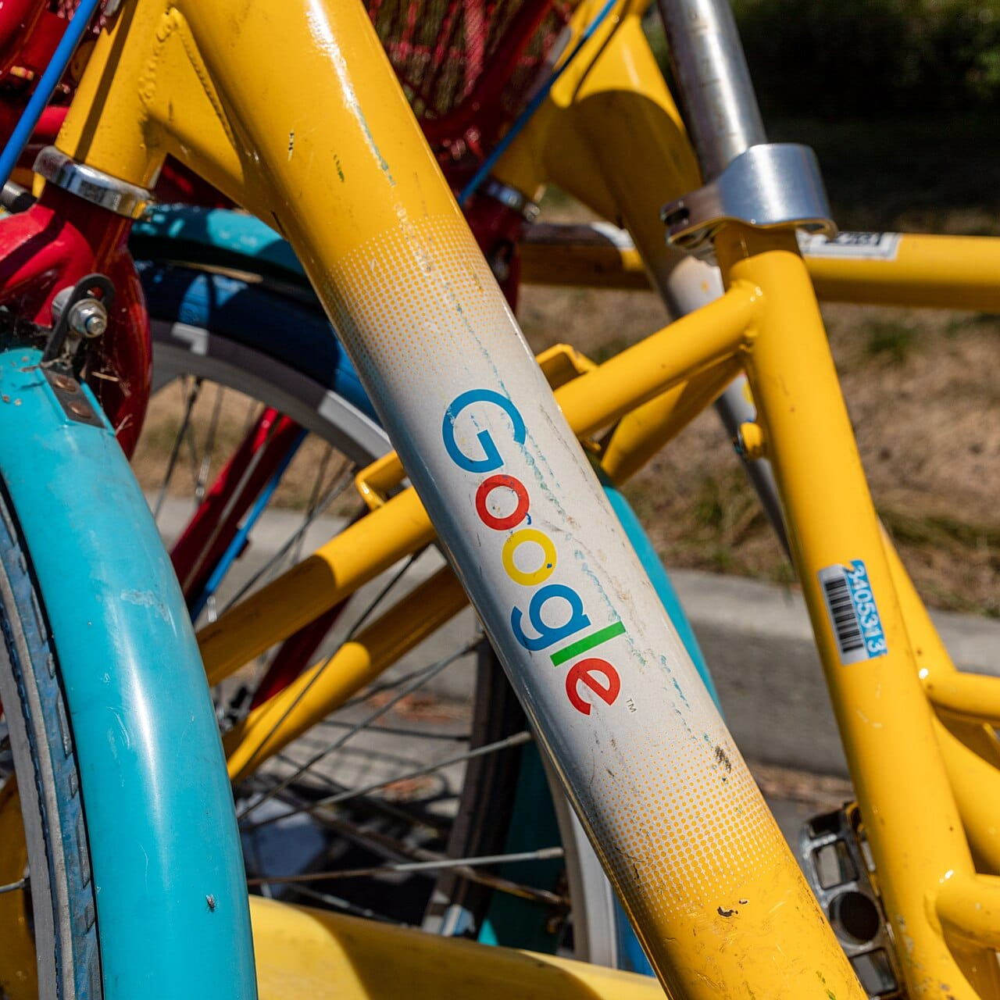

Google has opened Gemini 4 Carbon, its model for long and difficult tasks, to every paying Gemini API developer. It costs the same as Gemini 4 Argon for now, US$2 per million input tokens and US$10 per million output tokens, but that price doubles after November 30, 2026. If you build coding tools or agents, test it this month.

This take is part of my [AI, in Depth](/topics/ai "AI, in Depth articles") writing. For the model Carbon sits beside, see my take on [Gemini 4 Argon](/news/gemini-4-argon "Gemini 4 Argon is out: what Google's new top model costs").

## What happened?

On November 10, 2026, Google said in its [Gemini 4 Carbon update](https://blog.google/innovation-and-ai/models-and-research/gemini-models/gemini-4-carbon-now-available/ "Google's post on Gemini 4 Carbon availability") that "Gemini 4 Carbon is available via the API in Google AI Studio" for "all paying developers and enterprises, at the same introductory price." When Google first [introduced Carbon](https://blog.google/innovation-and-ai/models-and-research/gemini-models/introducing-gemini-4-carbon/ "Google's introduction of Gemini 4 Carbon") in late October, access was limited.

[Sundar Pichai announced](https://x.com/sundarpichai/status/2120185896469496180 "Sundar Pichai's post on Gemini 4 Carbon") the rollout on X:

<SocialPost platform="x" url="https://x.com/sundarpichai/status/2120185896469496180" author="Sundar Pichai" handle="sundarpichai" date="2026-11-10" text={"Gemini 4 Carbon is rolling out today. It’s built for sustained, long-horizon tasks, reasoning deeply through complex software engineering, cybersecurity, and scientific discovery.\n\nComing globally via the Gemini API in @GoogleAIStudio and Gemini for business, and for Ultra subscribers in @antigravity, the @GeminiApp, and AI Mode in Search."} />

*Sundar Pichai announced Gemini 4 Carbon's wider rollout on November 10. Photo: [Nguyen Hung Vu from Hanoi, Vietnam](https://commons.wikimedia.org/wiki/File:Meet_Google_CEO_Sundar_Pichai_@Hanoi,_Vietnam_%2823836877591%29.jpg "Nguyen Hung Vu from Hanoi, Vietnam's photo on Wikimedia Commons"), [CC BY 2.0](https://creativecommons.org/licenses/by/2.0/ "Creative Commons Attribution 2.0 license").*

## What changed?

Here is what Google's post says about access and price:

- **API:** paying developers and enterprises can use Carbon in Google AI Studio and Gemini for business.
- **Apps:** it "is also rolling out to all Google AI Ultra subscribers in Google Antigravity, the Gemini app, and AI Mode in Search."
- **Price now:** "$2 per million input tokens and $10 per million output tokens," the same as Argon.
- **Price later:** "After the introductory period expires on November 30, 2026, the price of $4 per 1M input tokens and $20 per 1M output tokens will apply."
- **Results:** Google says it "ranks #1 on CursorBench 4.0, Perplexity's WANDR, and Zapier's AutomationBench" at "more than 2X lower cost per task compared to the next best external model." These are Google's own claims.

Google DeepMind showed what Carbon can build, from long files to 3D web apps:

<SocialPost platform="x" url="https://x.com/GoogleDeepMind/status/2120219374388924610" author="Google DeepMind" handle="GoogleDeepMind" date="2026-11-10" text={"From synthesizing dense multimodal files to building interactive 3D web experiences, or even uncovering software vulnerabilities, Carbon helps solve problems that require sustained reasoning.\n\nNow rolling out in:\n🔘 The @GeminiApp and AI Mode in Search for Google AI Ultra subscribers.\n🔘 Gemini 4 Carbon is available via the API in @GoogleAIStudio and Gemini for business for all paying developers and enterprises\n🔘 Gemini for business, CodeMender, and Google Antigravity for enterprise use\n\nhttps://goo.gle/48Jd6ud"} media={[{"type":"video","src":"https://pbs.twimg.com/amplify_video_thumb/2120219091772321792/img/Cn_D6w2GH7Kk5-RN.jpg","alt":"Opening frame of Google DeepMind's video: an isometric pixel-art ski resort builder game with chairlifts, gondolas, a snowy village and a build menu of lift types","width":1920,"height":1080}]} />

Google pitches Carbon at multi-step coding and debugging, long agent workflows, and dense legal and finance documents. It also notes that Carbon uses more tokens than Argon on long tasks, which matters when you pay per token.

*The introductory price ends on November 30, 2026. Photo: [Dietmar Rabich](https://commons.wikimedia.org/wiki/File:Mountain_View_%28CA,_USA%29,_Charleston_Road,_Google-Fahrr%C3%A4der_--_2022_--_2903.jpg "Dietmar Rabich's photo on Wikimedia Commons"), [CC BY-SA 4.0](https://creativecommons.org/licenses/by-sa/4.0/ "Creative Commons Attribution-ShareAlike 4.0 license").*

## What does it mean for businesses and founders?

My read is that Carbon is for the hard jobs, not the everyday ones. A customer chatbot, product descriptions or simple automations will run well on a cheaper model. Carbon makes sense when a task needs many steps, such as fixing a bug across a codebase, reviewing long contracts or running an agent that checks its own work.

The deadline is the main point for small teams. If you already pay for the Gemini API, a few test runs before November 30 cost half of what they will cost in December. If you are new to token pricing, my post on [what tokenization is](/blog/what-is-tokenization "What tokenization is and how AI pricing works") explains how these prices add up.

## What should you do now?

1. **Pick one hard task** that your current model struggles with.
2. **Run it on Carbon before November 30** and note the result and the token cost.
3. **Compare with Argon or a cheaper model.** Keep Carbon only where it clearly wins.

## Where can you learn more?

- [Google's Carbon availability post](https://blog.google/innovation-and-ai/models-and-research/gemini-models/gemini-4-carbon-now-available/ "Google's post on Gemini 4 Carbon availability") - Access, pricing and benchmarks.
- [Google's introduction of Carbon](https://blog.google/innovation-and-ai/models-and-research/gemini-models/introducing-gemini-4-carbon/ "Google's introduction of Gemini 4 Carbon") - What the model was built for.
- [Sundar Pichai's announcement](https://x.com/sundarpichai/status/2120185896469496180 "Sundar Pichai's post on Gemini 4 Carbon") - Where it is rolling out.
