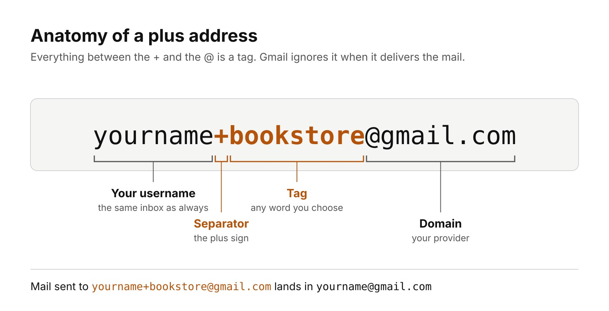
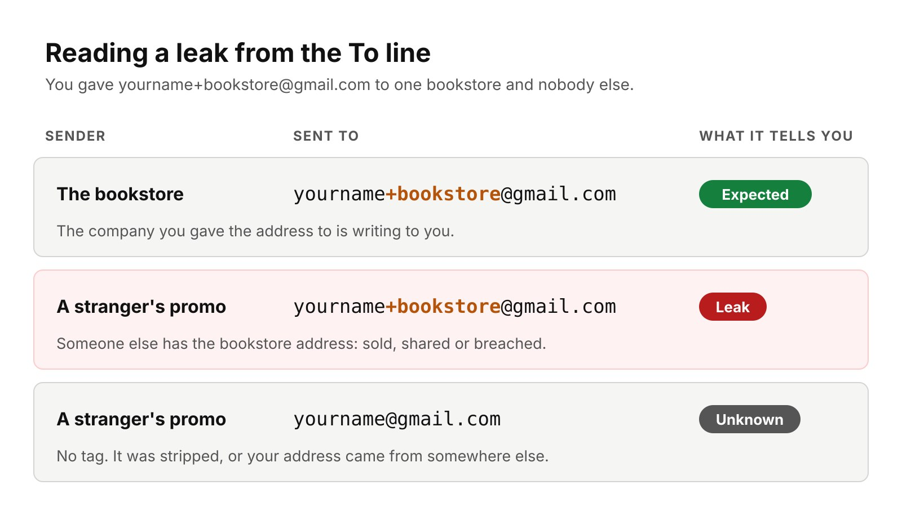

Gmail plus addressing lets you add a plus sign and any word after your username, such as `yourname+bookstore@gmail.com`, and still get the mail in your normal inbox. Give each company its own tag, and the To line of every email tells you which company your address came from. If a stranger writes to the tag you gave only one shop, that shop's list was shared, sold or breached.

I first saw the trick in a short reel from [NetworkChuck](https://www.youtube.com/@NetworkChuck "NetworkChuck, Chuck Keith's IT and networking channel on YouTube"), and wanted the full picture: where it works, where it fails, and what to use when it is not enough. I see email from the business side too. I built [InboxPilot, an AI agent that triages a café's inbox](/projects/inboxpilot "InboxPilot: an AI inbox agent with human approval"), and the CRM in the [VITE SEO ERP](/projects/vite-seo-erp "VITE SEO Digital Advertising ERP project") sends outreach from connected Gmail inboxes. This post is part of my [Technology and Business](/topics/tech-and-business "Technology and Business articles") writing.

## What is Gmail plus addressing?

Gmail plus addressing is a built-in way to create unlimited variations of one Gmail address. Google's [Workspace Learning Center](https://support.google.com/a/users/answer/9308648?hl=en "Google Workspace Learning Center: tips to optimize your Gmail inbox") puts it in one line: "Just add a plus sign (+) and any word before the @ sign in your current address." Every variation lands in the same inbox, and nothing needs to be set up first. Gmail's own [help page on aliases](https://support.google.com/mail/answer/22370?hl=en "Gmail Help: send emails from a different address or alias") gives a personal example, `janedoe+school@gmail.com`, as "an easy way to sort your email."

*Everything between the plus sign and the @ is the tag. Diagram: urielpapa.com.*

The idea is older than Gmail's help pages. The email standards call it subaddressing. [RFC 5233](https://www.rfc-editor.org/rfc/rfc5233 "RFC 5233: Sieve Email Filtering, Subaddress Extension"), published in January 2008, splits the part before the @ into a "user" and a "detail," joined by a separator such as "+". Its own example is `ken+sieve@example.org`. So plus addressing is a convention many mail servers follow, not a Gmail-only hack.

## How do you use plus addressing to find out who shared your email?

Plus addressing works as a leak detector when every company gets a tag that no one else has. The method takes a few seconds per sign-up:

1. **Pick a tag per company.** Use the company or site name, for example `yourname+bookstore@gmail.com` for one online bookstore.
2. **Use it only there.** Never reuse that tag for another sign-up, form or contest.
3. **Check the To line.** When an email arrives, look at which address it was sent to, not only who sent it.
4. **Compare sender and tag.** Mail from the bookstore to +bookstore is expected. Mail from anyone else to +bookstore means the address left the bookstore.

*The tag tells you where an address came from. Diagram: urielpapa.com.*

A tag shows where your address went, not why. A company may have sold its list, shared it with a partner, or lost it in a breach. When the [SEC confirmed a data breach in November 2026](/news/sec-data-breach-bir-probe "SEC confirms a data breach as the BIR probes leak claims"), its notice listed email addresses among the data that may have been exposed. A tagged address is how you would know which later scam emails came from that list.

## How do you sort plus-addressed mail with Gmail filters?

Gmail filters turn tags into automatic folders. Google's [Learning Center](https://support.google.com/a/users/answer/9308648?hl=en "Google Workspace Learning Center: create task-specific email addresses and filters") describes the steps: open the search options in Gmail's search bar, enter the tagged address under **To**, click **Create filter**, choose the actions, and save. A filter can apply a label, skip the inbox, mark mail as read or delete it.

A few tags I would set up for a small business owner:

- **+receipts** for online purchases, labeled and archived for bookkeeping.
- **+news** for newsletters, kept out of the inbox and read once a week.
- **+suppliers** for vendor portals, so supplier mail is never buried.
- **+urgent** for a short list of people who need you fast, which Google itself suggests.

Other providers can do this with no filter at all. [Fastmail](https://www.fastmail.help/hc/en-us/articles/360060591053-Plus-addressing-and-subdomain-addressing "Fastmail Help: plus addressing and subdomain addressing") files mail sent to alias+hiking into a folder named Hiking automatically, if the folder exists. The point is the same: the tag does the sorting, and the inbox stays for mail that needs a reply.

## Which email providers support plus addressing?

Plus addressing works with most large providers, but not all of them. The table sums up what each provider's documentation or a dated report says, as of November 2026:

| Provider | Plus addressing | Notes |
| --- | --- | --- |
| Gmail (personal) | Yes | Works with no setup; dots are also ignored |
| Google Workspace | Yes | Same as Gmail; dots do change the address |
| Outlook.com | Yes | Works automatically |
| Microsoft 365 (Exchange Online) | Yes, on by default | Admins can turn it off; receive only |
| iCloud Mail | Yes | Mail arrives in the regular inbox |
| Proton Mail | Yes | Unlimited variations, no setup |
| Fastmail | Yes | Also offers subdomain addressing |
| Yahoo Mail | No | Uses nickname-keyword disposable addresses |

Microsoft's [Exchange Online documentation](https://learn.microsoft.com/en-us/exchange/recipients-in-exchange-online/plus-addressing-in-exchange-online "Microsoft Learn: plus addressing in Exchange Online") says plus addressing is on by default, that admins can switch it off, and that users "can't send mail from plus addresses." [Office Watch](https://office-watch.com/2023/check-plus-addressing-your-email/ "Office Watch: check plus addressing for your email") confirms it works automatically in Outlook.com and that Yahoo has no plus addresses. [MacMost](https://macmost.com/take-control-of-your-email-with-icloud-plus-addressing.html "MacMost: take control of your email with iCloud plus addressing") covers iCloud Mail, and [Proton's support page](https://proton.me/support/addresses-and-aliases "Proton Support: email addresses and aliases") says plus aliases need no setup. Yahoo's alternative is its [disposable addresses](https://help.yahoo.com/kb/SLN28815.html "Yahoo Help: disposable email addresses in Yahoo Mail"), written as `nickname-keyword@yahoo.com`, with up to 500 for Yahoo Mail Plus subscribers.

## What are the limits of plus addressing?

Plus addressing has five real limits, and the first one matters most:

1. **Anyone can strip the tag.** The base address sits in plain sight before the plus sign. [Privacy Guides](https://privacyguides.org/en/email-aliasing "Privacy Guides: email aliasing services") warns that websites, advertisers and tracking networks "can trivially remove anything after the + sign." The [UID2 normalization rules](https://unifiedid.com/docs/getting-started/gs-normalization-encoding "UID2 documentation: normalization and encoding") used in ad tech say exactly that for gmail.com: remove the plus sign "and all subsequent characters" before matching.
2. **Some sign-up forms reject it.** A plus sign is valid in an email address, but badly written form checks still refuse it. The [Opquast web quality checklist](https://checklists.opquast.com/en/web-quality-assurance/the-website-accepts-email-aliases-containing-the-sign "Opquast rule 24: the website accepts email aliases containing the + sign") has a rule for this, rule 24, which suggests the problem is common.
3. **You can't switch a tag off.** Google says every variation arrives in your inbox. A filter can delete mail sent to a leaked tag, but the address keeps working.
4. **An untagged spam email proves nothing.** If the tag was stripped, you only know your address leaked somewhere.
5. **You usually can't send from it.** Microsoft's documentation says plus addresses in Exchange Online are receive only.

So plus addressing catches careless leaks well, such as a shop that sells its list as is. It does not stop a determined spammer, and it does not hide your real address.

## What are the alternatives to plus addressing?

Email alias services fix the biggest weakness of plus addressing: the alias has no visible link to your real address, and you can turn it off. Each alias forwards to your inbox, and a leaked one can be deleted without changing anything else. As of November 2026:

| Service | Free tier | Notes |
| --- | --- | --- |
| Apple Hide My Email | None; needs iCloud+ | As many addresses as you need |
| SimpleLogin (Proton) | 10 aliases | Premium costs US$36 a year or US$4 a month |
| Firefox Relay | 5 email masks | Premium adds unlimited masks and replies |
| DuckDuckGo Email Protection | Free | Also removes hidden email trackers |
| addy.io | 10 shared-domain aliases | Recommended by Privacy Guides |

[Apple's Hide My Email](https://support.apple.com/guide/icloud/what-you-can-do-with-icloud-and-hide-my-email-mme38e1602db/icloud "Apple Support: create unique, random email addresses with Hide My Email and iCloud+") creates random addresses and lets you deactivate or delete them. [SimpleLogin's pricing page](https://simplelogin.io/pricing/ "SimpleLogin pricing") lists the 10-alias free plan and the US$36 yearly Premium. Mozilla's [Relay Premium FAQ](https://support.mozilla.org/en-US/kb/firefox-relay-premium-faq/revision/255256 "Mozilla Support: Firefox Relay Premium FAQ") says free accounts can't create new masks above 5. [DuckDuckGo](https://duckduckgo.com/duckduckgo-help-pages/email-protection "DuckDuckGo Help: Email Protection") calls its service "a free email forwarding service" that also removes hidden email trackers. Privacy Guides recommends addy.io and SimpleLogin.

My rule of thumb: use plus tags for low-risk sign-ups and sorting, and use an alias for anything that asks for your email address but does not need your real one.

## What should businesses do about plus addresses?

Businesses should accept plus addresses in every form and keep them as typed. A customer who signs up with a tag is telling you how they manage their inbox, and blocking the plus sign only loses you that sign-up. Opquast's rule gives the reason plainly: accepting tags lets users "trace the spread of their email addresses" and strengthens their confidence in how you handle data.

Three habits follow from that:

- **Fix the form check.** Test your sign-up, checkout and contact forms with a plus address. If one rejects it, the check is wrong, not the customer.
- **Store the address exactly.** Send to the tagged address the customer gave you, so their filters keep working. If you need to spot duplicate accounts, compare a normalized copy in a separate field.
- **Protect the list.** A tagged address makes a leak traceable to you. If customers see spam arrive at the tag they gave your shop, they will know where it came from.

That last point is the useful one for founders. Plus addressing gives customers a cheap way to check how a business treats their data, so the safest response is to deserve their trust.
