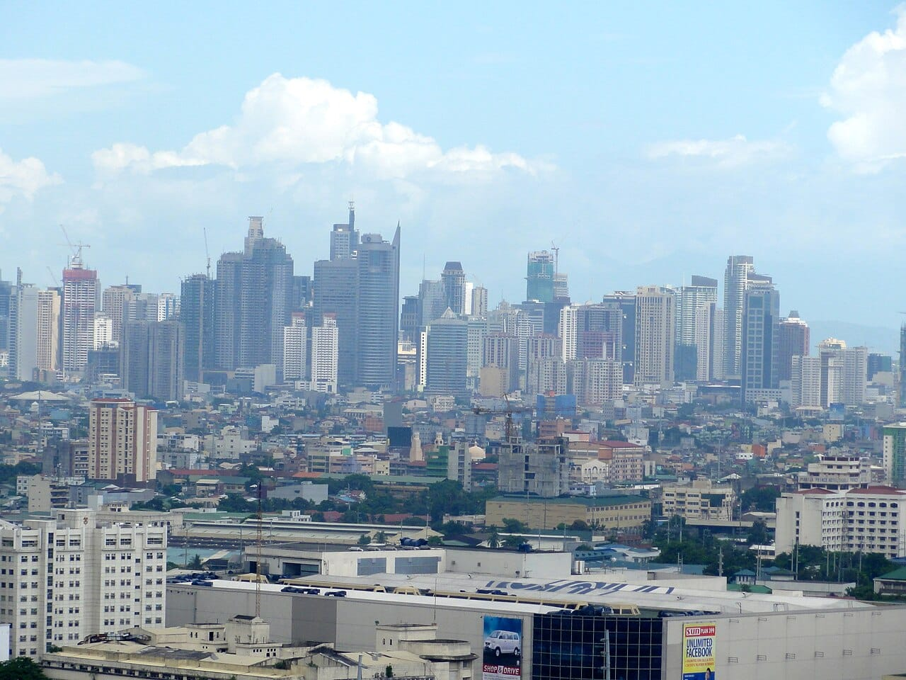
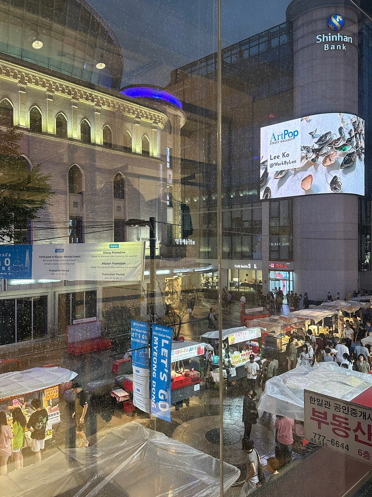
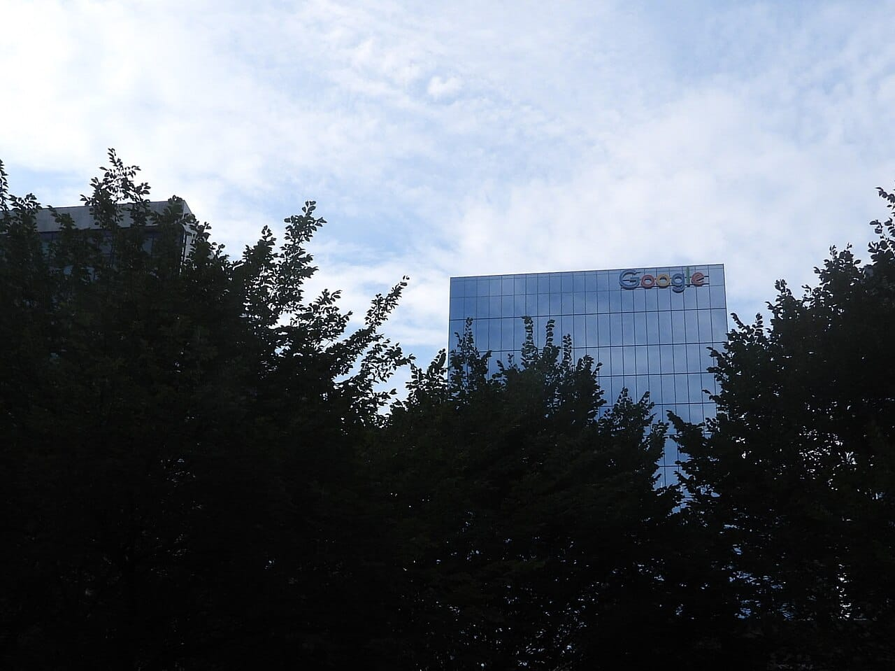

Google now shows ads inside AI Mode in the Philippines. On October 28, 2026, Google expanded ads in AI Mode to 10 countries, and existing Search, Shopping and Performance Max campaigns can appear there automatically, with no separate opt-out.

This take is part of my [Marketing](/topics/marketing) writing.

## What happened?

Google announced the expansion in [Ads in AI Mode expand to new markets](https://blog.google/products/ads-commerce/ads-in-ai-mode-global/), written by Shashi Thakur, Google's VP and GM of Search Ads. Ads in AI Mode now reach Australia, Canada, India, Kenya, Malaysia, New Zealand, Nigeria, Pakistan, the Philippines and Singapore. Google plans more locales in Q4 2026, including Brazil, Mexico and the United Kingdom.

*Ads in Google's AI Mode now reach searchers in the Philippines, including the business districts of Metro Manila. Photo: [Patrick Roque](https://commons.wikimedia.org/wiki/File:Makati_Skyline_as_of_June_2015.jpg "Patrick Roque's photo on Wikimedia Commons"), [CC BY-SA 3.0](https://creativecommons.org/licenses/by-sa/3.0/ "Creative Commons Attribution-ShareAlike 3.0 license").*

Google also launched multiturn ads in the US only, which can appear in follow-up questions inside an AI Mode conversation. Ads in AI Mode are labeled "Sponsored."

## What changed for advertisers?

These points come from [Google Ads Help on ads in AI-powered experiences](https://support.google.com/google-ads/answer/18826097):

* **No new campaign needed.** Existing Search, Shopping and Performance Max campaigns enter the AI Mode auction when relevant, with no separate budget.
* **No separate opt-out.** Google says you "can't target ads exclusively to AI Overviews or AI Mode, or opt out of showing ads in them separately from Search."
* **Your guardrails still apply.** Negative keywords, asset pinning and brand exclusions keep working.
* **Broad matching reaches further.** AI Max, broad match, Shopping and Performance Max can match contextual queries. Exact and phrase match only match queries with direct commercial intent.
* **Reporting is combined.** AI Mode results are included in aggregate in standard campaign reports and in the search terms report.
* **English only.** Ads in AI Overviews and AI Mode run in English in the US and select English-speaking markets.

*Ads in AI Mode work like other Google search ads: negative keywords and brand exclusions are the controls. Photo: [Leeko.archive](https://commons.wikimedia.org/wiki/File:Lee_Ko_%E2%80%93_A_Way_Coming_Back_digital_billboard_display,_Myeongdong,_Seoul,_South_Korea.jpg "Leeko.archive's photo on Wikimedia Commons"), [CC BY-SA 4.0](https://creativecommons.org/licenses/by-sa/4.0/ "Creative Commons Attribution-ShareAlike 4.0 license").*

Google also says AI Mode queries are on average three times longer than traditional searches, based on its US data from May 2026.

## What does it mean for businesses in the Philippines?

If you run Google Ads here, some of your budget can now go to clicks inside AI Mode answers, even though you never chose that placement. Longer, conversational queries are exactly where broad match tends to spend on searches that do not fit your business.

*There is no separate switch to opt out of AI Mode placements. Photo: [Wiki.cullin](https://commons.wikimedia.org/wiki/File:Google_office_building_in_Toronto_framed_by_trees.jpg "Wiki.cullin's photo on Wikimedia Commons"), [CC0](https://creativecommons.org/publicdomain/zero/1.0/ "Creative Commons CC0 1.0 public domain dedication").*

The other side is organic. In [my take on more links in AI Mode](/news/google-ai-mode-ai-overviews-more-links), sources gained space in AI answers. Now paid results compete for that same space, which makes the choice between [organic content and paid ads](/blog/organic-content-vs-paid-ads) a little more about where each one shows up.

## What should you do now?

* **Read your search terms report weekly** for the next month, and look for long, question-style queries.
* **Add negative keywords** for questions your business cannot answer or sell to.
* **Check brand exclusions** if you run Performance Max or AI Max.
* **Prefer exact and phrase match** for tight budgets, since they only match direct commercial intent.

## Where can you learn more?

- [Google's announcement](https://blog.google/products/ads-commerce/ads-in-ai-mode-global/) - The 10 countries, multiturn ads and Google's data on AI Mode queries.
- [Google Ads Help on ads in AI-powered experiences](https://support.google.com/google-ads/answer/18826097) - Eligible campaigns, controls and how reporting works.
- [Google Adds More Links to AI Mode and AI Overviews](/news/google-ai-mode-ai-overviews-more-links) - My take on how AI Mode treats organic sources.
