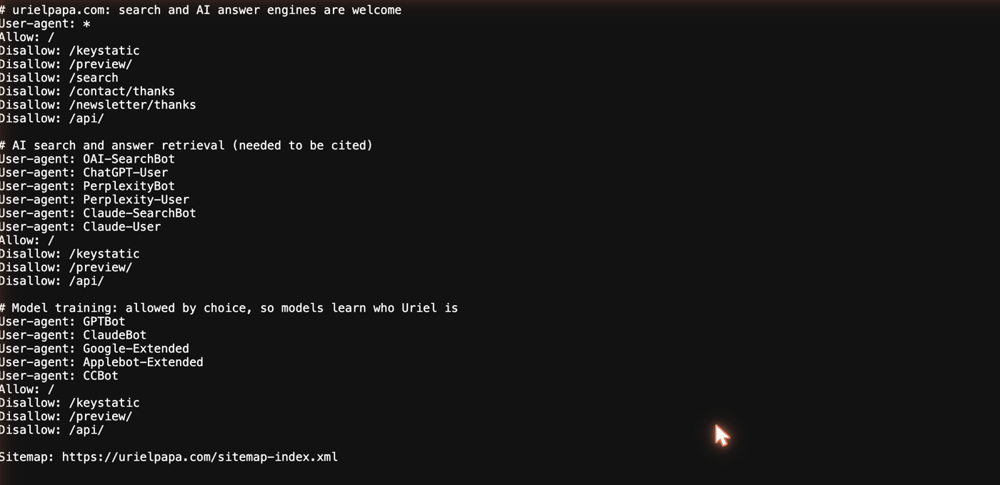
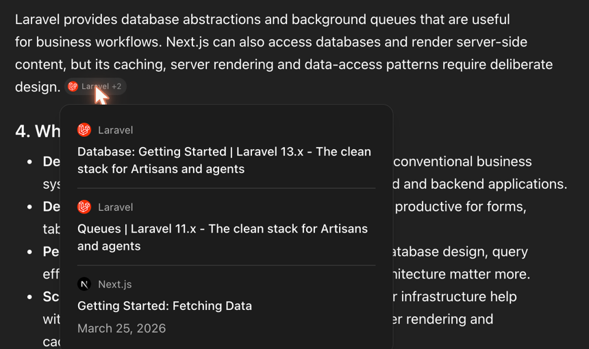
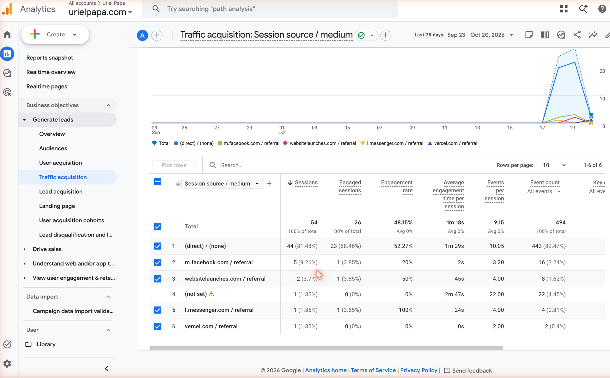

To check whether ChatGPT cites your site, ask it the questions your pages answer with web search on and look at the sources it lists, then confirm in your analytics, because ChatGPT tags the links it sends with `utm_source=chatgpt.com`. Before either check means anything, make sure your robots.txt lets OAI-SearchBot fetch your pages.

This guide is part of my [SEO, GEO and AEO](/topics/seo-geo-aeo) writing. I use these same checks on urielpapa.com, which is set up for AI search as described in [GEO and AEO fundamentals](/blog/geo-and-aeo-fundamentals).

## Can ChatGPT see your site at all?

ChatGPT search finds pages with its own crawler, OAI-SearchBot. OpenAI's [crawler documentation](https://developers.openai.com/docs/bots) says sites that block OAI-SearchBot "will not be shown in ChatGPT search answers", and that a robots.txt change can take about 24 hours to take effect. OpenAI runs two other bots with separate settings:

| Bot | What it does | Affects ChatGPT search? |
| --- | --- | --- |
| OAI-SearchBot | Finds pages to show and cite in ChatGPT search | Yes |
| ChatGPT-User | Visits a page when a user asks ChatGPT about it | No |
| GPTBot | Crawls content that may be used to train OpenAI's models | No |

So you can block GPTBot to opt out of training and still allow OAI-SearchBot to be cited. Open `yoursite.com/robots.txt` and check that no rule disallows OAI-SearchBot, or disallows every bot with `User-agent: *`. Also check your CDN or firewall, because some have their own AI bot blocking that overrides robots.txt.

On urielpapa.com, robots.txt allows OAI-SearchBot and ChatGPT-User on every public page. I allow GPTBot too, because I want models to learn who I am.

*urielpapa.com/robots.txt on 21 October 2026.*

I also searched my Vercel request logs for OAI-SearchBot over the last two weeks and found nothing. That told me nothing about the bot, because the same logs showed no requests of any kind for the previous day while GA4 recorded real visitors. Before you trust an empty search, check that your logs show normal traffic.

## How do you test whether ChatGPT cites you?

Ask ChatGPT the questions your pages already answer and look at the sources under each answer. A simple routine:

1. **List 10 to 20 questions** your pages answer, in the words a reader would use, not your page titles.
2. **Make sure the answer uses web search.** Answers that searched the web show their sources; an answer from the model's memory has none to check.
3. **Note every source** for each question: whether your site is cited, which page, and which other sites are cited instead.
4. **Repeat on the same day each month** with the same questions, so the results are comparable.

Answers change from one run to the next, so one missing citation means little. A question where you are never cited across several months is the signal to act on.

I ran this for urielpapa.com on 21 October 2026, logged out of ChatGPT with web search on, and asked each question twice:

| Question | My page that answers it | urielpapa.com cited? | What ChatGPT cited instead |
| --- | --- | --- | --- |
| Who is Uriel Papa? | [About](/about) | No | My old agency's website, and a TechBehemoths listing |
| Laravel vs Next.js for a business system | [Laravel vs Next.js](/blog/laravel-vs-nextjs) | No | The official Laravel and Next.js docs |
| How do I build an AI chatbot for Messenger and Instagram with n8n and OpenRouter? | [My n8n chatbot build](/blog/n8n-messenger-instagram-chatbot) | No | n8n, OpenRouter and Meta for Developers docs |
| What are GEO and AEO, and how do I get my pages cited by AI search? | [GEO and AEO fundamentals](/blog/geo-and-aeo-fundamentals) | No | Google Search Central, OpenAI and Perplexity docs, and arXiv |

Zero of four, which I expected: the site had only had visitors for four days. The sources also changed between the two runs of the same question, which is why one run is only a sample.

The useful finding was the first question. ChatGPT knew who I was, but it described me through [the agency I ran](/blog/closing-my-agency) and cited that agency's website, not this one. So the name is already known; my job is to connect it to urielpapa.com.

*"Who is Uriel Papa?": the answer cites my old agency's site, not urielpapa.com.*

*"Laravel vs Next.js for a business system": every source is official documentation.*

## How do you see ChatGPT visits in Google Analytics?

OpenAI's [publisher FAQ](https://help.openai.com/en/articles/12627856-publishers-and-developers-faq) says ChatGPT "automatically includes the UTM parameter utm_source=chatgpt.com in referral URLs", so its visits appear as their own source. In GA4:

1. Open **Reports**, then **Acquisition**, then **Traffic acquisition**.
2. Change the table's dimension to **Session source / medium**.
3. Search the table for `chatgpt.com`.

The landing pages for that source are the pages ChatGPT sent people to. To see every AI assistant in one row, create a custom channel group with a rule that matches sources such as `chatgpt.com`, `perplexity.ai`, `copilot.microsoft.com`, `gemini.google.com` and `claude.ai`.

Referral data only shows citations people clicked. ChatGPT can cite a page many times without a visit, so a low number does not mean you are never cited.

For urielpapa.com the answer so far is zero. From 23 September to 20 October 2026 the site had 54 sessions from six sources: 44 direct, 5 from Facebook, 2 from websitelaunches.com, and one each from Messenger, Vercel and an unknown source. Filtering the table for "chatgpt" returns nothing. Zero is my baseline, and the first chatgpt.com row will be easy to spot.

*GA4 Traffic acquisition by session source / medium, 23 September to 20 October 2026.*

## What do Google and Bing report about AI answers?

Neither report covers ChatGPT, but both show whether AI answers in their own products use your pages:

* **Google Search Console** has a [Generative AI performance report](https://support.google.com/webmasters/answer/16984139) that counts impressions of your links in AI Overviews and AI Mode, by page, country, device and date. Google says it rolled the report out to all websites by August 31, 2026.
* **Bing Webmaster Tools** added [AI Performance](https://blogs.bing.com/webmaster/February-2026/Introducing-AI-Performance-in-Bing-Webmaster-Tools-Public-Preview) as a public preview on February 10, 2026. It shows how often your pages are cited in Microsoft Copilot and AI summaries in Bing, which pages are cited, and a sample of the grounding queries that led to them.

Bing's report is the closest thing to a citation report today, and a page that Copilot cites is often worth testing in ChatGPT too.

## How often should you check?

Once a month is enough for most sites. A monthly rhythm gives Search Console, Bing and GA4 enough data to compare from one check to the next. Check sooner after a big change, such as a new robots.txt rule or a rewritten page.

Treat citations like rankings: a signal to watch over time, not a number to chase every day. Organic work is slow to show results, as I found comparing [organic content and paid ads](/blog/organic-content-vs-paid-ads), and I expect AI citations to build just as slowly.

If a page on urielpapa.com is still never cited after three months, I'll first rule out access: no firewall rule challenging bots, the page in the sitemap, and indexed in Bing. Then I'll rewrite its opening to answer the exact question in two or three sentences and lead with what only I have, because my Laravel vs Next.js test showed that a generic comparison loses to the official docs.

*Screenshots are from my own ChatGPT and Google Analytics sessions, taken on 21 October 2026. ChatGPT is a trademark of OpenAI. Google Analytics is a trademark of Google LLC. This post is not endorsed by or affiliated with OpenAI or Google.*
