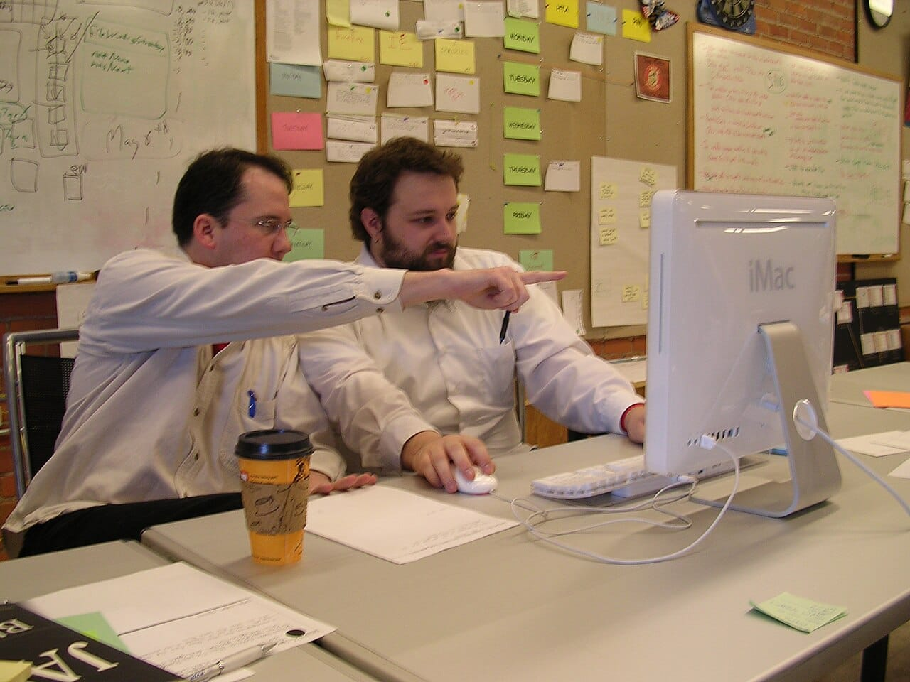

An IDE (integrated development environment) is where you write, run and debug code yourself, with AI as a helper. An ADE (agentic development environment) is where you hand tasks to AI coding agents and review what they return. In late 2026 the best IDEs are still Cursor, Google Antigravity and VS Code. A new group of ADEs, including T3 Code, Herdr and Orca, is built for the agent-first half of the job.

I write about this as part of my [AI, in Depth](/topics/ai "AI, in Depth: Uriel Papa's articles on AI") series because it is how I build now. I use Cursor for quick edits and run a multi-agent Claude Code pipeline that audits a production codebase in under 6 minutes. Now I am testing T3 Code (beta), Herdr and Orca to see what belongs in my workflow.

## What is the difference between an IDE and an ADE?

The difference between an IDE and an ADE is the unit of work. An IDE is organized around files: you open one, type, run it and fix it. An ADE is organized around tasks: you describe one, an agent works on it in its own copy of the repo, and you judge it. Paradev's guide puts it in one line: ["An IDE helps you write code. An ADE helps you manage agents that write code."](https://paradev.com/compare/what-is-an-agent-development-environment "Paradev's explainer: what is an agent development environment")

| | IDE | ADE |
| --- | --- | --- |
| Unit of work | A file or project | A task, agent session or workspace |
| Who types the code | Mostly you, with AI suggestions | Mostly the agent |
| What you watch | The code you are writing | Agent status: working, blocked or done |
| Parallel work | More windows or branches by hand | One Git worktree or sandbox per task |
| Where the work ends | A saved file and a commit | A diff, branch or pull request to review |
| Examples (Nov 2026) | Cursor, Antigravity Editor View, VS Code | T3 Code, Herdr, Orca, Antigravity Manager |

*Pair programming in an IDE: one screen, one file, a human at the keyboard. Photo: [Lisamarie Babik](https://commons.wikimedia.org/wiki/File:Pair_programming_1.jpg "Lisamarie Babik's photo on Wikimedia Commons"), [CC BY 2.0](https://creativecommons.org/licenses/by/2.0/ "Creative Commons Attribution 2.0 license").*

The line between the two keeps moving, because the IDEs are adding agent panels and the ADEs are adding editors. The table still works as a test. A screen built around a file is an IDE, and a screen built around a queue of agent tasks is an ADE.

## Where did the term "agentic development environment" come from?

The term "agentic development environment" was put on the map by Warp. On June 24, 2025, Warp's CEO Zach Lloyd launched [Warp 2.0 as "the first Agentic Development Environment"](https://www.warp.dev/blog/reimagining-coding-agentic-development-environment "Warp's announcement of Warp 2.0 and the Agentic Development Environment"). Its complaint was that other tools "bolt agents onto code editors through chat panels and bury them in CLI apps." Warp's later explainer defines an ADE as a tool [built around AI coding agents "as first-class participants rather than as an add-on"](https://www.warp.dev/articles/what-is-an-agentic-development-environment "Warp's article: what is an agentic development environment").

No one owns the word yet. Paradev notes that "the term is still settling." An [AWS Builder Center article from October 2026](https://builder.aws.com/content/3KjlCGjgh5tKBuOPjrzee8lJ9sx/beyond-the-ide-understanding-the-agent-development-environment-ade "AWS Builder Center: understanding the agent development environment") says ADE can also stand for "agent development environment." Most vendors selling ADEs agree on the same core: isolated workspaces per task, agent status at a glance, and a review step before anything merges.

*An ADE feels closer to a control room than a writing desk: many things moving, one person deciding. Photo: [United States Federal Government](https://commons.wikimedia.org/wiki/File:Air_traffic_controllers_at_the_Washington_ARTCC.jpg "The photo of the Washington ARTCC on Wikimedia Commons"), public domain.*

A control room is a fair picture of the job. The controllers do not fly the planes, but every landing still depends on their judgment.

## Why are Cursor, Antigravity and VS Code still the best IDEs in 2026?

Cursor, Antigravity and VS Code are still the best IDEs in 2026 because each one now covers both halves. Each has a strong editor for hands-on work and an agent surface for delegated tasks. That matters, because an ADE still needs somewhere to read, debug and finish the code.

### Cursor

Cursor, made by Anysphere, added parallel agents early. [Cursor 2.0 in October 2025 ran multiple agents in parallel using git worktrees or remote machines](https://en.wikipedia.org/wiki/Cursor_(code_editor) "Wikipedia's article on the Cursor code editor and its history"). Its [release notes](https://cursor.com/docs/release-notes "Cursor's versioned release notes for the IDE, Agents Window and CLI") now list a separate Agents Window, at version 3.27 on October 22, 2026. The [Cursor changelog](https://cursor.com/changelog "Cursor's changelog of new features, newest first") added voice chat with agents on November 6, 2026, and cloud agents that build and host web apps on November 5. Cursor stays my editor for quick edits when I am not working in Claude Code.

### Google Antigravity

Google launched [Antigravity on November 18, 2025](https://antigravity.google/blog/introducing-google-antigravity "Google's introduction of Antigravity") with two surfaces. The [Editor View is "a state-of-the-art, AI-powered IDE"](https://developers.googleblog.com/en/build-with-google-antigravity-our-new-agentic-development-platform/ "Google Developers Blog: build with Google Antigravity"), and the Manager lets you "spawn, orchestrate, and observe" several agents. Agents report through Artifacts such as task lists, plans, screenshots and browser recordings. At I/O on May 19, 2026, [Google added a standalone desktop app, the Antigravity CLI and an SDK](https://blog.google/innovation-and-ai/technology/developers-tools/google-io-2026-developer-highlights/ "Google I/O 2026 developer highlights"). Higher limits came with a Google AI Ultra plan from $100.

Kevin Hou, who leads product engineering for Antigravity, walks through its editor, browser and Agent Manager in this AI Engineer talk:

<YouTube id="HN-F-OQe6j0" title="Defying Gravity - Kevin Hou, Google DeepMind" channel="AI Engineer" />

### VS Code

VS Code's [January 2026 release (version 1.109)](https://code.visualstudio.com/updates/v1_109 "VS Code January 2026 release notes, version 1.109") set the goal of making it "the home for multi-agent development." By July 2026, you could [start Copilot, Claude or Codex sessions in a Git worktree](https://github.blog/changelog/2026-07-30-github-copilot-in-visual-studio-code-july-2026-releases/ "GitHub Changelog: Copilot in VS Code, July 2026 releases"), each in an isolated copy of the repo. The [October 28, 2026 update](https://github.blog/changelog/2026-10-28-github-copilot-in-vs-code-universe-releases/ "GitHub Changelog: Copilot in VS Code, Universe releases") starts cloud agent sessions from the Agents window, so the work continues after you close your laptop.

All three are now IDEs with an ADE inside. That is why I do not see the new tools as replacements for them.

## Which ADEs am I testing, and what does each one do?

The three ADEs I am testing are T3 Code, Herdr and Orca. Each takes a different route to the same goal: one place to run the agents I already use. None of them sells tokens, so the question for me is workflow, not price. These are the facts from each project's own pages, checked on November 28, 2026. My verdicts come after more real work.

| Tool | Shape | License | Platforms | Agents |
| --- | --- | --- | --- | --- |
| T3 Code | Desktop and web app, plus a `t3` CLI | MIT | macOS, Windows, Linux, web, iOS, Android | Claude Code, Codex, Cursor, OpenCode, Antigravity and more |
| Herdr | Native app, terminal app (TUI) and herdr-core server | Apache 2.0 | macOS, Linux, Windows, iOS, Android | 23 agent CLIs with built-in status support |
| Orca | Desktop app with a CLI and mobile apps | MIT | macOS, Windows, Linux, iOS, Android | "Any CLI agent," including Claude Code and Codex |

### T3 Code

[T3 Code](https://github.com/pingdotgg/t3code "T3 Code's source code and README on GitHub") calls itself "the open-source control plane for coding agents." It comes from Theo's team at T3, and the desktop app is labeled T3 Code (Beta). It runs the agents on your machine behind one interface, and each thread can work in its own worktree. You review the diff, then commit, push and open a pull request with one button. I am checking whether switching between Claude Code and Codex in one thread beats keeping two terminals open.

### Herdr

[Herdr](https://herdr.dev/ "Herdr, a native app for running coding agents") calls itself "a native app for running coding agents." The original [Herdr TUI](https://herdr.dev/tui/ "Herdr TUI, the terminal runtime for coding agents") is "the runtime your coding agents live on." Agents run in a background server, so closing the window does not stop them. The sidebar shows each agent as working, done or blocked, and it can reach other machines over SSH. Its [agent docs](https://herdr.dev/tui/docs/agents/ "Herdr's list of supported coding agents") list 23 agent CLIs, from Claude Code and Codex to Gemini CLI. I am checking whether persistent sessions change how long I can leave agents alone.

### Orca

[Orca](https://github.com/stablyai/orca "Orca's source code and README on GitHub") lets you "run a fleet of coding agents" with your own subscription, each in its own worktree. Its README lists diff review with notes on exact changed lines, and an orchestration mode where one agent splits a task and starts workers. It also has a browser design mode and mobile apps that notify you when an agent needs input. I am checking whether line-level review notes make agent output faster to accept or reject.

## How does the shift from IDE to ADE affect programmers?

The shift from IDE to ADE changes a programmer's main job from typing code to specifying, supervising and reviewing it. Adoption is already high. In the [Stack Overflow 2025 Developer Survey](https://survey.stackoverflow.co/2025/ai "Stack Overflow 2025 Developer Survey, AI section"), 84% of respondents used or planned to use AI tools. Trust is lower: 46% distrusted the accuracy of AI output, against 33% who trusted it.

*In an ADE the programmer moves from playing to conducting. Photo: [Jonathan Harker](https://commons.wikimedia.org/wiki/File:Tecwyn_Evans_rehearsing_the_Dunedin_Symphony_Orchestra,_April_2016.jpg "Jonathan Harker's photo on Wikimedia Commons"), [CC BY-SA 4.0](https://creativecommons.org/licenses/by-sa/4.0/ "Creative Commons Attribution-ShareAlike 4.0 license").*

That trust gap is the real cost. [Stack Overflow's own write-up](https://stackoverflow.blog/2025/07/29/developers-remain-willing-but-reluctant-to-use-ai-the-2025-developer-survey-results-are-here "Stack Overflow blog: 2025 Developer Survey results on AI") names the top frustration, cited by 45%: AI answers that are "almost right, but not quite." Speed is not guaranteed either. In [METR's July 2025 study](https://metr.org/blog/2025-07-10-early-2025-ai-experienced-os-dev-study/ "METR's study of AI and experienced open-source developers"), 16 experienced developers took 19% longer with AI tools, while believing they were 20% faster. METR now marks those results as out of date, but the lesson about measuring instead of guessing still holds.

Three skills grow in value as agents write more of the code:

1. **Writing specs.** An agent follows the task you write. I built [Zeke](/projects/zeke "Zeke, an open-source update and security center for macOS") by directing agents against a written spec with numbered acceptance checks.
2. **Reviewing diffs.** Reading code fast and spotting the "almost right" line is now the bottleneck, not typing.
3. **Setting limits.** Permissions, sandboxes and budgets matter more when five agents run at once. My guide to the [skills an agentic AI engineer needs](/blog/agentic-ai-engineer-skills "The 12 skills an agentic AI engineer needs in 2026") covers these.

The programmers who gain the most will be the ones who can judge code quickly, not only produce it.

## Which should you choose, an IDE or an ADE?

The choice between an IDE and an ADE depends on how much of your work you can describe as separate tasks. Most programmers will end up with both, so the better question is which one sits at the center of your day.

- **You are learning to code:** stay in an IDE such as VS Code. Writing code by hand is how you learn to review it later.
- **You work on one feature at a time:** Cursor or VS Code with agent mode is enough. A separate ADE adds tabs without saving time.
- **You run two or more agents in parallel:** try an ADE. Orca and T3 Code both give each task its own worktree, which stops agents from editing the same files.
- **You leave agents running for hours or on a remote box:** Herdr's background server and SSH support are built for that.
- **You want one vendor for both halves:** Antigravity pairs an editor with a Manager, and Google optimizes its SDK for Gemini models.

My own setup stays IDE-first for now: Cursor, Antigravity or VS Code for reading and finishing code, with one ADE on trial next to it. If an ADE saves me review time on real work, it earns the center of the screen.

## Where can you learn more?

- [Augment Code's guide to agentic IDEs vs ADEs](https://www.augmentcode.com/guides/agentic-ide-vs-agentic-development-environment "Augment Code: agentic IDE vs agentic development environment") - a side-by-side table of how the two handle orchestration, isolation and review, from a vendor that sells an ADE.
- [Flavio Copes' deep dive into T3 Code](https://flaviocopes.com/t3-code "Flavio Copes: a deep dive into T3 Code") - a long, current walkthrough of T3 Code's providers, worktrees, diff scopes and remote access.
- [Orca's documentation](https://orca.dev "Orca's website and documentation") - setup guides for worktrees, orchestration, diff review and the mobile app.
- [The best open-source Claude Code skills and plugins](/blog/best-claude-code-skills-plugins-github "The best open-source Claude Code skills and plugins on GitHub") - my review of five free repos that change how Claude Code plans and builds, whichever environment you run it in.
