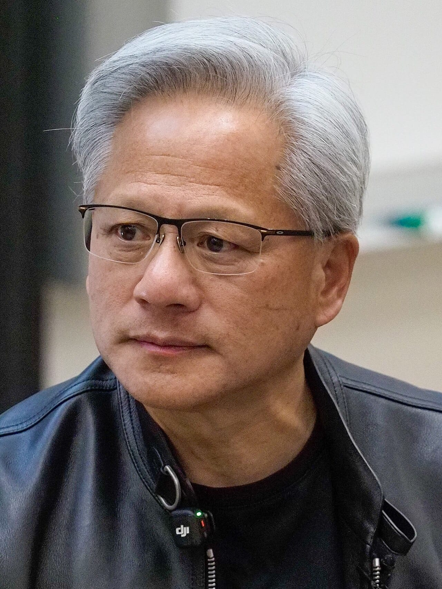
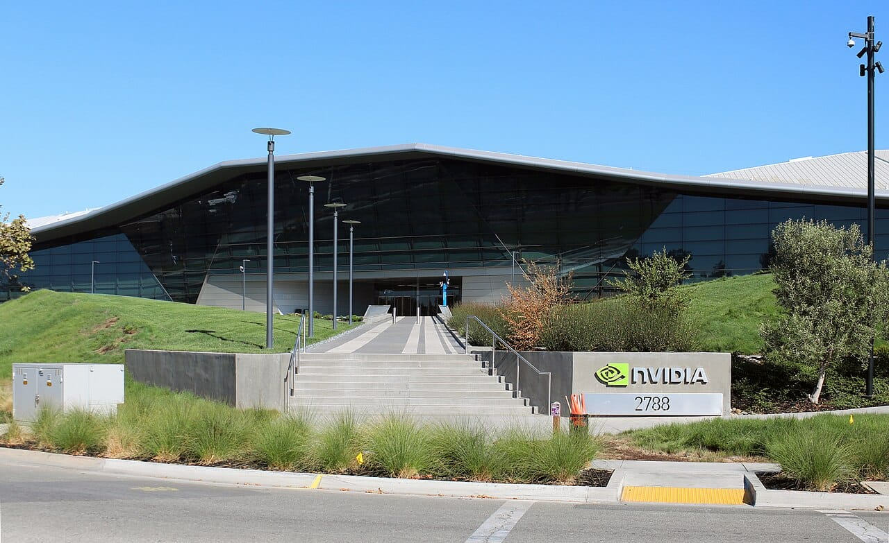

Jensen Huang has resigned as president, CEO and board member of Nvidia, effective immediately, the company announced on November 12, 2026. CFO Colette Kress is interim CEO, and the board is searching for a permanent replacement. Huang co-founded Nvidia, whose chips run most of the AI tools small businesses now use.

This take is part of my [Technology and Business](/topics/tech-and-business "Technology and Business articles") writing. It follows my posts on [the board's investigation into Huang](/news/nvidia-board-investigation-jensen-huang "Nvidia's board opens an independent investigation into Jensen Huang") and on [why Nvidia stock fell after that probe](/blog/why-nvidia-stock-fell-huang-investigation "Why Nvidia stock fell after its board opened a probe into Jensen Huang").

## What happened?

Nvidia published a release titled [NVIDIA Announces CEO Transition](https://nvidianews.nvidia.com/news/nvidia-announces-ceo-transition "Nvidia's press release announcing the CEO transition") on Thursday. Its [Form 8-K filed with the SEC](https://www.sec.gov/Archives/edgar/data/0001045810/000104581026000082/nvda-20261111.htm "Nvidia's Form 8-K on Jensen Huang's resignation, on SEC EDGAR") says the board accepted the resignation on November 11. Neither document gives a reason.

Nvidia's newsroom shared the release on X:

<SocialPost platform="x" url="https://x.com/nvidianewsroom/status/2120876571829662014" author="NVIDIA Newsroom" handle="nvidianewsroom" date="2026-11-12" text={"NVIDIA announces CEO transition. Read the release: https://nvidianews.nvidia.com/news/nvidia-announces-ceo-transition"} card={{"url":"https://nvidianews.nvidia.com/news/nvidia-announces-ceo-transition","title":"NVIDIA Announces CEO Transition","description":"NVIDIA (NASDAQ: NVDA) Board of Directors announced today that Jensen Huang has resigned as President, Chief Executive Officer, and a member of the Board, effective immediately.","domain":"nvidianews.nvidia.com","image":"https://pbs.twimg.com/card_img/2119872572158521345/yQwi9uUg?format=jpg&name=600x600","imageAlt":"The Nvidia logo, a green eye-shaped symbol above the word NVIDIA in white, on a black background"}} />

The resignation came four days after the board [opened an independent investigation](https://nvidianews.nvidia.com/news/statement-from-nvidia-board-of-directors "Nvidia's board statement on the independent investigation") into reports that Huang was the target of a foreign intelligence effort. The same day, Nvidia published [Huang's memo to employees](https://nvidianews.nvidia.com/news/a-message-to-our-company "Jensen Huang's message to Nvidia employees"), in which he admits an affair without naming the woman: "I was unfaithful to my wife."

*Jensen Huang co-founded Nvidia and ran it until his resignation on November 12, 2026. Photo: [Anderseidesvik](https://commons.wikimedia.org/wiki/File:Jensen_Huang_Stanford_2026-04-30_010_%28cropped%29.jpg "Anderseidesvik's photo on Wikimedia Commons"), [CC BY-SA 4.0](https://creativecommons.org/licenses/by-sa/4.0/ "Creative Commons Attribution-ShareAlike 4.0 license").*

## What changed, in plain words?

Nvidia now has a temporary leader and, for the first time, a separate board chair. Here is what the filing and the reporting say.

- **Interim CEO:** Colette Kress, CFO since 2013, runs the company and keeps the CFO job until a permanent CEO is named.
- **Board chair:** Harvey C. Jones, a director since 1993 and former Synopsys CEO, is Nvidia's first-ever chair. He says the board "has full confidence in Colette and the leadership team."
- **The allegations:** The New York Times reported in October that US officials see Alice Huang, a former Megaspeed executive, as a Chinese intelligence asset. [CBS News](https://www.cbsnews.com/news/nvidia-jensen-huang-investigation-china-intelligence/ "CBS News report on the Nvidia investigation") reports that China calls the claims baseless. Nothing has been proven.
- **The final days:** [Yahoo Finance's live coverage](https://finance.yahoo.com/technology/live/nvidia-live-updates-jensen-huang-resigns-cfo-colette-kress-to-serve-as-interim-ceo-140341430.html "Yahoo Finance live updates on Jensen Huang's resignation") says the Times reported a second relationship, with an Nvidia executive who reported to Huang, and the Wall Street Journal reported the board was preparing to oust him.
- **The stock:** [The San Francisco Standard](https://sfstandard.com/2026/11/12/nvidia-shares-tumble-as-wall-street-reacts-huang-s-exit/ "The San Francisco Standard on Nvidia shares after Huang's exit") reports shares fell as much as 14% on Thursday morning, then recovered to about US$166.

*Nvidia says work at its Santa Clara headquarters and its product roadmap continue without interruption. Photo: [Coolcaesar](https://commons.wikimedia.org/wiki/File:NVIDIA_Headquarters.jpg "Coolcaesar's photo on Wikimedia Commons"), [CC BY-SA 4.0](https://creativecommons.org/licenses/by-sa/4.0/ "Creative Commons Attribution-ShareAlike 4.0 license").*

## What does it mean for small businesses and founders?

My read is that this is a leadership story, not a product story. Nvidia says customer commitments and the product roadmap continue without interruption. ChatGPT, Claude, Gemini and the cloud servers behind them keep working.

The bigger lesson is for founders. Nvidia was built around its co-founder, and it changed leaders in four days. Most Philippine small businesses depend on their founder even more, with no board and no CFO ready to step in.

## What should you do now?

1. **Don't react to headlines.** No product, price or delivery change has been announced.
2. **Watch November 17.** Nvidia reports quarterly results that day, its first under Kress.
3. **Write down who runs your business if you can't.** Name a person, list the logins and payments they would need, and tell them.
4. **Keep a second AI option.** Make sure another tool could take over your most important AI task.

## Where can you learn more?

- [Nvidia's CEO transition release](https://nvidianews.nvidia.com/news/nvidia-announces-ceo-transition "Nvidia's press release announcing the CEO transition") - The official announcement.
- [Nvidia's Form 8-K](https://www.sec.gov/Archives/edgar/data/0001045810/000104581026000082/nvda-20261111.htm "Nvidia's Form 8-K on Jensen Huang's resignation, on SEC EDGAR") - The SEC filing with the board's actions.
- [Yahoo Finance live coverage](https://finance.yahoo.com/technology/live/nvidia-live-updates-jensen-huang-resigns-cfo-colette-kress-to-serve-as-interim-ceo-140341430.html "Yahoo Finance live updates on Jensen Huang's resignation") - The reporting that led up to the resignation.
