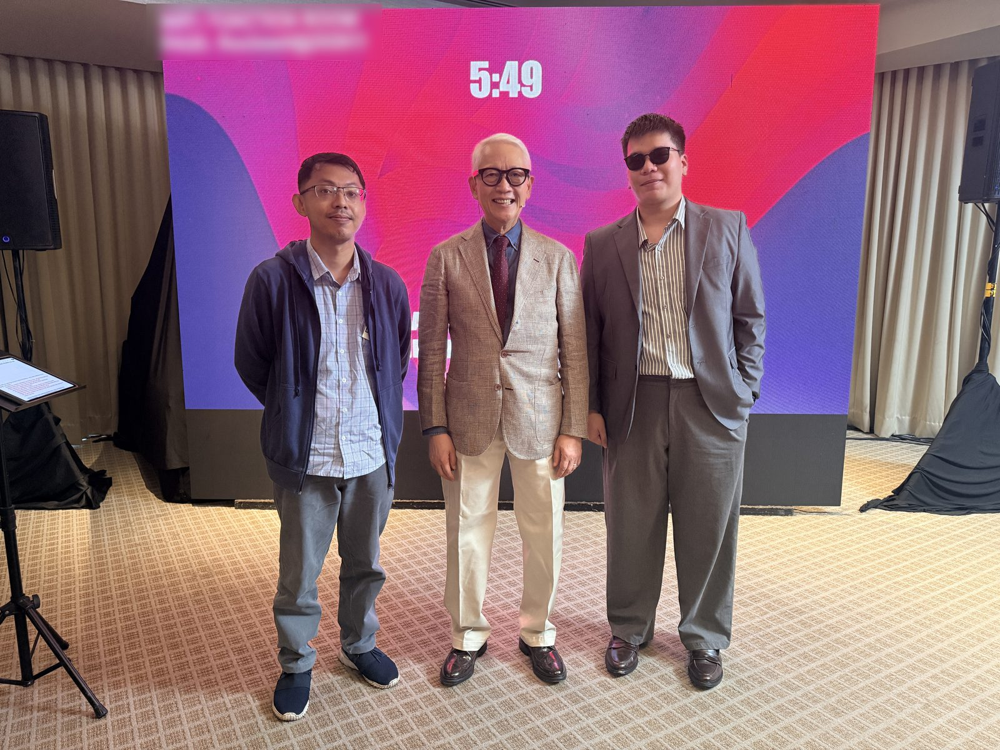
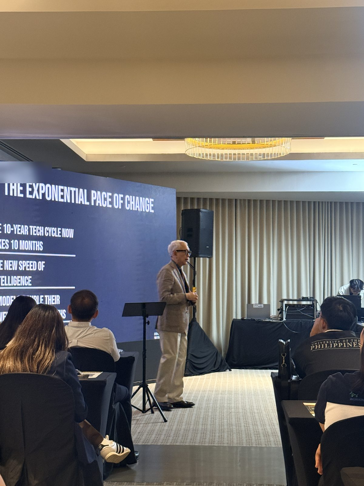
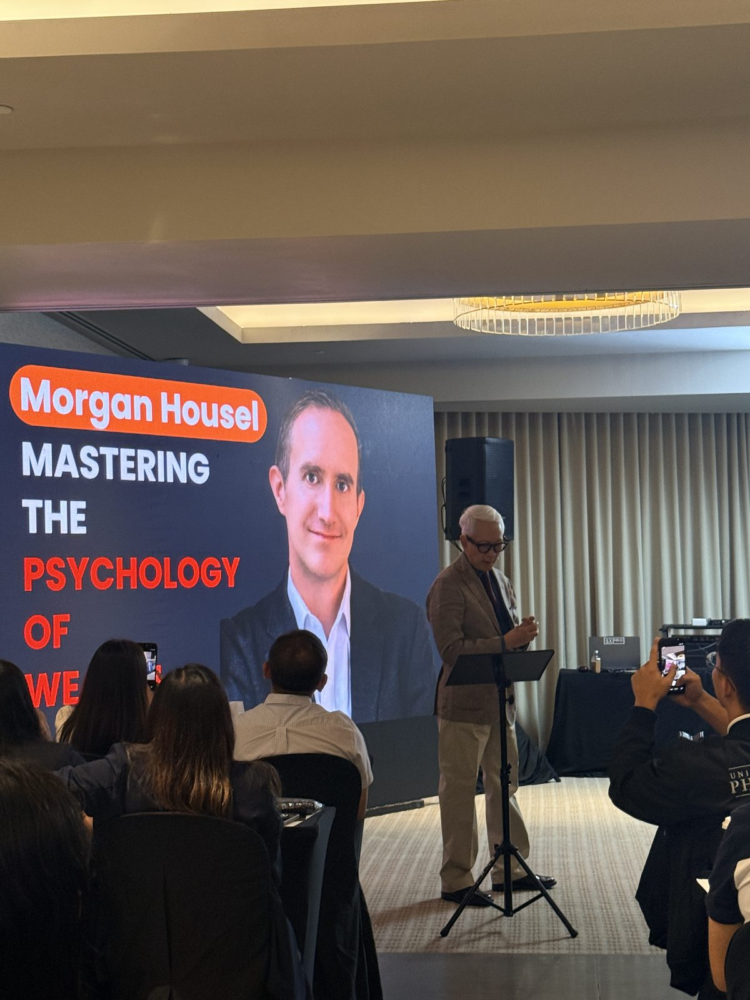
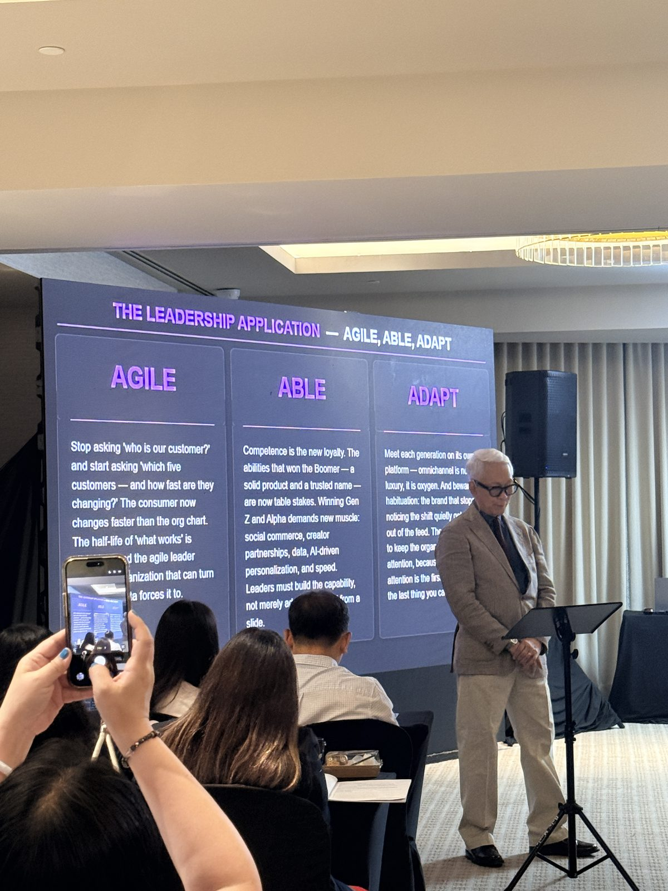

Level-Up Leadership: Agile, Able, Adapt was a one-day leadership seminar by Francis Kong, held on June 18, 2026 at Balmori Suites in Rockwell, Makati. The day was about leading through fast change, and its main framework asked leaders to be agile, able and adaptable.

I attended in person, and this note is part of my [Founder's Journey](/topics/founder-journey "Founder's Journey: posts on starting, running and losing a business") writing. You can see the other seminars I went to on my [events page](/events "Events and seminars Uriel Papa has attended").

## Who is Francis Kong?

Francis J. Kong is a business speaker, columnist, author and broadcaster in the Philippines. His [official site](https://franciskong.com/ "Francis Kong's official website") describes him as one of the most respected business speakers in the country, lists more than 29 published books, and names him a 2014 TOFIL awardee. His leadership programs run under [Level Up Leadership](https://levelupleadership.ph "Level Up Leadership, the seminar program by Francis Kong"), with Success Options Inc. handling bookings.

*With Francis Kong, center, after the session at Balmori Suites, Rockwell, Makati.*

## What was Level-Up Leadership: Agile, Able, Adapt?

Level-Up Leadership is a one-day live program that Francis Kong facilitates, offered on-site in Makati and online. The June 18, 2026 edition ran from 9:00 a.m. to 5:00 p.m. at Balmori Suites, Rockwell, Makati, according to the event poster. Its theme was printed under the title: Agile, Able, Adapt.

The Level Up Leadership site describes the program around five practices: thinking clearly, leading yourself, leading others, choosing well and continuing to learn. The tagline on the site is "Adapt. Lead. Thrive."

## Why does the pace of change matter for leaders?

The exponential pace of change was the starting point of the talk. One slide said that the 10-year tech cycle now takes 10 months, and another point on the same slide named the new speed of intelligence.

*Francis Kong on the exponential pace of change.*

As someone who builds with AI tools every week, I found this framing useful. A plan made at the start of a year can be out of date before the year ends, so leaders have to check their assumptions more often than before.

## What did the talk say about money and mindset?

Francis Kong also brought in Morgan Housel, the author of *The Psychology of Money*. A slide introduced Morgan Housel and the psychology of wealth, as part of a segment on how people think about money and long-term decisions.

*A segment on Morgan Housel and the psychology of wealth.*

## What do Agile, Able and Adapt mean in practice?

The leadership application of the day was one slide with three columns. Each column turned the theme into a question a leader can act on:

* **Agile:** Stop asking "who is our customer?" and start asking "which five customers, and how fast are they changing?" The slide said the consumer now changes faster than the org chart.
* **Able:** Competence is the new loyalty. A solid product and a trusted name are now table stakes. Winning Gen Z and Alpha demands social commerce, creator partnerships, data, AI-driven personalization and speed, and leaders must build that capability, not merely talk about it.
* **Adapt:** Meet each generation on its own platform, because omnichannel is no longer a luxury. The slide also warned about habituation: a brand that stops noticing the shift quietly drops out of the feed.

*The Leadership Application slide, the core framework of the day.*

The Able column matched a lesson from my own [agency years](/blog/closing-my-agency "What losing my agency taught me as a founder"): building is only half the work, and a team has to grow the skills a new market needs.

## Who would enjoy Level-Up Leadership?

I would recommend Level-Up Leadership to founders, managers and team leads who want a practical day on leading through change, especially if they lead people from different generations. The talk mixed business examples with clear frameworks, so it suits people early in a leadership role as well as experienced owners. Check the [Level Up Leadership site](https://levelupleadership.ph "Level Up Leadership schedule and sign-up") for the next date, since the program runs more than once.

## Where can you learn more?

- [Francis Kong's official site](https://franciskong.com/ "Francis Kong's official website") - His books, columns and speaking schedule.
- [Level Up Leadership](https://levelupleadership.ph "Level Up Leadership, the seminar program by Francis Kong") - The program page, with the five practices and sign-up for the next date.
- [Philippine SME Business Expo: what I learned about tech adoption](/events/philippine-sme-business-expo-technology-adoption "Uriel Papa's notes from the Philippine SME Business Expo") - My notes from another event where Francis Kong was one of the speakers.
