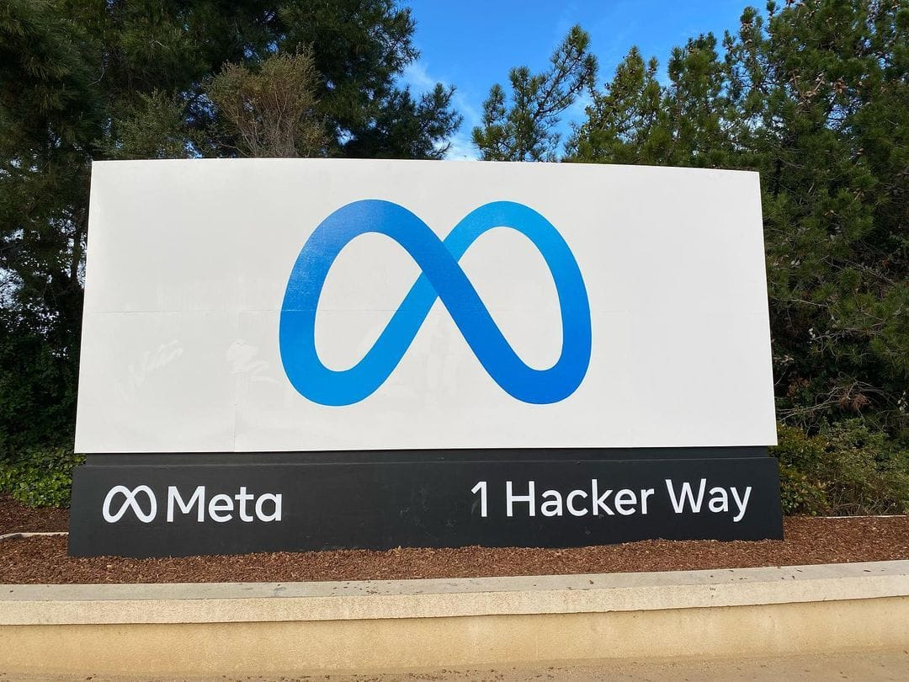

Conductor, a Mac app for running several AI coding agents in parallel, is joining Meta, and its cloud service closes on November 20, 2026, so anyone with work stored there has about two weeks to move it.

This take is part of my [AI, in Depth](/topics/ai) writing.

## What happened?

On November 4, 2026, Conductor published [Conductor is joining Meta](https://conductor.build/announcement). The page opens with "I have big news: Conductor is joining Meta." [RuntimeWire](https://runtimewire.com/article/meta-acquires-conductor-november-cloud-shutdown) reports that Axios broke the news first, citing sources, that the terms were not disclosed, and that the founders are going into Meta's MSL group. I could not open the Axios story, so those details rest on RuntimeWire.

Conductor's Charlie Holtz shared the news on X:

<SocialPost platform="x" url="https://x.com/charlieholtz/status/2118045232218743264" author="Charlie Holtz" handle="charlieholtz" date="2026-11-04" text={"I am very excited to share that Conductor is joining Meta!\n\nWe have some big, crazy plans for the next interface. If you liked Conductor, you’re gonna love what’s coming.\n\nWe’re super excited to work with @natfriedman and @alexandr_wang at MSL to build it. They’ve been on an absolute tear, and I’m convinced MSL has the highest talent density of all the labs.\n\nA huge thank you to our earliest believers @aaron_epstein, @ilyasu, and @nabeel. And to everyone here who tried Conductor, sent us feedback, and prompt requests - you made this so much fun. Thank you ❤️🚂\n\nChoo choo!"} media={[{"type":"video","src":"https://pbs.twimg.com/amplify_video_thumb/2118044320859406337/img/kFBZNK6j84A04Ogy.jpg","alt":"Still from Conductor's farewell video: a fuzzy cream-colored mascot carrying a dark cap steps off a silver train as a conductor watches from the door","width":1920,"height":1080}]} />

RuntimeWire also says Conductor is a San Francisco startup that raised a $22M Series A.

*Conductor announced on November 4 that it is joining Meta. Photo: [Nokia621](https://commons.wikimedia.org/wiki/File:Meta_Headquarters_Sign.jpg "Nokia621's photo on Wikimedia Commons"), [CC BY-SA 4.0](https://creativecommons.org/licenses/by-sa/4.0/ "Creative Commons Attribution-ShareAlike 4.0 license").*

## What changed?

The announcement gives a short timeline:

| Date | What happens |
| --- | --- |
| November 4 | New users can't sign up or download. Pro users keep pro features for free. |
| November 13 | Cloud workspaces become read-only. You can still read old chats and export. |
| November 20 | Cloud shuts down and deletion of cloud user data begins. |
| Early 2027 | The local app keeps getting new models and critical fixes until then. |

The page says active subscribers will get a refund. It also says "we have never sold or trained on Conductor user data, and we still won't," and that Conductor will delete all user data when the app shuts down in early 2027.

*Conductor is a Mac app for running several AI coding agents in parallel. Photo: [Marc Mueller seven11nash](https://commons.wikimedia.org/wiki/File:Macro_laptop_coding_%28Unsplash%29.jpg "Marc Mueller seven11nash's photo on Wikimedia Commons"), [CC0](https://creativecommons.org/publicdomain/zero/1.0/ "Creative Commons CC0 1.0 public domain dedication").*

To keep your work, the announcement gives two routes: right-click a cloud workspace and choose "Transfer to local," or go to Settings, then Account, then Export data.

## What does it mean for businesses and founders?

My read is that the date matters more than the deal. If your team ran agents in Conductor Cloud, the deadline is real, and the read-only week on November 13 leaves little room for mistakes.

The wider lesson is about dependence. Tools for managing several coding agents are new, and big tech is buying them. Meta has not said what it will build with Conductor beyond the page's promise of "something new" early next year. I would not assume the local app stays in its current form past that.

For a small team, the safe habit is to keep your prompts, project notes and agent instructions in your own repository, not only inside a tool.

## What should you do now?

1. **Check if you use Conductor Cloud.** If you do not, there is nothing to do.
2. **Export or transfer your workspaces** before November 13, while chats can still be sent.
3. **Keep your own copy** of prompts and agent instructions in your repository.
4. **Watch for your refund** if you were an active subscriber, since Conductor says active subscribers will get one.

## Where can you learn more?

- [Conductor's announcement](https://conductor.build/announcement) - The timeline and the export steps.
- [RuntimeWire's report](https://runtimewire.com/article/meta-acquires-conductor-november-cloud-shutdown) - The deal details and what Axios reported.
