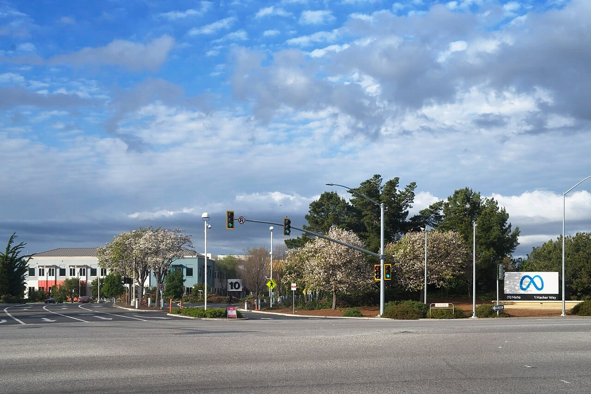
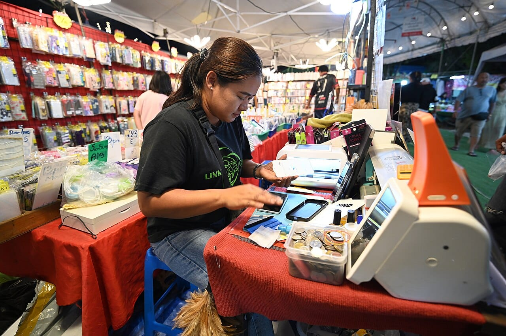

Meta has added spaces to its Muse app, which let you build a small custom tool, such as an order tracker or a client list, by describing it in plain words. Meta also upgraded the models behind Muse and Meta AI, and says they now forget less and recover better when a task goes wrong.

This take is part of my [AI, in Depth](/topics/ai) writing. Meta's AI plans also came up this week when it [bought Conductor, a tool for running coding agents](/news/meta-acquires-conductor-agents).

## What happened?

On November 6, 2026, Meta published [Design the Muse App, Just for You](https://about.fb.com/news/2026/11/introducing-spaces-customize-muse-app/ "Meta's announcement of spaces in the Muse app"). It says "a space is a custom experience you create inside Muse by describing your idea," and gives a holiday gift tracker and a daily word game as examples. After Muse builds a space, you can keep asking for changes to its features, look or behavior.

Meta Newsroom announced it on X:

<SocialPost platform="x" url="https://x.com/MetaNewsroom/status/2118816054281699651" author="Meta Newsroom" handle="MetaNewsroom" date="2026-11-06" text={"Today we’re introducing spaces, a way to design custom experiences inside the Muse app — from a school dashboard that tracks your kids’ activities and assignments to a freelancer hub that gathers your deadlines and invoices.\n\nhttps://about.fb.com/news/2026/11/introducing-spaces-customize-muse-app/"} card={{"url":"https://about.fb.com/news/2026/11/introducing-spaces-customize-muse-app/","title":"Design the Muse App, Just for You","description":"Today, we're introducing spaces, an interactive way to build a more customized experience in the Muse app.","domain":"about.fb.com","image":"https://pbs.twimg.com/card_img/2118767007323615232/cgBwWyUy?format=jpg&name=800x320_1","imageAlt":"Meta's fluffy cream-colored Muse mascot waving next to the words Muse, Introducing spaces and muse.ai"}} />

Meta says "spaces are available everywhere Muse is available," starting the same day. The page does not list countries, prices or limits.

*Meta announced spaces for its Muse app on November 6. Photo: [LPS.1](https://commons.wikimedia.org/wiki/File:Meta_Platforms_Headquarters_Menlo_Park_California.jpg "LPS.1's photo on Wikimedia Commons"), [CC0](https://creativecommons.org/publicdomain/zero/1.0/ "Creative Commons CC0 1.0 public domain dedication").*

## What changed?

Muse can now make tools, not only answer questions. The announcement lists what that looks like:

- **Small business:** an order tracker "with new orders, customer messages and what needs to ship today."
- **Freelancers:** a client hub "with projects, deadlines, and invoices."
- **Selling:** a shopping hub that brings Instagram saves, Marketplace listings and buyer messages into one view.
- **Staying current:** if you connect the apps you use, spaces "keep themselves up to date in the background."
- **Layout:** you can add spaces to the sidebar or main tabs, hide them, or schedule when they show.
- **Sharing:** Meta is "exploring ways for you to share your spaces with others," with no date given.

The same day, Meta's research team posted [Bringing Specialized Models to Muse and Meta AI](https://research.meta.ai/blog/specialized-models-for-muse-and-metaai "Meta's post on its new models for Muse and Meta AI"). Meta is "rolling them out to people who use Muse and Meta AI." On Meta's own tests, Muse's Active Memory score rose from 76% to 90%, and its Personal Superintelligence Index score rose from 38% to 47%.

Mark Zuckerberg summed up the model upgrade on X:

<SocialPost platform="x" url="https://x.com/finkd/status/2118767522782626104" author="Mark Zuckerberg" handle="finkd" date="2026-11-06" text={"Upgraded the models for Muse and Meta Al, bringing Active Memory and Active Focus from Muse Wonder to everyone. In Muse, these new specialized models are 2.4x less likely to forget critical info and are 67% better at self correcting and completing everyday tasks which means less repeating yourself and fewer dead ends.\n\nMore on the models: https://research.meta.ai/blog/specialized-models-for-muse-and-metaai"} card={{"url":"https://research.meta.ai/blog/specialized-models-for-muse-and-metaai","title":"Bringing Specialized Models to Muse and Meta AI","description":"Bringing key frontier capabilities to everyone with specialized models for Muse and Meta AI","domain":"research.meta.ai","image":"https://pbs.twimg.com/card_img/2118768752640819200/94YXy4Uy?format=jpg&name=600x600","imageAlt":"Graphic with the words Bringing the best parts of Muse Wonder to Muse over swirling blue lines on a dark background"}} />

*Meta's own examples include an order tracker for a small business, built by describing it to Muse. Photo: [PattayaPatrol](https://commons.wikimedia.org/wiki/File:DSC_8293_A_market_vendor_sits_at_a_cluttered_stall_using_a_smartphone_and_point-of-sale_tools_to_process_a_sale_under_the_bright_lights_of_a_night_market.jpg "PattayaPatrol's photo on Wikimedia Commons"), [CC BY-SA 4.0](https://creativecommons.org/licenses/by-sa/4.0/ "Creative Commons Attribution-ShareAlike 4.0 license").*

## What does it mean for businesses and founders?

My read is that this is aimed at the people who already run a business from their phone. Many sellers in the Philippines take orders through Facebook, Instagram and Marketplace messages, and Meta's examples pull in exactly those sources.

A tracker you describe in one sentence is useful for the small jobs that never justified a developer: what to ship today, who still owes an invoice. It is not a replacement for proper bookkeeping or an online store.

The gaps matter. Meta's page does not say what spaces cost, which countries have Muse, or how data from connected apps is stored. The test scores also come from Meta's own benchmarks, not an outside review.

## What should you do now?

1. **Check if Muse works for you.** Meta only says spaces are available where Muse is, so open the app before you plan around it.
2. **Start with one small tracker.** An order list or invoice tracker is a low-risk first test.
3. **Keep your records elsewhere too.** Until Meta explains how spaces store data, keep customer details in a sheet or tool you control.
4. **Watch for sharing.** A tracker your team can share would matter more than one only you can see.

## Where can you learn more?

- [Meta's spaces announcement](https://about.fb.com/news/2026/11/introducing-spaces-customize-muse-app/ "Meta's announcement of spaces in the Muse app") - Examples, availability and sharing plans.
- [Meta's post on the new models](https://research.meta.ai/blog/specialized-models-for-muse-and-metaai "Meta's post on its new models for Muse and Meta AI") - The test scores and how the models were trained.
