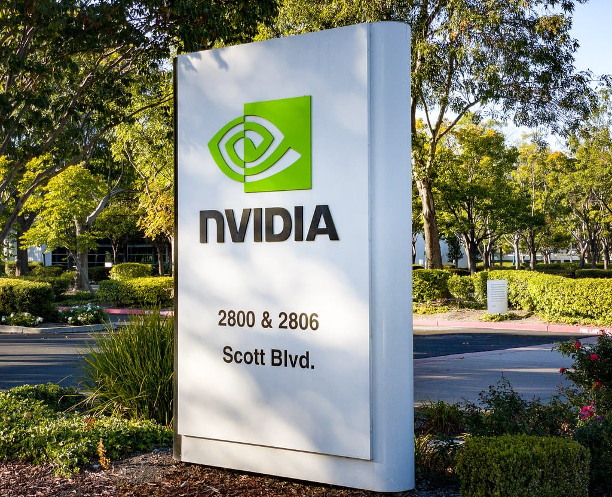
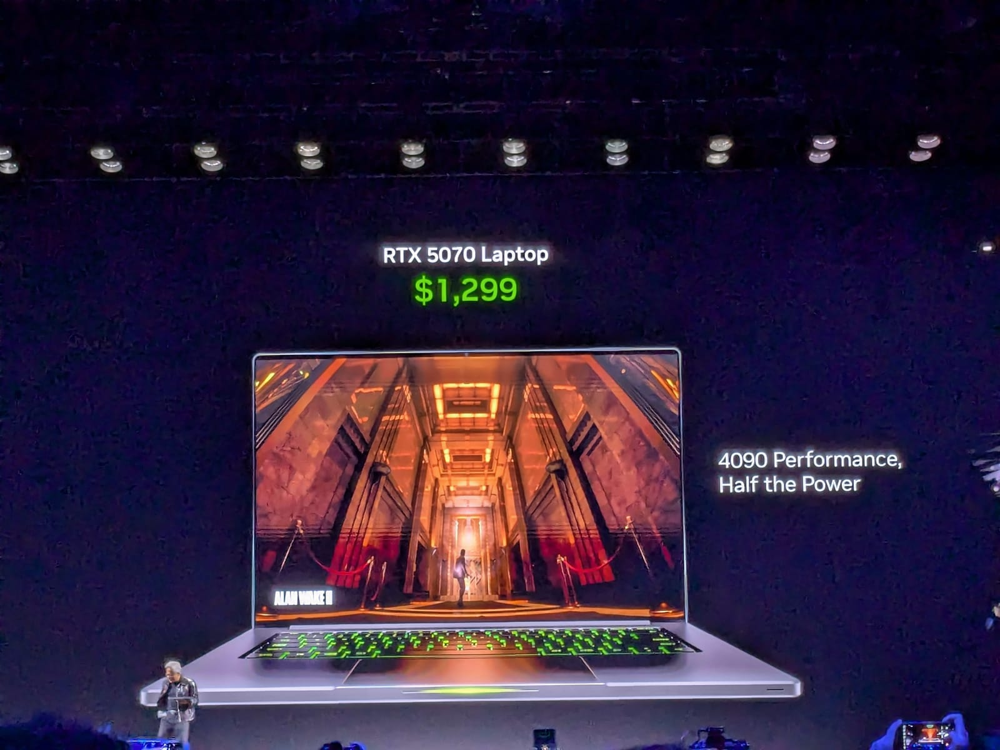

Nvidia's board of directors has started an independent investigation into CEO Jensen Huang, after news reports that he was the target of a foreign intelligence effort. The board says it has no reason to believe that national security or Nvidia secrets were compromised, and that it still has confidence in Huang.

This take is part of my [Technology and Business](/topics/tech-and-business "Technology and Business articles") writing. Nvidia's chips sit behind most of the AI tools I cover, and I wrote earlier about how [GPU financing shapes who can build AI](/news/musk-spacex-gpu-debt-ai-credit "Musk on SpaceX's GPU debt and AI credit").

## What happened?

On November 8, 2026, Nvidia published a [statement from its board of directors](https://nvidianews.nvidia.com/news/statement-from-nvidia-board-of-directors "Nvidia's board statement on the independent investigation"). It opens: "The NVIDIA Board is initiating an independent investigation." The board says the investigation follows recent reporting that Huang has been the target of a foreign intelligence effort.

Nvidia's newsroom shared the statement on X:

<SocialPost platform="x" url="https://x.com/nvidianewsroom/status/2119520873577398695" author="NVIDIA Newsroom" handle="nvidianewsroom" date="2026-11-08" text={"We just issued a press release from our board of directors. Read the release: https://nvidianews.nvidia.com/news/statement-from-nvidia-board-of-directors"} card={{"url":"https://nvidianews.nvidia.com/news/statement-from-nvidia-board-of-directors","title":"News Archive","description":"","domain":"nvidianews.nvidia.com","image":"https://pbs.twimg.com/card_img/2117535567533539328/628vD1Mz?format=jpg&name=600x600","imageAlt":"The Nvidia logo, a green eye-shaped symbol above the word NVIDIA in white, on a black background"}} />

The statement adds: "A committee of independent directors, assisted by outside independent counsel, will oversee the investigation." It says Huang fully supports the review and has committed to cooperating with it.

*Nvidia's board announced the independent investigation on November 8. Photo: [willbuckner](https://www.flickr.com/photos/160344139@N02/50591924966 "willbuckner's photo on Flickr"), [CC BY 2.0](https://creativecommons.org/licenses/by/2.0/ "Creative Commons Attribution 2.0 license").*

## What changed?

Nothing in Nvidia's leadership or products, for now. The statement announces no change in roles, and the board says it will share updates as appropriate.

- **Why now:** [CBS News](https://www.cbsnews.com/news/nvidia-jensen-huang-investigation-china-intelligence/ "CBS News report on the Nvidia investigation") says The New York Times first reported the allegations.
- **Security:** the board says "the Board prioritizes U.S. national and economic security," and that its inquiry will look at all available information.
- **China's response:** CBS News, citing BBC News, reports that China rejected the espionage allegations as "groundless speculation."
- **Huang:** CBS News reports that Huang said he supports the investigation and will cooperate fully.

None of the reported allegations has been proven, and the board has not published findings.

*Nvidia's board says it has confidence in Jensen Huang, seen here at lower left during a keynote, and in his leadership team. Photo: [Pronoia](https://commons.wikimedia.org/w/index.php?curid=157623447 "Pronoia's photo on Wikimedia Commons"), [CC0](https://creativecommons.org/publicdomain/zero/1.0/ "Creative Commons CC0 1.0 public domain dedication").*

## What does it mean for businesses and founders?

My read is that this is a governance story, not a product story. If you use ChatGPT, Claude or Gemini in your business, nothing about those tools changes because of this statement.

What it does show is how much of the AI market rests on one company. When a supplier that important is in the news, prices, supply and export rules can become part of the story later. None of that has happened here, and I would not plan around guesses.

For a Philippine business, the practical point is the same one I make about any single supplier: know which tools you rely on, and avoid building in a way that only works with one of them.

## What should you do now?

1. **Do nothing rushed.** The investigation has no findings yet, and no product or price has changed.
2. **List your AI dependencies.** Note which tools and cloud services your work relies on.
3. **Keep a backup option.** Where you can, make sure a second AI tool could take over a key task.
4. **Watch for the board's update.** Nvidia says it will share more as appropriate.

## Where can you learn more?

- [Nvidia's board statement](https://nvidianews.nvidia.com/news/statement-from-nvidia-board-of-directors "Nvidia's board statement on the independent investigation") - The full statement from the board.
- [CBS News report](https://www.cbsnews.com/news/nvidia-jensen-huang-investigation-china-intelligence/ "CBS News report on the Nvidia investigation") - Background on the reporting and the responses.
