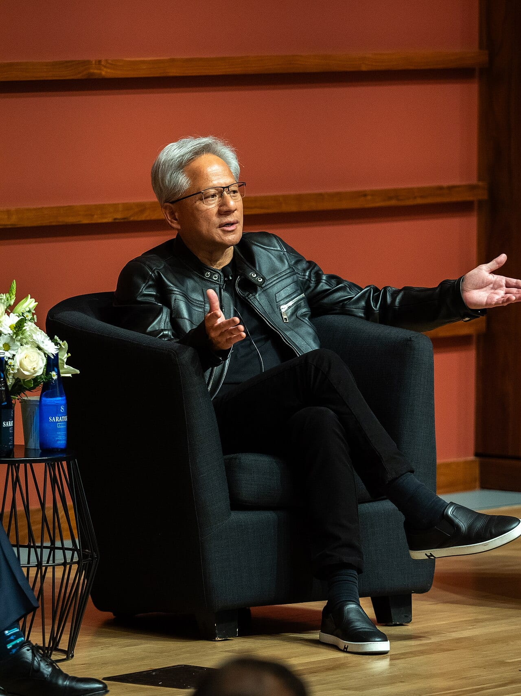
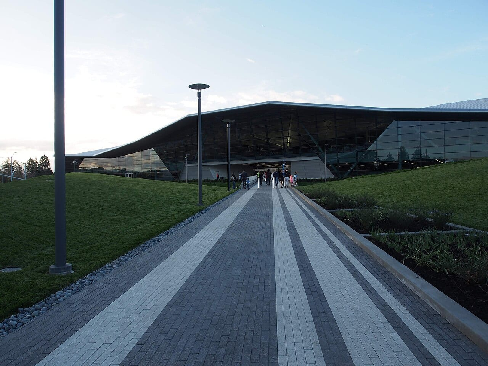

Nvidia has reinstated Jensen Huang as president, CEO and board member, effective immediately, the company announced on November 23, 2026, 11 days after he resigned. The board voted unanimously after meetings with Huang and input from senior US government officials, and says his return poses no national security risk. Harvey C. Jones stays on as chair, and Colette Kress, who led the company as interim CEO, continues as CFO.

This take is part of my [Technology and Business](/topics/tech-and-business "Technology and Business articles") writing. It follows my posts on [Huang's resignation](/news/jensen-huang-resigns-nvidia-ceo "Jensen Huang resigns as Nvidia CEO; CFO Colette Kress steps in"), [the board's investigation](/news/nvidia-board-investigation-jensen-huang "Nvidia's board opens an independent investigation into Jensen Huang") and [why Nvidia stock fell after that probe](/blog/why-nvidia-stock-fell-huang-investigation "Why Nvidia stock fell after its board opened a probe into Jensen Huang").

## What happened?

Nvidia published a release titled [NVIDIA Board Reinstates Jensen Huang as President, CEO and Board Director](https://nvidianews.nvidia.com/news/nvidia-board-reinstates-jensen-huang-as-president-ceo-and-board-director "Nvidia's press release reinstating Jensen Huang as CEO") on Monday, and filed the same text [with the SEC](https://www.sec.gov/Archives/edgar/data/0001045810/000104581026000090/nov23pressrelease.htm "Nvidia's November 23, 2026 press release, filed on SEC EDGAR"). It says the board acted after meetings with Huang, "after which the Board was satisfied with respect to Mr. Huang's candor and ability to lead NVIDIA."

Nvidia's newsroom shared the release on X:

<SocialPost platform="x" url="https://x.com/nvidianewsroom/status/2124865060397019480" author="NVIDIA Newsroom" handle="nvidianewsroom" date="2026-11-23" text={"NVIDIA Board reinstates Jensen Huang as President, CEO and Board Director.\n\nRead the release: https://nvidianews.nvidia.com/news/nvidia-board-reinstates-jensen-huang-as-president-ceo-and-board-director"} card={{"url":"https://nvidianews.nvidia.com/news/nvidia-board-reinstates-jensen-huang-as-president-ceo-and-board-director","title":"NVIDIA Board Reinstates Jensen Huang as President, CEO and Board Director","description":"NVIDIA (NASDAQ: NVDA) today announced that effective immediately, Jensen Huang has been reinstated as President and Chief Executive Officer and as a member of the Board.","domain":"nvidianews.nvidia.com","image":"https://pbs.twimg.com/card_img/2122438664232067072/fXBMARDj?format=jpg&name=600x600","imageAlt":"The Nvidia logo, a green eye-shaped symbol above the word NVIDIA in white, on a black background"}} />

It is a sharp turn. On November 17, Jones told analysts on the earnings call that the board "does not intend to reinstate Jensen as CEO," [NPR reported](https://www.wusf.org/2026-11-17/nvidia-board-says-it-does-not-intend-to-reinstate-jensen-huang-as-ceo "NPR: Nvidia board says it does not intend to reinstate Jensen Huang as CEO, on WUSF"). The same report says Huang had said he would be "honored" to return if the board agreed.

*Jensen Huang, seen here at Stanford in April 2026, is back as Nvidia's president and CEO. Photo: [Anders Eidesvik](https://commons.wikimedia.org/wiki/File:Jensen_huang_stanford_2026-04-09_033.jpg "Anders Eidesvik's photo on Wikimedia Commons"), [CC BY 4.0](https://creativecommons.org/licenses/by/4.0/ "Creative Commons Attribution 4.0 license").*

Huang's statement in the release reads: "I am honored to return to NVIDIA and lead one of the most consequential technology companies in the world at the beginning of a new industrial revolution." It ends: "I can't wait to get back to work."

## What changed, in plain words?

Huang is back, but the board kept its investigation running and put new checks around him. Here is what the release says.

- **Leadership:** Huang is president, CEO and a director again. Jones remains chair, and Kress keeps her job as CFO.
- **The investigation:** the committee of independent directors, working with independent counsel, "will proceed to conclusion." Huang "fully supports the investigation and is committed to cooperating with it."
- **Export control oversight:** a new board committee of independent directors oversees trade compliance and national security risks. Nvidia's newsroom [announced it on November 17](https://x.com/nvidianewsroom/status/2122633418269954302 "NVIDIA Newsroom on X announcing the National Security and Export Control Oversight Committee").
- **A new job:** Nvidia is searching for someone to fill a new position, Chief Compliance Officer, who will report to the board's Nominating and Corporate Governance Committee.
- **The stock:** [Yahoo Finance reported](https://finance.yahoo.com/markets/live/stock-market-today-monday-november-23-dow-sp-500-nasdaq-nvidia-reinstates-jensen-huang-141511975.html "Yahoo Finance live coverage of the market on November 23, 2026") that shares soared 27% in premarket trading on Monday.

None of the reported allegations has been proven, and the board has not said when the investigation will end. Nvidia says it will keep cooperating with ongoing government investigations and inquiries.

*Nvidia, based at this Santa Clara campus, is now searching for someone to fill a new Chief Compliance Officer role. Photo: [Daniel J. Prostak](https://commons.wikimedia.org/wiki/File:Nvdia_Endeavor_Grand_Opening_entry.jpg "Daniel J. Prostak's photo on Wikimedia Commons"), [CC BY-SA 4.0](https://creativecommons.org/licenses/by-sa/4.0/ "Creative Commons Attribution-ShareAlike 4.0 license").*

## What does it mean for small businesses and founders?

My read is that this is still a leadership story, not a product story. The release announces no product, price or delivery change, so ChatGPT, Claude, Gemini and the cloud servers behind them keep working as before.

The lesson for founders is in the conditions. Nvidia did not simply undo the resignation. It brought Huang back with an investigation that keeps running, a committee watching export rules and a compliance officer who reports to the board, not to him. Trust came back with checks attached.

Most Philippine small businesses have no board to do that. If your business rests on you, the same idea still works: a co-signer on large payments, a second person with the key logins, and someone outside the business you answer to.

## What should you do now?

1. **Don't react to headlines.** Nothing about Nvidia's products or prices has changed.
2. **Watch the investigation.** The board says it will run to its conclusion, and that is the next real news.
3. **Write down who runs your business if you can't.** Name a person and list the logins and payments they would need.
4. **If you hold Nvidia shares, read the release yourself.** Talk to a licensed adviser before acting on a 27% swing.

## Where can you learn more?

- [Nvidia's reinstatement release](https://nvidianews.nvidia.com/news/nvidia-board-reinstates-jensen-huang-as-president-ceo-and-board-director "Nvidia's press release reinstating Jensen Huang as CEO") - The official announcement.
- [The release on SEC EDGAR](https://www.sec.gov/Archives/edgar/data/0001045810/000104581026000090/nov23pressrelease.htm "Nvidia's November 23, 2026 press release, filed on SEC EDGAR") - The same text as filed with the SEC.
- [NPR on the board's November 17 position](https://www.wusf.org/2026-11-17/nvidia-board-says-it-does-not-intend-to-reinstate-jensen-huang-as-ceo "NPR: Nvidia board says it does not intend to reinstate Jensen Huang as CEO, on WUSF") - What the board said six days earlier.
