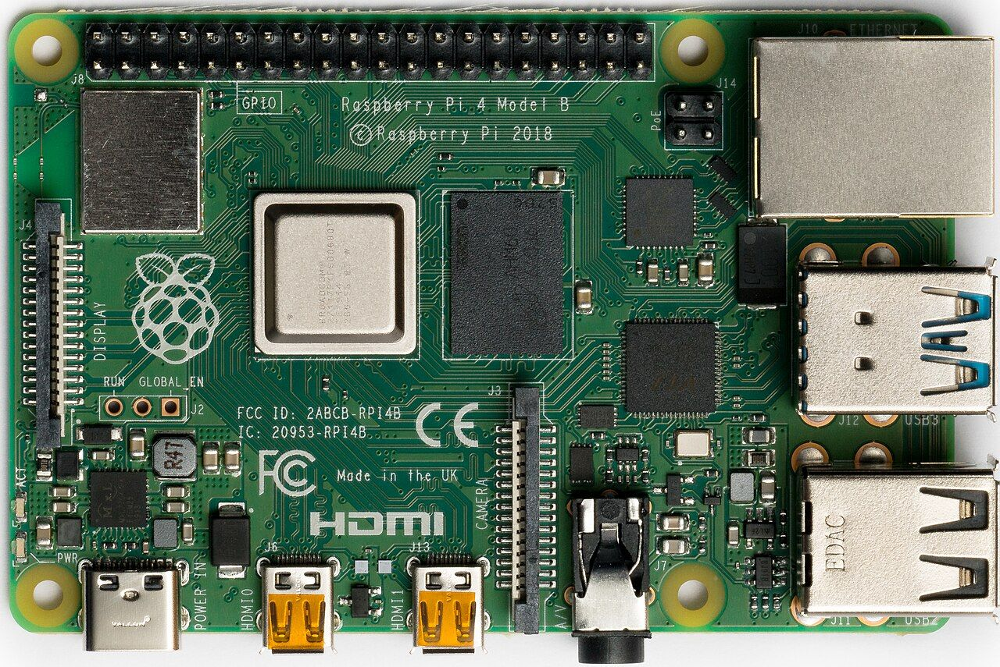

The best open-source n8n alternatives on GitHub are Activepieces for no-code business automation, Node-RED for event-driven flows on small servers, and Kestra for workflows you want to keep as code. All three use open-source licenses that allow commercial use, and all were updated in November 2026. Sim is a strong pick for AI agent workflows, and Windmill suits developers who write scripts.

This review is part of my [Automation](/topics/automation "Automation: Uriel Papa's articles on workflows and agents") writing. At my agency I led and co-developed an [AI chatbot for Messenger and Instagram with n8n](/blog/n8n-messenger-instagram-chatbot "How I built an n8n chatbot for Messenger and Instagram"), so I still like n8n. This post is for people who need a different license or a different way of working.

## Why look for an n8n alternative at all?

n8n's code is public, but its license is not an open-source license. The [n8n license file](https://github.com/n8n-io/n8n/blob/master/LICENSE.md "n8n's Sustainable Use License on GitHub") says you may use or modify it "only for your own internal business purposes or for non-commercial or personal use". Source files with `.ee` in their names also need a paid enterprise license.

For most small businesses, that is fine. Automating your own sales, support and reporting is internal use. The limits bite in three cases:

- **You want to resell automation as a hosted product** built on the tool itself.
- **You want to embed the engine** in software you sell.
- **Your company only approves OSI-style licenses** such as MIT, Apache 2.0 or the GPL family.

n8n is also huge, with about 210,000 GitHub stars on November 14, 2026, so leaving it means a smaller community. Weigh that before you move.

## How did I choose these five?

I judged every tool on the same checks, against the GitHub API and each README and license file on November 14, 2026:

- **License:** an open-source license for the core, with any paid parts named plainly.
- **Self-hostable:** runs on your own server or Docker, not only as a cloud service.
- **Active:** a push to the repository in November 2026.
- **AI-ready:** a way to call AI models or to be called by AI agents through MCP.
- **Stars:** a popularity signal only.

*Every workflow tool is built around the same idea: a trigger, then branches. Photo: [Olek Remesz](https://commons.wikimedia.org/wiki/File:POL_Manual_railroad_switch_Krynica.jpg "Olek Remesz's photo on Wikimedia Commons"), [CC BY-SA 3.0](https://creativecommons.org/licenses/by-sa/3.0/ "Creative Commons Attribution-ShareAlike 3.0 license").*

## Which open-source n8n alternatives are worth trying?

Five tools passed. Each one gets the same checks.

### Activepieces

[activepieces/activepieces](https://github.com/activepieces/activepieces "Activepieces on GitHub") calls itself "an open source replacement for Zapier", and it is the closest to n8n in feel.

- **Who it's for:** small teams where non-developers build the flows and a developer sets up the tools.
- **What's inside:** a no-code builder with loops, branches, retries, HTTP, code steps with npm, human approval and chat or form triggers. Integrations are called pieces, there are more than 200, and the README says each one is also available as an MCP server for Claude Desktop, Cursor or Windsurf.
- **Cost:** the Community Edition is free to self-host. Enterprise features are paid.
- **License and activity:** MIT for the Community Edition, with a commercial license for the `ee` folders. About 25,500 stars, last push November 13, 2026.
- **Watch out for:** check which features you need sit in the paid edition before you migrate.

The Activepieces team's own quickstart builds a first flow in about five minutes:

<YouTube id="8ExraM9WLb8" title="Activepieces Quickstart Tutorial: Start Automating in 5 Minutes" channel="Activepieces" />

### Node-RED

[node-red/node-red](https://github.com/node-red/node-red "Node-RED on GitHub") is "low-code programming for event-driven applications", built around a browser flow editor.

- **Who it's for:** people automating devices, sensors, webhooks and data streams, often on a small home server or a Raspberry Pi.
- **What's inside:** a visual editor where you wire nodes together, plus a public library of custom nodes and shared flows. Install with `npm install -g node-red`, run `node-red` and open port 1880.
- **Cost:** free.
- **License and activity:** Apache 2.0, about 23,800 stars, last push November 13, 2026. A project of the OpenJS Foundation.
- **Watch out for:** fewer ready-made connectors for business apps than n8n or Activepieces, so expect more HTTP and function nodes.

### Kestra

[kestra-io/kestra](https://github.com/kestra-io/kestra "Kestra on GitHub") is an "event-driven orchestration platform for data, AI, and infrastructure workflows".

- **Who it's for:** developers and data teams who want workflows reviewed in Git like code.
- **What's inside:** workflows written in YAML, with a no-code editor and an AI Copilot that edit the same file. Kestra 2.0 added AI agent and RAG tasks, a built-in MCP server and hundreds of plugins. It starts with one `docker run` command.
- **Cost:** the open-source edition is free. An Enterprise Edition adds access control and governance.
- **License and activity:** Apache 2.0, about 30,200 stars, last push November 13, 2026. Maintained by Kestra Technologies.
- **Watch out for:** 2.0 has breaking changes, such as a single `Loop` task replacing `ForEach`, so read the migration guide before upgrading.

### Sim

[simstudioai/sim](https://github.com/simstudioai/sim "Sim on GitHub") is a workspace "to build, deploy, and monitor AI agents and workflows".

- **Who it's for:** builders whose automations are mostly AI agents with tools, knowledge bases and tables.
- **What's inside:** more than 270 integrations with over 5,400 actions, every major LLM, and agents built visually, by chat or in code. `npx sim-setup` creates a Docker Compose install. An MCP server lets Claude Code or Codex run and deploy your workflows.
- **Cost:** free to self-host. Sim Cloud is the hosted option, and single sign-on and audit logs are part of its Enterprise plan.
- **License and activity:** Apache 2.0, about 30,100 stars, last push November 14, 2026.
- **Watch out for:** it needs Node.js 20 or later and Docker, and the setup wizard connects a chat model API key, so model costs are yours.

### Windmill

[windmill-labs/windmill](https://github.com/windmill-labs/windmill "Windmill on GitHub") is a "code-first platform for workflows, apps and AI agents".

- **Who it's for:** developers who already write scripts and want them turned into flows, cron jobs and simple internal apps.
- **What's inside:** scripts in Python, TypeScript, Go, Bash, SQL and more, synced with Git. Each script gets an auto-generated form and API. AI sessions build scripts in a workspace fork with a diff to review before deploy.
- **Cost:** the Community Edition is free. Windmill Labs sells dedicated instances and commercial licenses.
- **License and activity:** AGPLv3 for most source code, Apache 2.0 for the clients, and proprietary code for enterprise features. About 18,600 stars, last push November 13, 2026.
- **Watch out for:** the [license file](https://github.com/windmill-labs/windmill/blob/main/LICENSE "Windmill's license file on GitHub") says the Community Edition Docker images include proprietary code you may not "sell, resell, serve as a managed service, modify or wrap". Build from source without the enterprise flag if you need pure AGPLv3.

## How do the five tools compare?

The five tools split into two no-code builders, one AI agent builder and two code-first platforms.

| Tool | Best for | License | Stars (Nov 14, 2026) | Builder style |
| --- | --- | --- | --- | --- |
| Activepieces | Business automation, n8n-style | MIT (Community Edition) | about 25,500 | No-code |
| Node-RED | Devices, webhooks, data streams | Apache 2.0 | about 23,800 | Visual wiring |
| Kestra | Workflows as code in Git | Apache 2.0 | about 30,200 | YAML plus no-code |
| Sim | AI agent workflows | Apache 2.0 | about 30,100 | Visual and chat |
| Windmill | Script-heavy developer teams | AGPLv3 plus proprietary | about 18,600 | Code-first |
| n8n (for reference) | General automation | Sustainable Use License | about 210,000 | Visual |

Only Activepieces and Sim aim at the same non-developer audience that n8n serves.

## How hard is it to self-host one of these?

All five run on a single small server with Docker, and Node-RED runs with plain Node.js. The hard part is not the install; it is the upkeep: backups, updates, SSL and watching the logs.

*Node-RED is light enough to run on a board like this one. Photo: [Laserlicht](https://commons.wikimedia.org/wiki/File:Raspberry_Pi_4_Model_B_-_Top.jpg "Laserlicht's photo on Wikimedia Commons"), [CC BY-SA 4.0](https://creativecommons.org/licenses/by-sa/4.0/ "Creative Commons Attribution-ShareAlike 4.0 license").*

Plan for three things before you move a live workflow:

1. **Credentials:** every connected app needs a new login or API key on the new tool.
2. **Expect to rebuild:** none of the five READMEs mentions importing n8n workflows, so plan to rebuild flows by hand.
3. **Run both for a week:** keep the n8n flow on while the new one runs, then compare results.

A self-hosted tool trades a monthly bill for your own time. For a solo founder, that time is the real cost.

## Which one should you choose?

Choose by who builds the flows and what they connect:

- **Non-developers build business flows:** Activepieces.
- **You automate devices, sensors or webhooks on a small box:** Node-RED.
- **Developers want workflows reviewed in Git:** Kestra.
- **Most of your flows are AI agents:** Sim.
- **Your team already writes Python or TypeScript scripts:** Windmill, built from source if the license matters.
- **You automate only your own business and n8n works:** stay on n8n. My list of [free n8n workflow templates on GitHub](/blog/free-n8n-workflow-templates-github "Free n8n workflow templates on GitHub") is a good next step.

## Where can you learn more?

- [Activepieces license file](https://github.com/activepieces/activepieces/blob/main/LICENSE "Activepieces license file on GitHub") - which folders are MIT and which are under the commercial license.
- [Kestra's README on GitHub](https://github.com/kestra-io/kestra#readme "Kestra README on GitHub") - the one-command Docker start and what changed in Kestra 2.0.
- [Sim's self-hosting guide](https://github.com/simstudioai/sim#self-hosting "Sim self-hosting section on GitHub") - the `sim-setup` wizard and the optional services you can add later.
- [Node-RED's contributing guide](https://github.com/node-red/node-red/blob/main/CONTRIBUTING.md "Node-RED contributing guide on GitHub") - how the project takes bug reports, feature requests and pull requests, and where to ask questions.

*Repository details are from the GitHub API, each README and each license file, checked on November 14, 2026. n8n, Zapier and the other product names are trademarks of their owners. This post is not endorsed by or affiliated with any of the projects listed. This is not legal advice; read each license before you build a product on it.*
