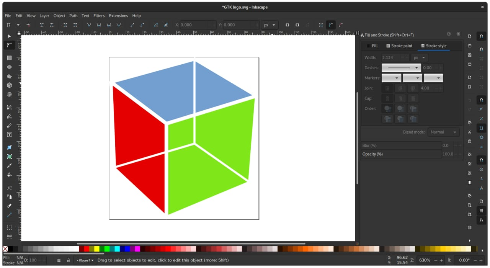

OpenAI has released two new image models, GPT-Image-2.6 Sunburst and GPT-Image-2.6 Flare, and they can output animated GIFs and SVG vector graphics as well as regular images.

This take is part of my [AI, in Depth](/topics/ai) writing.

## What happened?

On November 4, 2026, OpenAI's [developer changelog](https://developers.openai.com/changelog) listed "GPT-Image-2.6 Sunburst and GPT-Image-2.6 Flare for image generation and editing, with adjustable complexity, SVG generation, and animated GIF generation." The same entry added markup-guided editing for supported GPT Image 2.5 and 2.6 models.

OpenAI announced the ChatGPT side of the update on X:

<SocialPost platform="x" url="https://x.com/OpenAI/status/2118124944928432327" author="OpenAI" handle="OpenAI" date="2026-11-04" text={"Images, upgraded—introducing ChatGPT Images 2.6.\n\nNow with GIFs and reference images.\n\nPlus, two new models are coming to the API with 50% faster image generation."} media={[{"type":"video","src":"https://pbs.twimg.com/amplify_video_thumb/2118124891572748288/img/ZSIlzNmSPQEK0Sfd.jpg","alt":"ChatGPT answering the request can you make a dancing cat gif? with an image of a brown cat wearing a knitted daisy hat","width":1920,"height":1080}]} />

The models have their own pages for [Sunburst](https://developers.openai.com/api/docs/models/gpt-image-2.6-sunburst) and [Flare](https://developers.openai.com/api/docs/models/gpt-image-2.6-flare), and OpenAI points to its [image generation guide](https://developers.openai.com/api/docs/guides/image-generation#gpt-image-26).

*The Pioneer Building in San Francisco's Mission District was OpenAI's home for years. Photo: [HaeB](https://commons.wikimedia.org/wiki/File:Pioneer_Building,_San_Francisco_%282019%29_-1.jpg "HaeB's photo on Wikimedia Commons"), [CC BY-SA 4.0](https://creativecommons.org/licenses/by-sa/4.0/ "Creative Commons Attribution-ShareAlike 4.0 license").*

## What changed?

The same image tools can now produce more formats.

- **Animated GIFs:** according to [The Decoder](https://the-decoder.com/chatgpt-can-now-turn-text-prompts-and-photos-into-animated-gifs-with-openais-images-2-6-model/), ChatGPT can make a GIF from a text prompt or an uploaded photo, and users can adjust the speed or edit single frames.
- **SVG output:** the models can generate SVG, a vector format that stays sharp at any size.
- **Two models:** The Decoder says Flare is for efficient generation and Sunburst for higher-quality output.
- **Endpoints:** developers use `v1/images/generations` and `v1/images/edits`.
- **Rollout:** The Decoder reports, citing The Verge, that the GIF feature reaches "all ChatGPT and Codex users on web, desktop, and mobile apps."

The changelog entry does not state prices, tiers or regions. The Decoder also reports OpenAI's claim that users now generate "well over four billion images per week" across ChatGPT and the API.

*SVG is a vector format that editors like Inkscape can open, and it stays sharp at any size. Photo: [Inkscape developers and Andreas Nilsson](https://commons.wikimedia.org/wiki/File:Inkscape_1.png "Screenshot by the Inkscape developers and Andreas Nilsson on Wikimedia Commons"), [CC BY-SA 3.0](https://creativecommons.org/licenses/by-sa/3.0/ "Creative Commons Attribution-ShareAlike 3.0 license").*

## What does it mean for businesses and founders?

My read is that this is a practical tool, not a headline. A small shop that posts on Facebook or lists products on Shopee or TikTok Shop could use short GIFs and simple vector graphics without paying for each one.

The catch is control. The Decoder's example shows several slight variations of one character strung together in a flipbook style, so I would expect GIFs to suit simple, playful visuals more than product shots where details must be exact. Check every GIF before it goes near a customer, and keep your own logo and product photos as the source of truth.

SVG is the more useful format for a website. Vector graphics are small and sharp, but they still need a person to check that the shapes and text are right.

## What should you do now?

1. **Try it in ChatGPT first.** The GIF feature is the easiest way to see whether the output fits your brand.
2. **Wait for prices before building.** Read the Sunburst and Flare model pages before putting either in an automated workflow.
3. **Review every output.** Check text, logos and product details by eye.

## Where can you learn more?

- [OpenAI's developer changelog](https://developers.openai.com/changelog) - The November 4 entry and links to both models.
- [The Decoder's report](https://the-decoder.com/chatgpt-can-now-turn-text-prompts-and-photos-into-animated-gifs-with-openais-images-2-6-model/) - How the GIF feature works in ChatGPT.
- [Image generation guide](https://developers.openai.com/api/docs/guides/image-generation#gpt-image-26) - How to call the new models.
