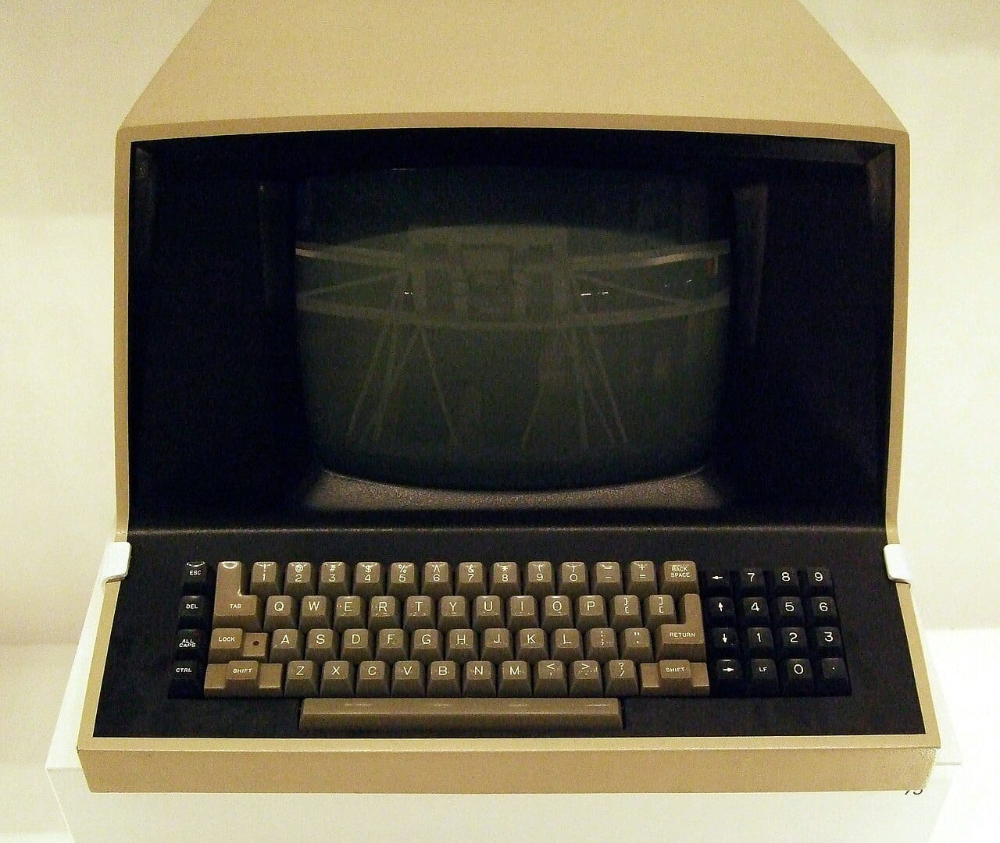
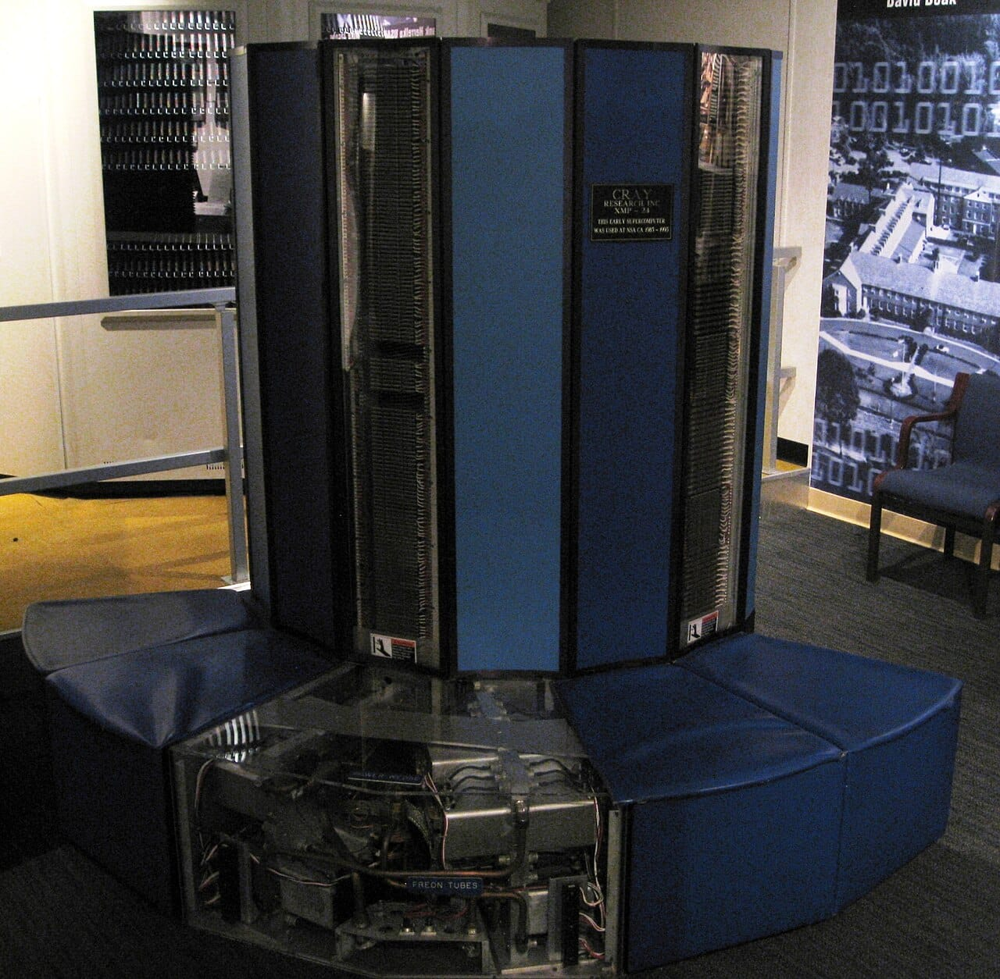
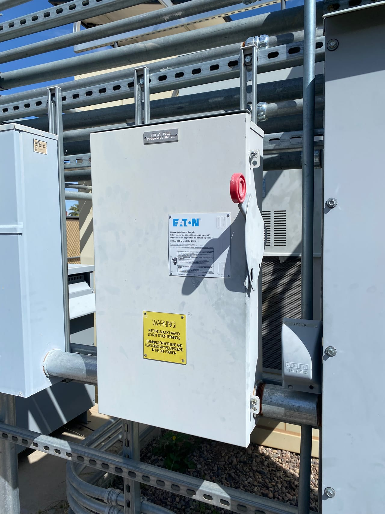

OpenAI shut down GPT-4, GPT-3.5 Turbo, o1, o3-mini and several other older models in its API on October 23, 2026. Any app, plugin or automation that still calls one of those model names now gets an error instead of an answer. The fix is usually one line: change the model name to the replacement OpenAI lists, then test.

This take is part of my [AI, in Depth](/topics/ai) writing.

## What happened?

On April 22, 2026, OpenAI announced the deprecation of a group of older models, with access ending on October 23, 2026. That date has now passed. The full list is on [OpenAI's deprecations page](https://developers.openai.com/api/docs/deprecations), which also names a recommended replacement for each model.

*Apps that still call the retired model names now get errors. Photo: [Jim Linwood](https://commons.wikimedia.org/wiki/File:An_Old_Computer_In_The_Design_Museum_-_London.jpg "Jim Linwood's photo on Wikimedia Commons"), [CC BY 2.0](https://creativecommons.org/licenses/by/2.0/ "Creative Commons Attribution 2.0 license").*

## Which models were shut down?

These are the main models from [OpenAI's deprecations page](https://developers.openai.com/api/docs/deprecations), with the replacement it recommends:

| Shut down on October 23, 2026 | OpenAI's recommended replacement |
| --- | --- |
| gpt-3.5-turbo (and its snapshots) | gpt-5.6-terra |
| gpt-4, gpt-4-0613, gpt-4-1106-preview | gpt-5.6-sol |
| gpt-4-turbo, gpt-4-turbo-2024-04-09 | gpt-5.6-sol |
| gpt-4o-2024-05-13 | gpt-5.6-sol |
| gpt-4.1-nano | gpt-5.6-luna |
| o1, o3-mini | gpt-5.6-sol |
| o1-pro | gpt-5.6-sol with pro reasoning mode |
| o4-mini | gpt-5.6-terra |
| gpt-image-1 | gpt-image-2.5-sunburst or gpt-image-2.5-flare |

*OpenAI lists a GPT-5.6 replacement for each model it shut down. Photo: [brewbooks](https://commons.wikimedia.org/wiki/File:Cray_XMP-24_Mainframe_%283319730327%29.jpg "brewbooks's photo on Wikimedia Commons"), [CC BY-SA 2.0](https://creativecommons.org/licenses/by-sa/2.0/ "Creative Commons Attribution-ShareAlike 2.0 license").*

Fine-tuned models built on GPT-3.5 Turbo, GPT-4, GPT-4.1 nano, o4-mini, babbage-002 and davinci-002 were shut down on the same date. Note that only the dated gpt-4o-2024-05-13 snapshot is on the list.

## What does it mean for businesses and site owners?

Most of the damage is quiet. A website chatbot, a WordPress plugin, a Zapier or n8n step, or an old script written in 2023 or 2024 may still name gpt-3.5-turbo or gpt-4. Those calls now fail, and the person who notices first is often a customer who gets no reply.

The upside is that the replacements are newer models. My post on [GPT-6 Sol and Luna](/news/gpt-6-sol-luna) covers OpenAI's current prices, which are worth comparing with the GPT-5.6 models before you pick one.

## What should you do now?

* **Search your code and tools for the old names.** Look for gpt-3.5, gpt-4, o1, o3-mini, o4-mini and gpt-image-1 in your code, plugin settings and automation steps.
* **Swap in the listed replacement and test.** Check the answer length, format and tool calls, since a newer model can behave differently.
* **Check your error logs from October 23.** Failed calls since that date show where something was missed.
* **Fine-tune again if you need to.** A fine-tuned model on a retired base has to be rebuilt on a newer base model.

*Check your code for the old model names and switch each one to the replacement OpenAI lists. Photo: [Rsparks3](https://commons.wikimedia.org/wiki/File:Utility_Disconnect_Switch.png "Rsparks3's photo on Wikimedia Commons"), [CC0](https://creativecommons.org/publicdomain/zero/1.0/ "Creative Commons CC0 1.0 public domain dedication").*

## Where can you learn more?

- [OpenAI's deprecations page](https://developers.openai.com/api/docs/deprecations) - The full list of shut-down models, dates and replacements.
- [GPT-6 Sol and Luna: OpenAI's Cheaper GPT-6 Models in the API](/news/gpt-6-sol-luna) - My take on OpenAI's current API models and prices.
- [OpenAI's Frontier Models Are Coming to Google Cloud](/news/openai-models-google-cloud) - My take on another way to buy OpenAI's models.
