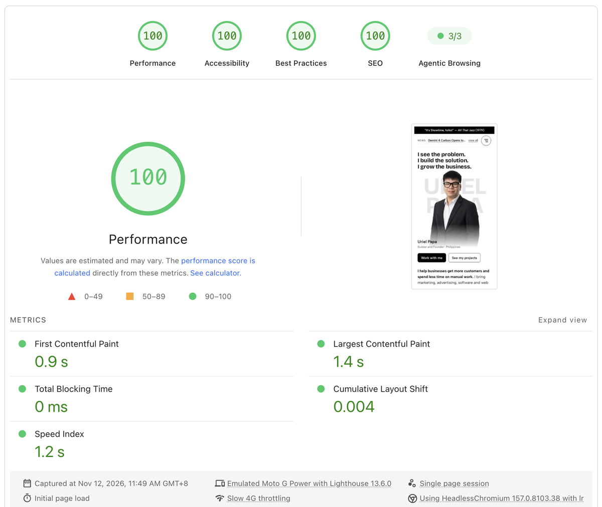
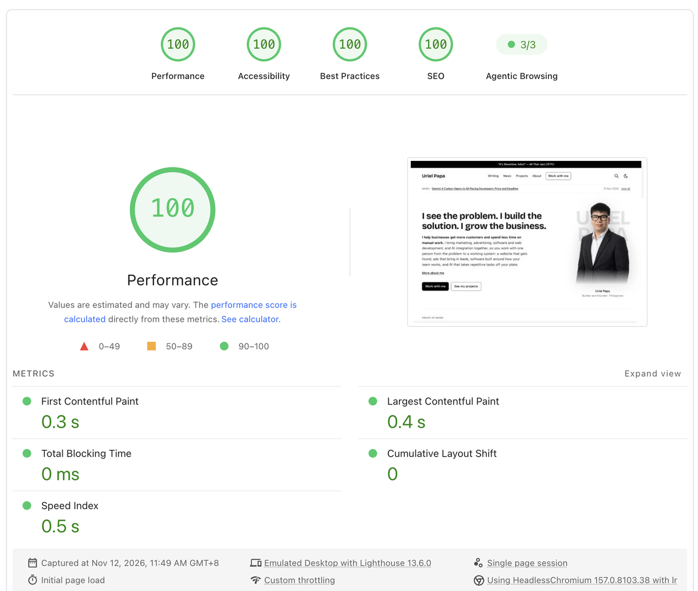

On 12 November 2026, urielpapa.com scored 100 in all four PageSpeed Insights categories, Performance, Accessibility, Best Practices and SEO, on both mobile and desktop. I got there in six steps: measuring the right pages, shrinking the main image, fixing the fonts, making third-party scripts wait, fixing a handful of accessibility flags and testing the live site again. None of it needs a big budget, and every step applies to a business website.

I built this site to share what works in [SEO, GEO and AEO](/topics/seo-geo-aeo "SEO, GEO and AEO topic page on urielpapa.com"), and site speed is the part of SEO that visitors feel first. All the changes are public in the site's code, in [pull request #42](https://github.com/Edamuza/urielpapa.com/pull/42 "Pull request #42 on GitHub: PageSpeed 100 on mobile and desktop") and [pull request #43](https://github.com/Edamuza/urielpapa.com/pull/43 "Pull request #43 on GitHub: load GA4 and Clarity on first interaction").

The six steps, in the order I would do them on any site:

1. **Measure the pages that matter**, on mobile first, and [read what each number means](#what-does-a-100-on-pagespeed-insights-actually-measure "Jump to: what a 100 on PageSpeed Insights measures").
2. **Shrink the biggest image** above the fold, because [it decides how fast the page looks ready](#why-is-the-biggest-image-usually-the-problem "Jump to: why the biggest image is usually the problem").
3. **Give your fonts a matching fallback**, so [text does not jump when the web font arrives](#how-can-fonts-slow-a-page-down "Jump to: how fonts slow a page down").
4. **Make third-party scripts wait** for the visitor, including [analytics, chat and spam checks](#why-should-analytics-chat-and-spam-checks-wait "Jump to: why analytics, chat and spam checks should wait").
5. **Fix the accessibility and SEO flags**, which are [usually small and fast](#which-accessibility-and-seo-fixes-closed-the-gap "Jump to: the accessibility and SEO fixes").
6. **Test the live site again**, because [the lab and the real world differ](#why-test-the-live-site-again "Jump to: why to test the live site again").

## What does a 100 on PageSpeed Insights actually measure?

PageSpeed Insights is Google's free tool that loads a page and grades it from 0 to 100 in four categories. The grades come from [Lighthouse](https://developers.google.com/speed/docs/insights/v5/about "Google's About PageSpeed Insights documentation"), which loads the page on a simulated phone or desktop in a lab. For my mobile test, the report says it used an emulated Moto G Power on slow 4G throttling, which is a tougher test than most of your customers' phones.

*The mobile report for the urielpapa.com home page, captured 12 November 2026 with Lighthouse 13.6.0.*

The Performance score is a weighted mix of five timings. Google's [Lighthouse scoring guide](https://developer.chrome.com/docs/lighthouse/performance/performance-scoring "Lighthouse performance scoring weights on Chrome for Developers") lists the weights:

| Metric | What it means for a visitor | Weight | My mobile result |
| --- | --- | --- | --- |
| Total Blocking Time | How long the page ignores taps while scripts run | 30% | 0 ms |
| Largest Contentful Paint | When the main image or heading appears | 25% | 1.4 s |
| Cumulative Layout Shift | How much the page jumps while loading | 25% | 0.004 |
| First Contentful Paint | When anything first appears | 10% | 0.9 s |
| Speed Index | How quickly the screen fills in | 10% | 1.2 s |

Blocking time and layout shift together carry more than half the score. That is why a page can look fast and still score in the 80s: a heavy script or a jumping layout costs more than a slow first paint.

## Why does website speed matter for your business?

A faster website turns more visits into inquiries and sales, and the effect shows up at fractions of a second. In [Milliseconds Make Millions](https://web.dev/case-studies/milliseconds-make-millions "Milliseconds Make Millions case study on web.dev"), a 2019 study by 55 and Deloitte for Google across 37 brands and over 30 million sessions, a 0.1-second faster mobile site raised retail conversions by 8.4% and travel conversions by 10.1%. For lead generation sites, 21.6% more visitors reached the form submission page.

Single companies see the same pattern. In a 2021 A/B test, [Vodafone made its main content load 31% faster](https://web.dev/case-studies/vodafone "Vodafone case study on web.dev: a 31% improvement in LCP increased sales by 8%") on a landing page and got 8% more sales, a 15% better lead-to-visit rate and an 11% better cart-to-visit rate. The fixes included resizing the hero image, which is the same first fix I made.

Search is the second reason. Google says in its [page experience guide](https://developers.google.com/search/docs/appearance/page-experience "Google Search Central: understanding page experience") that Core Web Vitals "are used by our ranking systems." The same page is honest about the limit: Google still shows the most relevant page even when its experience is poor, and a perfect score "just for SEO reasons may not be the best use of your time." Speed is a tiebreaker, not a substitute for good content.

Accessibility is the third. The [World Health Organization](https://www.who.int/news-room/fact-sheets/detail/disability-and-health "WHO fact sheet on disability and health") estimates 1.3 billion people, about 1 in 6, live with a significant disability. Yet the [WebAIM Million 2026 report](https://webaim.org/projects/million/ "WebAIM Million 2026 accessibility report") found detectable accessibility failures on 95.9% of the top million home pages. A site that works for everyone simply reaches more customers.

## Why is the biggest image usually the problem?

The largest image on the first screen is usually what Google times as Largest Contentful Paint, so its file size sets how fast the page looks ready. On my home page, that image is my portrait. Phones were downloading an 800-pixel-wide WebP of 69 KB to show it at about 270 pixels wide.

<FromTheBuild>

I made the portrait in several sizes and in AVIF, a newer image format that compresses far better than JPEG or WebP. Phones now load a 16 KB AVIF instead of the 69 KB WebP, the browser is told to fetch it first, and the mobile Largest Contentful Paint is 1.4 seconds.

</FromTheBuild>

Blog images had the opposite problem. They were marked as full-screen width, so a desktop browser fetched a 1,280-pixel file for a reading column that is only 612 pixels wide. Telling the browser the real column width cut about 300 to 500 KB from each photo-heavy post on desktop.

For a business site, the fix is the same idea. Export photos at the size they display, not straight from the camera. Ask your developer or platform for AVIF or WebP, responsive sizes, and a "high priority" hint on the main image only, with lazy loading for everything further down.

## How can fonts slow a page down?

Custom fonts arrive a moment after the text, and if the backup font has different letter widths, every heading and menu reflows when the real font lands. That reflow is layout shift. On my /blog page it reached 0.07 on desktop, enough to cost a point.

The less obvious problem was blocking time. My site's backup fonts named only Arial. PageSpeed Insights runs on Linux, where Arial is not installed, so the browser searched for a missing font for every text size and weight on the first screen. Those searches were the main block of script time on mobile.

The fix was one backup font per brand font, sized to match it, that also names Liberation Sans and Arimo, free fonts drawn to Arial's measurements that Linux systems use in its place. The home page's median blocking time on mobile fell from 72 ms to 20 ms, and its layout shift dropped to almost zero.

<Callout type="tip">

Not every speed trick is worth keeping. I tried a font setting that skips the web font on slow connections. The score stayed at 100, but first-time visitors on slow networks saw plain headings, so I reverted it. Always check how a fix looks to a real visitor, not only what it does to the score.

</Callout>

## Why should analytics, chat and spam checks wait?

Third-party scripts such as analytics, chat widgets, heatmaps and spam checks run code the moment they load, and while they run, the page cannot respond to taps. Most of them are not needed until the visitor actually does something. On urielpapa.com there were three:

| Script | What it does | When it loads now |
| --- | --- | --- |
| Cloudflare Turnstile | Blocks spam on the newsletter and contact forms | On the first scroll, tap, key press or focus |
| Google Analytics 4 | Counts visits and sign-ups | On the first scroll, tap, mouse move or key press |
| Microsoft Clarity | Records how visitors use the page | Same as GA4 |

The analytics change came from the live test. The first PageSpeed run on urielpapa.com after the other fixes scored 97 on mobile, with 100 ms of blocking time and a Speed Index of 4.1 seconds. GA4 and Clarity were set to load after a 4-second timer, and that timer fired inside PageSpeed's measurement. After [pull request #43](https://github.com/Edamuza/urielpapa.com/pull/43 "Pull request #43 on GitHub: load GA4 and Clarity on first interaction"), Speed Index fell to 1.2 seconds and blocking time to 0 ms.

The trade-off is real: a visitor who leaves without scrolling, tapping or switching tabs is not counted. I accepted it and updated the [privacy page](/privacy "urielpapa.com privacy page") to describe it. If you depend on exact visit counts, for example to report ad results, decide this with your marketing team first. I explain how I use GA4 to spot AI referrals in [how to check if ChatGPT cites your site](/blog/how-to-check-if-chatgpt-cites-your-site "How to check if ChatGPT cites your site").

## Which accessibility and SEO fixes closed the gap?

Accessibility and SEO scores drop for small, specific reasons, and Lighthouse names each one. In my first runs, the mobile home page scored 96 in Performance and 92 in SEO. The SEO flag was a link that said "See more", which tells neither a screen reader nor a search engine where it goes. It now says "More about me".

The other fixes were just as small:

* **Table headers.** Comparison tables in five posts had an empty top-left cell, so the first column had no header for screen readers.
* **Tap targets.** One photo caption link sat too close to other links on phones, so a thumb could hit the wrong one.
* **Alt text and titles.** Every image on the site has descriptive alt text and a title, and every link has a descriptive title. The build checks for both.

These match the most common failures in the [WebAIM Million 2026 report](https://webaim.org/projects/million/ "WebAIM Million 2026 accessibility report"): missing image alt text on 53.1% of home pages and empty links on 46.3%. Each one takes minutes to fix, and together they are often the difference between 92 and 100.

## Why test the live site again?

A lab test on a developer's machine and the real site on a real host are not the same. My own Lighthouse runs showed 100 before the analytics fix, but the live site scored 97, because the analytics scripts only run on the live site, where the real tracking IDs are set. Testing the real URL at [pagespeed.web.dev](https://pagespeed.web.dev/ "PageSpeed Insights by Google") found the last problem.

*The desktop report for the same page and time: the main content appears in 0.4 seconds.*

Scores also vary between runs, because network and server conditions change. Google's [Lighthouse scoring guide](https://developer.chrome.com/docs/lighthouse/performance/performance-scoring "Lighthouse performance scoring and variability on Chrome for Developers") recommends treating performance as a range rather than one number. Run the test two or three times, and once your site has enough traffic, watch the real-user section at the top of the report. It covers the [last 28 days of real Chrome visits](https://developers.google.com/speed/docs/insights/v5/about "Google's About PageSpeed Insights documentation"), and it is what Google's Core Web Vitals assessment uses.

## What should you ask your web developer?

You do not need to write code to use this guide. Run PageSpeed Insights on your home page and your most important service or product page, on mobile, then use this table to turn the report into requests:

| What the report flags | What it usually means | What to ask for |
| --- | --- | --- |
| Slow Largest Contentful Paint | The main photo or banner is too big | Resize it, serve AVIF or WebP, load it first |
| High Total Blocking Time | Too many scripts run at load | Delay chat, analytics and tracking until the first interaction |
| Layout shift | Fonts, images or banners push content around | Set image sizes and use a matched fallback font |
| Low Accessibility | Missing alt text, unclear links, weak contrast | Fix each item Lighthouse lists, one by one |
| Low SEO | Unclear link text, missing descriptions | Write descriptive links and meta descriptions |

Start with the image and the scripts, because those two moved my scores the most. If you would like help getting your own site there, you can [work with me](/contact "Contact Uriel Papa about your website"), or read more about [what I build](/about "About Uriel Papa") first.

## Where can you learn more?

- [Google's Core Web Vitals guide for Search](https://developers.google.com/search/docs/appearance/core-web-vitals "Google Search Central: Core Web Vitals and Google search results") - the "good" thresholds: main content within 2.5 seconds, layout shift under 0.1 and responses under 200 milliseconds.
- [Why lab and field data can be different](https://web.dev/articles/lab-and-field-data-differences "web.dev: why lab and field data can be different") - why your PageSpeed score and your real visitors' experience may not match.
- [Milliseconds Make Millions](https://web.dev/case-studies/milliseconds-make-millions "Milliseconds Make Millions case study on web.dev") - the full study on how small speed gains change conversions by industry.
