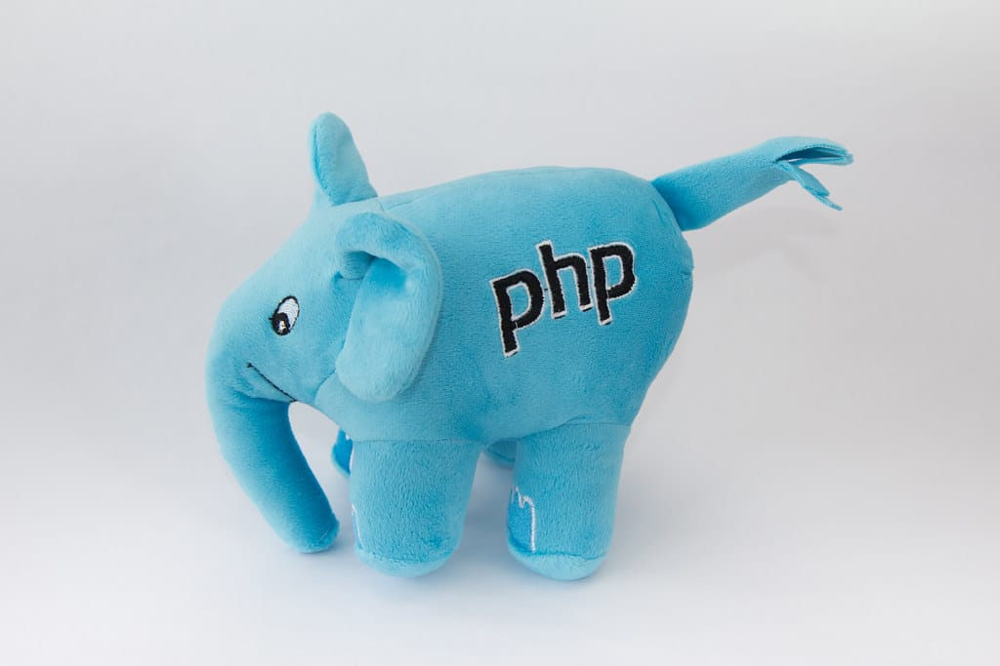

If your website runs on PHP, check its version this week. On November 19, 2026, the PHP project shipped security releases that fix phpAfterShell, a critical flaw in the default way PHP saves user sessions, which can lead to code running on the server. The fixed versions are PHP 8.5.13, 8.4.28, 8.3.37 and 8.2.36. That covers every WordPress and Laravel site, so ask your host or developer to confirm the update today.

This take is part of my [tech stacks](/topics/tech-stacks "Tech stacks articles") writing. It follows my take on [php2shell, two critical PHP flaws](/news/php2shell-critical-php-vulnerabilities "php2shell: two critical PHP flaws and what site owners should do") from October, and the [Apache mod_http2 flaw](/news/apache-mod-http2-flaw-update "Apache mod_http2 flaw: update to 2.4.71 now") from last week, which hit the same kind of servers.

## What happened?

On November 18, the PHP team posted an [early notice on php.net](https://www.php.net/archive/2026.php#2026-11-18-1 "PHP's November 18, 2026 notice of an upcoming critical security release") that security releases were "scheduled for Thursday, 19 November 2026, between 14:00 and 14:30 UTC" and that "The highest severity is CRITICAL." The next day it released [PHP 8.5.13, 8.4.28, 8.3.37 and 8.2.36](https://www.php.net/archive/2026.php#2026-11-19-4 "PHP 8.5.13 release announcement on php.net"), each marked "This is a security release."

*The elePHPant is the mascot of PHP, the language behind WordPress and most small-business websites. Photo: [Atomic Taco](https://www.flickr.com/photos/25443792@N05/46989853155 "Atomic Taco's photo on Flickr"), [CC BY-SA 2.0](https://creativecommons.org/licenses/by-sa/2.0/ "Creative Commons Attribution-ShareAlike 2.0 license").*

The most serious fix is described in [GitHub advisory GHSA-fm2m-fjf5-v3cp](https://github.com/php/php-src/security/advisories/GHSA-fm2m-fjf5-v3cp "PHP security advisory GHSA-fm2m-fjf5-v3cp on GitHub"), titled "Partially overwritten session files can lead to remote code execution." It is CVE-2026-126714, rated critical with a CVSS v4 score of 9.2. Cloudflare calls it [phpAfterShell](https://blog.cloudflare.com/phpaftershell-waf-protection/ "Cloudflare's post on how its WAF helps protect against phpAfterShell").

## Who is affected?

The advisory says the bug sits in the `files` session save handler, which is PHP's default. When PHP saves a session, it writes the new data over the old file without clearing it first. If that write is cut off, the file can end up holding parts of two sessions. An attacker who can shape what goes into a session, and interrupt the write at the right moment, may get PHP to load objects they control the next time the session opens.

*The flaw sits in the PHP that runs on the web server, so the server's PHP version is what has to change. Photo: [torkildr](https://www.flickr.com/photos/8718930@N07/3462606643 "torkildr's photo on Flickr"), [CC BY-SA 2.0](https://creativecommons.org/licenses/by-sa/2.0/ "Creative Commons Attribution-ShareAlike 2.0 license").*

The advisory lists every version below 8.2.36, and the 8.3, 8.4 and 8.5 branches below 8.3.37, 8.4.28 and 8.5.13, as affected. It adds that the affected code "has been present since PHP 4.1.0." Old, unsupported PHP versions get no release at all.

## How serious is it?

It is serious, but not a one-click break-in. The advisory says turning it into code execution also needs a suitable "gadget chain" in the application, meaning existing code that can be abused once the bad data loads. PHP's November 18 notice also said its critical issues "require either non-default configuration or uncommon setups," which sits awkwardly with the advisory's point that the default handler is affected. I read that as: not every site is exploitable, but no site owner should bet on being the exception.

Cloudflare posted on November 20 that its firewall now blocks the flaw for every plan:

<SocialPost platform="x" url="https://x.com/Cloudflare/status/2123898423791292647" author="Cloudflare" handle="Cloudflare" date="2026-11-20" text={"phpAfterShell is a critical flaw in PHP's default session handler that can lead to code execution. Cloudflare WAF blocks it for all customers, including Free plans, and adds new rules for other PHP flaws fixed in the same release. https://cfl.re/4A3d1Oa"} card={{"url":"https://cfl.re/4A3d1Oa","title":"How Cloudflare WAF helps protect against phpAfterShell and other critical PHP flaws","description":"phpAfterShell is a critical flaw in PHP's default session handler that can lead to code execution.","domain":"blog.cloudflare.com","image":"https://pbs.twimg.com/card_img/2123872804839772161/vKOBR0v6?format=jpg&name=600x600","imageAlt":"Cloudflare blog banner titled How Cloudflare WAF helps protect against phpAfterShell and other critical PHP flaws, with a magnifying glass over a PHP logo"}} />

A firewall rule buys time. It does not replace the patch.

## What does it mean for small businesses and founders?

Most small-business websites in the Philippines run WordPress on shared or managed hosting. There, the PHP version belongs to the host, so your job is to get written confirmation that the November 19 release is installed. If you run a Laravel or custom PHP app on a VPS or in Docker, the update is yours to do.

*Most WordPress sites run on hosting where the PHP version belongs to the host, so the first step is to ask whether it has been patched. Photo: [Archeduc - Vormingplus Halle-Vilvoorde](https://www.flickr.com/photos/26346696@N02/34063030750 "Archeduc - Vormingplus Halle-Vilvoorde's photo on Flickr"), [CC0](https://creativecommons.org/publicdomain/zero/1.0/ "Creative Commons CC0 1.0 public domain dedication").*

This is the second critical PHP release in a month. That pattern is the real message: a short list of every site, its host and its PHP version is now basic hygiene, not an IT luxury.

## What should you do now?

1. **Check the PHP version serving your site.** In WordPress, open Tools, then Site Health, then Info, and look at the [Server section](https://wordpress.org/documentation/article/site-health-screen/#server "WordPress Site Health screen documentation, Server section").
2. **Compare it with the fixed versions.** You want PHP 8.5.13, 8.4.28, 8.3.37 or 8.2.36 or later. Linux distributions may backport the fix under an older number, so check your vendor's notice too.
3. **Update, or ask your host to.** On shared hosting, open a ticket and ask whether the November 19 PHP security release is applied. On your own server, update the PHP packages or rebuild your Docker image.
4. **Restart PHP.** Restart PHP-FPM or Apache so no worker keeps running the old build.
5. **Use the stopgap only if you must wait.** The advisory suggests you "disable `session.upload_progress.enabled` administratively if the feature is not needed." That narrows one path in. It is not a fix.
6. **Plan your PHP 8.2 exit.** [PHP 8.2 reaches end of life on 31 December 2026](https://www.php.net/archive/2026.php#2026-10-21-1 "PHP 8.2.35 release notice with the PHP 8.2 end of life date"), after which it gets no security fixes.
