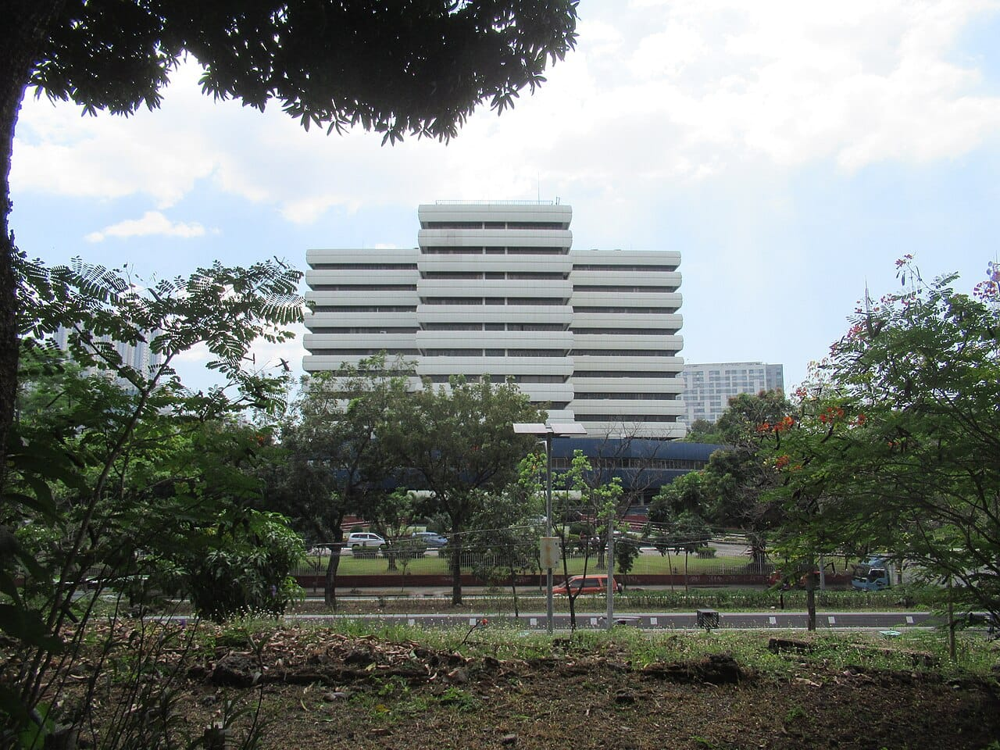
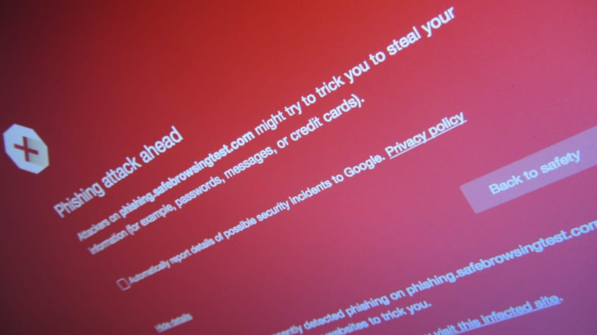

The Securities and Exchange Commission (SEC) has confirmed a data breach on its digital platforms, and says some users' personal data, including TINs, may have been exposed. The Bureau of Internal Revenue (BIR) is separately investigating claims that taxpayer data leaked, but has not confirmed a breach.

This take is part of my [Technology and Business](/topics/tech-and-business "Technology and Business articles") writing. Almost every founder in the Philippines deals with both agencies, so this one is worth a few minutes.

## What happened?

The SEC said in an advisory that on November 6 it "became aware of reports posted online pertaining to an alleged leak involving data claimed to be associated with the Commission."

The SEC posted the advisory on X:

<SocialPost platform="x" url="https://x.com/SEC_Philippines/status/2119642627125710911" author="SEC Philippines" handle="SEC_Philippines" date="2026-11-09" text={"📷 𝗔𝗱𝘃𝗶𝘀𝗼𝗿𝘆 𝗼𝗻 𝗗𝗮𝘁𝗮 𝗦𝗲𝗰𝘂𝗿𝗶𝘁𝘆 𝗜𝗻𝗰𝗶𝗱𝗲𝗻𝘁\n\nOn November 6, the Securities and Exchange Commission (SEC) became aware of reports posted online pertaining to an alleged leak involving data claimed to be associated with the Commission. 1/3"} media={[{"src":"https://pbs.twimg.com/media/HWp7drdbwAAahNX.jpg","alt":"SEC advisory graphic with the SEC logo over a photo of its headquarters, reading Advisory: Data security incident on November 6, 2026","width":1500,"height":1800}]} />

On November 9, the SEC said "initial findings indicate that no company records were affected by the incident" and that "no passwords were leaked and no data was modified or altered in any way," according to the [Philippine News Agency](https://www.pna.gov.ph/article/measures-in-place-to-prevent-another-data-security-breach-sec "Philippine News Agency report on the SEC's statement"). It added that some personal data "may have been exposed," and that it has notified the National Privacy Commission.

*The BIR says it is working with the CICC and DICT-NCERT on the breach claims. Photo: [Video13](https://commons.wikimedia.org/wiki/File:Bureau_of_Internal_Revenue_%28Philippines%29_Building_40.jpg "Video13's photo on Wikimedia Commons"), [CC BY-SA 4.0](https://creativecommons.org/licenses/by-sa/4.0/ "Creative Commons Attribution-ShareAlike 4.0 license").*

## What changed?

The SEC moved from "alleged leak" to a confirmed incident, and the BIR opened its own probe.

- **Data that may be exposed:** the SEC's notice to affected users, [quoted by The Philippine Star](https://www.philstar.com/headlines/2026/11/10/2569098/sec-confirms-data-breach-its-digital-platforms "Philippine Star report on the SEC data breach"), lists "full name, username, email address, mobile number, date of birth, gender, address and TIN."
- **Still being checked:** the SEC says it "is currently verifying the origin, scope, and validity of these affected records."
- **SEC response:** it says it reinforced access controls, updated credential authentication and started a system-wide audit.
- **BIR:** the [BIR said](https://www.pna.gov.ph/article/bir-investigating-alleged-data-breach "Philippine News Agency report on the BIR's statement") it is coordinating with the Cybercrime Investigation and Coordinating Center and DICT-NCERT, and that "immediate response measures have been implemented."

The BIR shared its advisory on X:

<SocialPost platform="x" url="https://x.com/birgovph/status/2119678730243289419" author="birgovph" handle="birgovph" date="2026-11-09" text={"https://www.facebook.com/birgovph/posts/pfbid0PXoVGpwes9Yxuz44rNYHdwYpsqHQzQLLzDuzKG7NB7VMzQbXE1jBNHVfJMCbnMtpl"} card={{"url":"https://www.facebook.com/birgovph/posts/pfbid0PXoVGpwes9Yxuz44rNYHdwYpsqHQzQLLzDuzKG7NB7VMzQbXE1jBNHVfJMCbnMtpl","title":"Bureau of Internal Revenue Philippines","description":"𝗔𝗗𝗩𝗜𝗦𝗢𝗥𝗬 09 November 2026, 12:00 P.M. The Bureau of Internal Revenue (BIR) informs taxpayers that claims of cybersecurity breaches are currently being addressed in coordination with the...","domain":"facebook.com","image":"https://pbs.twimg.com/card_img/2119678732126527488/XQymuq4G?format=jpg&name=420x420_2","imageAlt":"Text of the BIR advisory dated 9 November 2026, saying breach claims are being addressed with the CICC and DICT-NCERT and urging the public to use only official channels"}} />

Neither agency has said how many people are affected.

*The SEC warns users to be careful with unexpected texts, calls and emails asking for account details. Photo: [Christiaan Colen](https://www.flickr.com/photos/132889348@N07/20444222428 "Christiaan Colen's photo on Flickr"), [CC BY-SA 2.0](https://creativecommons.org/licenses/by-sa/2.0/ "Creative Commons Attribution-ShareAlike 2.0 license").*

## What does it mean for businesses and founders?

My read is that the immediate risk is scams, not stolen companies. The SEC says company records and passwords were not affected, but a name, TIN, mobile number and address are enough to write a very convincing fake message.

Expect texts or emails that claim to be from the SEC or BIR, mention a penalty or a filing problem, and ask you to click a link or confirm details. The SEC says it "will never ask for your passwords or security PINs."

## What should you do now?

1. **Change your SEC account password** and use one you do not use anywhere else.
2. **Scan the devices you log in from.** The SEC's notice also advises checking for malware.
3. **Treat SEC and BIR messages as suspect.** Go to the agency's website yourself instead of clicking a link.
4. **Warn your team.** Anyone who files for the company can be targeted.

## Where can you learn more?

- [SEC statement via the Philippine News Agency](https://www.pna.gov.ph/article/measures-in-place-to-prevent-another-data-security-breach-sec "Philippine News Agency report on the SEC's statement") - What the SEC found and what it changed.
- [The Philippine Star's report](https://www.philstar.com/headlines/2026/11/10/2569098/sec-confirms-data-breach-its-digital-platforms "Philippine Star report on the SEC data breach") - The exposed fields and the SEC's advice.
- [BIR statement via the Philippine News Agency](https://www.pna.gov.ph/article/bir-investigating-alleged-data-breach "Philippine News Agency report on the BIR's statement") - The BIR's response so far.
