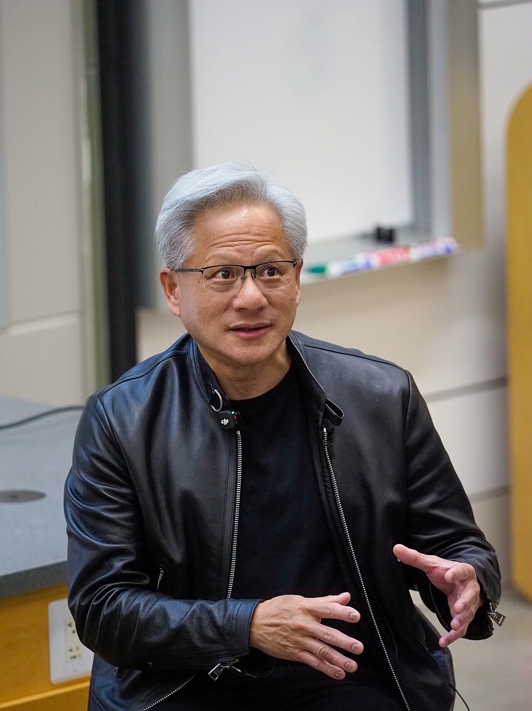

Nvidia stock fell 4.27% to US$178.67 on Monday, November 9, 2026, on a day when the rest of the market rallied. The cause was a statement from Nvidia's board the day before: it opened an independent investigation into reports that CEO Jensen Huang was the target of a foreign intelligence effort. Investors priced in three risks at once: the risk to Huang himself, the political risk in Washington, and the old question of where Nvidia's chips end up.

This post is part of my [Technology and Business](/topics/tech-and-business "Technology and Business articles") writing, and it follows up my short [news take on the board's investigation](/news/nvidia-board-investigation-jensen-huang "Nvidia's board opens an independent investigation into Jensen Huang"). This longer post explains why the stock fell, checks each claim against a source I opened, and keeps rumor out. None of it is investment advice.

## How far did Nvidia stock fall?

Nvidia stock closed down 4.27% at US$178.67 on November 9, according to [The Motley Fool's market report](https://www.fool.com/investing/2026/11/09/why-nvidia-stock-was-down-today/ "The Motley Fool: Why Nvidia Stock Was Down Today") (also [republished on Yahoo Finance](https://finance.yahoo.com/markets/stocks/articles/why-nvidia-stock-down-today-233002945.html "Why Nvidia Stock Was Down Today, on Yahoo Finance")). The same day, the S&P 500 rose 2.35% and the Nasdaq Composite rose 2.74%. [Stocktitan's market wrap](https://www.stocktitan.net/articles/stock-market-today-live-november-9-2026 "Stocktitan: The Stock Market Today, November 9, 2026") says it was the S&P 500's best day since April 8, with AMD up 13.26% and Broadcom up 8.78%.

The fall was deeper early in the day. A [Reuters report on Yahoo Finance](https://finance.yahoo.com/news/south-korea-says-nvidia-issues-022650481.html "Reuters: South Korea says Nvidia issues, on Yahoo Finance") says the shares dropped around 8% in early trading, to multi-month lows. [IBTimes UK puts the day's loss](https://www.ibtimes.co.uk/nvidia-shareholders-lawsuit-jensen-huang-allegations-1831298 "IBTimes UK on Nvidia's market value loss and the shareholder lawsuit") at about US$190 billion of market value.

*Nvidia trades on the Nasdaq, which rose 2.7% on the day Nvidia fell 4.3%. Photo: [ajay_suresh](https://commons.wikimedia.org/wiki/File:Nasdaq_MarketSite_%2851494550508%29.jpg "ajay_suresh's photo on Wikimedia Commons"), [CC BY 2.0](https://creativecommons.org/licenses/by/2.0/ "Creative Commons Attribution 2.0 license").*

The stock was already weak. [Yahoo Finance's live coverage](https://finance.yahoo.com/technology/live/nvidia-scandal-live-updates-nvidia-stock--board-investigates-ceo-jensen-huang-affair-alleged-chinese-spy-163130372.html "Yahoo Finance live updates on Nvidia and Jensen Huang") says Nvidia had turned negative for the year and fell 21% over the past month, amid a wider sell-off in AI stocks. A falling stock with fresh bad news tends to fall further, and Monday's gap with the rest of the market shows the news was specific to Nvidia.

## What did Nvidia's board announce?

Nvidia's board published a [statement on November 8, 2026](https://nvidianews.nvidia.com/news/statement-from-nvidia-board-of-directors "Nvidia's board statement on the independent investigation") that opens: "The NVIDIA Board is initiating an independent investigation." It says the inquiry follows recent reporting that Huang was the target of a foreign intelligence effort. A committee of independent directors, assisted by outside independent counsel, will oversee it.

The board added two lines meant to calm investors. It says it has no reason to believe "that either national security or NVIDIA secrets were compromised," and it says it "has confidence in Jensen and his leadership team." It also says Huang fully supports the review.

*Investors are pricing in risk around Jensen Huang, who co-founded Nvidia and still runs it, seen here at Stanford in April 2026. Photo: [Anderseidesvik](https://commons.wikimedia.org/wiki/File:Jensen_huang_stanford_2026-04-30_008.jpg "Anderseidesvik's photo on Wikimedia Commons"), [CC BY-SA 4.0](https://creativecommons.org/licenses/by-sa/4.0/ "Creative Commons Attribution-ShareAlike 4.0 license").*

On the same day, Nvidia published [Huang's message to employees](https://nvidianews.nvidia.com/news/a-message-to-our-company "Jensen Huang's message to Nvidia employees"). In it he admits an affair, without naming the woman: "I was unfaithful to my wife." He writes that the board, partners and shareholders "deserve better from me," and that he is "fully committed to NVIDIA." [TechCrunch](https://techcrunch.com/2026/11/08/nvidia-says-its-investigating-ceo-jensen-huangs-relationship-with-possible-chinese-spy/ "TechCrunch on Nvidia's investigation of Jensen Huang") identifies the woman as Alice Huang, a former executive at Megaspeed.

## What did the New York Times report about Alice Huang and Megaspeed?

The New York Times reported on October 29, 2026, that US officials concluded Alice Huang, a Chinese citizen and top executive at a Singapore-based data center company, was a Chinese intelligence asset. I read the report in its [republished version in The Nightly](https://thenightly.com.au/politics/world/the-new-york-times-nvidia-chief-jensen-huang-seen-as-target-of-chinese-spy-plot-c-23091245 "The New York Times report, republished by The Nightly"). It says surveillance of her showed a close relationship with Jensen Huang, and that officials at first did not believe he knew she was gathering information for China.

The company in the middle is Megaspeed. The Times says the Commerce Department began to suspect it of helping China get around US chip limits near the end of the Biden administration, and that the case moved to the Justice Department this year. It cites trade records showing Megaspeed's Malaysian sister company bought at least US$4.8 billion of AI equipment with Nvidia chips between June 2024 and February 2026. Questions about Megaspeed are not new: [Tom's Hardware reported in December 2025](https://www.tomshardware.com/pc-components/gpus/nvidias-biggest-sea-customer-exposes-the-limits-of-us-ai-export-controls "Tom's Hardware on Megaspeed and US AI export controls") that it had become Nvidia's largest buyer in Southeast Asia, and that Nvidia said it found "no evidence of diversion."

Nvidia and China both reject the claims. [CBS News](https://www.cbsnews.com/news/nvidia-jensen-huang-investigation-china-intelligence/ "CBS News report on the Nvidia investigation") quotes China's Foreign Ministry calling the "so-called Chinese spy narrative" "entirely baseless," and Nvidia spokesperson John Rizzo saying the company trusts the US government would have warned it of a genuine threat. None of the allegations has been proven.

## Why does Washington matter for the stock?

Washington matters because Nvidia's sales to China and to Asian data centers already depend on US export rules. Five days before the board's statement, three House chairs wrote to Huang. Their [press release of November 5, 2026](https://chinaselectcommittee.house.gov/media/press-releases/moolenaar-mast-and-crawford-seek-briefing-from-jensen-huang-on-ties-to-chinese-intelligence-asset "House Select Committee on China: chairmen seek briefing from Jensen Huang") names John Moolenaar of the Select Committee on China, Brian Mast of Foreign Affairs and Rick Crawford of the Intelligence Committee. The letter itself, dated November 4, asks Huang to appear in a joint, closed-door briefing on November 18, 2026, and to accept or offer another date by November 11.

*Three House committee chairs have asked Huang for a closed-door briefing at Congress on November 18. Photo: [Martin Falbisoner](https://commons.wikimedia.org/wiki/File:US_Capitol_east_side.JPG "Martin Falbisoner's photo on Wikimedia Commons"), [CC BY-SA 3.0](https://creativecommons.org/licenses/by-sa/3.0/ "Creative Commons Attribution-ShareAlike 3.0 license").*

The pressure grew on Monday. [Al Jazeera reports](https://www.aljazeera.com/economy/2026/11/10/trump-says-fbi-probing-nvidia-ceos-affair-with-alleged-spy "Al Jazeera: Trump says FBI probing Nvidia CEO Huang's affair with alleged spy") that President Trump told reporters, "I know the FBI is looking into it," and that Huang told him he had no idea she was a spy. IBTimes UK reports that shareholders filed a proposed class action against Nvidia and Huang in federal court in San Jose after Monday's close. Those claims have not been tested in court.

The committee shared the letter on X:

<SocialPost platform="x" url="https://x.com/ChinaSelect/status/2118452107590189291" author="Select Committee on China" handle="ChinaSelect" date="2026-11-05" text={"Chairman @RepMoolenaar, Chairman @RepBrianMast, and Chairman @RepRickCrawford have sent a letter to NVIDIA CEO Jensen Huang asking him to appear before their three committees this month. The letter expresses concerns over NVIDIA’s security protocols against foreign adversary espionage and Mr. Huang’s reported ties to a Chinese intelligence-linked executive of a Singapore-based data center company."} media={[{"src":"https://pbs.twimg.com/media/HWZA9xUW4AAbJUG.jpg","alt":"A letter on House Committee on Foreign Affairs letterhead dated November 4, 2026, to Jensen Huang, requesting a joint closed-door briefing on November 18, signed by Chairmen Brian Mast, John Moolenaar and Rick Crawford","width":829,"height":1073}]} />

## Why are investors worried about key-person risk?

Key-person risk is the chance that a company suffers if one leader can no longer do the job. Nvidia is an extreme case: Huang co-founded it and still runs it. Ben Emons of FedWatch, quoted in [Yahoo Finance's live coverage](https://finance.yahoo.com/technology/live/nvidia-scandal-live-updates-nvidia-stock--board-investigates-ceo-jensen-huang-affair-alleged-chinese-spy-163130372.html "Yahoo Finance live updates on Nvidia and Jensen Huang"), put it simply: "Every high-profile company carries key-person risk, and Nvidia is no exception."

Patrick Moorhead of Moor Insights & Strategy, in the same coverage, does not expect Huang to be pushed out unless the investigation finds something. Even so, Wedbush analyst Matt Bryson wrote that "we necessarily see Jensen losing some of his power/credibility" whatever the outcome. Prediction markets are more pessimistic:

<SocialPost platform="x" url="https://x.com/YahooFinance/status/2119956419348779200" author="Yahoo Finance" handle="YahooFinance" date="2026-11-10" text={"Prediction market traders are already pricing in a future without Jensen Huang at Nvidia.\n\nKalshi traders put the odds of Jensen Huang leaving as Nvidia CEO at 45% before 2028, 58% before 2029 and 62% before 2031.\n\nRead more: https://yhoo.it/3UHhere"} media={[{"src":"https://pbs.twimg.com/media/HWuZIQEWoAAEJOH.jpg","alt":"Jensen Huang sitting and wearing glasses and a leather jacket. The text reads, \"Under Scrutiny: Prediction market puts 45% odds on Jensen Huang leaving Nvidia before 2028.\" Credit: Yahoo Finance, Getty Images.","width":1080,"height":1350}]} />

My read: the market is not saying Nvidia's chips got worse. It is saying the future is less certain, and uncertainty costs money when a company is valued at trillions of dollars.

## Does the scandal change Nvidia's business today?

Nvidia's business does not change today, as far as any source shows. The Motley Fool's report says plainly: "None of this is going to affect the numbers Nvidia reports this quarter." The board says it has no reason to believe company secrets were compromised, and no product, price or delivery change has been announced.

The effects so far are small and human. Reuters reports that Huang's daughter Madison, an Nvidia executive, canceled a planned visit to Seoul. The same report says South Korea's deputy science minister expects no disruption to contracted Nvidia GPU deliveries, and that TSMC shares closed 4.7% higher that day.

The longer-term risk is policy. If Congress or the FBI finds problems, the result could be tighter export checks on Asian data centers like Megaspeed's, which would touch Nvidia's sales in Southeast Asia. That is a possibility, not a fact, and I would not plan around it yet.

## What should founders and small businesses in the Philippines do?

For most Philippine businesses, this is a story to follow, not a reason to change anything this week. ChatGPT, Claude, Gemini and the cloud servers behind them keep running as before. I wrote earlier about how [GPU financing shapes who can build AI](/news/musk-spacex-gpu-debt-ai-credit "Musk on SpaceX's GPU debt and AI credit"), and this is the same lesson from another side: a few companies, and a few people, carry the whole AI supply chain.

1. **Don't react to headlines.** The investigation has no findings yet, and nothing about the products has changed.
2. **List your AI dependencies.** Write down which AI tools and cloud services your business relies on, and what each one does.
3. **Keep a second option.** Make sure a second AI tool could take over your most important task, so a supplier's bad month does not become yours.
4. **If you hold Nvidia shares, read the sources.** Check the board's statement and the November 18 briefing date yourself, and talk to a licensed adviser before acting.
5. **Watch three dates.** November 11 (Huang's reply to Congress), November 18 (the requested briefing) and the board's next update.
