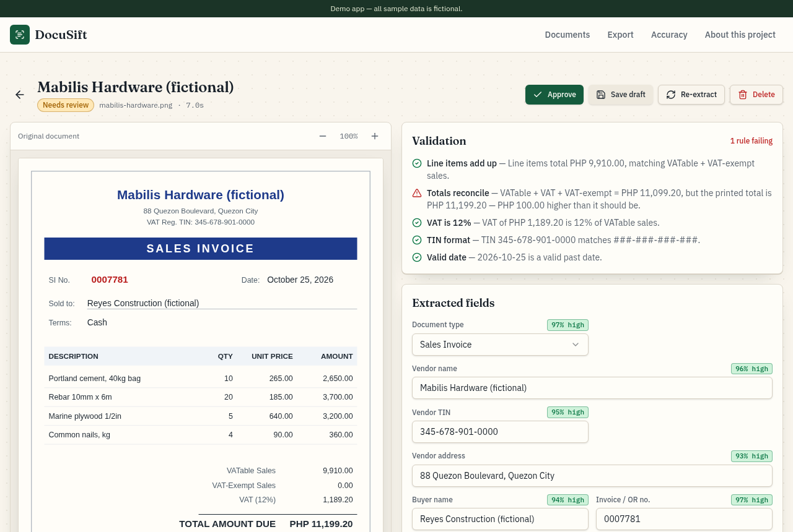
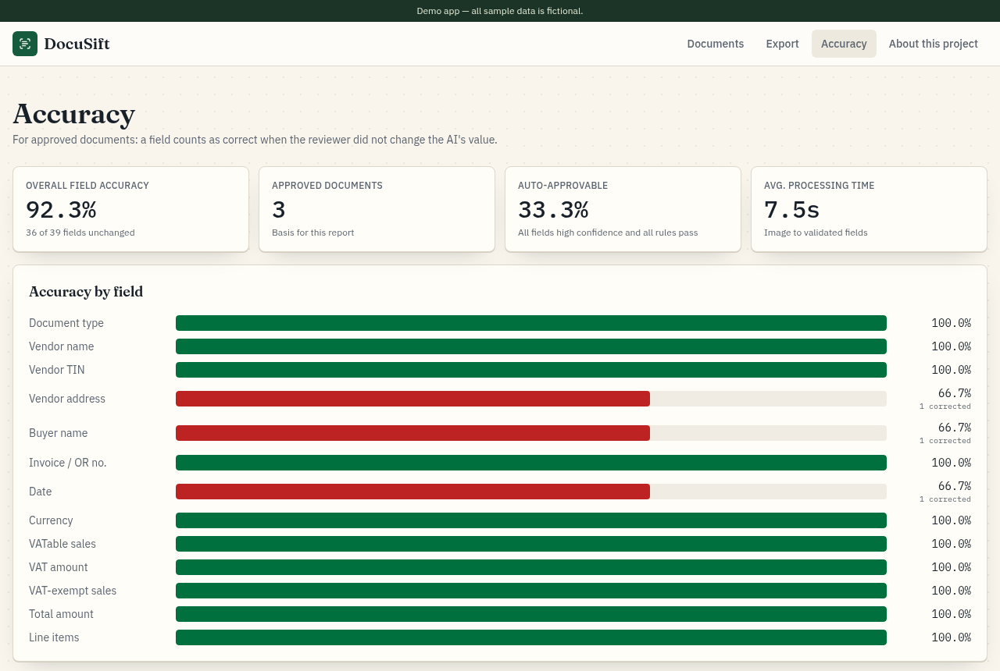

## Abstract

Bookkeepers in the Philippines still key invoices and official receipts into spreadsheets by hand, and a mistyped TIN or VAT amount surfaces months later. Those fields matter: a buyer's input VAT claim rests on the invoice showing the VAT amount and both parties' TINs. E-invoicing reaches covered taxpayers by December 31, 2026, but Micro taxpayers are exempt. I built DocuSift, which reads an invoice with a vision model. Rules in code check the math, the 12% VAT, the TIN format and the date, and doubtful documents go to a person. In browser testing, it read every field of three fictional invoices correctly and caught a deliberate PHP 100.00 total error. It runs as a live demo with fictional sample data.

## The problem I saw

Accounting staff and small finance teams in the Philippines still type sales invoices and official receipts into spreadsheets. The work is slow. A single mistyped digit in a TIN, a VAT amount or a total shows up later as a mismatch during reconciliation or tax filing.

Fully automatic extraction doesn't solve it either. Nobody signs off on a number without knowing how sure the system was and whether the math adds up. A useful tool has to read the document, check its own work and hand the doubtful cases to a person.

I co-developed the [VITE SEO ERP](/projects/vite-seo-erp), whose accounting module handled invoices, bills, bank reconciliation and BIR VAT reports. A system like that is only as good as the numbers that go into it.

Invoice data is getting more structured, not less. [BIR RMC 98-2026](/news/bir-rmc-98-2026-e-invoicing) sets e-invoicing rules for covered taxpayers before the end of 2026. Until every supplier issues e-invoices, paper and PDF invoices still need reading.

## What the data says

**The invoice is now the main sales document.** The BIR's Revenue Regulations No. 7-2024 changed the invoicing rules from April 27, 2024. Since then, official receipts are no longer valid as evidence of sales, as [KPMG's summary of the rules](https://kpmg.com/us/en/taxnewsflash/news/2024/07/tnf-philippines-updated-invoicing-requirements.html) notes. Leftover ORs can still be used as supplementary documents, stamped as not valid for input tax claims, per [P&A Grant Thornton's note on RR 7-2024](https://www.grantthornton.com.ph/insights/articles-and-updates1/tax-notes/clarification-on-the-invoicing-requirements-per-rr-no-7-2024-as-amended-by-rr-no-11-2024/).

**A few fields decide the VAT claim.** The same note says input VAT may be claimed when the invoice properly shows the sales amount and the VAT amount. It must also show both parties' registered names and TINs, what was sold and the date. [PwC's Philippines tax summary](https://taxsummaries.pwc.com/philippines/corporate/other-taxes) gives the same list.

**VAT is a flat 12%.** PwC's summary, last reviewed August 1, 2026, gives a uniform rate of 12%.

**E-invoicing is coming, but not for everyone.** The BIR issued [RMC No. 98-2026](https://bir-cdn.bir.gov.ph/BIR/pdf/RMC%20No.%2098-2026%20redacted.pdf) on September 22, 2026. It requires covered taxpayers, except Micro taxpayers, to issue electronic invoices on or before December 31, 2026. It adds that the BIR's system takes sales data in JSON.

**The best AP teams spend far less.** Two benchmarks show the gap in accounts payable (AP):

| Benchmark | Finding |
| --- | --- |
| [APQC's Blueprint for Success: Accounts Payable](https://www.apqc.org/blog/4-kpis-set-good-accounts-payable-organizations-apart) (2018) | Top performers' AP costs are one-fifth of the bottom quartile's, and they are five times more productive at processing invoices |
| [Ardent Partners' State of ePayables 2025](https://tradeshift.com/state-of-epayables-2025-report/) (200+ AP leaders, sponsored by Tradeshift) | Only 46% of organizations have deployed comprehensive ePayables solutions. Best-in-Class teams have 79% lower processing costs and 79% faster cycle times than peers |

## Why I chose this solution

**Read paper and PDF invoices, including ORs.** E-invoicing covers only some taxpayers, and ORs can still be used as supplementary documents. So DocuSift reads images and PDFs, and one of its three samples is a VAT-exempt official receipt.

**Check the fields that matter, in code.** The VAT claim rests on the sales amount, the VAT amount and the TINs. So the rules check the totals, the VAT and the TIN format. With a flat 12% rate, the VAT check is one multiplication. That's where code beats a model: in the NeurIPS 2023 paper [Faith and Fate](https://arxiv.org/pdf/2305.18654), off-the-shelf GPT-4 got only 59% of 3-digit by 3-digit multiplications right. [ProcessLens](/projects/processlens) uses the same split.

**Send doubtful documents to a person.** A wrong VAT amount or TIN can put the buyer's input VAT claim at risk. So anything below 0.75 confidence, or any failed rule, goes to review, and auto-approval is off by default.

**Keep the output structured.** The BIR is moving to structured data, with JSON for sales reporting. DocuSift already returns a fixed set of fields and exports approved documents as CSV.

The alternatives compare like this:

| Option | What it does well | Where it falls short |
| --- | --- | --- |
| Typing by hand | No new tools to learn | Slow, and a typo shows up at reconciliation or filing |
| Fully automatic extraction | Fast | No one knows how sure it was or whether the math adds up |
| DocuSift | Reads, checks in code, and routes doubtful cases to a person | Tested only on three fictional invoices |

## What I built

- **Documents:** upload a PNG, JPG or PDF up to 10 MB, or try one of three bundled fictional invoices. Every document shows its vendor, total, date and status: Processing, Needs review, Approved or Failed.
- **Extraction:** a vision model reads document type, vendor, TIN, address, buyer, invoice number, date, VATable, VAT and VAT-exempt amounts, total and line items. Each field gets a confidence score.
- **Validation:** five rules in code check the arithmetic, the 12% VAT, the TIN format and the date.
- **Review:** the document image beside editable fields with green, amber and red confidence badges, an editable line-item table and a panel listing every rule result. Approving records which fields the reviewer changed.
- **Export:** approved documents as a CSV with one row per document, or one row per line item.
- **Accuracy:** field-by-field accuracy, based on how often reviewers had to correct each field.

## How it works

DocuSift follows one pattern: extract, verify in code, then route to a person. The model only reads. Rules decide whether the numbers hold up. Anything the rules reject, or the model wasn't sure about, waits for a human.

1. The browser turns the file into an image. A PDF's first page is rendered with pdf.js.
2. The server stores the image in a private storage bucket and creates the document record.
3. A vision model, called through the Lovable AI gateway, returns the fields as structured output checked against a schema.
4. Rules in code check the result, with a tolerance of ±₱1.00:
   - Line items add up to the VATable plus VAT-exempt sales.
   - VATable plus VAT plus VAT-exempt equals the total.
   - VAT is 12% of the VATable sales.
   - The TIN matches the ###-###-###-### format, with 3 to 5 digits in the last group.
   - The invoice date is valid and not in the future.
5. Any field below 0.75 confidence, or any failed rule, sends the document to Needs review. Clean documents are approved automatically only if that setting is switched on, and it's off by default.

Keeping the rules out of the model was the main design choice. A model can read "11,199.20" correctly and still not notice that the total is wrong. A subtraction in code always notices.

Structured output makes the extraction predictable. Every response has the same fields, so the rules and the review screen never have to guess. Storing which fields reviewers changed turns everyday corrections into an accuracy report without any extra work.

## How I built and tested it

I built DocuSift by directing a small team of AI agents. One agent turned my brief into a spec with seven acceptance checks. It included three fictional samples: a clean sales invoice, a VAT-exempt official receipt and a hardware invoice. That invoice's printed total is deliberately PHP 100.00 too high. The agent built the app in Lovable, an AI app builder. One follow-up added timeouts, a "stuck in processing" state and clear Failed messages.

The stack:

- **App:** TanStack Start with React 19 and TypeScript, built in Lovable, with pdf.js for PDFs.
- **Database and storage:** Postgres and a private storage bucket on Lovable Cloud (Supabase).
- **AI:** a vision model through the Lovable AI gateway, using the Vercel AI SDK with structured output.
- **Tests:** Vitest, covering all five rules on the three samples, the review routing and the accuracy math.

A separate QA agent then tested the published app in a real browser.

QA ran all three samples through the real model and compared every field with the images.

| Sample | What the model read | What the rules said |
| --- | --- | --- |
| Sari-Sari Supplies Trading sales invoice | TIN 123-456-789-00000, SI 0001245, VATable ₱4,520, VAT ₱542.40, total ₱5,062.40 and all 4 line items | All 5 rules pass |
| Kusina ni Lola Catering official receipt | OR 004512, VAT-exempt sales ₱5,300 and 2 line items | All 5 rules pass |
| Mabilis Hardware sales invoice | The printed total of ₱11,199.20, exactly as shown | Totals rule fails: PHP 100.00 higher than ₱9,910 + ₱1,189.20 |

The third row is the point of the whole design. The model read the wrong total faithfully, as it should, and the rule caught it and sent the invoice to review.

QA also edited one vendor name and approved the document. On the Accuracy page, vendor name accuracy dropped from 100% to 75%, and the export showed the corrected name. An unreadable noise image ended as Failed, with "The image could not be read as an invoice or receipt" and a Retry button.

One bug came up in QA. When the browser tab was in the background, the image-loading step never finished, so uploads sat on "Extracting…" for over two minutes. Lovable changed how images load and added a 20-second timeout with a clear error. A retest on the published app confirmed that samples and re-extraction still complete with the new loader. The test browser couldn't fully recreate a background tab, so the timeout itself hasn't been seen firing.

## Results

- Every field of all three sample invoices read correctly.
- A deliberate PHP 100.00 total error caught by the rules and sent to review.
- Field-level accuracy that updates from real reviewer corrections.
- The acceptance checks passing in browser testing after one round of fixes. The phone-width layout and the file picker weren't part of the browser test, though a PNG passed straight to the upload input went through correctly.
- Live at [docusift-uriel.lovable.app](https://docusift-uriel.lovable.app), with fictional sample data.

## Limitations

- **Three fictional samples.** Every result comes from three fictional invoices. For a real finance team, I'd test on a few hundred of their suppliers' invoices and set the confidence threshold from that data.
- **First page only.** A real version should read every page of a multi-page PDF, not only the first.
- **No comparison with typing.** The Accuracy page shows average processing time, but I haven't compared it with typing the same invoices by hand. The benchmarks above show the direction, not a peso cost for a Philippine bookkeeper.
- **No link to the books.** A real version should push approved documents into the accounting system, with duplicate-invoice checks.
- **No logins or roles.** A real version should add them, so only finance staff can approve and export.
- **Untested paths.** The 20-second timeout hasn't been seen firing.
- **A reader, not an issuer.** DocuSift reads invoices and doesn't issue them, so it is no substitute for an e-invoicing system under RMC 98-2026.

## Sources

1. [Philippines: Updated invoicing requirements](https://kpmg.com/us/en/taxnewsflash/news/2024/07/tnf-philippines-updated-invoicing-requirements.html), KPMG TaxNewsFlash, July 2024.
2. [Clarification on the invoicing requirements per RR No.7-2024, as amended by RR No.11 -2024](https://www.grantthornton.com.ph/insights/articles-and-updates1/tax-notes/clarification-on-the-invoicing-requirements-per-rr-no-7-2024-as-amended-by-rr-no-11-2024/), P&A Grant Thornton, July 24, 2024.
3. [Philippines - Corporate - Other taxes](https://taxsummaries.pwc.com/philippines/corporate/other-taxes), PwC Worldwide Tax Summaries, last reviewed August 1, 2026.
4. [RMC No. 98-2026: Prescribing Policies and Guidelines on the Issuance of Electronic Invoice](https://bir-cdn.bir.gov.ph/BIR/pdf/RMC%20No.%2098-2026%20redacted.pdf), Bureau of Internal Revenue, September 22, 2026.
5. [4 KPIs Set Good Accounts Payable Organizations Apart](https://www.apqc.org/blog/4-kpis-set-good-accounts-payable-organizations-apart), APQC blog post summarizing APQC's Blueprint for Success: Accounts Payable (second edition), May 22, 2018.
6. [The state of ePayables 2025: AP's unfinished journey](https://tradeshift.com/state-of-epayables-2025-report/), report by Ardent Partners, on the download page of its sponsor, Tradeshift, June 16, 2025.
7. [Faith and Fate: Limits of Transformers on Compositionality](https://arxiv.org/pdf/2305.18654), Dziri et al., NeurIPS 2023.
