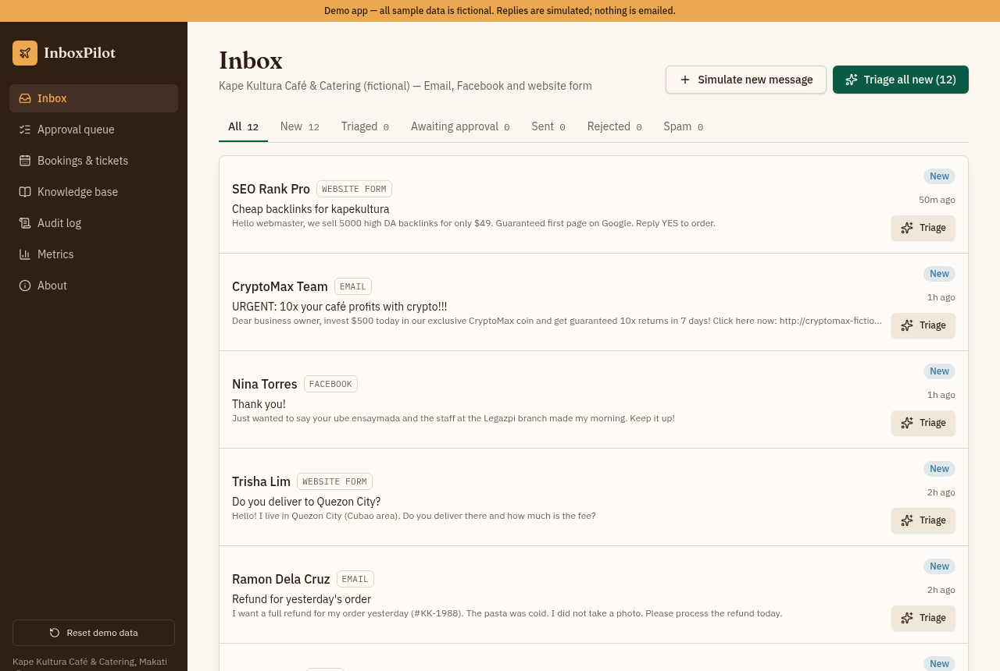
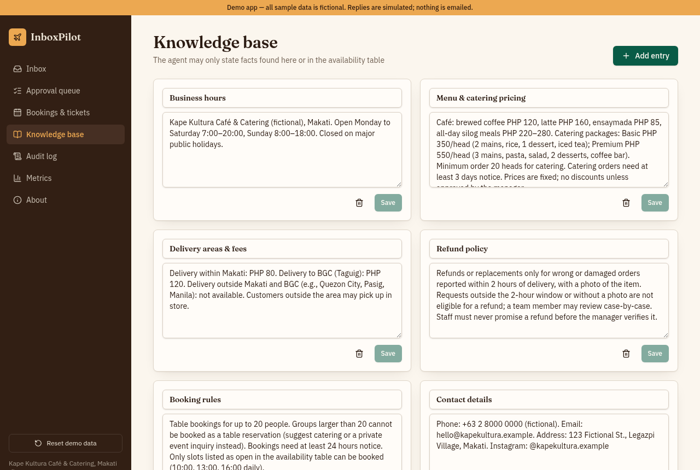

## Abstract

A small café or caterer answers bookings, quotes, complaints and spam across email, Facebook and website forms. In late 2025, Meta's ads on Messenger reached 65.8 million people in the Philippines. In 2024, a Canadian tribunal held Air Canada liable for its chatbot's wrong refund advice. I built InboxPilot, an AI agent that classifies messages, checks real data with tool calls, drafts a grounded reply and proposes bookings or tickets. Nothing happens until a person approves it. In browser testing on fictional sample data, it triaged 12 messages in about 40 seconds, with no invented prices, refunds or availability.

## The problem I saw

A café or caterer gets messages all day: catering quotes, table bookings, late deliveries, refund requests and spam. Someone has to read each one, work out what it is, look up the hours, prices or open slots, and write a reply. That's staff time every day.

Speed is only half the problem. A rushed reply can promise a refund the policy doesn't allow, a delivery to an area the business doesn't serve, or a table that's already taken. Every one of those becomes a cost or an angry customer.

At VITE SEO Digital Advertising, I led and co-developed an [AI chatbot for Messenger and Instagram with n8n](/blog/n8n-messenger-instagram-chatbot). It answered inquiries from our Meta ads on its own, even at night and on weekends, and did best with simple, repeated questions. It struggled with mixed Taglish and short messages like "how much?", where it sometimes guessed which service the person meant.

InboxPilot explores the other design: the agent prepares the reply and the actions, and a person decides. For anything that changes a booking or money, that's the safer default.

## What the data says

**The channel is large.** DataReportal's [Digital 2026 report on the Philippines](https://datareportal.com/reports/digital-2026-philippines) counts 95.8 million Facebook users in late 2025. Meta's ads on Messenger reached 65.8 million, or 56.2% of the population. Both are ad reach, not active users.

**Customers expect a reply within a day.** In the [2025 Sprout Social Index](https://sproutsocial.com/insights/social-media-customer-service-statistics/), about three quarters of consumers expect a brand to respond on social within 24 hours or sooner. In the same study, [73% said they'll buy from a competitor](https://www.globenewswire.com/news-release/2025/01/07/3005527/0/en/index.html) if a brand doesn't respond. Glimpse surveyed 4,044 consumers in the US, UK, Canada and Australia in September 2024.

**Messenger has a clock.** Meta's [Send API documentation](https://developers.facebook.com/docs/messenger-platform/send-messages) gives a business a 24-hour standard messaging window after a person messages its Page. After that, it needs a message tag or another permitted message type, and tags can't carry deals or discounts.

**A business owns what its bot says.** In [Moffatt v. Air Canada](https://decisions.civilresolutionbc.ca/crt/crtd/en/525448/1/document.do), decided February 14, 2024, the airline's chatbot said a bereavement fare could be claimed after travel. Its own policy page said otherwise. Air Canada argued it wasn't liable for its chatbot. The tribunal replied: "It should be obvious to Air Canada that it is responsible for all the information on its website." It ordered the airline to pay $812.02 (Canadian).

**Philippine law treats false promises as deceptive.** Article 50 of the [Consumer Act, RA 7394](https://bps.dti.gov.ph/index.php/component/edocman/7-laws-and-issuances/8-republic-acts/225-republic-act-no-7394-consumer-act-of-the-philippines), makes a deceptive sales act a violation "whether it occurs before, during or after the transaction." Its examples include a false price advantage and false statements about "rights, remedies or obligations". The [Internet Transactions Act, RA 11967](https://elibrary.judiciary.gov.ph/thebookshelf/showdocs/2/96902), adds a ₱20,000 to ₱100,000 fine for an online merchant or e-retailer's first deceptive sales act online.

## Why I chose this solution

Replying by hand is slow at busy times and after hours. A fully automatic chatbot is instant, but no one checks its promises before they go out. InboxPilot sits between them: fast triage, with tool calls, code rules and a person checking every reply.

The Moffatt decision shows why a person approves every action. A business answers for what its bot tells customers, and Philippine law can treat a false price or refund promise as deceptive. So nothing goes out without a human decision.

Grounding is the second choice. My n8n chatbot needed a prompt update every time our packages changed. InboxPilot keeps those facts in a knowledge base a person can edit. The agent must look them up with a tool, and each draft lists the entries it used.

Rules that cost money live in code, not in the prompt. The agent doesn't guess whether 1:00 PM is open; it checks the availability table, and the code checks it again on approval. That double check is what keeps a confident model from double-booking a table. [My take on Claude's unsanctioned actions](/news/anthropic-claude-agent-unsanctioned-actions) argues the same for all agents: put the limits outside the model.

Speed comes from triage, not from skipping the review. The agent triages three messages at a time, and the approval queue puts the oldest first, nearest the end of Messenger's 24-hour window.

Each draft also shows the agent's intent, confidence and reasoning, so a reviewer can catch a guessed intent before it becomes a reply. The audit log then traces any disputed reply to what the agent proposed and what the reviewer decided.

## What I built

- **Inbox:** messages from email, Facebook and a website form, with status tabs and buttons to triage one message or all new ones.
- **Approval screen:** the agent's read of the message (intent, priority, sentiment, confidence and reasoning), an editable reply with the knowledge-base entries it used, and proposed actions as cards. A person can approve and send, edit, reject with a reason, or re-run the agent.
- **Approval queue:** every message waiting for a decision, oldest first.
- **Bookings and tickets:** rows that exist only because a person approved them, plus the table availability for the next 14 days.
- **Knowledge base:** the facts the agent must stick to: hours, menu and catering prices, delivery areas, refund policy and booking rules.
- **Audit log and metrics:** every tool call and human decision, plus approval, edit and rejection rates computed from stored data.
- **Webhook:** a public endpoint that accepts new messages from any outside system, with input validation.

The demo business is Kape Kultura Café & Catering, a fictional café in Makati. Sending is simulated, so no real email ever goes out.

The app runs on TanStack Start with React 19 and TypeScript, built in Lovable. The database is Postgres on Lovable Cloud (Supabase), with row-level security and no direct browser access to any table. AI calls go through the Lovable AI gateway and the Vercel AI SDK, with tool calling. Vitest covers the metrics math and routing.

## How it works

InboxPilot is a tool-calling agent with a person in the middle. For each message, the model can look things up freely:

- `search_knowledge_base` for hours, prices, delivery areas and policies.
- `check_availability` for open table slots on a date.

It can also propose changes, but proposals only write pending rows:

- `propose_booking`, `propose_ticket` and `flag_spam`.

The loop ends when the model calls `submit_triage` with a structured result: intent, priority, sentiment, confidence, reasoning, the reply draft and the sources it used.

Guardrails live in two places. The agent's instructions forbid refunds, discounts or availability that aren't in the knowledge base or the availability table. The code enforces the booking rules, whatever the model says. `propose_booking` rejects parties over 20, slots that are taken and requests with less than 24 hours' notice.

When a person approves, the server checks the slot again, creates the booking, marks the slot as taken and writes the audit entries. Only then does the reply count as sent.

## How I built and tested it

I built InboxPilot by directing a small team of AI agents. One agent turned my brief into a spec with eight acceptance checks and built the app in Lovable, an AI app builder. One detailed message built the app, and one follow-up fixed what the agent's code review found, including a database reset function. The agent also made the demo refresh itself. After 24 hours with no activity, it resets on the next visit. Otherwise, it extends the 14-day slot window, so booking dates never go stale.

A separate QA agent then tested the published app in a real browser and read every drafted reply against the knowledge base.

QA started from a fresh demo with 12 new messages and pressed "Triage all new". All 12 were done in about 40 seconds, three at a time, each with an intent, priority and confidence.

| Message | What the agent did |
| --- | --- |
| A table for 4 on an open slot | Proposed a booking for that exact slot. Approving it created the booking and marked the slot taken. |
| A table for 30 people | Declined politely, citing the 20-person limit, suggested catering instead, and proposed no booking. |
| Delivery to Quezon City | Answered that the café only delivers within Makati and BGC, citing the knowledge base. |
| A crypto offer and SEO backlink spam | Flagged both as spam, with no reply drafted. |

QA read all 12 drafts against the knowledge base and found no invented prices, refunds or availability. Catering quotes were computed correctly, for example 50 Premium guests at ₱550 a head came to ₱27,500.

QA also tested the human side. Editing a draft before approving raised the edit rate on the Metrics page, and rejecting a message required a reason and logged it. The webhook returned 201 for a valid message and a clear 400 error for bad input. QA tried a missing field, a bad email, an unknown channel, a body over 5,000 characters and invalid JSON.

One wording problem came up after QA. The booking draft said the table was "pending team approval", but the reply is only sent after a person approves, and approval creates the booking. The agent now confirms the booking plainly with the exact date and time: "Your table for 4 under Paolo Garcia on Thursday, Nov 5 at 1:00 PM is confirmed." A server check also blocks that confirmation from going out unchanged if the reviewer unticks the booking.

## Results

- 12 messages triaged in about 40 seconds, each with intent, priority and confidence.
- No invented prices, refunds or availability across all 12 drafts.
- Every booking, ticket and spam flag happens only after a person approves it, with a full audit trail.
- The acceptance checks passing in browser testing, plus the webhook tested with direct requests. The phone-width layout wasn't part of the browser test.
- Live at [inboxpilot-uriel.lovable.app](https://inboxpilot-uriel.lovable.app), with fictional sample data.

## Limitations

InboxPilot is a demo, not a deployment. The café, messages and knowledge base are fictional, and no real customer has used it. One QA run of 12 messages shows the design works; it is not an accuracy rate.

QA did not score intents or priorities against a labeled set. The 40 seconds covers triage, not review time, and the phone-width layout wasn't part of the browser test.

The evidence has limits too. The Sprout Social survey didn't cover the Philippines. Moffatt is a Canadian decision, and my reading of RA 7394 and RA 11967 is not legal advice.

What would make it stronger for a real business:

- Connect real channels (Gmail, Messenger and the website form) with signed webhooks, and send for real after approval.
- Add staff logins with roles, so the right person sees each message.
- Auto-approve only high-confidence, low-risk replies, like answers about opening hours, and keep bookings and refunds human.
- Build a test set of real messages for each intent and track accuracy over time, the same way [PolicyDesk](/projects/policydesk) tests its answers.

## Sources

1. [Digital 2026: The Philippines](https://datareportal.com/reports/digital-2026-philippines), DataReportal, November 5, 2025.
2. [Social media customer service statistics to know in 2026](https://sproutsocial.com/insights/social-media-customer-service-statistics/), Sprout Social, September 8, 2026.
3. [The Days of Trend-Chasing Are Over: New Research from Sprout Social Reveals a Third of Consumers Think Jumping on Viral Trends is "Embarrassing" for Brands](https://www.globenewswire.com/news-release/2025/01/07/3005527/0/en/index.html), Sprout Social via GlobeNewswire, January 7, 2025.
4. [Send a Message](https://developers.facebook.com/docs/messenger-platform/send-messages), Meta for Developers, accessed November 2026.
5. [Moffatt v. Air Canada, 2024 BCCRT 149](https://decisions.civilresolutionbc.ca/crt/crtd/en/525448/1/document.do), Civil Resolution Tribunal of British Columbia, February 14, 2024.
6. [Republic Act No. 7394 (Consumer Act of the Philippines)](https://bps.dti.gov.ph/index.php/component/edocman/7-laws-and-issuances/8-republic-acts/225-republic-act-no-7394-consumer-act-of-the-philippines), Department of Trade and Industry, Bureau of Philippine Standards, accessed November 2026.
7. [Republic Act No. 11967: An Act Protecting Online Consumers and Merchants Engaged in Internet Transactions](https://elibrary.judiciary.gov.ph/thebookshelf/showdocs/2/96902), Supreme Court E-Library, December 5, 2023.
