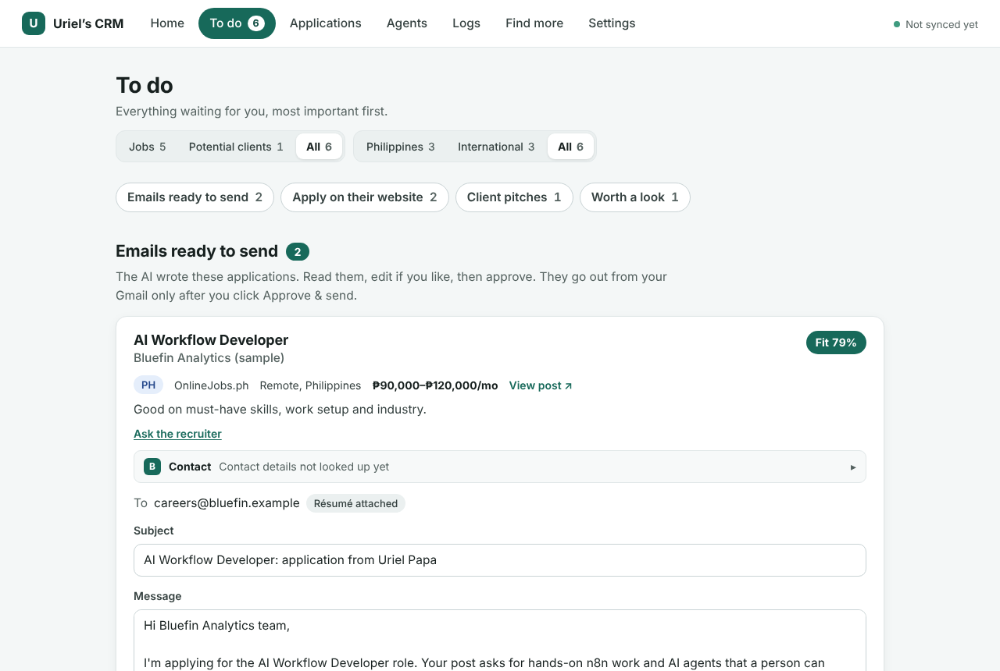
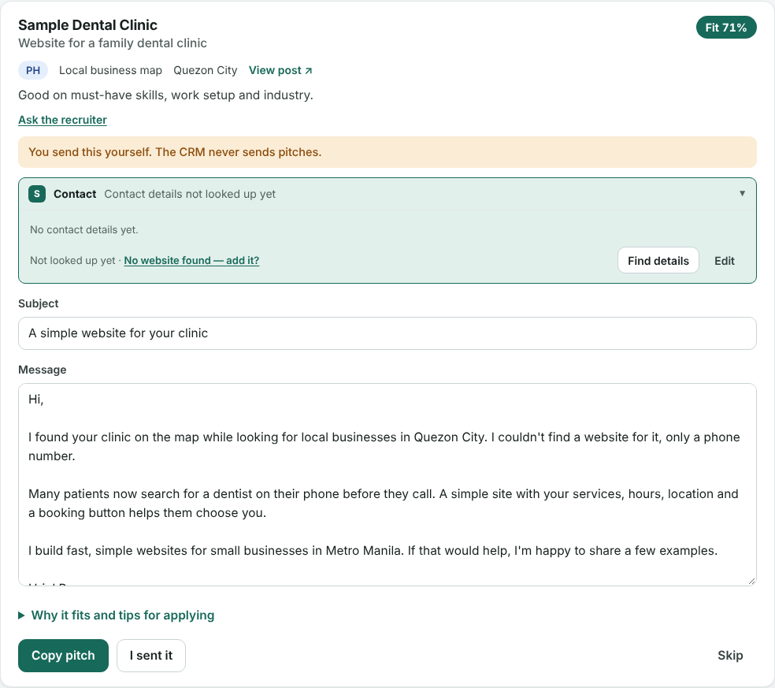

## Abstract: the job and client CRM in brief

I'm [deciding what comes next](/now): a job, freelancing or a new business. Good openings are spread across remote job boards, Philippine boards, Hacker News threads and local businesses with no website. I built a personal CRM that searches them for me. A server runs n8n around the clock to find and score opportunities, and my Mac holds the database, the interface and every decision. Each match is scored from both sides, so a job I want but can't get, or one that wants me but pays too little, sinks. The first real scoring run judged 26 jobs for about US$0.0025 in total. Nothing is sent until I approve it, and client pitches are never sent by the CRM at all.

## The problem I saw: openings scattered across a dozen places

After [my agency closed](/blog/closing-my-agency), I needed both kinds of work in view at once: jobs I could apply for and businesses that might hire me as a freelancer. They live in very different places. Remote jobs sit on global boards and company career pages. Philippine jobs sit on Kalibrr and OnlineJobs.ph. Freelance work shows up in Hacker News threads, and some of the best client leads are local businesses that simply have no website.

Checking all of that by hand every day is a part-time job. Worse, most of what I'd find wouldn't fit. A role might be open only to US residents, need working hours I can't keep from Manila, or pay less than I need.

The opposite mistake costs more. Mass-applying with a bot burns the Gmail, LinkedIn and Upwork reputations a freelancer in the Philippines can't easily rebuild. I wanted fewer, better applications, each one checked by me.

## What the research says about two-sided matching

**Fit has two sides.** A good match needs the job to suit me and me to clear the employer's screen. Wantedly, a Japanese job platform, tested this on its own production data in [a 2024 paper on reciprocal job recommendations](https://arxiv.org/abs/2409.10992). Combining both sides beat either side alone:

| How matches were ranked | NDCG@10 |
| --- | --- |
| Company side only | 0.0592 |
| Job seeker side only | 0.0886 |
| Product of both sides | 0.0969 |
| Harmonic mean of both sides | 0.0979 |
| Learned blend (the paper's method) | 0.1050 |

**Job boards don't let you apply by bot.** Greenhouse's [Job Board API documentation](https://docs.greenhouse.io/job-board.html) says its job listings are public, so reading them needs no key. Submitting an application "requires HTTP Basic Auth" with the employer's own API key. So the CRM reads public listings and leaves the application form to me.

**Scoring can be almost free.** Jev, a decision model from TypeSafe, returns typed answers with probabilities instead of prose. Its [OpenRouter guide](https://openrouter.ai/docs/guides/community/jev) lists yes-or-no, scale and choice questions. In the [OpenRouter model catalog](https://openrouter.ai/api/v1/models?output_modalities=decisions) on November 6, 2026, Jev 1.14 cost US$0.042 per million input tokens, with free output.

## Why I split the CRM between my Mac and a server

The design follows one rule. Anything I decide, or anything that identifies me in full, lives on my Mac. Anything the pipeline produces waits on the server until my Mac picks it up.

The server does the work that never sleeps. It searches the sources, filters and scores what it finds, and later sends the emails I approved. My Mac holds the full database, the interface and my profile. The interface only listens on the Mac itself, so it's never on the internet.

Sync runs one way. My Mac always starts it, over a private network with a token as a second lock, and the server never calls my Mac. When the laptop is closed, the server just keeps the matches waiting. That makes the approval gate a property of the network, not only of the code: the server can't send anything without a decision that came from my laptop.

Writing runs on subscriptions I already pay for. Claude Code and Google's Antigravity command-line tool run on my Mac, with no tools or web access, to draft emails and notes. The only pay-per-use cost is Jev.

## What I built: the CRM features

- **To do:** everything waiting for me, split into emails ready to send, jobs to apply for on the company's own site, client pitches and matches worth a second look. Every list has a Philippines, international or all switch.
- **Sources:** five global remote job boards, Kalibrr and OnlineJobs.ph for Philippine jobs, Hacker News hiring and freelancer threads, and Greenhouse, Lever and Ashby pages for companies I target.
- **Client leads:** OpenStreetMap searches for Metro Manila clinics, offices, salons, gyms and hotels that have a phone or Facebook page but no website.
- **Add a post:** paste a post I saw on Facebook, X, Threads or LinkedIn, and it's scored like everything else.
- **Recruiter:** a candid pursue-or-skip review for strong matches, with odds, gaps, a plan and interview prep, written from my own data.
- **Contact lookup:** a company's public contact details, kept only when they can be traced back to a page the CRM fetched itself.
- **Applications, Agents and Logs:** every application and its outcome, every background worker with its schedule and expected cost, and the run logs from both machines.

My profile comes from my résumé and the project pages on this site. So the case studies you're reading are part of what the CRM matches against.

## How the CRM works: from posting to approved email

Every opportunity goes through five stages:

1. **Hard filters in code.** Pay is converted to US dollars a month and checked against my floor, with a separate peso floor for Philippine jobs. US-only work authorization and impossible time zones are removed here.
2. **Jev's knockout questions.** One batched call asks whether the role accepts someone in the Philippines, whether I meet the minimum years, and whether the posting looks like a scam.
3. **Two directional scores.** One score covers how well I fit the job's must-haves, seniority and evidence. The other covers how well the job fits my pay, work mode, industry and hours.
4. **A harmonic mean.** The two scores combine as a harmonic mean, which stays low when either side is low. One-sided matches sink.
5. **Routing.** A strong match with an email address gets a drafted application. One with only an apply link gets a card with tailoring notes. Unsure matches go to "Worth a look", and the rest are archived.

Writing comes last. Claude is told to explain Jev's answers, not to re-decide them, and to back each must-have with a quote from my résumé or this site. A quote that isn't an exact match of the stored text is rejected, so a draft can't invent experience I don't have.

Application emails go out from my own Gmail only after I click Approve, with my résumé attached. Client pitches are drafts only: I copy one, send it myself, then mark it sent. The CRM refuses to send a pitch at three separate layers: the interface, the sync agent and the server's database.

## How I built and tested the CRM

I started with research, not code. AI agents researched sources, matching, deliverability and the rules on unsolicited email, and I turned that into a design report. I then directed AI agents to build each part against a written spec, the same way I built [InboxPilot](/projects/inboxpilot). The server side builds on what I learned at my agency, building [an AI chatbot for Messenger and Instagram with n8n](/blog/n8n-messenger-instagram-chatbot) and the [VITE SEO ERP's outreach workflows](/projects/vite-seo-erp).

Testing came in three rounds:

- **A local test bed with a real n8n.** The finder fetched 9 live feeds and staged 105 relevant postings, and the hard filters removed 19 that were locked to other regions. A full loop then ran against a local mail sink, so no real email was sent: a simulated match, sync, a Claude draft with 4 verified quotes, approval, and a send with the résumé attached.
- **A rehearsal of the server stack in Docker.** It found and fixed two setup bugs before anything touched the real server.
- **A security audit on November 6, 2026.** It found no critical or high issues. Fixes included a stricter guard on the contact lookup's web fetches, running the writing models with their tools and web access turned off, and a constant-time check of the sync token.

The code has 89 automated tests, and its only npm dependency is the Postgres driver.

## Results: what the CRM did in its first runs

- Deployed to my server on November 6, 2026, with the finder running every 6 hours and the scorer every 30 minutes.
- The first real Jev run scored 26 jobs for about US$0.0025 in total, around US$0.0001 and 5 seconds per job.
- Every match carries its reasons: each criterion is its own question, and each must-have keeps the exact line from the posting.
- No email can be sent without my approval, and no pitch can be sent by the CRM at all.
- The monthly running cost is my existing server plus Jev, since drafting runs on subscriptions I already have.

## Limitations of the CRM

The CRM is a personal tool, not a product. It runs for one person, on my own Mac and server, and it isn't public.

Its scores aren't calibrated yet. No published benchmark covers Jev on résumé and job matching. The plan is to hand-label 30 to 50 matches before trusting any threshold, then fit the weights to real replies and interviews after 100 to 200 outcomes.

Some parts aren't built or tested yet:

- Sending from Gmail isn't switched on yet. The send path was tested against a local mail sink.
- Reading replies from a real inbox hasn't been tested.
- Job-alert emails, Reddit and automatic follow-ups aren't built.
- Facebook, X and Threads have no permitted automated access, so posts from them are pasted by hand.
- Most map leads have only a phone number or a Facebook page, so many pitches still need a contact found by hand.

## Sources

1. [A Best-of-Both Approach to Improve Match Predictions and Reciprocal Recommendations for Job Search](https://arxiv.org/abs/2409.10992), Shuhei Goda, Yudai Hayashi and Yuta Saito (Wantedly and Cornell University), arXiv, 2024.
2. [Job Board API](https://docs.greenhouse.io/job-board.html), Greenhouse, accessed November 2026.
3. [Jev](https://openrouter.ai/docs/guides/community/jev), OpenRouter documentation, accessed November 2026.
4. [Decision models](https://openrouter.ai/api/v1/models?output_modalities=decisions), OpenRouter model catalog, accessed November 6, 2026.
