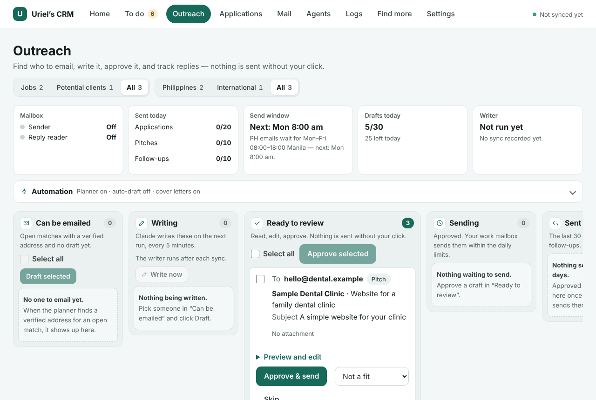

## Abstract: the job and client CRM in brief

I'm [deciding what comes next](/now): a job, freelancing or a new business. Good openings are spread across remote job boards, Philippine boards, Hacker News threads and local businesses with no website. I built a personal CRM that runs the whole search for me, from finding an opening to writing the email. Thirteen agents share the work: five on a server that never sleeps, and eight on my Mac. Each match is scored from both sides, so a job I want but can't get, or one that wants me but pays too little, sinks. The first real scoring run judged 26 jobs for about US$0.0025 in total. Nothing is sent until I approve it.

## The problem I saw: openings scattered across a dozen places

After [my agency closed](/blog/closing-my-agency), I needed both kinds of work in view at once: jobs I could apply for and businesses that might hire me as a freelancer. They live in very different places. Remote jobs sit on global boards and company career pages. Philippine jobs sit on Kalibrr and OnlineJobs.ph. Freelance work shows up in Hacker News threads, and some of the best client leads are local businesses that simply have no website.

Checking all of that by hand every day is a part-time job. Most of what I'd find wouldn't fit. A role might be open only to US residents, need working hours I can't keep from Manila, or pay less than I need.

Even a good match takes work. I'd still have to find the right person to write to, tailor an email and a cover letter, and remember to follow up. The opposite shortcut costs more: mass-applying with a bot burns the email and account reputations a freelancer in the Philippines can't easily rebuild. I wanted fewer, better applications, each one checked by me.

## What the research says about two-sided matching

**Fit has two sides.** A good match needs the job to suit me and me to clear the employer's screen. Wantedly, a Japanese job platform, tested this on its own production data in [a 2024 paper on reciprocal job recommendations](https://arxiv.org/abs/2409.10992). Combining both sides beat either side alone:

| How matches were ranked | NDCG@10 |
| --- | --- |
| Company side only | 0.0592 |
| Job seeker side only | 0.0886 |
| Product of both sides | 0.0969 |
| Harmonic mean of both sides | 0.0979 |
| Learned blend (the paper's method) | 0.1050 |

**Job boards don't let you apply by bot.** Greenhouse's [Job Board API documentation](https://docs.greenhouse.io/job-board.html) says its job listings are public, so reading them needs no key. Submitting an application "requires HTTP Basic Auth" with the employer's own API key. So the CRM reads public listings, and when a job has its own form, it leaves the form to me.

**Scoring can be almost free.** Jev, a decision model from TypeSafe, returns typed answers with probabilities instead of prose. Its [OpenRouter guide](https://openrouter.ai/docs/guides/community/jev) lists yes-or-no, scale and choice questions. In the [OpenRouter model catalog](https://openrouter.ai/api/v1/models?output_modalities=decisions) on November 6, 2026, Jev 1.14 cost US$0.042 per million input tokens, with free output.

## Why I split the CRM between my Mac and a server

The design follows one rule. Anything I decide, or anything that identifies me in full, lives on my Mac. Anything the pipeline produces waits on the server until my Mac picks it up.

The server does the work that never sleeps. It searches the sources, scores what it finds, sends the emails I approved and reads the replies. My Mac holds the full database, the interface and my profile. The interface only listens on the Mac itself, so it's never on the internet.

Sync runs one way. My Mac always starts it, over a private network with a token as a second lock, and the server never calls my Mac. When the laptop is closed, the server just keeps the matches waiting. That makes the approval gate a property of the network, not only of the code: the server can't send anything without a decision that came from my laptop.

Each AI model sees only what it needs. My profile goes to Claude only, running on my Mac with its tools and web access turned off. Gemini researches companies on the web, so it only ever gets public facts about the company, never my profile. Writing runs on subscriptions I already pay for, so the only pay-per-use cost is Jev.

## What I built: 13 agents and the CRM features

The Agents page lists every worker, where it runs, whether it's working and what it's expected to cost this month.

| Agent | Where | What it does |
| --- | --- | --- |
| Job and client finder | Server | Searches the job boards and the map every 6 hours |
| AI scorer (Jev) | Server | Scores both sides of each match every 30 minutes |
| Sender | Server | Sends approved emails from my work mailbox |
| Reply reader | Server | Reads replies, sorts them with Jev, and stops on "stop" |
| Cleanup and error alerts | Server | Clears old staged data and reports failures |
| Scout | Mac | Reads a post and works out who is really hiring |
| Researcher | Mac | Searches the web for a company's public contact details |
| Verifier | Mac | Keeps a contact only if a fetched page proves it |
| Contact finder | Mac | Reads the company's own website politely |
| Outreach planner | Mac | Decides form, email or wait, and picks the address |
| Writer | Mac | Drafts emails, cover letters and follow-ups |
| Recruiter | Mac | Gives candid pursue-or-skip advice, and answers questions in a chat |
| Sync | Mac | Moves matches and decisions between the two machines |

The sources cover five global remote job boards, Kalibrr and OnlineJobs.ph, Hacker News hiring and freelancer threads, and the Greenhouse, Lever and Ashby pages of companies I target. OpenStreetMap supplies Metro Manila clinics, offices, salons, gyms and hotels with no website. I can also paste a post I saw on Facebook, X, Threads or LinkedIn, and it's scored like the rest.

The interface puts each step on its own page. To do holds everything waiting for me, and the Outreach board follows each lead from "can be emailed" to "sent and replies". Mail shows what went out and what came back. Applications tracks every outcome, and every list has a Philippines, international or all switch.

My profile comes from my résumé and the project pages on this site. So the case studies you're reading are part of what the CRM matches against.

## How the CRM works: from posting to approved email

Every opportunity goes through seven stages:

1. **Hard filters in code.** Pay is converted to US dollars a month and checked against my floor, with a separate peso floor for Philippine jobs. US-only work authorization and impossible time zones are removed here.
2. **Jev's questions.** One batched call asks whether the role accepts someone in the Philippines, whether I meet the minimum years, whether I have each must-have, and whether the posting looks like a scam.
3. **A harmonic mean.** One score covers how well I fit the job. The other covers how well the job fits my pay, work mode, industry and hours. A harmonic mean stays low when either side is low, so one-sided matches sink.
4. **Scout and research.** Scout reads the post and spots when a recruiter or agency is hiring for a hidden client. Gemini looks for public contact details, and Claude keeps a detail only when its quote really appears on a page the CRM fetched itself.
5. **The outreach plan.** A job with its own application form gets the link and tailored notes, never an email. Otherwise the planner picks the best verified address, preferring the posting's own address, then careers or HR inboxes. It skips anyone who said "stop", any company emailed in the last 90 days, and any company I've already applied to.
6. **Writing.** Claude explains Jev's answers instead of re-deciding them. Every claim about me needs a quote from my résumé or this site, and a quote that isn't an exact match is rejected. Job applications also get a one-page cover letter, printed to PDF and attached after the résumé. A sentence with a number found in neither my sources nor the posting is dropped.
7. **Approval and sending.** Nothing goes out until I click Approve, one by one or in a batch. A client pitch without an opt-out line is refused. The server then sends at most 20 applications and 10 pitches a day, 4 minutes apart, and only on weekdays from 8 a.m. to 6 p.m. Manila time for Philippine recipients.

Follow-ups work the same way. After 5 quiet days, a follow-up is drafted into the same queue and waits for my approval. A reply that says "stop" adds the address to the suppression list for good.

## How I built and tested the CRM

I started with research, not code. AI agents researched sources, matching, deliverability and the rules on unsolicited email, and I turned that into a design report. I then directed AI agents to build each part against a written spec, the same way I built [InboxPilot](/projects/inboxpilot). The server side builds on what I learned at my agency, building [an AI chatbot for Messenger and Instagram with n8n](/blog/n8n-messenger-instagram-chatbot) and the [VITE SEO ERP's outreach workflows](/projects/vite-seo-erp).

Testing came in rounds:

- **A local test bed with a real n8n.** The finder fetched 9 live feeds and staged 105 relevant postings, and the hard filters removed 19 that were locked to other regions. A full loop then ran against a local mail sink, so no real email was sent: a simulated match, sync, a Claude draft with 4 verified quotes, approval, and a send with the résumé attached.
- **A rehearsal of the server stack in Docker.** It found and fixed two setup bugs before anything touched the real server.
- **A security audit on November 6, 2026.** It found no critical or high issues. Fixes included a stricter guard on the contact lookup's web fetches, running the writing models with their tools and web access turned off, and a constant-time check of the sync token.
- **A dry run of the outreach plan.** The planner can print who it would email, and why, without writing anything.

The code has 141 automated tests. On November 7, 2026, I re-ran the 71 that don't need a database, and all of them passed. The whole app is about 18,000 lines, and its only npm dependency is the Postgres driver.

## Results: what the CRM can do today

- Searches more than ten sources around the clock, and scores each match from both sides.
- The first real Jev run scored 26 jobs for about US$0.0025 in total, around US$0.0001 and 5 seconds per job.
- Every match carries its reasons: each criterion is its own question, and each must-have keeps the exact line from the posting.
- Every contact detail is traced to a page the CRM fetched, and every claim in an email or cover letter is backed by a quote.
- No email can be sent without my approval, and daily limits, a send window and a "stop" list hold even after I approve.
- The monthly running cost is my existing server plus Jev, since writing runs on subscriptions I already have.

## Limitations of the CRM

The CRM is a personal tool, not a product. It runs for one person, on my own Mac and server, and it isn't public.

Sending isn't switched on yet. The sender and reply reader are built, but they wait until my work mailbox is connected. The send path so far has only been tested against a local mail sink.

Its scores aren't calibrated yet. No published benchmark covers Jev on résumé and job matching. The plan is to hand-label 30 to 50 matches before trusting any threshold, then fit the weights to real replies and interviews after 100 to 200 outcomes.

Some parts aren't built or tested yet:

- Reading replies from a real inbox hasn't been tested.
- Follow-ups don't thread under the first email in the recipient's inbox.
- Job-alert emails and Reddit aren't connected.
- Facebook, X and Threads have no permitted automated access, so posts from them are pasted by hand.
- Most map leads have only a phone number or a Facebook page, so many still need a contact found by hand.

## Sources

1. [A Best-of-Both Approach to Improve Match Predictions and Reciprocal Recommendations for Job Search](https://arxiv.org/abs/2409.10992), Shuhei Goda, Yudai Hayashi and Yuta Saito (Wantedly and Cornell University), arXiv, 2024.
2. [Job Board API](https://docs.greenhouse.io/job-board.html), Greenhouse, accessed November 2026.
3. [Jev](https://openrouter.ai/docs/guides/community/jev), OpenRouter documentation, accessed November 2026.
4. [Decision models](https://openrouter.ai/api/v1/models?output_modalities=decisions), OpenRouter model catalog, accessed November 6, 2026.
