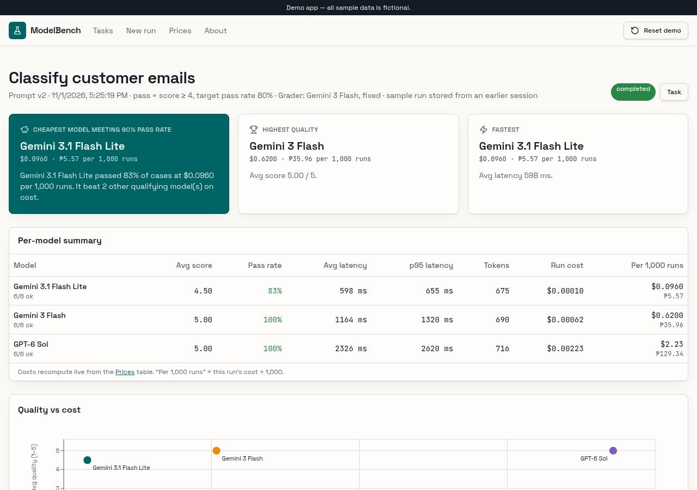
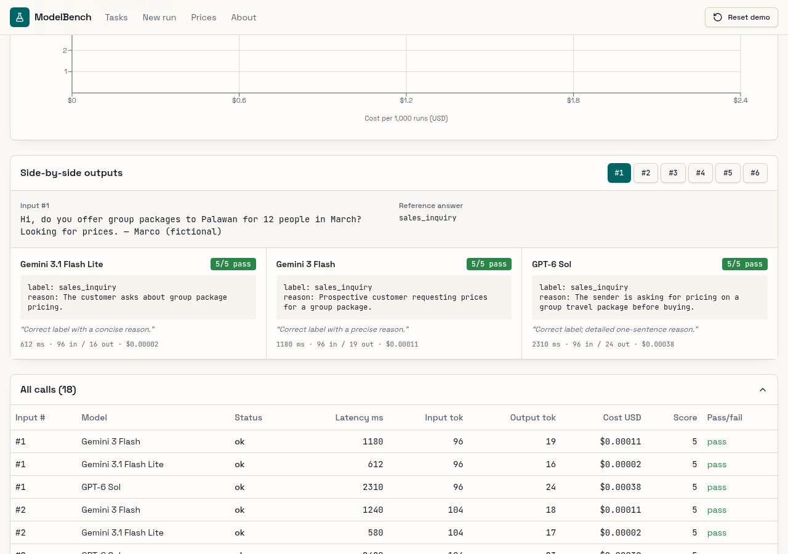

## Abstract

Picking an AI model for a business task is a cost decision. As of November 2026, OpenAI's flagship list prices run from US$0.50 per million output tokens on GPT-6 Luna to US$50 on GPT-6 Astra. Public leaderboards don't settle the choice, and a 2025 study found that private testing on Chatbot Arena favors a few providers. I built ModelBench, which runs one task's inputs on several models, grades every answer against a rubric and prices each run from its tokens. On a seeded email-classification run at example prices, a model about 23 times cheaper than GPT-6 Sol still met the 80% pass target.

## The problem I saw

Choosing a model is a cost decision that teams often make by feel. Pick a model that's too large, and every single request costs more than it needs to. Pick one that's too small, and it gives wrong answers in production, where they're expensive to find.

Public leaderboards don't settle it, because they test general skills, not your task with your inputs. The only reliable answer comes from running your own examples on several models and grading the results.

The [VITE SEO ERP](/projects/vite-seo-erp) drafted replies through OpenAI and OpenRouter, and any system like that faces the same choice. ModelBench answers the question with data: same task, same inputs, several models, one graded result.

The choice also keeps coming back. In my [take on GPT-6 Sol and Luna](/news/gpt-6-sol-luna), I noted that a switch means checking the model name, tool calls and answer format together. When [OpenAI shut down GPT-4 and other older models](/news/openai-older-models-shutdown), every app still calling them had to switch and test again.

## What the data says

**The price gap is wide.** Standard list prices per million tokens as of November 2026, from the official [OpenAI](https://developers.openai.com/api/docs/pricing), [Gemini API](https://ai.google.dev/gemini-api/docs/pricing) and [Anthropic](https://platform.claude.com/docs/en/about-claude/pricing) pricing pages:

| Model | Input | Output |
| --- | --- | --- |
| GPT-6 Luna | US$0.10 | US$0.50 |
| Gemini 3.1 Flash-Lite | US$0.25 | US$1.50 |
| Gemini 3 Flash Preview | US$0.50 | US$3.00 |
| GPT-6.1 Sol | US$2.00 | US$10.00 |
| Claude Opus 5.5 | US$4.00 | US$20.00 |
| GPT-6 Astra | US$10.00 | US$50.00 |

Within OpenAI's lineup, GPT-6 Astra costs 100 times as much per token as GPT-6 Luna. The demo below uses example prices and its own model names, such as GPT-6 Sol instead of GPT-6.1 Sol.

**Prices move fast.** [Epoch AI found](https://epoch.ai/data-insights/llm-inference-price-trends) in March 2025 that the price of a given performance level fell 9 to 900 times per year, by milestone. Some changes are scheduled: Google's page lists Gemini 4 Argon at US$2 input and US$10 output through November 30, 2026, then US$4 and US$20.

**Models retire.** OpenAI announced on April 22, 2026 that gpt-4, gpt-3.5-turbo, o1, o3-mini and other older models would shut down. [Access ended on October 23, 2026](https://developers.openai.com/api/docs/deprecations), with a substitute named for each.

**Leaderboards have blind spots.** [The Leaderboard Illusion](https://arxiv.org/abs/2504.20879), a 2025 study of Chatbot Arena, found that undisclosed private testing benefits a handful of providers. The authors counted 27 private variants Meta tested before the Llama 4 release. The result, they wrote, is "overfitting to Arena-specific dynamics rather than general model quality."

**LLM judges work, with known biases.** [Zheng et al. (2023)](https://arxiv.org/html/2306.05685v4) found GPT-4 as a judge reached over 80% agreement with human preferences, the same level as between humans. They also found position, verbosity and self-enhancement biases, where a judge may favor its own answers. Giving the judge a reference answer cut its failure rate on 10 math questions from 70% to 15%.

## Why I chose this solution

Leaderboards rank general skill on other people's prompts, and the Leaderboard Illusion shows how those ranks can drift. So ModelBench tests what a leaderboard can't: your task, your inputs and your rubric. Running the same inputs on every model makes results comparable.

Grading by hand gets slow as runs grow. Zheng's 80% agreement makes an LLM judge a reasonable default. The reference-answer result supports giving each test input a reference answer. A fixed grader keeps scores comparable between runs, and a one-line reason makes each grade checkable.

Computing costs from stored tokens, instead of storing the costs, means a price change updates every past run at once. That matters because model prices change often, as the Epoch data and Google's scheduled increase show. A recommendation is only as good as the prices behind it.

ModelBench recommends the cheapest model that passes, because the price gap is the decision. Every request is billed per token, as I explain in [what tokenization is](/blog/what-is-tokenization). Take a request with 1,000 input and 200 output tokens. At list prices as of November 2026, it costs about US$0.0002 on GPT-6 Luna and US$0.02 on GPT-6 Astra (estimate: tokens × price ÷ 1,000,000). At 100,000 requests a month, that's about US$20 against US$2,000.

Versioned prompts cover the other moving part. When a model retires or a cheaper one arrives, a team can rerun the same prompt version on it and compare grades first.

## What I built

- **Tasks:** each task is one business job, such as classifying customer emails, with its test inputs, the latest prompt version and the recommended model.
- **Versioned prompts:** a system prompt and a user template, saved as v1, v2, v3 with a change note, so every run records exactly which prompt it used.
- **Test inputs and rubric:** 5 to 20 inputs with optional reference answers, and a grading rubric with a pass threshold on a 1 to 5 scale.
- **Runs:** pick a task, a prompt version and 2 to 4 models. Every input runs on every model, with live progress, and then a grader scores each answer.
- **Results:** a per-model summary (average score, pass rate, average and p95 latency, tokens, run cost and projected cost per 1,000 runs), a quality-versus-cost chart, recommendation cards and a side-by-side view of every answer.
- **Prices:** an editable table of input and output prices per million tokens, with a peso exchange rate. Every cost in the app recomputes from it.

The app runs on TanStack Start with React 19 and TypeScript, built in Lovable. The database is Postgres on Lovable Cloud (Supabase), with every read and write going through server functions. Gemini and GPT models run through the Lovable AI gateway, with Gemini 3 Flash as the fixed grader. Charts use Recharts, and Vitest covers the cost formula and the recommendation logic.

## How it works

ModelBench runs the same task on several models, then uses an LLM as a judge. The browser drives each run, keeping up to 4 calls in flight. Each call is a short server request that sends the prompt to one model through the Lovable AI gateway. It stores the answer, the latency, the token counts and the status.

1. **Run:** every test input goes to every selected model. If a response doesn't report its token usage, the app estimates tokens as characters divided by 4 and marks the figure as estimated.
2. **Grade:** a fixed grader model, Gemini 3 Flash, scores each answer from 1 to 5 against the rubric and the reference answer, with a one-line reason. An answer passes when its score meets the task's threshold.
3. **Cost:** costs are never stored. They're computed from the stored token counts and the current Prices table. The formula is input tokens times the input price, plus output tokens times the output price, divided by 1,000,000.
4. **Recommend:** the app names the cheapest model whose pass rate meets the target, 80% by default, plus the highest-quality and the fastest models.

Running one call per request keeps every request short, so none of them hits a server time limit. A reloaded results page also picks the run back up. A call that times out after 60 seconds is stored as failed, so a run can't hang.

## How I built and tested it

I built ModelBench by directing a small team of AI agents. One agent turned my brief into a spec with seven acceptance checks and three seeded tasks: classifying customer emails, extracting invoice fields to JSON and summarizing an HR policy. It built the app in Lovable, an AI app builder, and one follow-up message fixed the gaps it found in a code review.

A separate QA agent then tested the published app in a real browser and checked the cost math by hand.

QA started a new run on "Extract invoice fields to JSON" with 3 models. All 18 calls succeeded and were graded in about 35 seconds, with progress counting up live.

QA then checked one call by hand: 108 input tokens at $1.50 per million plus 104 output tokens at $10 per million comes to $0.00120, the same as the page. Changing a model's output price moved the run's cost to the exact value of a new hand calculation, and the price was set back afterward.

The seeded sample run shows why the tool exists. On "Classify customer emails", using the example prices:

| Model | Passed | Cost per 1,000 runs |
| --- | --- | --- |
| Gemini 3.1 Flash Lite | 5 of 6 (83%) | $0.096 |
| Gemini 3 Flash | 6 of 6 (100%) | $0.62 |
| GPT-6 Sol | 6 of 6 (100%) | $2.23 |

With an 80% target, ModelBench recommends Gemini 3.1 Flash Lite. It costs about 23 times less than GPT-6 Sol on this task and still clears the bar. If the business needs every email right, the table shows the price of that last 17%. That trade-off is the real decision, and it's visible in one screen.

QA also saved a prompt edit as v3 and ran it, and tested the reset, the prices page and the about page. Three issues were fixed in one round: chart labels were clipped to one word, grading progress stayed at zero until the end, and broken links showed a raw error instead of "not found".

## Results

- A recommendation for the cheapest model that meets the quality bar, backed by graded runs.
- A model about 23 times cheaper meeting the 80% target on email classification, at the example prices.
- Cost math that matched a hand calculation, and updated correctly when a price changed.
- The acceptance checks passing in browser testing after one round of fixes. The phone-width layout wasn't part of the browser test, and none of the 48 live calls failed, so the failed-call display hasn't been seen on screen.
- Live at [modelbench-uriel.lovable.app](https://modelbench-uriel.lovable.app), with fictional sample data and example prices.

## Limitations

ModelBench is a demo with fictional sample data and example prices, not the list prices above. Its 23-times gap comes from one seeded run at those prices. It shows how the tool reasons, not what a real team would save.

In the seeded run, Gemini 3 Flash graded its own answers, the self-enhancement case Zheng et al. describe, and scored 6 of 6. Its grades haven't been checked against human ratings. The study's 80% agreement was for GPT-4 on MT-Bench, not this grader on these rubrics.

What would make it stronger for a real team:

- Load the provider's real prices and keep them updated, instead of example prices.
- Check the grader against human ratings on a sample, so the scores can be trusted.
- Use a grader from another model family, or compare two graders.
- Run the benchmark on a schedule, and again whenever a prompt changes, to catch regressions.
- Add more test inputs per task, since 6 inputs is enough for a demo but not for a production decision.

## Sources

1. [Pricing | OpenAI API](https://developers.openai.com/api/docs/pricing), OpenAI, accessed November 2026.
2. [Gemini Developer API pricing](https://ai.google.dev/gemini-api/docs/pricing), Google AI for Developers, accessed November 2026.
3. [Pricing](https://platform.claude.com/docs/en/about-claude/pricing), Anthropic, Claude Platform Docs, accessed November 2026.
4. [LLM inference prices have fallen rapidly but unequally across tasks](https://epoch.ai/data-insights/llm-inference-price-trends), Epoch AI, March 12, 2025.
5. [Deprecations | OpenAI API](https://developers.openai.com/api/docs/deprecations), OpenAI, accessed November 2026.
6. [The Leaderboard Illusion](https://arxiv.org/abs/2504.20879), Shivalika Singh et al., arXiv, April 29, 2025 (revised May 12, 2025).
7. [Judging LLM-as-a-Judge with MT-Bench and Chatbot Arena](https://arxiv.org/html/2306.05685v4), Lianmin Zheng et al., arXiv, NeurIPS 2023 Datasets and Benchmarks Track, revised December 24, 2023.
