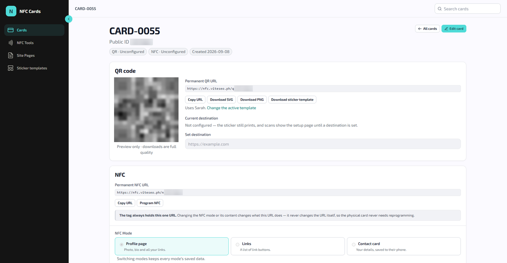
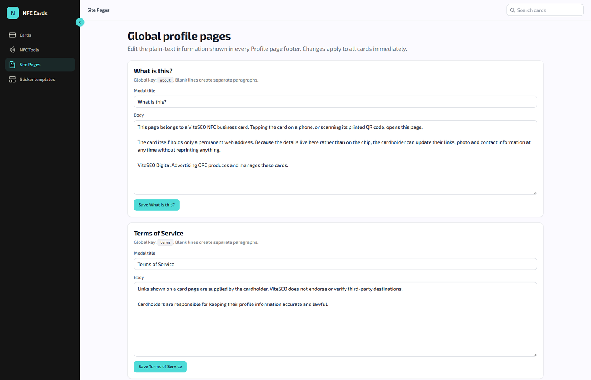

## Abstract: the VITE SEO NFC card platform in brief

A business card goes out of date the moment a phone number or link changes. An NFC chip written with one link has the same flaw. The card was made for small business owners, and there are many of them. In 2023, the PSA counted 1,241,733 MSMEs, 99.63% of all Philippine businesses. At VITE SEO Digital Advertising, I led and co-developed the system behind our NFC business cards as a new revenue line. Each card holds a permanent link, and the owner changes where it points with a PIN. A tap or a QR scan always opens their latest details. The system shipped with an admin dashboard and 497 automated tests, and the "Tap into Possibilities" card was sold on TikTok Shop.

## The problem we saw: business cards that go out of date

A business card holds information that changes: phone numbers, links, job titles. Once a card is printed or an NFC chip is written, changing that information usually means a new card. The goal was a card whose tap or scan always opens the owner's latest details.

We saw this through the agency's own clients. They kept asking for business cards that matched the online profiles we built for them. Every reprint after a changed number felt like waste. An updatable NFC card fit the agency's work for small businesses: one place online for everything, now in a card someone could hand over.

There was a business reason too. We built the NFC card as a new revenue line, beyond the agency's client services. It sat alongside the other in-house products I directed, including the [VITE SEO ERP](/projects/vite-seo-erp), which I describe in [what losing my agency taught me](/blog/closing-my-agency).

A plain NFC card does not fix the reprint problem on its own. A chip written with one link keeps that link until someone rewrites it. A card that points at an old page is as stale as a paper one. The real problem was where the information lived. It sat on the card, instead of somewhere the owner could edit it.

## What the data says about the NFC card market

Public data points to four things. There is a large market of small businesses, and most of the country is online. Phones open NFC links without an app, and shoppers already buy through video.

**Small businesses are almost the whole market.** The [DTI's 2023 Philippine MSME statistics](https://www.dti.gov.ph/resources/msme-statistics/) draw on the PSA's 2023 List of Establishments. They show that 1,241,733 of the country's 1,246,373 business enterprises were MSMEs, or 99.63%. Micro enterprises alone made up 90.43% of all establishments. The National Capital Region, which includes Makati, had the most MSMEs, with 221,893.

**Most Filipinos are online.** [DataReportal's Digital 2026 report on the Philippines](https://datareportal.com/reports/digital-2026-philippines) counted 98.0 million internet users at the end of 2025, or 83.8% of the population. It also counted 137 million cellular mobile connections in late 2025, equal to 117% of the population.

### How phones read and write NFC tags

**Phones open NFC links without an app.** Apple's guide to [background tag reading](https://developer.apple.com/documentation/corenfc/adding-support-for-background-tag-reading) says iPhone XS and later read NFC tags without an app. The iPhone shows a notification, and when no installed app claims the link, it opens in Safari. Google's [Android NFC basics](https://developer.android.com/develop/connectivity/nfc/nfc) says Android devices usually look for NFC tags whenever the screen is unlocked, unless NFC is turned off. From Android 17, a tag holding a web link shows an "open link" notification first.

**Writing tags from a browser is much narrower.** Chrome's guide to [Web NFC on Chrome for Android](https://developer.chrome.com/docs/capabilities/nfc) says the feature launched in Chrome 89 for Android. It works only in top-level frames over HTTPS. MDN's [Web NFC API page](https://developer.mozilla.org/en-US/docs/Web/API/Web_NFC_API) marks it as experimental, with limited availability. It does not work in some of the most widely used browsers.

### How Filipino shoppers buy through video

**Shoppers buy through video.** The [e-Conomy SEA 2025 report](https://www.bain.com/insights/e-conomy-sea-2025/) by Google, Temasek and Bain & Company found video commerce was about 25% of Southeast Asia's e-commerce GMV. [Manila Bulletin's coverage of the report's Philippine results](https://mb.com.ph/2025/11/25/philippine-digital-economy-surges-on-driving-16-growth-towards-36-billion-gmv-by-2025) put the country's digital economy on track for $36 billion in GMV in 2025. E-commerce was more than 60% of it. DataReportal adds that TikTok's advertising resources showed 64.0 million users aged 18 and above in late 2025. That was an ad reach of 81.8% of Filipino adults. The [e-Conomy SEA 2026](https://www.bain.com/insights/e-conomy-sea-2026/) edition, released in October 2026, expects the region's digital economy GMV to grow 17% this year.

## Why we chose a permanent link for the NFC card

Each design choice on the card lines up with one of those facts. The table compares the three realistic ways to keep a card current when a detail changes.

| Approach | When a number or link changes | Who can open it |
| --- | --- | --- |
| Paper card | Print a new card | Anyone holding it, no phone needed |
| NFC chip written with one link | Rewrite the chip, or replace the card | Phones that read NFC |
| Permanent link with an editable destination | The owner changes the destination with a PIN | Phones that read NFC, plus any camera through the QR code |

**A permanent link, an editable destination.** The core choice was to give each card permanent QR and NFC links, and keep the details on the platform. The owner changes where the card points with a PIN, and the card itself never needs rewriting. That removes the reprint. It also means an owner never has to rewrite a chip. Public data shows phones read tags without an app, while writing tags from a browser works in far fewer places.

### How the NFC card reaches every phone

**Tap and QR on every card.** Apple documents background tag reading for iPhone XS and later. Android phones read tags only when they have NFC and it is switched on. A dynamic QR code covers the rest. Apple's guide to [scanning a QR code with an iPhone](https://support.apple.com/en-us/102680) uses the built-in Camera app: point it at the code, then tap the link. Both paths lead to the same card, so one change by the owner updates both.

**Five destinations, not one.** A tap can open a profile, a link list, a downloadable contact card, a phone call or an email. Most buyers were business owners who wanted one tap for everything, and five destinations let one card cover more than a single web page.

### PIN security and sales channels for the NFC card

**A PIN, with rate limits.** Card pages are public, because anyone who taps a card must be able to see it. Owner access sits behind a PIN, and the endpoints are rate-limited. A PIN is only safe if no one can try guess after guess, and rate limits are what stop that.

**Selling where small businesses already are.** The card went on sale on TikTok Shop, and we marketed it directly to business owners around Makati. Public data lines up with both channels. Video commerce is about a quarter of e-commerce GMV in the region. The National Capital Region holds the largest share of the country's MSMEs.

## What we built: the NFC card platform features

- **Card behavior:** a tap or a dynamic QR scan opens a profile, a link list, a downloadable contact card, a phone call or an email. The owner changes where it points with a PIN, and the card itself never needs rewriting.
- **Card tooling:** a web app that reads and writes NFC cards.
- **Admin dashboard:** card generation, QR and sticker exports, and profile management.
- **Security:** public card pages with PIN-gated owner access and rate-limited endpoints.
- **The product:** I led the design and launch of the "Tap into Possibilities" NFC card. It was sold on TikTok Shop and marketed directly to business owners around Makati.

The screenshots below are from the admin dashboard. I blurred the card's public ID and QR code.

## How the NFC card platform works

Every card has two permanent links, one for its QR code and one for its NFC chip, as the card editor shows. Those links never change. What changes is where they lead, which the platform stores and the owner can update with a PIN.

1. A phone taps the chip or scans the QR code, and opens the card's permanent link.
2. The platform looks up that card and where it points right now.
3. The visitor sees the owner's profile or link list, saves the contact card, or starts a phone call or an email.
4. To change the destination, the owner opens owner access with a PIN and picks a new one. The next tap opens the new destination.

The admin dashboard handles everything around the card. It generates cards, exports each QR code as SVG or PNG, and exports a sticker template. The card editor sets the NFC mode: profile page, links or contact card.

A separate global profile pages screen holds the text on every card page: "What is this?", the Terms of Service and the Privacy Policy. That text is edited once and applies to all cards, so a policy change never means touching each card one by one.

## How we built and tested the NFC card platform

I led and co-developed the platform with the VITE SEO Digital Advertising in-house team from August to September 2026. I also led the design and launch of the card.

- **Application:** Laravel 13 (PHP).
- **Styling:** Tailwind CSS.

Laravel was already our back-end framework, so the team could reuse its patterns for sign-in, rate limiting and testing. The system is covered by 497 automated tests.

Tailwind CSS kept the public card pages light and quick to load on a phone. That matters when someone taps your card in front of you. Tailwind also styles this site, and I wrote about what [Tailwind Labs joining Shopify](/news/tailwind-joins-shopify) means for the projects built on it.

## Results: what the NFC card platform shipped

- 497 automated tests covering the system.
- One card that stays current: owners update their details with a PIN instead of replacing the card.
- The "Tap into Possibilities" card went on sale on TikTok Shop.

Most buyers were business owners who wanted one tap for everything: their page, their contact card and a way to message them. The change owners made most often was their main link, for example pointing the card at a new promo during a sale.

## Limitations of the NFC card platform

- **Sales and usage are not recorded here.** This page does not record how many cards sold, how many taps or scans they got, or how many reprints they replaced. The case shows that the design works, not how large the demand was.
- **The market data is broad.** The DTI figures count all MSMEs, not businesses that want an NFC card. DataReportal counts users and connections, not how many Filipinos own a phone that reads NFC. This page has no public figure for that.
- **No figure on paper waste.** Popular claims about how many business cards get thrown away could not be traced to a primary study. This page does not use them.
- **The card depends on the platform.** A permanent link is only useful while the platform behind it is online. A printed card keeps working on its own. That is the trade-off for a card that can change.
- **What would make it stronger:** four kinds of data. Tap and scan counts per card, how often owners changed their destination, reprint costs saved, and why buyers chose the card.

## Sources

1. [2023 Philippine MSME Statistics](https://www.dti.gov.ph/resources/msme-statistics/), Department of Trade and Industry, accessed November 2026.
2. [Digital 2026: The Philippines](https://datareportal.com/reports/digital-2026-philippines), DataReportal, November 5, 2025.
3. [Adding Support for Background Tag Reading](https://developer.apple.com/documentation/corenfc/adding-support-for-background-tag-reading), Apple Developer Documentation, accessed November 2026.
4. [NFC basics](https://developer.android.com/develop/connectivity/nfc/nfc), Android Developers, accessed November 2026.
5. [Interact with NFC devices on Chrome for Android](https://developer.chrome.com/docs/capabilities/nfc), Chrome for Developers, accessed November 2026.
6. [Web NFC API](https://developer.mozilla.org/en-US/docs/Web/API/Web_NFC_API), MDN Web Docs, accessed November 2026.
7. [Scan a QR code with your iPhone or iPad](https://support.apple.com/en-us/102680), Apple Support, September 14, 2026.
8. [e-Conomy SEA 2025](https://www.bain.com/insights/e-conomy-sea-2025/), Bain & Company with Google and Temasek, November 11, 2025.
9. [Philippine digital economy surges on, driving 16% growth towards $36 billion GMV by 2025](https://mb.com.ph/2025/11/25/philippine-digital-economy-surges-on-driving-16-growth-towards-36-billion-gmv-by-2025), Manila Bulletin, November 25, 2025.
10. [e-Conomy SEA 2026](https://www.bain.com/insights/e-conomy-sea-2026/), Bain & Company with Google and Temasek, October 21, 2026.
