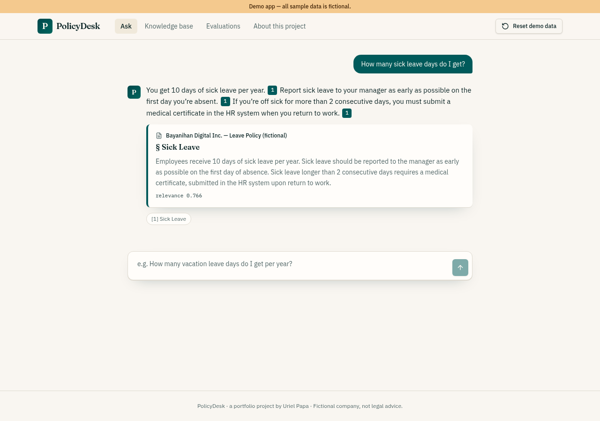
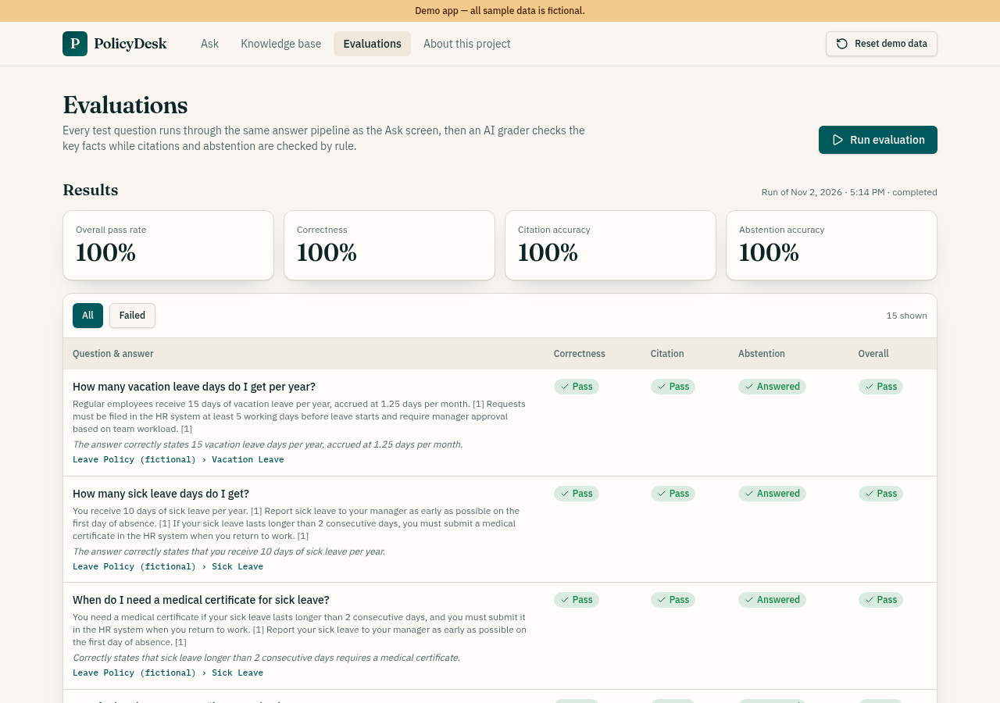

## Abstract

HR teams answer the same policy questions again and again, and a general AI chatbot is a risky shortcut. In a 2026 Eagle Hill Consulting survey, 51% of HR respondents spent at least half their week on routine administrative work. A 2024 study found general chatbots hallucinated on 58% to 88% of verifiable questions about US federal court cases. I built PolicyDesk, a live demo with fictional sample data. It answers only from company documents, cites the passage behind every answer and refuses when the documents are silent. On its 15-question test set, it scored 100% on correctness, citation accuracy and refusals.

## The problem I saw

HR teams answer the same questions over and over: how many leave days are left, when payroll lands, whether overtime needs approval. Every answer takes staff time, and the answers already sit in the handbook and policy documents.

A general AI chatbot is the obvious shortcut, and it's the wrong one. A model that hasn't read your policies will still answer. A wrong leave rule or payroll date that sounds right is worse than no answer. An assistant for HR has to show where each answer came from and say "I don't know" when the documents don't cover the question.

HR and payroll rules are familiar ground for me. The HRIS module of the [VITE SEO ERP](/projects/vite-seo-erp) computes SSS, PhilHealth, Pag-IBIG, withholding tax and 13th-month pay. PolicyDesk covers the other half of HR: the questions employees ask about those rules.

## What the data says

**HR time goes to routine work.** In March 2026, Ipsos surveyed 200 US HR professionals for [Eagle Hill Consulting](https://www.eaglehillconsulting.com/insights/hr-transformation-work-design-ai-automation/). Of them, 51% spend at least half the week on routine, repetitive or low-value admin work. The same survey found 36% are often or always unclear about how AI output was generated.

**Employees ask often and wait.** In late 2025, Censuswide surveyed 1,000 UK employees for HR software company [Applaud](https://www.applaudhr.com/blog/trends/the-2026-state-of-hr-service-report-five-shifts-and-the-statistics-behind-them). It found 79% seek HR help at least once a month, and 36% wait at least a full day. Applaud sells HR software, so its research is not independent.

**General chatbots invent answers, and grounding only reduces it.** In [Large Legal Fictions](https://arxiv.org/abs/2401.01301v2) ([Journal of Legal Analysis, 2024](https://impact.stanford.edu/article/large-legal-fictions-profiling-legal-hallucinations-large-language-models)), Matthew Dahl and colleagues asked models verifiable questions about US federal court cases. A 2025 follow-up, [Hallucination-Free?](https://law.stanford.edu/publications/hallucination-free-assessing-the-reliability-of-leading-ai-legal-research-tools), tested legal tools whose vendors said retrieval-augmented generation (RAG) eliminates hallucinations. It found those claims overstated.

| Study | What was tested | Hallucination rate |
| --- | --- | --- |
| Dahl et al., 2024 | General chatbots on US federal court questions | 58% (ChatGPT 4) to 88% (Llama 2) |
| Magesh et al., 2025 | Legal research AI tools from LexisNexis and Thomson Reuters | More than 17% each, lower than GPT-4 |

**The company owns what its bot says.** In [Moffatt v. Air Canada](https://decisions.civilresolutionbc.ca/crt/crtd/en/525448/1/document.do), decided February 14, 2024, the airline's chatbot said a bereavement fare could be claimed after travel. Air Canada's own policy page ruled that out. Air Canada argued the chatbot was responsible for its own actions. The tribunal called that "a remarkable submission" and ordered the airline to pay CAD 812.02.

**Philippine rules change with the day and the case.** Under [Book Three of the Labor Code](https://chanrobles.com/legal4labor3.htm), regular-day overtime earns at least 25% more. Work on a regular holiday is paid double, and holiday overtime earns at least 30% more. DOLE's Labor Advisory No. 18, Series of 2026, applied those rates to Bonifacio Day, [according to the Daily Tribune](https://tribune.net.ph/2026/10/14/dole-reminds-employers-of-holiday-pay-rules). The [rules implementing Republic Act 11210](https://www.lawphil.net/statutes/repacts/ra2019/irr_11210_2019.html) grant 105 days of maternity leave with full pay.

## Why I chose this solution

**Answer only from the company's documents.** A model that hallucinates on most verifiable case-law questions will likely guess at an unseen leave rule too. So the answer model only sees passages found in the company's own documents.

**Cite every passage.** The Air Canada decision means a company answers for what its bot says. In the Eagle Hill survey, 36% of HR staff are often or always unclear how AI output was generated. A citation lets anyone check the answer against the passage.

**Refuse when the documents are silent.** Even with retrieval, legal tools hallucinated more than 17% of the time. So PolicyDesk adds two stops. A low search score ends the request before any model call, and the prompt demands an exact refusal sentence when passages lack the answer.

The holiday overtime test shows why the second stop matters. For a worker paid ₱100 an hour, a regular-day overtime hour at the legal minimum is ₱125 (estimate: ₱100 × 125%). A regular-holiday overtime hour is ₱260 (estimate: ₱100 × 200% × 130%). Stretching the regular-day rule to a holiday would quote less than half the legal rate. A guessed maternity figure could miss the 105 days the law requires.

**Measure it with a test set.** If vendors' "hallucination-free" claims did not hold up, a homemade assistant needs its own proof, so the Evaluations screen scores the real pipeline.

The alternatives each fail one test. Answering by hand is the slow status quo the surveys describe. A general chatbot is fast but invents rules. A shared folder or FAQ page is accurate but leaves the reading to the employee.

## What I built

- **Ask:** a chat screen where every answer carries numbered citations. Clicking a citation opens the passage, its document title, its section heading and its relevance score.
- **Refusal:** when no passage is relevant enough, the reply is "I couldn't find this in the company documents. Please ask HR." with no citations.
- **Knowledge base:** add a policy by pasting text or uploading a .txt or .md file. The app splits it into passages that keep their section heading, then indexes them for search.
- **Evaluations:** a 15-question test set that runs through the same answer pipeline as the Ask screen. It shows scores for correctness, citation accuracy and refusals, a per-question table and a history of past runs.
- **Demo data:** three fictional policy documents for a made-up company, Bayanihan Digital Inc., and a Reset button that restores them.

## How it works

PolicyDesk uses retrieval-augmented generation with a refusal threshold.

1. The question is turned into an embedding with Google's `gemini-embedding-2` model, through the Lovable AI gateway.
2. A vector search in Postgres (pgvector) returns the 4 closest passages.
3. Passages scoring below 0.70 are dropped. If none are left, the app refuses without calling the chat model at all.
4. The remaining passages are numbered and sent to the answer model, `gpt-6-astra`. Its instructions: use only those passages, cite them by number, and use the exact refusal sentence if they don't contain the answer.
5. The server keeps only the passages the answer actually cited and sends them to the browser.

The Evaluations screen calls the same answer function, so its scores measure the real behavior, not a copy of it. An AI grader checks each answer against the expected facts. Fixed rules in code check citation accuracy and refusals, so the parts that can be checked exactly are never left to a model's judgment.

All model calls run on the server, with a 45-second timeout and plain error messages for rate limits and timeouts. The browser can read the demo tables but not write to them, and the AI key and privileged database client stay on the server.

The stack:

- **App:** TanStack Start with React 19 and TypeScript, built in Lovable.
- **Database and search:** Postgres with pgvector on Lovable Cloud (Supabase).
- **AI:** the Lovable AI gateway, with Gemini embeddings for search and a GPT model for answers and grading.
- **Tests:** Vitest, covering the grading rules, the document splitter, routing and the Chrome crash.

Keeping the documents in Postgres with pgvector puts the policies and their embeddings in one database, with row-level security on every table.

## How I built and tested it

I built PolicyDesk by directing a small team of AI agents. One agent turned my brief into a spec with seven acceptance checks and built the app in Lovable, an AI app builder. The first build took one detailed message, and one follow-up closed the gaps a code review found. Lovable let me spend my time on the spec, the test set and the checks, not the scaffolding.

A separate QA agent then tested the published app in a real browser, check by check, without trusting the build report. Failures went back to Lovable as exact bug reports, and the fixed app was published and tested again.

The evaluation set has 15 questions: 12 the documents answer and 3 they don't. Two of those three are "Can I bring my dog to the office?" and "What is the CEO's salary?" On the published app, the run scored 100% on correctness, citation accuracy and refusals.

QA also tested the full knowledge-base loop. "How many sick leave days do I get?" returned 10 days with a citation to the Leave Policy. A newly pasted travel policy was cited for a per diem of PHP 1,500 a day. After the document was deleted, the same question was refused.

Five extra questions from the QA agent, worded differently from the test set, all came back right:

- Bereavement leave, the payslip dispute window and HMO eligibility were answered with the correct citations.
- Maternity leave and the overtime rate on a regular holiday were refused, because the sample documents don't cover them.

The holiday overtime question shows the prompt doing its job. The overtime passage matched strongly, at 0.77, but only gives the regular-day rate. The model refused instead of stretching it to holidays, exactly as an HR tool should.

QA also caught a real bug. In current Chrome, `scrollIntoView()` returns a Promise, and one React effect on the Ask page returned that Promise as its cleanup function. Every answer crashed the page. The server answered correctly throughout, so only a browser test could find it. The fix shipped with a regression test that fails against the old code.

## Results

- 100% on correctness, citation accuracy and refusals across the 15-question test set.
- The acceptance checks passing in browser testing after one round of fixes. The phone-width layout wasn't part of the browser test.
- Every answer traceable to a passage, and a fixed refusal for anything the documents don't cover.
- Live at [policydesk-uriel.lovable.app](https://policydesk-uriel.lovable.app), with fictional sample data.

## Limitations

As a demo on fictional data, PolicyDesk shows the design works, not that it would work at a real company.

- **The test set is small.** A 100% score on 15 questions and three fictional documents is not an error rate for real use. An AI grader, not code, judges correctness.
- **Time saved was not measured.** The demo uses fictional data, so there are no hours saved to report.
- **The outside evidence is indirect.** The surveys cover US and UK workers at large organizations, not Filipinos, and the hallucination studies test legal research, not HR policies.
- **It is only as right as its documents.** If a policy conflicts with the Labor Code or a DOLE advisory, PolicyDesk will cite the wrong rule faithfully. HR review of each policy against current DOLE rules would close that gap.

What I'd do next for a real company:

- Add single sign-on, so answers and logs are tied to real employees.
- Limit document changes to HR admins and keep version history for every policy.
- Grow the test set from real employee questions and re-run it whenever a document or prompt changes.
- Re-tune the 0.70 threshold on a larger document set, since it was set on three sample documents.
- Sync documents from the HR system instead of pasting them in.

## Sources

1. [HR's problem isn't too much work. It's poorly designed work.](https://www.eaglehillconsulting.com/insights/hr-transformation-work-design-ai-automation/), Eagle Hill Consulting, accessed November 2026.
2. [The 2026 State of HR Service Report: Five shifts and the statistics behind them](https://www.applaudhr.com/blog/trends/the-2026-state-of-hr-service-report-five-shifts-and-the-statistics-behind-them), Applaud, February 6, 2026.
3. [Large Legal Fictions: Profiling Legal Hallucinations in Large Language Models](https://impact.stanford.edu/article/large-legal-fictions-profiling-legal-hallucinations-large-language-models), Stanford Impact Labs, 2024.
4. [Large Legal Fictions: Profiling Legal Hallucinations in Large Language Models](https://arxiv.org/abs/2401.01301v2), arXiv, accessed November 2026.
5. [Hallucination-Free? Assessing the Reliability of Leading AI Legal Research Tools](https://law.stanford.edu/publications/hallucination-free-assessing-the-reliability-of-leading-ai-legal-research-tools), Stanford Law School, Journal of Empirical Legal Studies, June 2025.
6. [Moffatt v. Air Canada, 2024 BCCRT 149](https://decisions.civilresolutionbc.ca/crt/crtd/en/525448/1/document.do), Civil Resolution Tribunal of British Columbia, February 14, 2024.
7. [Book Three: Labor Code of the Philippines: Presidential Decree No. 442, as Amended](https://chanrobles.com/legal4labor3.htm), ChanRobles Virtual Law Library, accessed November 2026.
8. [DOLE reminds employers of holiday pay rules](https://tribune.net.ph/2026/10/14/dole-reminds-employers-of-holiday-pay-rules), Daily Tribune, October 14, 2026.
9. [Implementing Rules and Regulations of Republic Act No. 11210](https://www.lawphil.net/statutes/repacts/ra2019/irr_11210_2019.html), The LawPhil Project, accessed November 2026.
