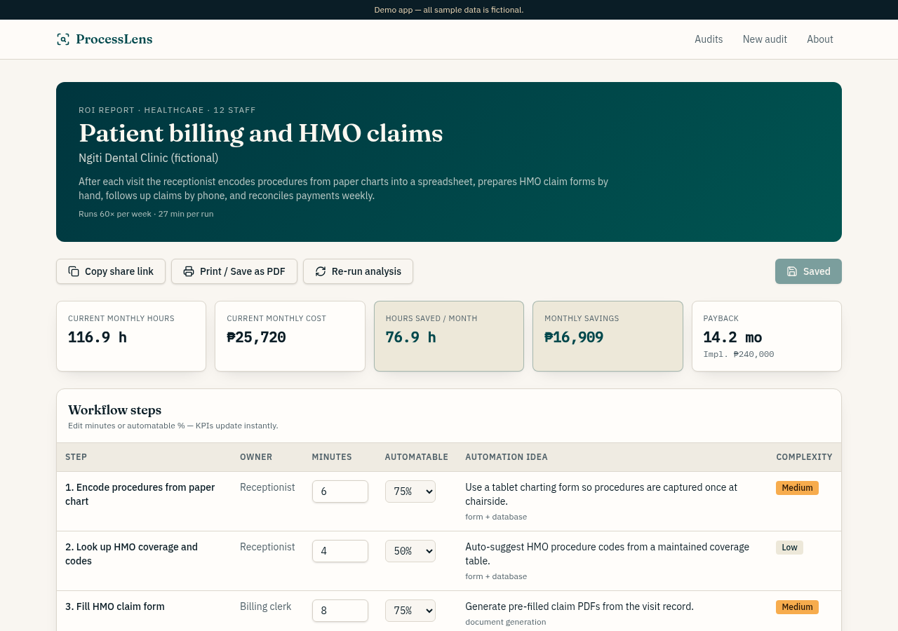
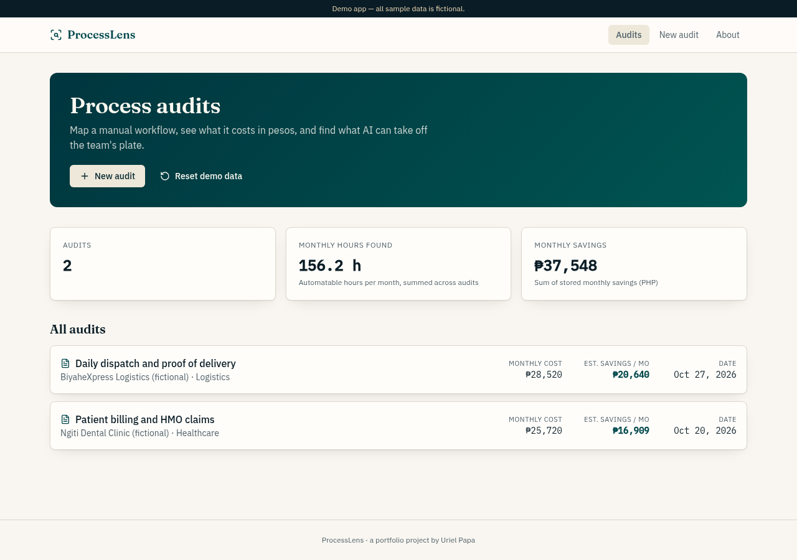

## Abstract

Small business owners rarely know what a manual workflow costs them each month, so "should we automate this?" becomes a guess. In 2023, MSMEs were 99.63% of Philippine businesses, and a 2025 PIDS study found only 14.9% of firms use AI tools. I built ProcessLens, a discovery tool where AI maps an owner's description into steps and code computes the hours, peso cost, savings and payback. Language models are unreliable at arithmetic, so no number comes from the model. In browser testing, every hour and peso matched a hand calculation. One test showed a weekly payroll that would take over 12 years to pay back. It runs as a live demo with fictional sample data.

## The problem I saw

Small businesses run their core work by hand: billing, insurance claims, dispatch, payroll. Owners feel the pain, but they rarely know how many staff hours a workflow takes each month or what those hours cost. Without numbers, "should we automate this?" becomes a guess.

I've lived this as a founder. Before we built the [VITE SEO ERP](/projects/vite-seo-erp), payroll at the agency was manual. Every cutoff meant copying attendance into sheets, computing contributions by hand and typing the totals into the books again. That's exactly the kind of workflow ProcessLens is built to measure.

I attended the [Philippine SME Business Expo](/events/philippine-sme-business-expo-technology-adoption) in November 2025 and May 2026. My takeaway was that owners trust technology more when someone explains it in plain words, with their own numbers.

An AI solutions engineer starts every engagement with that question: what does this process cost today, and what would automating it save? ProcessLens turns a discovery conversation into numbers an owner can check.

## What the data says

**Most businesses are small.** The [DTI's 2023 Philippine MSME statistics](https://www.dti.gov.ph/resources/msme-statistics/), drawn from the PSA's List of Establishments, counted 1,246,373 business enterprises in 2023. Of these, 99.63% were micro, small or medium enterprises, and they generated 66.97% of the country's jobs.

**They have computers, but few use AI.** A [2025 PIDS study on AI readiness](https://pids.gov.ph/details/news/press-releases/ph-businesses-lag-in-ai-adoption-despite-digital-access-pids) reported that 90.8% of establishments own computers and 81% have internet access. Yet only 14.9% of firms use AI tools, and use is concentrated in large urban companies. The [DTI's 2020 baseline survey of 400 MSMEs](https://ecommerce.dti.gov.ph/madali/baseline_survey.html) found that 23% used no ICT tools for business and 51% used only basic ones.

**Much of the work can be automated, but in parts.** About half of the activities people are paid to do could be automated with demonstrated technologies. That was the McKinsey Global Institute's 2017 estimate in [Harnessing automation for a future that works](https://www.mckinsey.com/featured-insights/mckinsey-global-institute/harnessing-automation-for-a-future-that-works). Fewer than 5% of occupations could be fully automated, and data collection and processing were among the most exposed activities. MGI's 2025 report, [Agents, robots, and us](https://www.mckinsey.com/mgi/our-research/agents-robots-and-us-skill-partnerships-in-the-age-of-ai), put the figure at about 57% of US work hours. MGI calls that technical potential, not a forecast of job losses.

**Labor cost sets the size of any saving.** Under [Wage Order No. NCR-28](https://nwpc.dole.gov.ph/regionandwages/ncr/), the NCR daily minimum wage for non-agriculture workers is ₱755, effective September 26, 2026. That is about ₱94 an hour (estimate: ₱755 ÷ 8 hours), before contributions and benefits.

**Language models make arithmetic mistakes.** In the NeurIPS 2023 paper [Faith and Fate](https://arxiv.org/pdf/2305.18654), off-the-shelf GPT-4 got only 59% of 3-digit by 3-digit multiplications right. In the 2024 study [GSM-Symbolic](https://arxiv.org/abs/2410.05229), every model tested did worse when only the numbers in a math question changed. Adding one clause that seemed relevant, but wasn't, cut performance by up to 65%.

## Why I chose this solution

**Measure before automating.** Most firms are small and don't use AI tools yet. So the first output is what a workflow costs today, in hours and pesos the owner can check.

**Score each step, not the whole workflow.** MGI found that few jobs can be fully automated, but most have parts that can. So each step gets its own automatable share, and hours saved add up step by step.

**Let AI structure and code calculate.** A payback figure is plain multiplication and division, such as 167.5 minutes × 4.33 ÷ 60 × ₱250. That's the kind of multi-digit arithmetic the studies above found unreliable. So the model only returns steps, and code computes every number. [DocuSift](/projects/docusift) uses the same split for invoices.

**Make the hourly cost an input.** Monthly savings are hours saved times the hourly cost, so the rate drives the payback. The owner sets it, and the minimum wage is a floor to check it against. At about ₱94 an hour, the payroll test below would save about ₱1,141 a month (estimate: 12.0879 h × ₱94.375). Payback would stretch to about 390 months (estimate: ₱445,000 ÷ ₱1,141), against 147.3 months at ₱250 an hour. Either way: don't automate this yet.

The realistic alternatives compare like this:

| Option | What it does well | Where it falls short |
| --- | --- | --- |
| A spreadsheet by hand | Free, and the owner controls every formula | The owner must map the steps alone |
| Asking a chatbot for the ROI | Fast, and good at listing steps | Unreliable arithmetic, per the studies above |
| ProcessLens | AI lists the steps, code does the math | The AI's time estimates still need checking |

## What I built



- **Guided intake:** three steps (business, workflow, review) with validation, so the owner can't skip the fields the math needs.
- **AI workflow map:** the owner's plain description becomes 4 to 10 ordered steps, each with an owner, minutes per run, how much of it can be automated, an automation idea and an implementation complexity.
- **ROI report:** cards for monthly hours, monthly cost, hours saved, monthly savings and payback, plus an editable step table, a chart of minutes per step, risks and a 30/60/90-day plan.
- **Live editing:** change a step's minutes, its automatable share, the hourly cost or the complexity costs, and every figure recomputes on the spot. Save keeps the changes.
- **Sharing:** every report has its own link and a print layout for saving as PDF.
- **Demo data:** two fictional audits, Ngiti Dental Clinic's billing and HMO claims and BiyaheXpress Logistics' dispatch and proof of delivery.

## How it works

The AI structures; the code calculates. The model reads the owner's description and returns structured JSON, validated against a schema: the steps, the risks and the plan. It never does arithmetic.

Every hour and peso comes from one function in the codebase:

```text
monthly hours        = Σ step minutes × runs per week × 4.33 ÷ 60
monthly cost         = monthly hours × hourly cost
hours saved          = Σ (step minutes × automatable share) × runs per week × 4.33 ÷ 60
monthly savings      = hours saved × hourly cost
implementation cost  = Σ complexity cost of automatable steps
                       (defaults: low ₱15,000 · medium ₱40,000 · high ₱90,000)
payback (months)     = implementation cost ÷ monthly savings
```

Language models are good at turning a messy description into a clean list of steps, and unreliable at multiplying. Keeping the math in code means the same inputs always give the same answer. An owner can also check any number on the report with a calculator.

Structured output with a schema is what makes the split work. The model's answer either fits the shape the calculator expects, or it's rejected before any number is shown.

The same function produces the totals stored with each audit, so the home page and the reports always agree. All writes and model calls run on the server, and the browser can only read.

## How I built and tested it

I built ProcessLens by directing a small team of AI agents. One agent turned my brief into a spec with seven acceptance checks, including the exact formulas. It then built the app in Lovable, an AI app builder. The agent reviewed the generated code against the spec and confirmed the math matched the formulas. One follow-up fixed number inputs that turned an empty field into "1".

The stack:

- **App:** TanStack Start with React 19 and TypeScript, built in Lovable.
- **Database:** Postgres on Lovable Cloud (Supabase), with one `audits` table.
- **AI:** the Lovable AI gateway through the Vercel AI SDK, with structured output.
- **Charts and tests:** Recharts and Vitest, with unit tests for the formulas, including payback of "n/a" when savings are zero.

A separate QA agent then tested the published app in a real browser and recomputed the numbers by hand.



QA ran a new audit end to end: weekly payroll for a 25-person restaurant, at ₱250 an hour and one run a week. The AI mapped it into 8 steps with 5 risks and a 30/60/90-day plan in about 25 seconds. QA then checked the math by hand:

| Figure | Hand calculation | On the page |
| --- | --- | --- |
| Monthly hours | 255 min × 1 × 4.33 ÷ 60 = 18.4025 h | 18.4 h |
| Monthly cost | 18.4025 h × ₱250 = ₱4,600.63 | ₱4,601 |
| Hours saved | 167.5 min × 1 × 4.33 ÷ 60 = 12.0879 h | 12.1 h |
| Monthly savings | 12.0879 h × ₱250 = ₱3,021.98 | ₱3,022 |
| Payback | ₱445,000 ÷ ₱3,022 | 147.3 months |

That payback is the most useful number in the test. A weekly payroll saves about ₱3,000 a month, so a ₱445,000 automation project would take over 12 years to pay back. The honest advice is "don't automate this yet," and the tool says so with numbers. The dental clinic's billing, by contrast, runs 60 times a week and pays back in 14.2 months.

QA also checked live recomputing, saving and reloading, the share link in a fresh tab, validation on the intake form, re-running an analysis, and resetting the demo. Two bugs came up and were fixed in one round:

- **A date mismatch:** the server rendered dates in UTC and the browser in local time. An audit could show November 2 on one and November 3 on the other, which threw a React error. Dates now use Manila time everywhere.
- **Copy share link:** browsers that block the clipboard showed an error, so the button gained a fallback copy method.

## Results

- Every hour and peso figure matched a hand calculation, on a new audit and on both seeded reports.
- The acceptance checks passing in browser testing after one round of fixes. The phone-width layout wasn't part of the browser test.
- A report that can tell an owner not to automate, which is as valuable as one that says go.
- Live at [processlens-uriel.lovable.app](https://processlens-uriel.lovable.app), with fictional sample data.

## Limitations

These are the gaps a real engagement would need to close.

- **AI time estimates.** The math is checked, but the minutes per step are the model's estimates. For a real client, I'd validate them with a short time study or system logs before quoting.
- **One hourly cost.** A rate per role would be more accurate, and the minimum wage estimate above shows the rate alone can move payback by years.
- **No recurring costs.** Payback counts only the one-time build. It should also include software licenses and AI usage.
- **No version history.** Re-running an analysis replaces the previous one.
- **Fictional data only.** Every result comes from fictional sample data, not a real client's workflow, and the phone-width layout wasn't tested.
- **Broad evidence.** MGI's figures are global (2017) and US-only (2025), and the arithmetic studies used 2023 and 2024 models. Newer models may do better, but code gives the same answer every time.
- **No sales flow yet.** Next, I'd export the report as a branded proposal and connect it to a CRM for the discovery pipeline.

## Sources

1. [2023 Philippine MSME Statistics](https://www.dti.gov.ph/resources/msme-statistics/), Department of Trade and Industry, accessed November 2026.
2. [PH businesses lag in AI adoption despite digital access—PIDS](https://pids.gov.ph/details/news/press-releases/ph-businesses-lag-in-ai-adoption-despite-digital-access-pids), Philippine Institute for Development Studies, September 11, 2025.
3. [Baseline Survey on Digitalization of MSME (September 2020)](https://ecommerce.dti.gov.ph/madali/baseline_survey.html), DTI e-Commerce Office, accessed November 2026.
4. [Harnessing automation for a future that works](https://www.mckinsey.com/featured-insights/mckinsey-global-institute/harnessing-automation-for-a-future-that-works), McKinsey Global Institute, January 12, 2017.
5. [Agents, robots, and us: Skill partnerships in the age of AI](https://www.mckinsey.com/mgi/our-research/agents-robots-and-us-skill-partnerships-in-the-age-of-ai), McKinsey Global Institute, November 25, 2025.
6. [NCR – National Wages and Productivity Commission](https://nwpc.dole.gov.ph/regionandwages/ncr/), National Wages and Productivity Commission (DOLE), Wage Order No. NCR-28, accessed November 2026.
7. [Faith and Fate: Limits of Transformers on Compositionality](https://arxiv.org/pdf/2305.18654), Dziri et al., NeurIPS 2023.
8. [GSM-Symbolic: Understanding the Limitations of Mathematical Reasoning in Large Language Models](https://arxiv.org/abs/2410.05229), Mirzadeh et al., arXiv, October 2024, revised August 2025.
