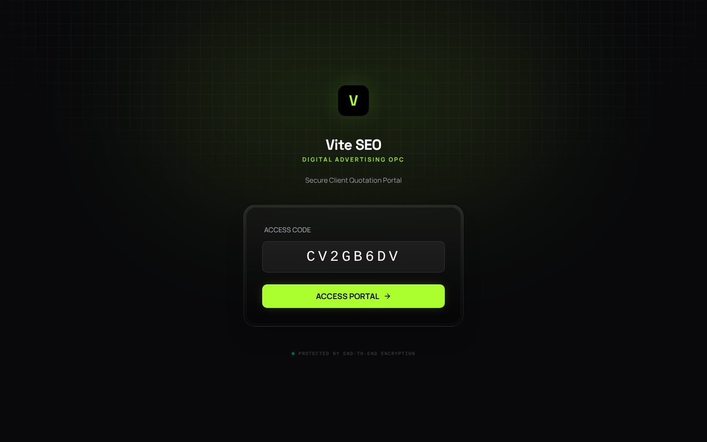
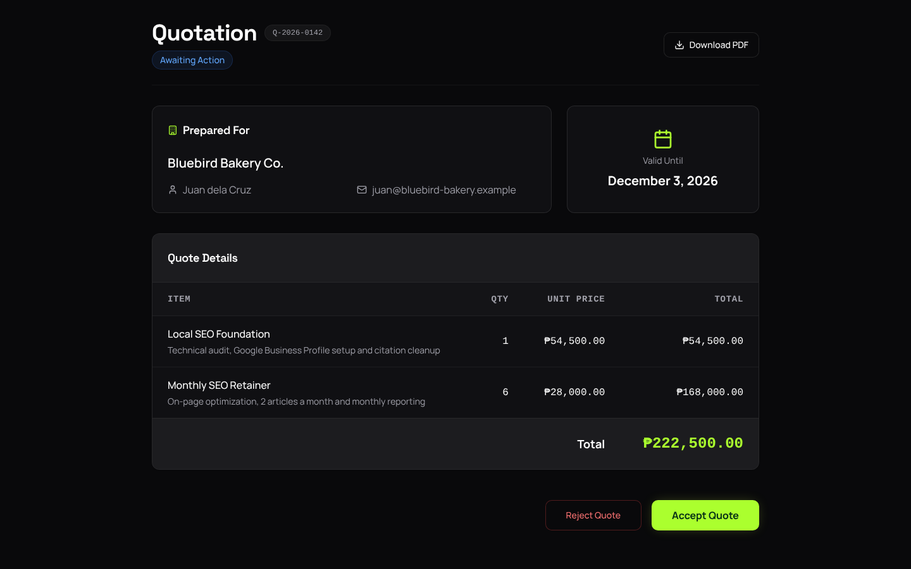
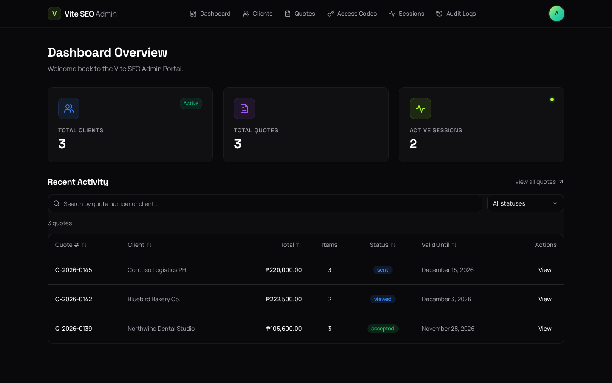
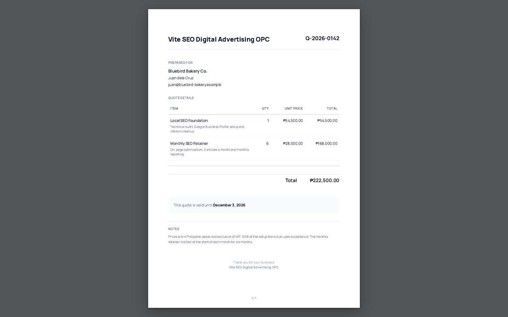

## Abstract

Quotations sent as email attachments made it hard to know which version a client saw and what they agreed to. Email is also a common channel for business fraud. In 2025, the FBI's Internet Crime Complaint Center logged 24,768 business email compromise complaints, with about $3.05 billion in losses. Philippine law also recognizes offers and acceptances made electronically. For VITE SEO Digital Advertising, I led and co-developed a private Next.js portal to replace those attachments. Clients sign in with a one-time code to view, accept or reject quotations and download them as PDFs. Access codes are hashed with Argon2, Redis rate limiting guards the sign-in, and audit logs record what happened to each quotation. The portal has 174 automated tests.

## The problem we saw

Quotations need to reach the right person, stay private, and leave a clear record of what was accepted or rejected. Email attachments do none of that well.

Before the portal, quotations went out as PDF attachments by email. Clients sometimes replied to an older version, approvals got buried in threads, and we had to dig through inboxes to confirm what was agreed.

Quotations were part of the sales process I built for [VITE SEO Digital Advertising](/blog/closing-my-agency), the agency I founded and have since closed. That process also included a four-tier service package line, a consultation playbook, a client fit-check form and proposals. When the record of a quote is unclear, the deal behind it is unclear too.

## What the data says

Public data shows that the risks of quoting by email go beyond lost threads. It also shows that Philippine law supports agreeing online.

Email is a major channel for business payment fraud. The [FBI's 2025 IC3 Annual Report](https://www.ic3.gov/AnnualReport/Reports/2025_IC3Report.pdf) counted 1,008,597 complaints and $20.877 billion in losses across all crime types in 2025. Business email compromise was the second-costliest type, after investment fraud:

| Year | Business email compromise complaints | Reported losses |
| ---- | ------------------------------------ | --------------- |
| 2023 | 21,489 | $2,946,830,270 |
| 2024 | 21,442 | $2,770,151,146 |
| 2025 | 24,768 | $3,046,598,558 |

Over those three years, reported losses add up to about $8.76 billion (estimate: the sum of the three years). From 2024 to 2025, complaints rose about 16% and losses about 10% (estimate from the table).

The report defines business email compromise as a scam aimed at businesses that work with suppliers or regularly pay by wire transfer. Fraudsters compromise email accounts and other channels, then push unauthorized transfers. Quotes and invoices travel through exactly those supplier conversations.

Philippine law accepts agreement made online. Section 16 of the [Electronic Commerce Act (RA 8792)](https://elibrary.judiciary.gov.ph/thebookshelf/showdocs/2/3888) says an offer and its acceptance may be expressed in and proved by electronic documents. A contract also cannot be denied validity only because it is electronic.

Section 8 of the same law sets a bar for electronic signatures. An electronic signature equals a written one if it is proved that a prescribed procedure, not alterable by the parties, existed. Under it, a method must identify the person and show their access to the document for approval. That method must also be reliable for its purpose, among other conditions.

Philippine law also expects care with personal data. Section 20(a) of the [Data Privacy Act (RA 10173)](https://lawphil.net/statutes/repacts/ra2012/ra_10173_2012.html) requires personal information controllers to "implement reasonable and appropriate organizational, physical and technical measures." Those measures guard personal information against accidental or unlawful destruction, alteration and disclosure, and any other unlawful processing.

## Why we chose this solution

The realistic alternatives were to keep emailing PDFs with more care, or to share files through a general link. Both leave the quote in one place and the client's decision in another, usually an email reply. A portal puts the current quote, the decision and the record in one system.

| Problem | What the evidence says | Design choice |
| ------- | ---------------------- | ------------- |
| Clients replied to older versions | An electronic offer and acceptance can be expressed and proved electronically (RA 8792) | One private place to view the quote and accept or reject it |
| Approvals got buried in threads | Same as above | Accept and reject in the portal, with audit logs |
| Email is a fraud channel | 24,768 business email compromise complaints and about $3.05 billion lost in 2025 (IC3) | Quotations behind a private sign-in, not in attachments |
| Sign-in codes can be guessed | Verifiers must limit failed attempts to no more than 100 (NIST) | Redis rate limiting on the one-time code endpoint |
| Stored codes can leak | Hash secrets one-way; OWASP recommends Argon2id | Access codes hashed with Argon2 |
| The PDF can drift from the web page | Playwright's PDF method renders the page itself | PDFs rendered from the same page the client sees |

The security choices match published guidance. [NIST's SP 800-63B](https://pages.nist.gov/800-63-4/sp800-63b.html), part of its current digital identity guidelines, requires verifiers to protect against online guessing. It caps consecutive failed attempts with one authenticator at 100, and allows increasing waits after failures. Redis rate limiting on the one-time code endpoint is that kind of control.

For stored secrets, the [OWASP Password Storage Cheat Sheet](https://cheatsheetseries.owasp.org/cheatsheets/Password_Storage_Cheat_Sheet) explains that hashing is one-way. An attacker who steals a hash cannot use it to log in. OWASP recommends Argon2id with at least 19 MiB of memory, an iteration count of 2 and 1 degree of parallelism. Hashing access codes with Argon2 means a leaked database does not hand out working codes.

For PDFs, [Playwright's Page documentation](https://playwright.dev/docs/api/class-page) says `page.pdf()` "generates a pdf of the page with print css media." So the PDF comes from the same page as the web view, with its print styles applied.

The stack followed the same reasoning. Next.js let one codebase serve both the client and admin sides. Prisma on PostgreSQL gave typed queries and clean records for the audit log. Clerk handled admin sign-in so we didn't build it from scratch.

Redis kept the one-time code endpoint safe from guessing. Playwright rendered PDFs from the same page the client sees, so the PDF always matches. A portal with a few clear screens also did not need a separate back end. In [Laravel vs Next.js](/blog/laravel-vs-nextjs), I explain why I would start a small portal with Next.js alone. I would add a separate back end only when the rules get heavy.

## What we built

- **Client side:** clients sign in with a one-time code, then view, accept or reject quotations and download them as PDFs.
- **Admin side:** management of clients, quotes, access codes and sessions, with Clerk for admin sign-in.
- **Security:** access codes hashed with Argon2, Redis rate limiting, and audit logs.
- **PDFs:** quotations rendered to PDF with Playwright.

The screenshots below come from the portal running on localhost in November 2026, with fictional clients and quotes loaded through its own import script. The one-time code was issued by the admin side and signed in through the normal client screen.

## How it works

The portal runs on one stack:

- **Application:** Next.js 14.
- **Data:** Prisma on PostgreSQL.
- **Admin sign-in:** Clerk.
- **Rate limiting:** Redis.
- **PDF rendering:** Playwright.

A quotation moves through the portal in five steps:

1. The admin signs in through Clerk and sets up the client, the quotation and an access code.
2. The client signs in with the one-time code. The portal checks it against the stored Argon2 hash, and Redis limits how often the code endpoint can be tried.
3. The client views the quotation and accepts or rejects it.
4. The audit log records what happened to the quotation.
5. The client can download the quotation as a PDF, rendered by Playwright from the same page.

Each step answers one of the problems above. Step 2 is where guessing attacks happen, so the rate limit sits there. Step 4 replaces digging through inboxes, because the record of each decision stays with the quotation.

## Results

- 174 automated tests.
- One private place for clients to review, accept or reject quotations.
- Audit logs that record what happened to each quotation.

## Limitations

- **No before-and-after numbers.** This page does not record how long approvals took before and after the portal, or how often version mix-ups happened.
- **Security settings are not recorded here.** The page does not list the Argon2 variant, its settings or the rate limit. So it cannot show that they meet OWASP's minimums or NIST's attempt cap.
- **Code rules are not recorded either.** For out-of-band one-time secrets, NIST calls for at least six digits, use within 10 minutes and single use. This page does not record the portal's code length or lifetime.
- **The evidence is partly foreign.** The IC3 figures are complaints to a US agency, not Philippine data. They also cover business email compromise in general, not quotations alone.
- **The legal points are general.** RA 8792 recognizes electronic acceptance and sets conditions for electronic signatures. This page does not claim that the portal's accept button met those conditions.
- **No new usage data.** The agency has closed, so this page cannot add results from new clients.
- **The data layer will need care.** Prisma ORM 8 is a near-total rewrite, so moving to it needs testing first, as I explain in [my note on Prisma ORM 8](/news/prisma-orm-8-release-candidate).

Three numbers would make this study stronger: quotes sent through the portal, time from sending to a decision, and version disputes before and after.

## Sources

1. [2025 IC3 Annual Report](https://www.ic3.gov/AnnualReport/Reports/2025_IC3Report.pdf), Federal Bureau of Investigation, Internet Crime Complaint Center, accessed November 2026.
2. [Republic Act No. 8792 (Electronic Commerce Act)](https://elibrary.judiciary.gov.ph/thebookshelf/showdocs/2/3888), Supreme Court E-Library, June 14, 2000.
3. [Republic Act No. 10173 (Data Privacy Act of 2012)](https://lawphil.net/statutes/repacts/ra2012/ra_10173_2012.html), The LawPhil Project, August 15, 2012.
4. [NIST Special Publication 800-63B](https://pages.nist.gov/800-63-4/sp800-63b.html), National Institute of Standards and Technology, accessed November 2026.
5. [Password Storage Cheat Sheet](https://cheatsheetseries.owasp.org/cheatsheets/Password_Storage_Cheat_Sheet), OWASP Cheat Sheet Series, accessed November 2026.
6. [Page | Playwright](https://playwright.dev/docs/api/class-page), Playwright, accessed November 2026.
