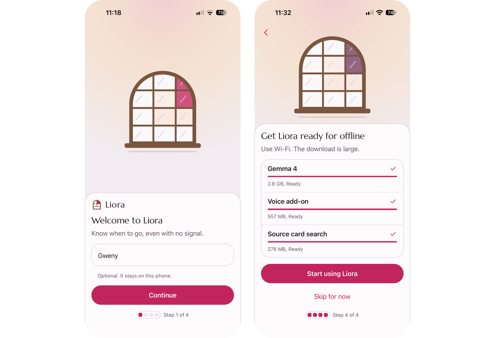
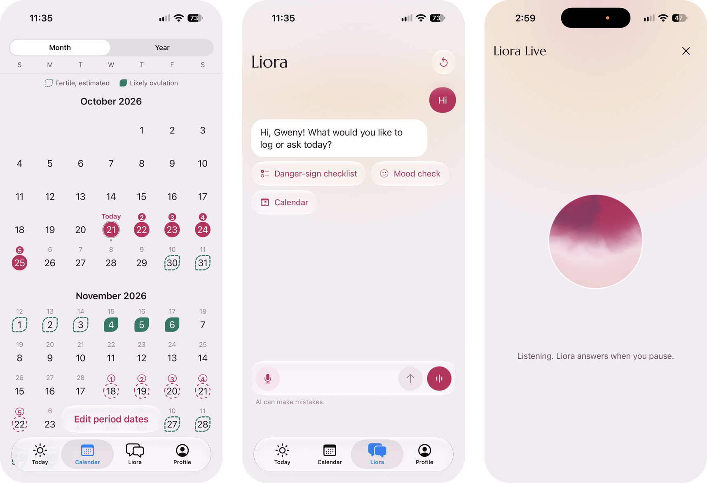
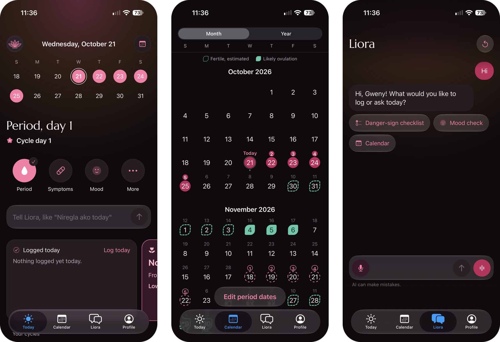
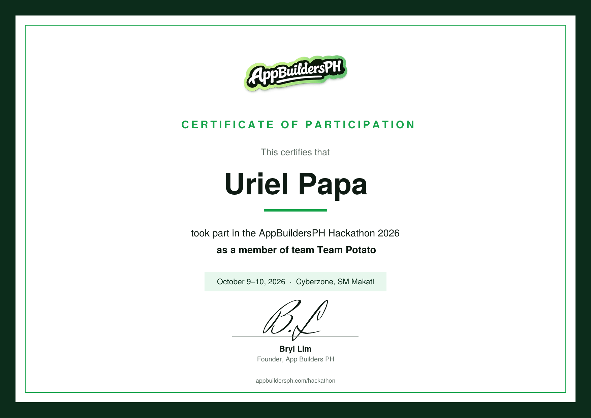

## Abstract: Tell Liora in brief

Pregnant women are not always sure whether a symptom needs care, and in much of the Philippines the answer cannot depend on a signal. Public data shows the stakes. In 2022, the Philippine Statistics Authority registered 2,008 maternal deaths, and in 2024 only 48.8% of households had internet at home. The region with the lowest prenatal care coverage also has one of the lowest internet rates. At the AppBuildersPH Hackathon 2026, I co-developed Tell Liora, an offline mobile app that pairs an on-device Gemma model with 8 WHO decision tables. It helps a pregnant woman decide when to seek care. It does not diagnose. The result was a working offline demo, an iOS build, a research brief, pitch materials and a 73-second product video.

## The problem we saw: knowing when a pregnancy symptom needs care

Deciding when a symptom during pregnancy needs care is stressful. A woman may not know whether it can wait for her next checkup or needs a health worker today. And help is not always a call or a connection away.

We wanted a problem where offline AI makes a real difference. In much of the Philippines, a pregnant woman with a worrying symptom may have a weak signal and a long trip to a clinic. An app that needs the internet would fail her at the moment she needs it most.

Two requirements followed. The app had to work offline, and it had to ground its answers in trusted guidance, not in whatever a model happens to generate. An app that works without internet and follows WHO guidance felt worth building. Its job is narrow on purpose: to help her decide when to seek care, not to diagnose her.

## What the data says about maternal care and connectivity

Public data shows the problem behind Tell Liora is real and serious, and that care and connectivity are both thinnest in the same places.

### Maternal deaths in the Philippines

**Maternal deaths are still common.** In 2022, 2,008 women in the Philippines died of maternal causes, according to the PSA's [report on registered deaths in 2022](https://psa.gov.ph/statistics/vital-statistics/node/1684062362). That is more than five women a day (estimate: 2,008 ÷ 365). WHO's report _Trends in maternal mortality 2000 to 2023_ put the Philippine ratio at 84 deaths per 100,000 live births in 2023. The figure appears in [World Bank data drawn from that report](https://data.worldbank.org/indicator/SH.STA.MMRT?locations=PH). The Philippine Daily Inquirer [reported the same figure](https://asianews.network/philippines-goal-reduce-maternal-deaths-to-70-per-100000-live-births-by-2030/) and the Sustainable Development Goal target of 70 by 2030.

**Most maternal deaths are preventable, and timing matters.** The WHO [fact sheet on maternal mortality](https://www.who.int/news-room/fact-sheets/detail/maternal-mortality) says the solutions to prevent or manage complications are well known. Around 75% of maternal deaths come from five complications: severe bleeding, infections, high blood pressure in pregnancy, complications from delivery and unsafe abortion. WHO notes that severe bleeding after birth can kill a healthy woman within hours if she is unattended. It also says poor women in remote areas are the least likely to receive adequate care.

### Gaps in prenatal care and distance to hospitals

**Prenatal care is high on average but uneven.** In the PSA's [2022 NDHS key indicators on maternal care](https://rssocar.psa.gov.ph/system/files/attachment-dir/CAR-SSR-2023-25_2022-NDHS-Maternal-Care-and-Child-Health.pdf), 86.0% of women with a recent birth got antenatal care from a skilled provider. Nationally, 82.9% had four or more visits, and 89.0% of those births happened in a health facility. In BARMM, only 47.5% got skilled antenatal care and 27.9% had four or more visits.

**Distance to emergency care is real.** A 2023 [BMJ Open study of 2-hour access to essential surgery](https://bmjopen.bmj.com/content/13/12/e074521) mapped hospitals that can do cesarean sections, laparotomies and open fracture care. It found 85.1% of Filipinos lived within 2 hours of one. Six regions fell below the 80% target: Bicol, Eastern Visayas, Zamboanga, BARMM, Caraga and Mimaropa. BARMM had the lowest access, given as 31.1% in one passage and 31.8% in another. The authors add that their estimates are likely optimistic.

### Internet access in the same regions

**Connectivity is thinnest in many of the same places.** The 2024 National ICT Household Survey by the PSA and DICT found that 48.8% of households had internet access at home. The figure was [reported by PTV News](https://ptvnews.ph/psa-dict-record-spike-in-internet-connected-households-increased-online-access-among-filipino-populace/). The lowest rates were in the Zamboanga Peninsula, at 21.2%, and BARMM, at 27.7%, [according to SunStar](https://www.sunstar.com.ph/cebu/filipino-households-spend-less-on-internet-in-2024-access-usage-expand).

| Measure | Philippines | BARMM |
| --- | --- | --- |
| Antenatal care from a skilled provider (2022) | 86.0% | 47.5% |
| Four or more antenatal visits (2022) | 82.9% | 27.9% |
| Within 2 hours of a surgery-capable hospital (2022 hospital data) | 85.1% | 31.1% to 31.8% |
| Households with internet at home (2024) | 48.8% | 27.7% |

The pattern is the point. In the region where women are least likely to get prenatal care, households are also among the least likely to have internet.

## Why we built Tell Liora as an offline app

Each part of Tell Liora answers one piece of that evidence.

### Running the Gemma model offline on the phone

**Offline, on the phone.** With only about half of households online at home, a server-based app would fail many of the women it is meant for. Running the model on the device removes that dependency. Google's [Gemma 3 on mobile and web](https://developers.googleblog.com/en/gemma-3-on-mobile-and-web-with-google-ai-edge/) post says an on-device model lets an app "work fully when WiFi or cellular data is unavailable." The same post puts Gemma 3 1B at 529MB. The [Gemma 3n model overview](https://ai.google.dev/gemma/docs/gemma-3n) describes Gemma 3n as optimized for everyday devices such as phones, laptops and tablets. Gemma is small enough to run on a phone, which is what makes offline answers possible.

### WHO decision tables and when to seek care

**WHO decision tables, not free text.** A language model on its own can produce an answer that sounds right and is wrong. Decision tables keep the "seek care" call tied to fixed, published guidance. WHO itself writes antenatal guidance this way for software. One example is its [Digital Adaptation Kit for Antenatal Care](https://www.who.int/publications/i/item/9789240020306), published in February 2021. It turns WHO recommendations into requirements for digital systems, including decision-support logic.

In WHO's [antenatal care implementation guide](https://build.fhir.org/ig/WorldHealthOrganization/smart-anc/documentation.html), decision tables "provide decision support logic and algorithms to support appropriate service delivery." Before each contact, the health worker checks for danger signs, and any danger sign means urgent referral to a hospital. That is the same question Tell Liora is built around: does this need care now?

**Decide when to seek care, not diagnose.** WHO's data says five complications cause most maternal deaths, and that timely treatment can make the difference between life and death. The time-critical step for a woman at home is deciding to go. A diagnosis needs a health worker, so the app's job is to help her reach one sooner, not to replace one.

### One codebase and the alternatives we ruled out

**One codebase for both platforms.** In October 2026, Android carried 86.28% of mobile web traffic in the Philippines and iOS 13.71%. Those shares come from [Statcounter's mobile OS data for the Philippines](https://gs.statcounter.com/os-market-share/mobile/philippines). Expo let us build for iOS and Android from one React Native codebase in the time a hackathon allows.

The realistic alternatives each miss one requirement. A cloud chatbot can follow guidance but stops working without a signal. Printed guidance works offline but cannot respond to a question. A hotline needs both a signal and someone on the other end. Pairing an on-device model with fixed WHO tables was our way to meet both requirements at once.

## What we built: the Tell Liora app

- **An offline mobile app** built with Expo and React Native.
- **An on-device Gemma model** that runs on the phone, so the app does not need an internet connection.
- **8 WHO decision tables** that the app pairs with the model to guide when to seek care.

My own part, beyond co-developing the app:

- Prepared the iOS build in Xcode.
- Produced the research brief and the pitch materials.
- Made a 73-second product video with Remotion.

The stack:

- **App:** Expo (React Native).
- **Model:** Gemma, on device.
- **Video:** Remotion.

### Tell Liora app screens

The screens below come from the project's repository. Each one is an unedited screenshot of the app running on an iPhone. Besides guiding when to seek care, the app keeps her cycle, symptom and mood log, and all of it stays on her phone.

Setup takes two steps. She enters her name, which never leaves the phone. Then she downloads the models once over Wi-Fi: Gemma 4, a voice add-on and source card search, about 3.6 GB in total. After that, the app needs no signal.

The Today screen shows her cycle day, quick logs and a bar for telling Liora how she feels. Each cycle estimate says how sure it is, and the fertile window is labeled "An estimate, not contraception." Log your day records flow, symptoms, discharge, moods and activities.

The calendar fills in the days she logged and keeps estimates dashed. In the Liora chat she can write in Taglish, with the danger-sign checklist one tap away. Liora Live is a hands-free voice mode that also runs on the phone.

The app also has a dark mode.

## How we built and tested Tell Liora

Tell Liora was a long, fast build. We built the app in Expo, and I prepared the iOS build in Xcode. That iOS work is why the iOS changes in [Expo SDK 58](/news/expo-sdk-58) are the ones I read first.

The hardest part was getting the model to run smoothly on a phone while keeping its answers tied to the WHO tables.

Remotion let me make the product video in code, so script changes were quick.

## Results: what Tell Liora shipped at the hackathon

- A working offline app that pairs an on-device model with 8 WHO decision tables.
- An iOS build, a research brief, pitch materials and a 73-second product video.

Showing a working offline demo, not just slides, is the part I'm proudest of.

### Tell Liora hackathon certificate

App Builders PH gave me a certificate of participation for the AppBuildersPH Hackathon 2026, held October 9 to 10, 2026, at Cyberzone, SM Makati. Our team was Team Potato. Anyone can check it: open the [AppBuildersPH Hackathon participants page](https://appbuildersph.com/hackathon/participants/) and search for my name, Uriel Papa. The original is also available as a [PDF](/certificates/uriel-papa-appbuildersph-hackathon-2026-certificate.pdf).

## Limitations of Tell Liora

Tell Liora is a hackathon prototype, and the evidence for it has clear gaps.

- **No clinical validation or field test is recorded.** The site records no clinical review and no test with pregnant women, midwives or barangay health workers.
- **No accuracy score is recorded.** The site records no score for how often the model's guidance matches the WHO tables, and no list of test phones.
- **It is not medical advice.** The app helps a woman decide when to seek care. It does not diagnose and does not replace a health worker.
- **The connectivity data has limits.** The 48.8% figure measures internet at home, not mobile signal, so it can overstate or understate who is offline at a given moment.
- **Regional numbers are averages.** They show where gaps are largest, not what any one woman faces, and the data years run from 2022 to 2024.

What would make it stronger:

- A clinician review of the 8 decision tables against current WHO and Department of Health guidance.
- A fixed set of symptom scenarios with the expected "seek care" answer, scored on every change, the way [PolicyDesk](/projects/policydesk) scores its answers.
- Testing on low-cost Android phones, since Android carries most mobile traffic in the Philippines.
- A pilot in a remote area, measuring whether women who use the app reach care sooner.

## Sources

1. [Registered Deaths in the Philippines, 2022](https://psa.gov.ph/statistics/vital-statistics/node/1684062362), Philippine Statistics Authority, accessed November 2026.
2. [Maternal mortality ratio (modeled estimate, per 100,000 live births), Philippines](https://data.worldbank.org/indicator/SH.STA.MMRT?locations=PH), World Bank Open Data, updated October 8, 2026.
3. [Philippines' goal: Reduce maternal deaths to 70 per 100,000 live births by 2030](https://asianews.network/philippines-goal-reduce-maternal-deaths-to-70-per-100000-live-births-by-2030/), Philippine Daily Inquirer via Asia News Network, April 8, 2025.
4. [Maternal mortality](https://www.who.int/news-room/fact-sheets/detail/maternal-mortality), World Health Organization, April 7, 2025.
5. [2022 National Demographic and Health Survey (NDHS) Key Indicators: Maternal Care and Child Health](https://rssocar.psa.gov.ph/system/files/attachment-dir/CAR-SSR-2023-25_2022-NDHS-Maternal-Care-and-Child-Health.pdf), Philippine Statistics Authority, May 18, 2023.
6. [Geospatial mapping of 2-hour access to timely essential surgery in the Philippines](https://bmjopen.bmj.com/content/13/12/e074521), BMJ Open, 2023.
7. [PSA, DICT record spike in internet-connected households; increased online access among Filipino populace](https://ptvnews.ph/psa-dict-record-spike-in-internet-connected-households-increased-online-access-among-filipino-populace/), PTV News, July 22, 2025.
8. [Filipino households spend less on internet in 2024; access, usage expand](https://www.sunstar.com.ph/cebu/filipino-households-spend-less-on-internet-in-2024-access-usage-expand), SunStar, July 21, 2025.
9. [Gemma 3 on mobile and web with Google AI Edge](https://developers.googleblog.com/en/gemma-3-on-mobile-and-web-with-google-ai-edge/), Google Developers Blog, March 12, 2025.
10. [Gemma 3n model overview](https://ai.google.dev/gemma/docs/gemma-3n), Google AI for Developers, accessed November 2026.
11. [Digital Adaptation Kit for Antenatal Care: Operational requirements for implementing WHO recommendations in digital systems](https://www.who.int/publications/i/item/9789240020306), World Health Organization, February 17, 2021.
12. [Documentation - WHO Antenatal Care Guideline Implementation Guide v0.3.0](https://build.fhir.org/ig/WorldHealthOrganization/smart-anc/documentation.html), World Health Organization, accessed November 2026.
13. [Mobile Operating System Market Share Philippines](https://gs.statcounter.com/os-market-share/mobile/philippines), Statcounter Global Stats, accessed November 2026.
