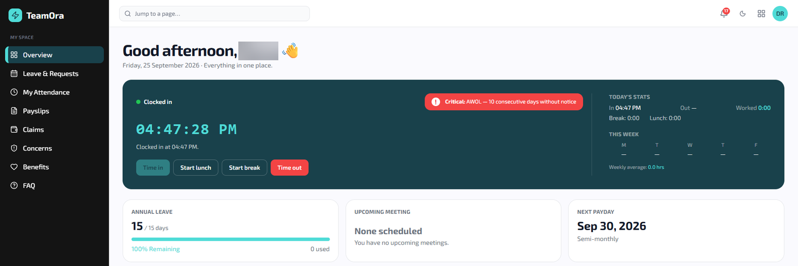
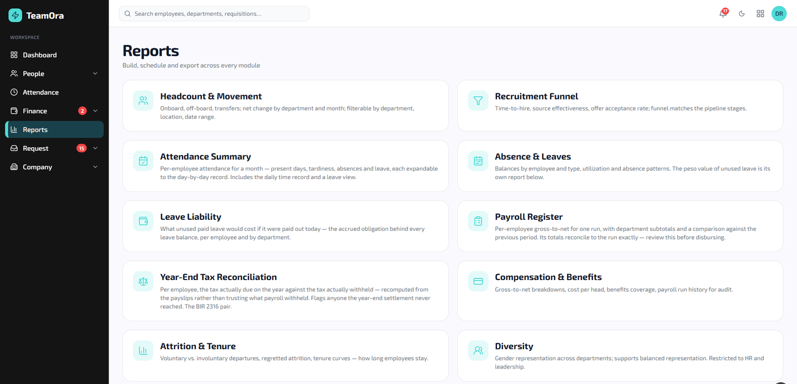
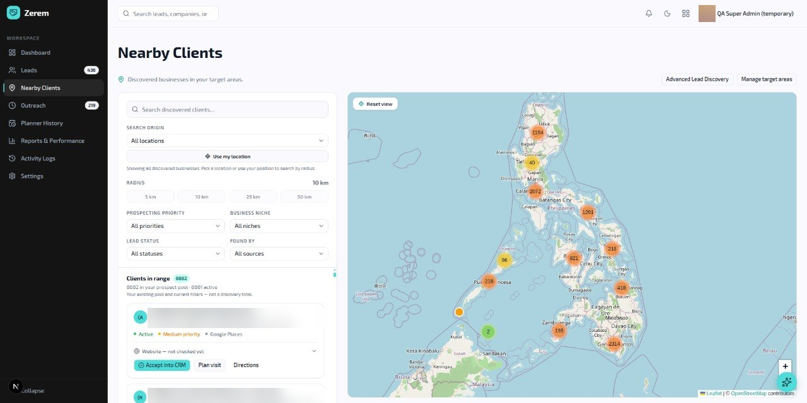
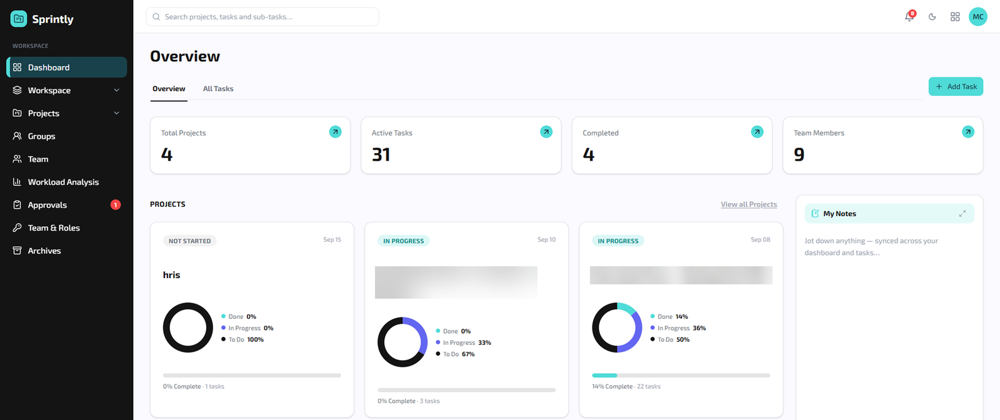

## Abstract: the VITE SEO ERP in brief

VITE SEO Digital Advertising grew to a team of up to 22, with its people, leads, projects and books in separate places. We paid per-seat fees for HR, CRM and project tools, and computed payroll by hand every cutoff. At list prices as of November 2026, entry plans for three comparable tools would cost an estimated US$550 plus ₱2,178 monthly for 22 seats. Philippine payroll must also apply five separate rules, from SSS to 13th-month pay. With the in-house team, I led and co-developed one ERP with four modules behind one login. The first MVP shipped in under 2 weeks. The full platform reached 115 pages, 144 data models and 5,241 automated tests in under 3 months.

## The problem we saw: scattered tools and manual payroll

VITE SEO Digital Advertising, [the agency I founded and have since closed](/blog/closing-my-agency), grew to a team of up to 22. The team spanned sales, development, project management, marketing and SEO. HR, sales, project work and accounting each needed their own records. Some of them had to connect, such as payroll posting into the accounting books.

Before the ERP, the team ran on spreadsheets, a separate project tool, shared inboxes and manual payroll computations. Payroll was the hardest part. Every cutoff meant copying attendance into sheets, computing contributions by hand and typing the totals into the books again.

Cost was the other problem. We paid per-seat fees for HR, CRM and project tools, and per-seat pricing means the bill rises with every hire. We built the ERP to stop paying those fees and to fix the payroll work above.

## What the data says about seat fees and Philippine payroll

Public data backs up both sides of the agency's problem. Typical HR, CRM and project tools charge for each user. The table uses list prices as of November 2026 from [Tropa's pricing](https://go-tropa.com/pricing), [Pipedrive's pricing](https://www.pipedrive.com/en/pricing) and [Asana's pricing](https://asana.com/pricing).

| Need               | Tool      | Entry plan, per seat a month    | Next plan up       | 22 seats, entry plan (estimate) |
| ------------------ | --------- | ------------------------------- | ------------------ | ------------------------------- |
| HR and payroll     | Tropa     | ₱99 (Starter, billed monthly)   | ₱149 (Professional) | ₱2,178                          |
| CRM                | Pipedrive | US$14 (Lite, billed annually)   | US$39 (Growth)     | US$308                          |
| Project management | Asana     | $10.99 (Starter, billed annually) | $24.99 (Advanced) | $241.78                         |

At these list prices, the entry plans for 22 seats would cost about US$550 plus ₱2,178 a month (estimate: price × 22). That is about US$6,597 plus ₱26,136 a year. On the next plan up, the same estimate is about US$1,408 plus ₱3,278 a month. It assumes a seat for everyone in every tool, which overstates the CRM. Asana's page shows "$" with no currency code, so I assumed US dollars.

### Accounting pricing and unused SaaS seats

Accounting software can be priced differently. [Xero's US pricing page](https://www.xero.com/us/pricing-plans/) lists "No per-user license fees."

Paying for a seat is also not the same as using it. [Zylo's post on SaaS waste](https://zylo.com/blog/how-much-wasted-on-saas-spend), updated March 2026, says the average organization uses only 54% of its SaaS licenses. It names no source for that figure, and Zylo, a SaaS management company, has a stake in it.

### Philippine payroll deduction rules

Philippine payroll is hard to do by hand, because each deduction has its own rate, base and limit:

| Item                                                                                                                                                                                                       | Rule                                                                                                          |
| ---------------------------------------------------------------------------------------------------------------------------------------------------------------------------------------------------------- | ------------------------------------------------------------------------------------------------------------- |
| [SSS Circular 2024-006](https://www.grantthornton.com.ph/insights/articles-and-updates1/tax-notes/sss-implements-revised-contribution-rates-for-2025/), summarized by Grant Thornton                        | 15% of the monthly salary credit from January 2025: 10% employer and 5% employee, on credits of ₱5,000 to ₱35,000 |
| [PhilHealth Advisory No. 2025-0002](https://www.philhealth.gov.ph/advisories/2025/PA2025-0002.pdf)                                                                                                          | 5% of monthly basic salary in 2025, with a ₱10,000 floor and a ₱100,000 ceiling                                |
| [Pag-IBIG Fund Circular No. 460](https://www.grantthornton.com.ph/contentassets/3696729c37164538add37945681d7d6f/circular-no.-460---guidelines-on-the-pag-ibig-funds-implementation-of-increase-in-the-mfs-effective-february-2024-1.pdf) | 2% from the employee and 2% from the employer, on a maximum fund salary of ₱10,000 from February 2024          |
| Withholding tax (RR No. 11-2018), [as reported by the PIA](https://mirror.pia.gov.ph/press-releases/2022/12/28/individual-taxpayers-to-have-lower-income-tax-rates-in-2023)                                 | The BIR's revised table from January 1, 2023: exempt below ₱250,000 of taxable income a year, then 15% to 30%, and 35% above ₱8 million |
| [13th-month pay under DOLE Labor Advisory No. 16, Series of 2025](https://pmap.org.ph/circular-no-2025-088-labor-advisory-no-16-series-of-2025-guidelines-on-the-payment-of-the-thirteenth-month-pay/)     | At least one-twelfth of the basic salary earned in the calendar year, paid by December 24                      |

These rules also move. SSS raised its rate from 14% to 15% in January 2025. Pag-IBIG doubled its maximum fund salary from ₱5,000 to ₱10,000 in February 2024.

### How common payroll errors are

Payroll errors are common and costly. In a [2022 Ernst & Young survey announced by the payroll vendor Paycom](https://www.paycom.com/about/press-room/ey-survey-payroll-errors-average-291-each-impacting-the-economy/), one in five US payrolls had errors, averaging $291 each. It covered 508 people at US companies with 250 to 10,000 employees. For a small Philippine team, it is a signal, not a benchmark.

## Why we built one ERP instead of buying more tools

Before building the ERP, we had three realistic options: keep the spreadsheets and separate tools, buy a full set of per-seat tools, or build one system. The evidence above shows the weak spot in each of the first two.

### Keeping manual payroll or buying more seats

Keeping payroll by hand meant applying five rules with different rates, bases and limits every cutoff, then typing the totals into the books again. Two of those rules changed within a year. In a manual process, a missed update becomes a wrong payslip.

Buying more per-seat tools would have kept the fees we wanted to stop. Entry plans alone come to an estimated US$550 plus ₱2,178 a month, rising with each hire. Separate tools also mean separate logins and records, and payroll totals still have to reach the books.

### What building one ERP gave us

Building one system meant we had to build, test and maintain it ourselves. In return, we could design around the problems the data points to:

- **Payroll rules in code, with tests.** The payroll rules lived in the Laravel API, next to the double-entry accounting. A broken rule usually showed up in a failing test before it reached anyone.
- **Payroll posting into the books.** At each cutoff, payroll posts straight into the accounting module, so nobody types the totals in twice.
- **One login with role-based access.** Staff, sales and project leads work in one system instead of separate accounts in separate tools.
- **No seat fee per tool.** Adding a person adds a user, not a seat in three subscriptions, though hosting and paid integrations still cost money.
- **One daily problem per module.** The 144 data models only made sense to the team once each module fixed one daily problem, such as payroll or CRM follow-ups.

### Why the ERP uses Laravel and Next.js

The stack followed the same logic, as I explain in [Laravel vs Next.js](/blog/laravel-vs-nextjs). Laravel handled the business rules, queues and real-time events, and it's strong for data-heavy systems with many models. Next.js gave all 115 pages one consistent interface. MySQL fit transactional records like payroll and journals, and keeping the API separate let back-end and front-end work move in parallel.

## What we built: the four ERP modules

The ERP is one system with role-based access and four modules.

- **HRIS (TeamOra):** attendance with geofenced clock-in and remote check-in, leave and overtime requests, recruitment, employee self-service, and payroll that computes SSS, PhilHealth, Pag-IBIG, withholding tax and 13th-month pay and issues payslips.
- **CRM (Zerem):** lead management with scoring and follow-ups, email outreach from connected Gmail inboxes, in-browser calling, an inbox for Facebook Page and Instagram messages, AI-drafted replies, and a map-based lead-discovery tool.
- **PMS (Sprintly):** workspaces, projects, tasks and subtasks with custom statuses, bulk task import with manager approval, workload analysis, activity logs and real-time updates.
- **Accounting:** double-entry journals, invoices, bills, purchase orders, recurring invoices, bank reconciliation and budgets, with payroll posting from the HRIS and reports for trial balance, balance sheet, profit and loss, cash flow, aged receivables and BIR VAT.

The system also connected to Gmail, Twilio Voice, Meta messaging webhooks, OpenAI and OpenRouter. It used Laravel Reverb for real-time events, ran 5 n8n outreach workflows, and fed a Python lead-discovery scraper built on OpenStreetMap data.

The screenshots below are from the system itself. I blurred staff and client names.

## How the ERP works: Laravel API and Next.js front end

The ERP keeps the rules and the screens apart:

- **Back end:** a Laravel 13 API.
- **Front end:** Next.js 16 with React 19.
- **Database:** MySQL.
- **Integrations:** the services listed above, plus a Python scraper.

The Laravel API holds the data, the business rules and the permissions. Next.js renders the 115 pages and calls that API, and React let us build shared components once for all four modules.

Attendance, leave, overtime and payroll all sit in the HRIS. At each cutoff, payroll computes the contributions, tax and 13th-month pay, issues payslips and posts to the accounting books. Those books feed the financial and BIR VAT reports. A queue worker and a scheduler run background jobs, and Laravel Reverb carries the real-time events behind the project module's live updates.

## How we built and tested the ERP

The first MVP of the ERP shipped in under 2 weeks. The team then grew it into the full platform in under 3 months, from July to October 2026.

Splitting the API from the interface let back-end and front-end work move at the same time, which helped us ship in under 3 months. Once our conventions were set, adding a new model with its migration, validation and tests felt routine, which mattered with 144 models.

Work was slower where the logic was unusual, like payroll edge cases and the accounting reports. There the framework could not help much, and we had to think through every rule and write a test for it.

The suite grew to 5,241 automated tests, and we ran all of them before every deploy. Upkeep was mostly keeping dependencies updated on both sides and checking that the queue worker and scheduler were still running.

## Results: what the ERP delivered

- 4 modules (HRIS, CRM, PMS and accounting) behind one login.
- 115 pages and 144 data models.
- 5,241 automated tests.
- Built in under 3 months, from July to October 2026.

Staff clocked in through the HRIS, sales worked leads and messages in the CRM, and projects ran in the PMS. At each payroll cutoff, payroll posted straight into the accounting books instead of being typed in again.

## Limitations of the ERP and this study

- **The cost comparison is an estimate.** It uses list prices for 22 seats as of November 2026, not what we actually paid before the ERP. It also leaves out the build cost in team time, so it cannot show a payback period.
- **Payroll accuracy was not measured.** This page records how payroll worked, not how many corrections it saved. The error and license figures do not come from Philippine small businesses.
- **The rules keep changing.** Rates and tax tables change by circular, so someone has to update the rules and their tests each time. The BIR's [RMC No. 98-2026](https://bir-cdn.bir.gov.ph/BIR/pdf/RMC%20No.%2098-2026%20redacted.pdf), dated September 22, 2026, says invoices made in Word, Excel, Google Docs or Google Sheets are not valid e-invoices. This page does not show whether the accounting module met those rules. I explain the rules in [my note on BIR e-invoicing](/news/bir-rmc-98-2026-e-invoicing).
- **Two codebases cost upkeep.** Running Laravel and Next.js means two deployments and two sets of dependencies to keep updated.
- **Software did not save the business.** The agency closed after financial losses. Code alone did not make the business stronger, and many of the problems I faced were about people, process or focus.

Before-and-after numbers on tool bills, payroll hours, payroll corrections and module use would make this study stronger.

## Sources

1. [Tropa Pricing | HRIS and PH Payroll from ₱99 per User](https://go-tropa.com/pricing), Tropa, accessed November 2026.
2. [Plans built to help you close more deals, faster](https://www.pipedrive.com/en/pricing), Pipedrive, accessed November 2026.
3. [Asana Pricing | Personal, Starter, Advanced, & Enterprise plans](https://asana.com/pricing), Asana, accessed November 2026.
4. [Pricing Plans | Xero US](https://www.xero.com/us/pricing-plans/), Xero, accessed November 2026.
5. [How Much Is Wasted on SaaS Spend? Learn How to Identify & Stop Waste](https://zylo.com/blog/how-much-wasted-on-saas-spend), Zylo, updated March 19, 2026.
6. [SSS Implements Revised Contribution Rates for 2025](https://www.grantthornton.com.ph/insights/articles-and-updates1/tax-notes/sss-implements-revised-contribution-rates-for-2025/), Grant Thornton Philippines, February 27, 2025.
7. [Premium Contribution for All Direct Contributors for CY 2025 (PhilHealth Advisory No. 2025-0002)](https://www.philhealth.gov.ph/advisories/2025/PA2025-0002.pdf), PhilHealth, accessed November 2026.
8. [Circular No. 460: Guidelines on the Pag-IBIG Fund's Implementation of Increase in the Maximum Fund Salary (MFS) Effective February 2024](https://www.grantthornton.com.ph/contentassets/3696729c37164538add37945681d7d6f/circular-no.-460---guidelines-on-the-pag-ibig-funds-implementation-of-increase-in-the-mfs-effective-february-2024-1.pdf), Pag-IBIG Fund (copy hosted by Grant Thornton Philippines), January 15, 2024.
9. [Individual taxpayers to have lower income tax rates in 2023](https://mirror.pia.gov.ph/press-releases/2022/12/28/individual-taxpayers-to-have-lower-income-tax-rates-in-2023), Philippine Information Agency, accessed November 2026.
10. [Circular No. 2025-088: Labor Advisory No. 16, Series of 2025, Guidelines on the Payment of the Thirteenth Month Pay](https://pmap.org.ph/circular-no-2025-088-labor-advisory-no-16-series-of-2025-guidelines-on-the-payment-of-the-thirteenth-month-pay/), People Management Association of the Philippines, December 1, 2025.
11. [EY survey: Payroll errors average $291 each, impacting the economy](https://www.paycom.com/about/press-room/ey-survey-payroll-errors-average-291-each-impacting-the-economy/), Paycom, December 22, 2022.
12. [RMC No. 98-2026: Prescribing Policies and Guidelines on the Issuance of Electronic Invoice](https://bir-cdn.bir.gov.ph/BIR/pdf/RMC%20No.%2098-2026%20redacted.pdf), Bureau of Internal Revenue, September 22, 2026.
