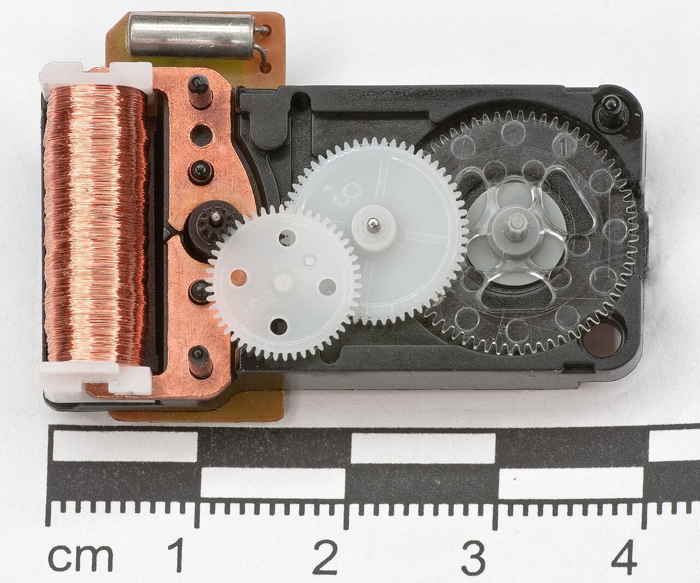

## What changed in n8n 2.45?

n8n 2.45, released on 20 October 2026, runs every Schedule Trigger node on the durable scheduler by default, on every instance, with no setting to turn on. According to n8n's [release notes](https://docs.n8n.io/release-notes/ "n8n's official release notes"), "The scheduler stores each run in the database before it's due, so a restart no longer drops pending runs."



*A scheduled workflow is only as good as the clock behind it, which is what n8n 2.45 changes. Photo: [Medvedev](https://commons.wikimedia.org/wiki/File:Quartz_Clockwork_%28disassembled%29.jpg "Medvedev's photo on Wikimedia Commons"), [CC BY-SA 3.0](https://creativecommons.org/licenses/by-sa/3.0/ "Creative Commons Attribution-ShareAlike 3.0 license").*

Runs missed while the instance was down still fire within their grace period, and in a multi-main setup only one main instance claims each run. Existing Schedule Trigger nodes switch over without being republished.

## What could break?

Two things need a look before you upgrade:

- **Interval timing.** "Every N seconds" and "every N minutes" schedules now run N apart counted from publish time, not lined up with the clock. A workflow set to every 15 minutes may no longer fire at :00, :15, :30 and :45. Hourly, daily, weekly, monthly and cron schedules behave the same in everyday use.
- **Removed setting.** The Skip Durable Scheduler node setting and its `N8N_ENV_FEAT_SKIP_DURABLE_SCHEDULER` flag are gone.

Two environment variables are deprecated but still work for now, and log a warning at startup:

```bash
# Keep clock-aligned timing on the durable scheduler
N8N_SCHEDULER_TRIGGER_NODE_MODE=legacy
# Go back to the old in-memory scheduler
N8N_SCHEDULER_ENABLED=false
```

## Should a small team upgrade?

For most self-hosted setups, yes: a scheduled workflow that silently skips a run after a restart is worse than one that shifts by a few minutes. Search your workflows for interval schedules first, and set the legacy mode only if something downstream depends on exact clock times. If you are new to self-hosting n8n, my guide to [building a Messenger and Instagram chatbot with n8n](/blog/n8n-messenger-instagram-chatbot "How to build an AI chatbot for Messenger and Instagram with n8n") covers the setup.
